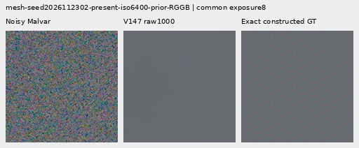
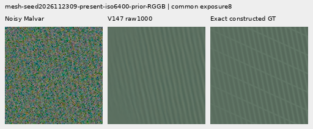
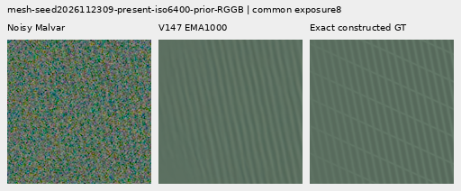
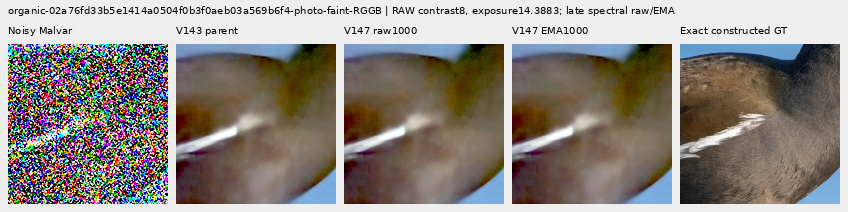
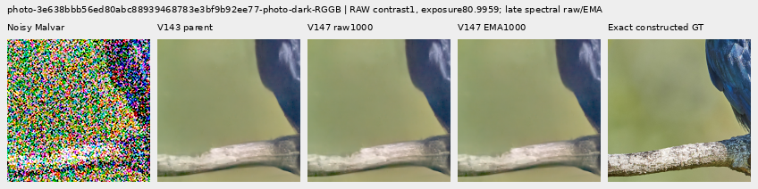
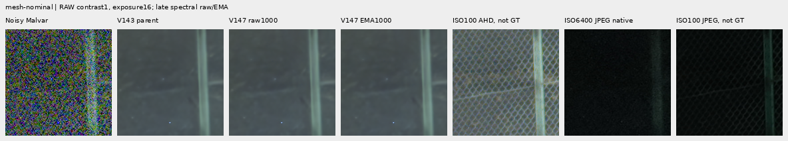
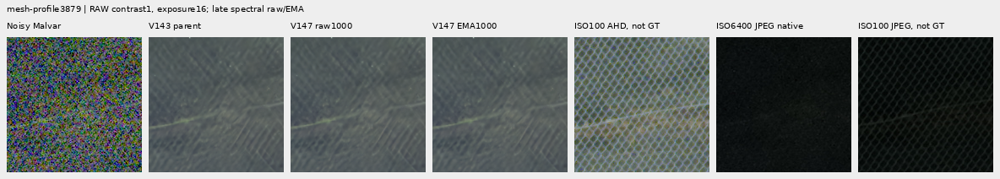
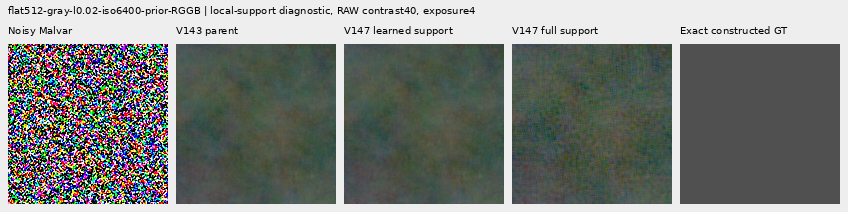

# V147 late spectral detail: completed review

V147 lowers weak-mesh response about 8% and slightly increases noisy-flat error
against frozen V143. Native comparisons show no convincing new fine green mesh,
feather or bark detail. It improves whole-image error on the strong-edge controls
by 0.31–0.42%, while worsening their exact quiet regions. The component remains a
research implementation; it does not improve the requested weak-detail/clean-sky
tradeoff. [V143 with explicit periodic detail](supported-wave-amplitude.md) retains
its useful mesh gains and substantial remaining weaknesses.

Both final raw and EMA endpoints completed their prospectively fixed reviews.
A subsequent diagnostic holds the raw weights/frequency gains fixed and removes
only local support. This makes detail recovery and flat-field noise much worse:
the local gate is limiting a poor frequency proposal, rather than hiding useful
recovery. This result supports changing the estimator before training it longer
or opening its support. It does not prove that every late spectral architecture
must fail.

## Measured strengths and weaknesses

These are mean per-observation RMS errors in unclipped camera RGB, scaled by 65535.
Mesh response is the projection onto exact plane-detrended procedural texture;
its ideal value is 1. Cases reuse 64 mesh recipes across four CFAs, rather than
representing 256 independent scenes.

| Test | V143 | V147 raw 1k | V147 EMA 1k |
| --- | ---: | ---: | ---: |
| Present mesh, full RMS;256 cases |9.11124|9.14578|9.14852|
| Present mesh response |.0220209|.0202623|.0202942|
| Absent mesh, full RMS;256 cases |5.23791|5.26714|5.27176|
| Added blank-region RMS inside present cases |0|.62761|.67211|
| Fresh 512 ISO 6400 flat, full RMS;24 cases |18.54681|18.59095|18.59957|
| Fresh 512 ISO 12800 flat, full RMS;24 cases |24.07189|24.14170|24.15489|

Mesh image errors rise 0.379%/0.409% raw/EMA; response falls 7.986%/7.841% relative.
The existing periodic `detail` comparator gives mesh RMS 8.58613 and response .0708975
on the same cases, with mean blank spill .000636. It is visibly stronger on some
meshes, while remaining incomplete and susceptible to seams/spill.

Fresh 512 noisy-flat errors rise 0.238%/0.284% at ISO 6400 and 0.290%/0.345% at ISO 12800.
Their full spatial and coarse errors also increase. All 48 ADC-only constant
observations across native 256/512 retain the exact parent under both endpoints.
That constant-input property does not establish safety on noisy fields.

All four photographic groups lose luma-band gain and increase relative band
error. The band is a DCT16 annulus at native frequencies 1/8–1/3 cycles per pixel.

| Photo group;32 observations each | V143 band error | Raw band error | EMA band error |
| --- | ---: | ---: | ---: |
| Retained 512, faint |.824639|.824909|.824912|
| Retained 512, dark |.661447|.661485|.661481|
| Organic 384, faint |.924117|.924623|.924631|
| Organic 384, dark |.781612|.781680|.781680|

Organic dark full-image RMS improves only 0.0032%/0.0038% raw/EMA, while its band
error rises and native detail stays soft. The other three full-image photo groups
regress slightly. This small full-image reduction is not evidence of recovered
feather, grass or bark structure.

The 32 new analytic strong-edge/bar/stripe controls contain an independently
verified exact constant ROI beside stronger structure. Whole-scene improvement
and quiet-region regression coexist:

| Prior;16 cases each | Method | Full-scene RMS | Quiet 160 RMS | Quiet spatial RMS |
| --- | --- | ---: | ---: | ---: |
| ISO 6400 |V143|27.10563|3.89885|3.26850|
| ISO 6400 |Raw|27.02133|3.93315|3.30709|
| ISO 6400 |EMA|27.01686|3.93828|3.31291|
| ISO 12800 |V143|36.74747|6.15265|5.34183|
| ISO 12800 |Raw|36.60879|6.19026|5.38432|
| ISO 12800 |EMA|36.59419|6.19517|5.38988|

Strong edges remain resolved. Diagnostic contrast 40 reveals the existing colored
mottle in quiet regions, with slightly more fine grain after V147. These are
synthetic controls, not new independent photographs.

## Native 100% comparisons

Every crop cell is 160×160 original pixels. None was resized. The
[64-image manifest](images/v147-late-spectral-v1/manifest-v1.json) links byte-exact
PNGs to source, ROI, noise, exposure, shared contrast/anchor and checkpoint
metadata. Seventeen unscaled sheets containing all 64 primary figures were
actually viewed; repeated triplets are not independent observations.

Two exact procedural-GT triplets per endpoint follow. Both use native 512 inputs,
ROI `[176,176,160,160]`, RGGB, shot .00128/read 6.5536e-6 and display exposure 8 with
contrast 1. They share each input and display transform with their corresponding
comparison boards. The source recipe seeds are 2026112302 and 2026112309. The first
still looks nearly flat; the second retains one dominant family while missing
the other.

Faint organic feathers remain soft. This 384 context uses ROI `[112,112,160,160]`,
exposure 14.388348 and diagnostic contrast 8 about common target channel means.
Source and attribution are retained in the manifest.

The actual 512 dark bird/branch example also retains soft bark and feather detail:
ROI `[176,176,160,160]`, exposure 80.995917, contrast 1. These are constructed targets
from bin 8 Commons imagery, not exact physical-scene GT.

The standing main DSCF3879/3880 scene remains near V143. See its native
[sky](images/v147-late-spectral-v1/main-overcast-sky-crop-contrast1.png),
[building](images/v147-late-spectral-v1/main-building-detail-crop-contrast1.png),
[foliage](images/v147-late-spectral-v1/main-foliage-crop-contrast1.png) and
[chain-link fence](images/v147-late-spectral-v1/main-chain-link-fence-crop-contrast1.png)
boards, all at exposure 4. Foliage stays painterly and fine building detail stays
soft. Sky block 32 variation changes by less than .002%; this is descriptive
variation, not GT error.

The additional DSCF3842/3835 green mesh remains unresolved under both retained
priors and both windows. RAW display exposure is 16; camera JPEG panels retain
native sRGB8 brightness. ISO 100 AHD/JPEG references differ in aperture, exposure
and moving subjects and are **not exact GT**; no real-reference scores are used.

The other [nominal/right](images/v147-late-spectral-v1/mesh-nominal-fine-green-mesh-right-contrast1.png)
and [profile 3879/left](images/v147-late-spectral-v1/mesh-profile3879-fine-green-mesh-left-contrast1.png)
windows are also published. All captures/JPEGs and their siblings stay outside
this Commons-only training trial; original files remain read-only.

## Local-support diagnostic

After completing the fixed review and native inspection, the raw endpoint was
run once more on all 766 cached observations. Each learned-path replay is
bit-exact to its archived prediction. The diagnostic replaces only the local
support with 1 after the same forward, keeping every learned frequency gain and
weight fixed. It is a post-hoc intervention, not fresh validation or another
trained model.

| Test | V143 | Learned support | Full support |
| --- | ---: | ---: | ---: |
| Mesh response |.0220209|.0202623|.0086952|
| Present mesh RMS |9.11124|9.14578|10.35740|
| Added blank RMS, present cases |0|.62761|4.70598|
| Fresh 512 ISO 6400 flat RMS |18.54681|18.59095|21.26113|
| Fresh 512 ISO 12800 flat RMS |24.07189|24.14170|28.38856|

The mean learned support is about .133 on mesh/photo inputs. Its image-level mean
alone does not establish spatial selectivity. Opening it exposes a worse
frequency proposal: more false fine grid/grain on noisy flat fields and still
no convincing new true green-mesh lattice. All four photo groups also regress
with full support.

Fourteen native diagnostic boards cover all real windows/priors, two weak meshes,
two noisy flats, faint feathers and an actual 512 dark bird. The
[diagnostic receipt](results/v147-late-spectral-v1/ablation-figures.json) records the
same ROIs/transforms and their independent pixel checks. The evidence favors
changing frequency estimation or its training signal, including how CFA phases
are combined, before enlarging windows or relaxing support again. Those are
next hypotheses, not established improvements.

## Implementation, training and evidence

The [component](../src/demosaic/late_spectral_detail.py) has 30,402 parameters in
12 tensors. It analyzes original RAW and sampled parent RGB in separate tapered,
weighted-affine-detrended FFT frames, then applies a shared signed frequency gain
to their innovation. Maximum support is packed 256/native 512 with 50% overlap;
shorter contexts use the largest fitting power of two and execute the head.
A dilated packed-grid CNN supplies local support before fixed signed Malvar
interpolation adds the correction after V143. The frequency band spans native
periods about 4.4–64 pixels.

Observed-power scaling makes constant CFA phases exactly inactive even with
arbitrary learned weights and a nonconstant parent. Neither gain is a calibrated
probability. The mean tapered-variance proxy is not an exact post-detrend
covariance. No target/reference enters forward.

The [fixed recipe](../configs/quality-v143-late-spectral-v147.yaml) trains for 1,000
updates/B4 with AdamW LR .001, warmup 50, clipping 1 and ramped EMA. Pixel/gradient
Charbonnier errors use input-noise units (floor 2 DN16), epsilons .01/.003 and
gradient weight .25; coefficient supervision has weight .25. Mesh/weak source
losses receive 4× weight. This combines architecture, loss, data and budget
changes relative to V146; it is not a causal comparison of individual changes.

Actual batches: 357 mesh, 106 weak, 158 flat, 164 mixed and 215 photo, totaling 4,000
unique training observation IDs. Mesh contains 740 present/688 absent targets.
The 860 photo draws use 453 unique sources, 419 faint targets and 433 reviewed-ROI
choices. The eligible pool is 90,782 photos/27 regions; all 16 review photos are
validation-only and absent from actual training. Procedural 512/photo 256 preserves
bin 4→geometry→area 2 construction without stretching or tiling small photographs.
Optical PSF remains zero.

All 12 Adam states reached 1,000 with finite weights/moments and nonzero recorded
maximum gradients. The V143 and official DINOv3 ConvNeXt-Small hashes stayed exact.
Global CPU/CUDA RNG states match across checkpoints 250/500/750/1,000. The discarded
CUDA 10 smoke run includes a genuine 8+2 reload. Production adopted its ten
input/parent batches without redraw/replay. All ten total losses match; one
FP32 gradient subterm differs by 9.3e-10. No bit-exact independent uninterrupted
training trajectory is claimed.

The explicit user pause suspended the original worker near 550. It continued in
memory after controller-only deadline replacement: see the
[resume evidence](results/v147-resume-v1.json) and
[pause/resume diary](../diary/2026-11-03-10-45-19-v147-user-pause-resume.md).
No worker restart or checkpoint reload occurred. Initial preparation and scope
clarification receipts remain preserved in the
[preparation evidence](results/v147-late-spectral-preparation-v1.json).

Checkpoint bindings for every triplet and board:

| State | SHA 256 |
| --- | --- |
| Frozen V143 parent |`96d146d017c54196288c585f8b7eddcf030e8a235061049c31e985b9380b7ce4`|
| Final 1k training state |`61701e52f79145b655d80c9cbc6e0e89017a7857d774118a7f0c06e33828d6a3`|
| Raw 1k component export |`8e7d6bac95e96da73adc94948b88d71504faff3a363de07352c6151f4ed8a3b6`|
| EMA 1k component export |`a83a958998dff408d1a13bf779fa8d1e44d54e04b3b3265d5fb3db1768be0778`|

The [final evidence index](results/v147-late-spectral-final-v1.json) provides 19
byte-exact receipt copies,64 PNGs, source bundles and a compact training-trace
index. The original 6.76MB full trace, predictions and checkpoints remain unchanged
in `.cache/quality-20261103/V147-late-spectral-v2/`. The independent metric audit
checks 18,782 scalars/203 Decimal reductions (max difference 4.55e-13); all pixel
checks cover 25,113,600 RGB channels, including repeated triplet cells. The new
mixed-input audit reconstructs exact analytic targets and checks ADC/noise moments.

Tracked calls, excluding unit tests: 1,032 parent/DINO calls (DINO nested inside
parent), 3,372 component calls including the 766-call diagnostic, 4,000 unique
training observations and 32 new mixed controls. The main 766 inputs are reused.
Peak CUDA allocated memory: training 3,177,952,256 bytes, main review 951,366,144;
smoke 3,178,908,672. All 14 recorded job owners and the exact-argument process scan
are terminal. No RAW decoding or `/mnt/dataz` access occurred. Ordinary inference
integration is absent; the broader fine-detail/clean-sky objective remains open.

The full427-source/CFA panels and full102MP inference were not run for this
candidate. Current conclusions apply to the declared detail/flat/real-scene
support above. See the
[result and diagnostic diary](../diary/2026-11-03-11-21-09-v147-final-spectral-quality.md)
for the historical decision and next estimator question.
