# V171 learned matching RGB residual: completed quality

The fresh matching residual improves standalone-flat error while retaining the
V169 detail response. EMA full-flat RMS falls **1.21% at ISO6400 and 1.52% at
ISO12800**, and coarse32 RMS falls **1.73% at both priors**, versus V169 EMA.
All 48 native noisy-flat inputs improve in both measures. Raw also improves all
48 coarse inputs, with 42/48 full-RMS improvements. This is a useful flat-field
option above the existing DINO restoration, not a general upgrade.

Mesh response rises **1.04–1.26%**, reaching **3.876–3.885% of exact constructed
amplitude**. Present-mesh RMS falls 0.47–0.52% and wholly absent RMS falls
0.98–1.09%. The native gain is subtle: seed2302 remains almost flat and seed2309
keeps mainly one diagonal family. The real green cab fence retains incomplete
strands under both priors; the weak crossing family is still missing. Main sky
looks smooth at ordinary exposure, while building, foliage and coarse fence are
close to V169. Neither a clear new lattice nor flat-region safety is established.

The quiet-color cost is substantial. EMA quiet RMS rises **30.73%/25.78%** at
ISO6400/12800, to **5.289473/7.979617 DN16**; DC color error rises **91.04%/93.22%**.
Quiet spatial RMS falls only 0.29–0.61%. Raw quiet RMS rises 42.80–51.10% and DC
error 140.68–142.11%. Actual amplified quiet crops show stronger purple/blue casts
and remaining blotches, although ordinary-display step/bar edges look clean.
Whole-context or standalone-flat gains do not excuse this nearby-region failure.

Natural photographic band-error means improve slightly in all four cohorts,
while full-RMS means worsen in three of four; the retained-faint improvement is
only about0.002%. Bird, butterfly and plant microtexture remains heavily smoothed.
All 144 ADC-only results retain V169 exactly, including smooth planes and
bark/fur texture; the new branch adds none of V170's periodic ADC artifact.
This is an exact bypass property, not a learned ADC improvement or a guarantee
for noisy flats.

All 60 fixed native figures were actually viewed at original detail, including
both protected GFX scenes, both cab priors/windows and both JPEGs. Separate
ISO100/AHD/JPEG views remain qualitative references, not exact GT. Keep V171's
full/coarse-flat option beside V169 quiet color, V161/V164 stronger learned
response, V165 grain and earlier useful choices. V120 remains the general
recommendation. Greater matching capacity at this schedule does not by itself
solve the fine-crossing and no-fabricated-structure objective.

The training worker completed 900 updates and 100 ADC skips with an actual
step-8 restoration and no prefix replay. Quality completed both fixed endpoints
on all 822 cases; all 1,644 frozen V169 outputs replay exactly. The first review
initialization missed a metric helper and stopped before any neural call. Its
claim/log/source are preserved, the verified helper was added through a separate
receipt, and the original inference source and plan stayed unchanged. The
corrected worker repeated no completed scientific inference. The future
preparer now includes that dependency.

[Runtime dependency evidence](results/v171-runtime-dependency-preparation-v1.json)
· [Future preparer correction](results/v171-preparer-dependency-fix-v1.json)
· [Training-audit counter clarification](results/v171-training-audit-scope-clarification-v1.json).

[Final evidence and exact sources](results/v171-matching-residual-final-v1.json) · [Native pixels, source ROIs, checkpoint, noise and display metadata](images/v171-matching-residual-v1/manifest-v1.json).

## Mesh response and actual blank error

| Metric | V143 parent | V168 EMA | V169 EMA | V171 raw | V171 EMA |
| --- | ---: | ---: | ---: | ---: | ---: |
| Present full RMS | 9.111243 | 8.943902 | 8.956287 | 8.914337 | 8.909846 |
| Present signed template gain | 0.02202090 | 0.03835930 | 0.03836594 | 0.03876320 | 0.03884819 |
| Present actual blank RMS | 5.523323 | 5.589461 | 5.609300 | 5.552093 | 5.544439 |
| Present blank spatial RMS | 5.343113 | 5.407807 | 5.431940 | 5.357659 | 5.361961 |
| Present blank DC RMS | 1.289621 | 1.300783 | 1.289568 | 1.353987 | 1.300170 |
| Absent full RMS | 5.237910 | 5.290214 | 5.305929 | 5.253982 | 5.248144 |
| Absent signed template gain | 0.00003236 | -0.00000810 | -0.00000719 | 0.00001442 | 0.00001071 |
| Absent actual blank RMS | 5.237910 | 5.290214 | 5.305929 | 5.253982 | 5.248144 |
| Absent blank spatial RMS | 5.099652 | 5.146561 | 5.169538 | 5.098484 | 5.102240 |
| Absent blank DC RMS | 1.098115 | 1.128089 | 1.098120 | 1.182550 | 1.135453 |

## Quiet fields beside detail

| Metric | V143 parent | V168 EMA | V169 EMA | V171 raw | V171 EMA |
| --- | ---: | ---: | ---: | ---: | ---: |
| iso6400-prior whole RMS | 27.105631 | 26.831196 | 26.806949 | 27.569658 | 27.302897 |
| iso6400-prior quiet RMS | 3.898845 | 4.203388 | 4.046127 | 6.113523 | 5.289473 |
| iso6400-prior quiet spatial RMS | 3.268502 | 3.433879 | 3.439626 | 3.440404 | 3.429768 |
| iso6400-prior quiet DC RMS | 2.016074 | 2.279202 | 2.018205 | 4.886203 | 3.855646 |
| iso12800-prior whole RMS | 36.747466 | 35.550733 | 35.462223 | 36.523774 | 36.176612 |
| iso12800-prior quiet RMS | 6.152652 | 6.745842 | 6.344343 | 9.059415 | 7.979617 |
| iso12800-prior quiet spatial RMS | 5.341833 | 5.547922 | 5.559786 | 5.538902 | 5.525857 |
| iso12800-prior quiet DC RMS | 2.849060 | 3.617679 | 2.853327 | 6.867470 | 5.513166 |

## Native 512-pixel standalone flats

| Metric | V143 parent | V168 EMA | V169 EMA | V171 raw | V171 EMA |
| --- | ---: | ---: | ---: | ---: | ---: |
| iso6400-prior full RMS | 18.546808 | 18.546646 | 18.618871 | 18.433524 | 18.394478 |
| iso6400-prior spatial RMS | 18.235130 | 18.237235 | 18.308796 | 18.044088 | 18.067235 |
| iso6400-prior coarse32 RMS | 13.440561 | 13.367796 | 13.438463 | 13.187782 | 13.205937 |
| iso12800-prior full RMS | 24.071890 | 24.086164 | 24.219097 | 23.866236 | 23.850667 |
| iso12800-prior spatial RMS | 23.596861 | 23.649192 | 23.747288 | 23.404751 | 23.431650 |
| iso12800-prior coarse32 RMS | 17.932544 | 17.832479 | 17.930574 | 17.595109 | 17.619500 |

## Natural photographic detail

| Metric | V143 parent | V168 EMA | V169 EMA | V171 raw | V171 EMA |
| --- | ---: | ---: | ---: | ---: | ---: |
| retained512/photo-faint full RMS | 33.963754 | 33.968609 | 33.966492 | 33.965711 | 33.965750 |
| retained512/photo-faint band response | 0.298560 | 0.297996 | 0.298025 | 0.298087 | 0.298141 |
| retained512/photo-faint band error | 0.824639 | 0.824695 | 0.824693 | 0.824613 | 0.824595 |
| retained512/photo-dark full RMS | 29.097715 | 29.098256 | 29.094009 | 29.118453 | 29.115518 |
| retained512/photo-dark band response | 0.531446 | 0.530871 | 0.530900 | 0.530994 | 0.531020 |
| retained512/photo-dark band error | 0.661447 | 0.661254 | 0.661251 | 0.661224 | 0.661223 |
| organic384/photo-faint full RMS | 37.469061 | 37.487138 | 37.483612 | 37.499171 | 37.498859 |
| organic384/photo-faint band response | 0.150701 | 0.149124 | 0.149160 | 0.149350 | 0.149403 |
| organic384/photo-faint band error | 0.924117 | 0.925055 | 0.925058 | 0.924928 | 0.924904 |
| organic384/photo-dark full RMS | 33.685796 | 33.690339 | 33.685928 | 33.721566 | 33.717351 |
| organic384/photo-dark band response | 0.398945 | 0.397768 | 0.397799 | 0.398001 | 0.398053 |
| organic384/photo-dark band error | 0.781612 | 0.781689 | 0.781691 | 0.781670 | 0.781667 |

## ADC-only controls

| Metric | V143 parent | V168 EMA | V169 EMA | V171 raw | V171 EMA |
| --- | ---: | ---: | ---: | ---: | ---: |
| Photo full RMS | 18.149871 | 18.142182 | 18.142182 | 18.142182 | 18.142182 |
| Photo band error | 0.101855 | 0.101800 | 0.101800 | 0.101800 | 0.101800 |
| fresh-flat512 full RMS | 3.322910 | 3.322910 | 3.322910 | 3.322910 | 3.322910 |
| fresh-flat512 coarse32 RMS | 0.538587 | 0.538587 | 0.538587 | 0.538587 | 0.538587 |
| adc-sloped512 full RMS | 3.771369 | 3.776943 | 3.776943 | 3.776943 | 3.776943 |
| adc-sloped512 coarse32 RMS | 0.574652 | 0.573442 | 0.573442 | 0.573442 | 0.573442 |

RMS values are camera-RGB DN16. Signed template gain 1 means exact constructed mesh amplitude; a small signed absent mean does not certify absence of artifacts. Coarse32 is spatially centered block-mean error. All paired differences and decrease/increase counts are retained. The reused, adaptively studied cohort does not establish blind generalization or training-seed uncertainty.

## Architecture, training and evidence

A fresh 2,088,906-parameter matching network predicts RGB residuals above frozen V169 EMA and its cached V143/DINO parent. It reuses the [pinned April 2026 NLFeMF definitions](https://github.com/MIA-UIB/nonlocal-matchfilter), with width 16, nine neighbors per scale and three scales. Inputs are the existing 39 physical RAW-innovation/noise/CFA/white-balance/parent features. A zero 12-channel tail gives exact V169 initial output; supplied image noise RMS scales the RGB correction. Raw/EMA refer to the new residual; V169 EMA stays fixed in both. No released V170 weights are loaded. New matching weights train from scratch on the existing free-image and synthetic cache. All 93 prior neural source files remain unchanged.

The fixed cache contains 341 mesh, 243 photo, 156 mixed, 153 flat and 107 weak-detail batches, including V168's fine-wire/contrast ladder. Inputs, parents, noise and coupled-pair units are reused exactly. Losses combine pixel/gradient reconstruction, paired differences, paired common error, clean-flat anchoring and local/DC regret relative to V169. Targets, pairs and masks never enter inference. The old spectral-head loss is omitted: architecture and objective changes are not isolated. These losses provide no unseen noisy-flat guarantee. Zero supplied variance bypasses the new branch and retains V169 exactly.

The 1,000-row schedule completes 900 AdamW updates and skips 100 ADC-only rows without model/optimizer evaluation. Learning rate starts at 0.0003 with 50-row warmup and cosine decay; gradients clip at 1 and EMA is retained. A real step-8 checkpoint restores model, Adam, EMA and RNG state exactly, then continues at step 9 without prefix replay. All 141 trainable tensors receive nonzero gradients during the run; 141 final Adam states and both endpoint tensors are finite and checked. Frozen V169 weights and RNG state stay unchanged.

All 114 relevant CPU tests pass, including six new phase-order/routing/frozen-parent cases. Eight independent NumPy adjoint fixtures cover CPU/CUDA, FP32/FP64 and 1×1/3×3 sampling. Full-network CPU/CUDA forward and input gradients agree within the admitted tolerance. Three batch-4 native 512 backward cases and native 768 inference pass. The upstream CUDA grad-input kernel explicitly uses atomic addition; warn-only deterministic mode records this. Exact checkpoint restoration does not imply bit-exact retraining.

Two synthetic admission failures are preserved: an incorrect initial all-nonzero gradient assertion, and reading `.grad` from a non-leaf device input. The first exposed the upstream zero-initialized offset tail: 50 earlier tensors initially receive zero gradients. Corrected admission verifies finite gradients and later activation. Neither failure used held-out data or changed inference sources. [Original protocol](results/v171-matching-residual-v1/original-protocol-v1.md) · [Preparation and exact sources](results/v171-matching-residual-preparation-v1.json) · [CPU readiness](results/v171-CPU-readiness-v1.json).

All 1,000 training input/parent/unit bindings and durable rows are audited. NumPy FP32 independently checks 900 actual weighted loss totals. Clean-mask fingerprints reproduce previously independently audited V168 masks on identical targets; this is inheritance validation, not a new independent mask construction. No new source/noise, parent/DINO or original/dataz reads occur.

Quality uses 1,644 composed calls, each with frozen V169 evaluation; the matching network runs 1,500 times with 7,500 nested sampling calls. All 1,644 frozen V169 outputs replay their existing fingerprints exactly, including 144 ADC-only outputs retained exactly by the final result. All 6,576 actual input fingerprints, durable method rows and event bindings are checked. Independent in-process FP32 addition covers 1,186,725,888 channels.

Full new arrays cover only 36 preselected native cases: 72 RGB and 72 residual arrays, totaling 430,196,736 bytes. Separate posthoc metrics and addition checks cover all those arrays, 582 scalar values and 53,772,288 RGB channels. Other new outputs were scored/fingerprinted and norm/decomposition/addition checked in process but not retained. There is no complete new full-array archive or all-822 new-array posthoc audit. Independent Decimal arithmetic checks 645 grouped means.

Actual new matching calls, including all admission attempts, are 2,406 CUDA and 3 CPU. Frozen-component CUDA calls are 2,548; these are nested components rather than extra DINO-parent calls. Admission includes 3 discarded synthetic updates and 8 sampler-only fixtures. Peak training/quality CUDA allocations are 6.278943/2.786150 GiB. Patch intervals do not establish full-frame speed; no 100MP/10-second claim is made. Both scientific owners are terminal.

The bounded trial declares 52/114 GiB local/external reserves plus a 0.5 GiB projection margin, 32 GiB runtime RAM and 24 GiB CUDA. Older guards and receipt bytes remain unchanged. The inherited MIT notices and embedded sampler Caffe notices remain in provenance.

## Native comparisons

All 60 figures were actually viewed in 15 original-detail sheets: 48 boards and 12 noisy/restored/exact constructed GT triplets. Every cell has 160×160 native pixels without resizing. Source/ROI, checkpoint hash, noise conditioning, camera transform, exposure, contrast and anchor are in the manifest. The synthetic mesh uses RGGB 512, ROI `[176,176,160,160]`, shot 0.00128/read variance 6.5536e-6, exposure 8 and contrast 1/40. Quiet fields use ROI `[80,176,160,160]`, exposure 8 and contrast 40; flats use ROI `[176,176,160,160]`, exposure 4 and contrast 40. ISO12800 uses shot 0.00256/read variance 2.62144e-5. Photographic credits/licenses remain in the [V168 source report](fine-mesh-training.md#photographic-credits).

The main DSCF3879/3880 scene includes sky, building, foliage and coarse fence at exposure 4. Cab DSCF3842/3835 includes both noise priors, both native windows `[206,229,160,160]` and `[426,189,160,160]` in 768-pixel contexts, exposure 16, and both camera JPEGs. Separate ISO100/AHD/JPEG references differ in aperture, shutter, motion and processing; they are qualitative references, not exact GT, and are not pixelwise scored. Captures, JPEGs and siblings remain excluded from training and originals read-only. [Main scene](../configs/gfx-qualitative-20231231.json) · [Fine cab mesh](../configs/gfx-green-mesh-20231231.json).

### All native comparison boards

mesh-seed2026112302-present-iso6400-prior-RGGB; ROI `[176, 176, 160, 160]`, exposure 8, contrast 1.

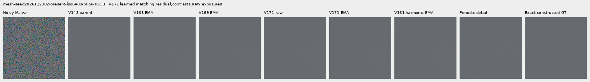

mesh-seed2026112302-present-iso6400-prior-RGGB; ROI `[176, 176, 160, 160]`, exposure 8, contrast 40.

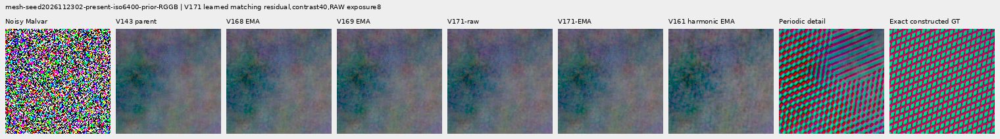

mesh-seed2026112309-present-iso6400-prior-RGGB; ROI `[176, 176, 160, 160]`, exposure 8, contrast 1.

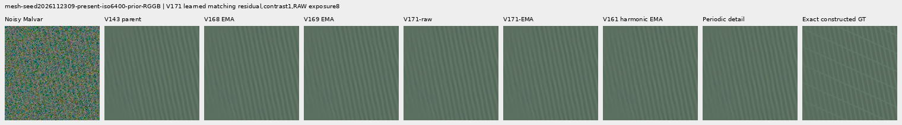

mesh-seed2026112309-present-iso6400-prior-RGGB; ROI `[176, 176, 160, 160]`, exposure 8, contrast 40.

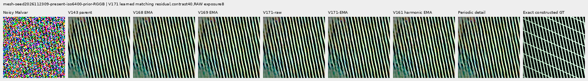

mesh-seed2026112304-absent-iso6400-prior-RGGB; ROI `[165, 0, 160, 160]`, exposure 8, contrast 40.

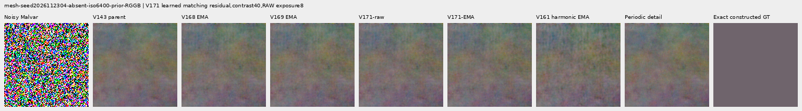

main-overcast-sky; ROI `[176, 176, 160, 160]`, exposure 4, contrast 1.

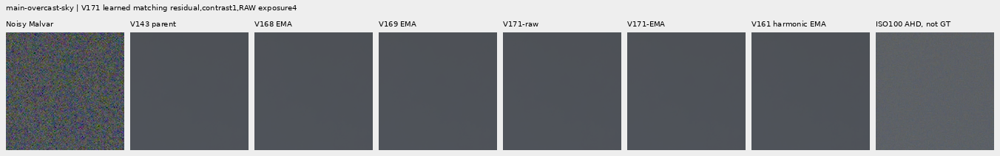

main-building-detail; ROI `[176, 176, 160, 160]`, exposure 4, contrast 1.

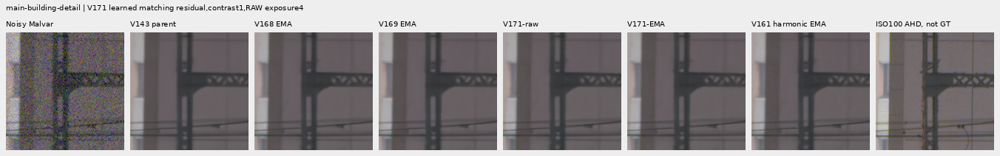

main-foliage; ROI `[176, 176, 160, 160]`, exposure 4, contrast 1.

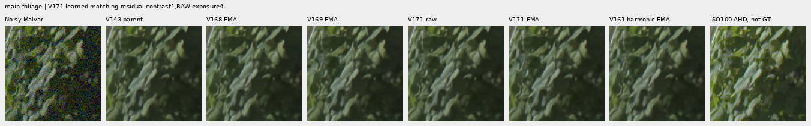

main-chain-link-fence; ROI `[176, 176, 160, 160]`, exposure 4, contrast 1.

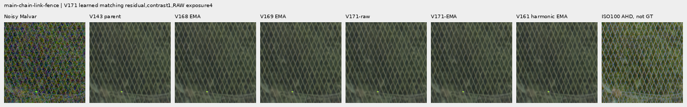

mesh-nominal; ROI `[206, 229, 160, 160]`, exposure 16, contrast 1.

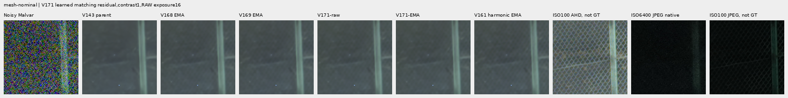

mesh-nominal; ROI `[426, 189, 160, 160]`, exposure 16, contrast 1.

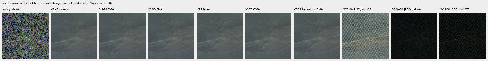

mesh-profile3879; ROI `[206, 229, 160, 160]`, exposure 16, contrast 1.

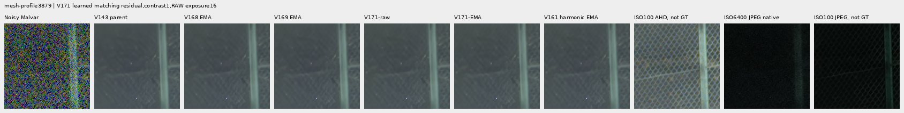

mesh-profile3879; ROI `[426, 189, 160, 160]`, exposure 16, contrast 1.

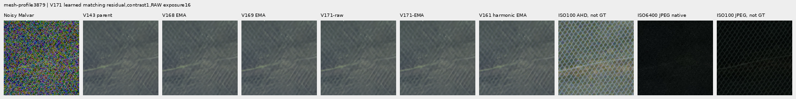

organic-02a76fd33b5e1414a0504f0b3f0aeb03a569b6f4-photo-faint-RGGB; ROI `[112, 112, 160, 160]`, exposure 14.3883, contrast 8.

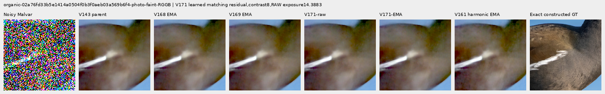

organic-dabacecd4780a1c230f8e9fce6ca1a604bdeab4c-photo-dark-RGGB; ROI `[112, 112, 160, 160]`, exposure 102.758, contrast 1.

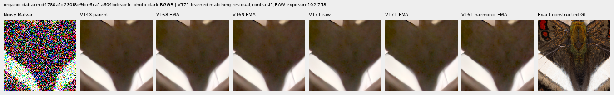

organic-6b3920bceba82d95ecf9351d47f6f94267694bd0-photo-dark-RGGB; ROI `[112, 112, 160, 160]`, exposure 64.0491, contrast 1.

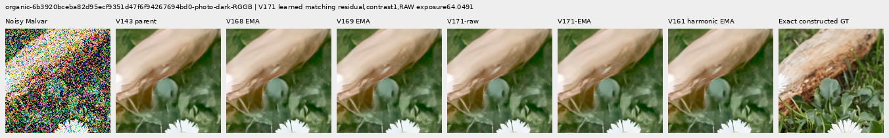

gray-l0.02-adc-only-RGGB; ROI `[48, 48, 160, 160]`, exposure 4, contrast 40.

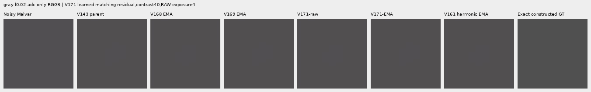

gray-l0.02-iso12800-prior-RGGB; ROI `[48, 48, 160, 160]`, exposure 4, contrast 40.

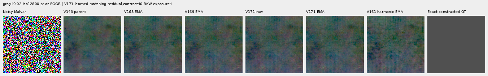

flat512-gray-l0.02-adc-only-RGGB; ROI `[176, 176, 160, 160]`, exposure 4, contrast 40.

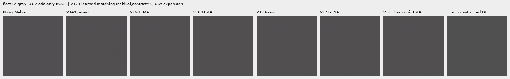

flat512-gray-l0.02-iso6400-prior-RGGB; ROI `[176, 176, 160, 160]`, exposure 4, contrast 40.

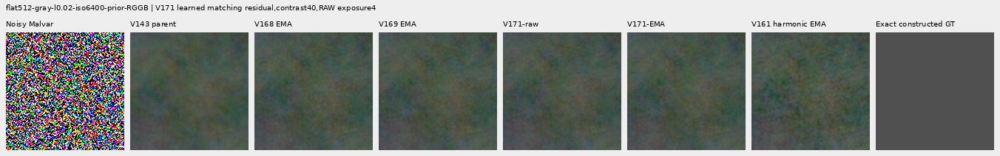

flat512-gray-l0.02-iso12800-prior-RGGB; ROI `[176, 176, 160, 160]`, exposure 4, contrast 40.

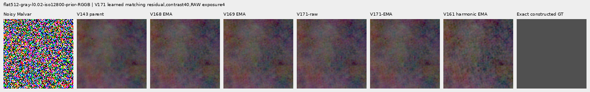

flat512-h210-s0.50-l0.02-iso6400-prior-RGGB; ROI `[176, 176, 160, 160]`, exposure 4, contrast 40.

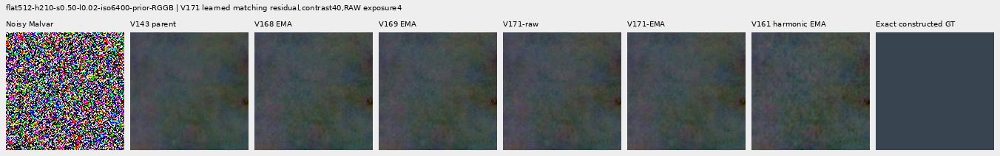

flat512-gray-l0.18-iso12800-prior-RGGB; ROI `[176, 176, 160, 160]`, exposure 1, contrast 8.

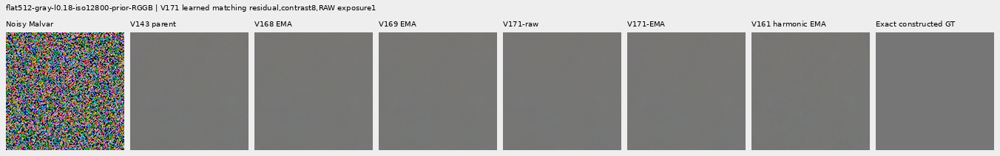

flat512-gray-l0.90-iso12800-prior-RGGB; ROI `[176, 176, 160, 160]`, exposure 1, contrast 4.

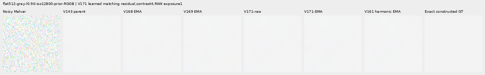

photo-3e638bbb56ed80abc88939468783e3bf9b92ee77-photo-faint-RGGB; ROI `[176, 176, 160, 160]`, exposure 12.1494, contrast 8.

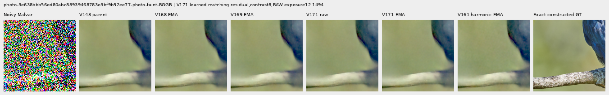

photo-3e638bbb56ed80abc88939468783e3bf9b92ee77-photo-dark-RGGB; ROI `[176, 176, 160, 160]`, exposure 80.9959, contrast 1.

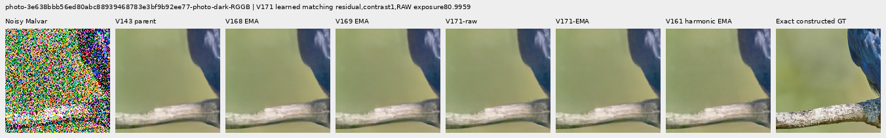

mixed-vertical-step-iso6400-prior-RGGB; ROI `[80, 176, 160, 160]`, exposure 8, contrast 40.

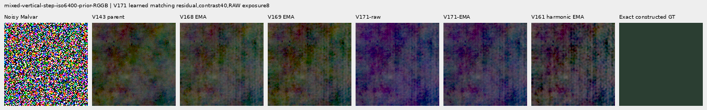

mixed-vertical-step-iso6400-prior-RGGB; ROI `[240, 176, 160, 160]`, exposure 8, contrast 1.

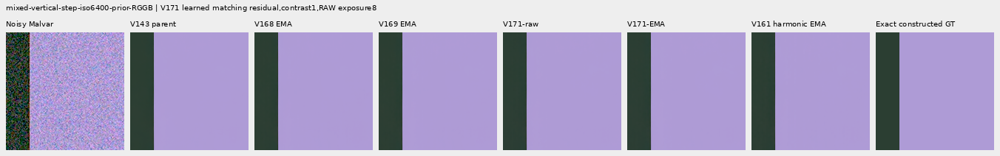

mixed-vertical-step-iso12800-prior-RGGB; ROI `[80, 176, 160, 160]`, exposure 8, contrast 40.

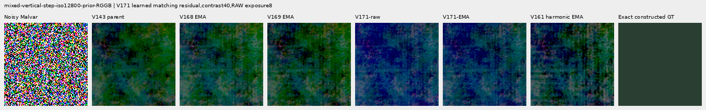

mixed-vertical-step-iso12800-prior-RGGB; ROI `[240, 176, 160, 160]`, exposure 8, contrast 1.

mixed-narrow-bar-iso6400-prior-RGGB; ROI `[80, 176, 160, 160]`, exposure 8, contrast 40.

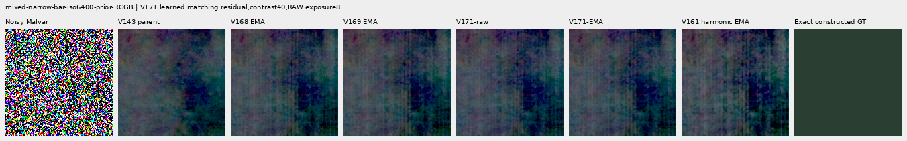

mixed-narrow-bar-iso6400-prior-RGGB; ROI `[240, 176, 160, 160]`, exposure 8, contrast 1.

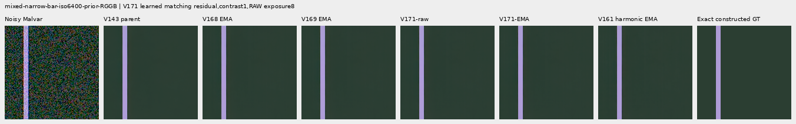

mixed-narrow-bar-iso12800-prior-RGGB; ROI `[80, 176, 160, 160]`, exposure 8, contrast 40.

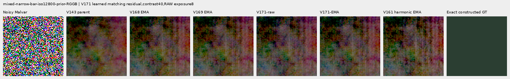

mixed-narrow-bar-iso12800-prior-RGGB; ROI `[240, 176, 160, 160]`, exposure 8, contrast 1.

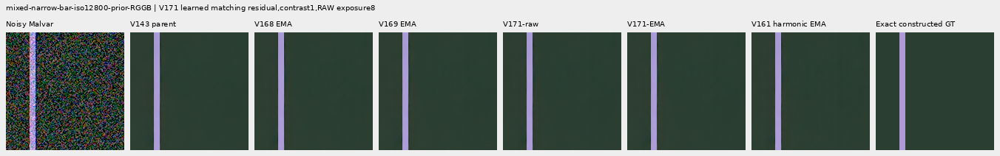

mixed-slanted-step-iso6400-prior-RGGB; ROI `[80, 176, 160, 160]`, exposure 8, contrast 40.

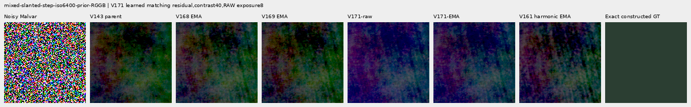

mixed-slanted-step-iso6400-prior-RGGB; ROI `[240, 176, 160, 160]`, exposure 8, contrast 1.

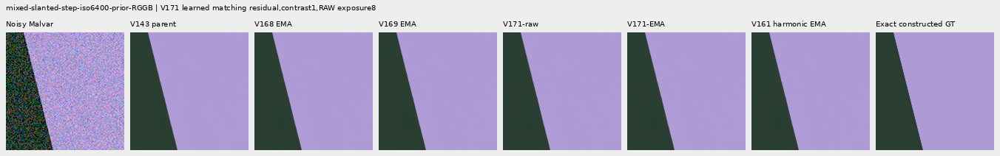

mixed-slanted-step-iso12800-prior-RGGB; ROI `[80, 176, 160, 160]`, exposure 8, contrast 40.

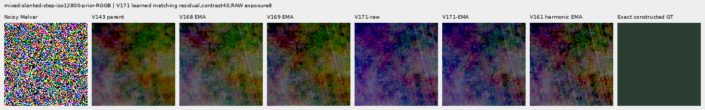

mixed-slanted-step-iso12800-prior-RGGB; ROI `[240, 176, 160, 160]`, exposure 8, contrast 1.

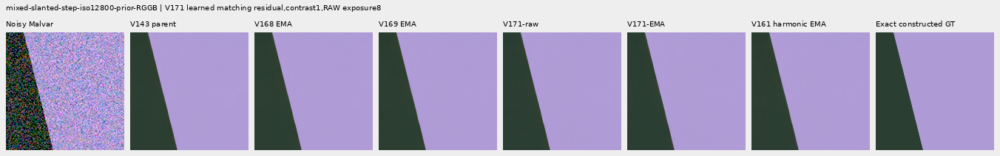

mixed-striped-patch-iso6400-prior-RGGB; ROI `[80, 176, 160, 160]`, exposure 8, contrast 40.

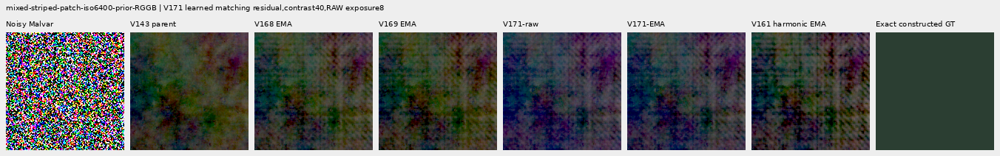

mixed-striped-patch-iso6400-prior-RGGB; ROI `[240, 176, 160, 160]`, exposure 8, contrast 1.

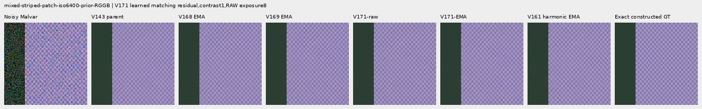

mixed-striped-patch-iso12800-prior-RGGB; ROI `[80, 176, 160, 160]`, exposure 8, contrast 40.

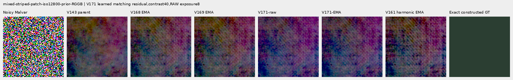

mixed-striped-patch-iso12800-prior-RGGB; ROI `[240, 176, 160, 160]`, exposure 8, contrast 1.

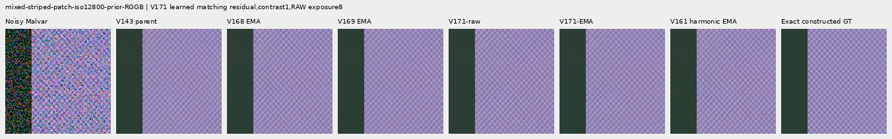

V150-control-bark-contrast0p025-adc-RGGB; ROI `[48, 48, 160, 160]`, exposure 1, contrast 40.

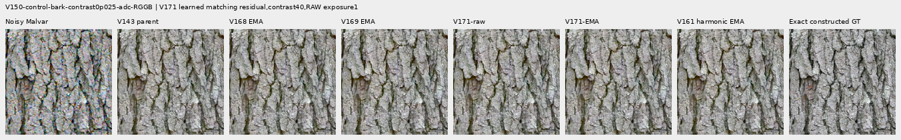

V150-control-raccoon-fur-contrast0p025-adc-RGGB; ROI `[48, 48, 160, 160]`, exposure 1, contrast 40.

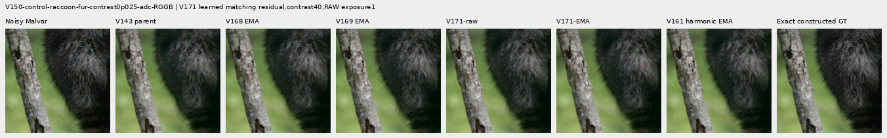

V150-control-ADC-plane0-RGGB; ROI `[176, 176, 160, 160]`, exposure 45, contrast 8.

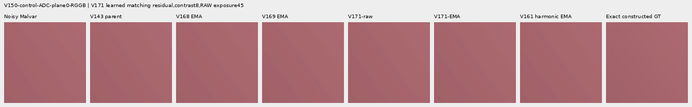

V150-control-ADC-plane1-RGGB; ROI `[176, 176, 160, 160]`, exposure 9, contrast 8.

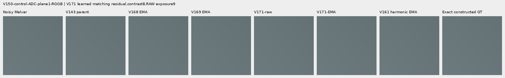

V150-control-ADC-plane2-RGGB; ROI `[176, 176, 160, 160]`, exposure 1, contrast 8.

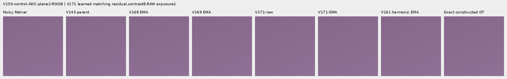

V150-control-ADC-plane3-RGGB; ROI `[176, 176, 160, 160]`, exposure 0.24, contrast 8.

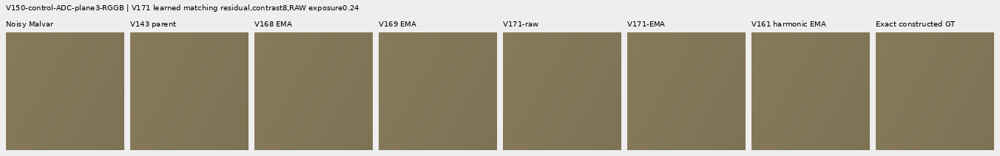

### Noisy, restored and exact constructed GT triplets

mesh-seed2026112302-present-iso6400-prior-RGGB; ROI `[176, 176, 160, 160]`, exposure 8, contrast 1.

mesh-seed2026112302-present-iso6400-prior-RGGB; ROI `[176, 176, 160, 160]`, exposure 8, contrast 1.

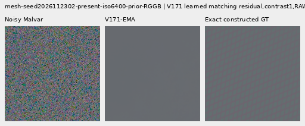

mesh-seed2026112309-present-iso6400-prior-RGGB; ROI `[176, 176, 160, 160]`, exposure 8, contrast 1.

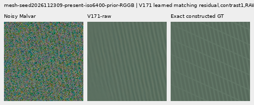

mesh-seed2026112309-present-iso6400-prior-RGGB; ROI `[176, 176, 160, 160]`, exposure 8, contrast 1.

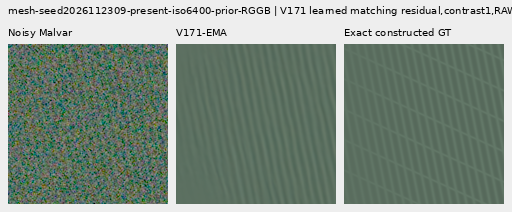

flat512-gray-l0.02-iso6400-prior-RGGB; ROI `[176, 176, 160, 160]`, exposure 4, contrast 40.

flat512-gray-l0.02-iso6400-prior-RGGB; ROI `[176, 176, 160, 160]`, exposure 4, contrast 40.

flat512-gray-l0.02-iso12800-prior-RGGB; ROI `[176, 176, 160, 160]`, exposure 4, contrast 40.

flat512-gray-l0.02-iso12800-prior-RGGB; ROI `[176, 176, 160, 160]`, exposure 4, contrast 40.

mixed-vertical-step-iso6400-prior-RGGB; ROI `[80, 176, 160, 160]`, exposure 8, contrast 40.

mixed-vertical-step-iso6400-prior-RGGB; ROI `[80, 176, 160, 160]`, exposure 8, contrast 40.

mixed-vertical-step-iso12800-prior-RGGB; ROI `[80, 176, 160, 160]`, exposure 8, contrast 40.

mixed-vertical-step-iso12800-prior-RGGB; ROI `[80, 176, 160, 160]`, exposure 8, contrast 40.

[Independent publication verification](results/v171-matching-residual-publication-verification-v1.json).
