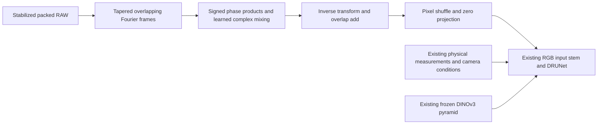

# Learned RAW frequency features: implementation checks

**An optional 3,264-parameter input adapter now learns complex frequency mixing
before the mature RGB restoration trunk.** It preserves signed phase information
and starts with exactly zero effect on the parent. It passes mathematical,
initialization, gradient, checkpoint and discarded CPU/CUDA training checks.
**Trained image quality and complete-frame behavior remain unmeasured.**
Current model recommendations and the original V120/V121 trials are unchanged.

[Execution, retained arrays and independent state audits](results/raw-frequency-features-engineering-v1.json) ·
[Implementation](../src/demosaic/raw_frequency_features.py) ·
[Focused tests](../tests/test_raw_frequency_features.py).

## Motivation and design

The [train-fence diagnostic](green-phase-spectrum.md) finds matching RAW
frequency structure that V115/V119 attenuate. The
[photographic reference check](green-phase-reference.md) also finds many
reference-supported frequencies with nonpositive green cross-power. Those
observations argue against a forced positive-only mask. The earlier
[fixed MHC spectral correction](spectral-photo-components.md) already caused
grids and color errors when strengthened; it is not reused here.

[FFNet, April 2026](https://www.mdpi.com/2227-7390/14/7/1175) studies learned global
and local Fourier features for JDD. That motivates investigating frequency
features, without transferring its benchmark results to this independent design.
No FFNet implementation or weights are incorporated.



The adapter receives the same stabilized four-phase measurements and variance
proxy as the physical RGB path, scaled to restoration units. It keeps the four
physical phase slots, with CFA one-hot placement and packed-frequency coordinates.
Its default frame is 64 packed pixels, or 128 native pixels, at 50% overlap.
Smaller inputs use the largest fitting power-of-two frame, down to 4. There are
no resolution-specific learned weights.

Within each frame, remove a weighted affine fit, apply a sine-product analysis
window and take an orthonormal full complex FFT. The descriptor contains 16
real components of the four-phase Hermitian Gram representation: four powers
and real/imaginary products for all six phase pairs. It adds one log-strength
channel, twelve CFA-placement channels and two frequency coordinates.
Neither real nor imaginary cross-product signs are clipped.

A 31→32→64 pointwise MLP predicts a complex 8×4 mixing adjustment at each
frequency. A fixed identity/Hadamard mixing supplies the initial nonzero latent
features; the MLP's last layer starts at zero. Hermitian projection makes the
mixed spectra consistent with real spatial fields. Inverse transform, synthesis
window and normalized overlap-add produce eight packed latent planes; pixel
shuffle makes two native channels, then a zero-initialized 2→64 projection adds
an offset to the existing RGB input stem. The output RGB head, inverse VST,
camera handling and frozen DINO branch retain their existing roles.

This is learned input-feature conditioning, **not a fixed RGB restoration
correction, observed-minus-predicted innovation or confidence-threshold mask**.
The Gram descriptor is invariant to a common complex phase rotation; the
learned mixing preserves that phase through the observed coefficients.
This property is checked after nonzero adaptation. It does not establish
translation invariance for the complete windowed/padded network.

## Initialization and API

The new option is disabled by default. Existing checkpoints omit it and load
with `raw_frequency_features: false`. To select it in a compatible native,
stabilized, physically anchored pretrained-RGB experiment:

```yaml
model:
  # Keep the compatible parent's other model settings.
  raw_frequency_features: true
raw_frequency_lr_multiplier: 20
```

The multiplier defaults to 1 and affects only the five new parameter tensors.
Invalid multipliers or incompatible RAW-head/late-head/normalization-augmentation
combinations are rejected. A changed multiplier is rejected on resume. The
checked prototype uses a fresh initializer and optimizer; it is not a recommended
trained checkpoint or a newly launched full-budget recipe.

Construction preserves global Torch RNG. The zero projection preserves initial
parent outputs and common gradients, including CPU BF16 autocast checks. All
per-phase constant-color observations produce exactly zero added features even
after feature weights change. Nonconstant channels-last and contiguous inputs
give identical latent fields. These properties do not prevent the separately
trainable common trunk from drifting during a longer run.

Review after the CPU run found that global `torch.manual_seed` could also reset
CUDA RNG. Construction now uses an explicit CPU-local generator and CPU
allocations. All 25,165 parameter/buffer values match the executed CPU constructor
exactly, and runtime method ASTs are unchanged. The original CPU source and
outputs are preserved; no completed forward is rerun for that correction.
The later CUDA check verifies unchanged CPU/CUDA RNG at all three actual
adapter constructions, including with CUDA already initialized.

## Actual mature-model checks

The discarded run initializes from genuine final V115 Small EMA, SHA256
`fee5d05c599cb32f5a1e587c31979f040a06152c8e14676481eee83a4ce04d84`.
All 91 shared restoration/EMA tensors match that parent before the first update.
The official frozen DINOv3 ConvNeXt-Small encoder retains hash
`691963f0f796aac860d818d59d9d14287a4675612829fbe9467c7f5df8ce5b14`.

Both checks use seed66 and the prepared 90,786-source corpus with fourteen reviewed regions
corpus, corrected paired32 data and existing native-RAW data, with zero optical
PSFs and the established geometry/noise/loss settings:

| Check | Native patch / batch / precision | Updates | Saved batches / samples |
| --- | --- | --- | --- |
| CPU | 128 / 1 / FP32 | 16 fresh + 2 resumed | 18 / 18 |
| GB10 CUDA | 256 / 16 / BF16 | 16 fresh + 2 resumed | 18 / 288 |

Each retains nine Commons, three paired and six native batches. The 16-step
checkpoints are preserved separately; resumed steps 17/18 use new observations.
Model/EMA/AdamW states stay finite, with 94 optimizer states at the correct steps.
Finite nonzero gradients reach all five new tensors in both checks.

One explicit feature-disabled forward on each **new first training batch** checks
the parent function against the enabled zero adapter. All 65,536 CPU and 4,194,304
CUDA FP32 RGB/measured-CFA output values match byte-for-byte. Each check adds one
witness to 18 training forwards: 38 restoration/encoder forwards across both.
No earlier completed quality-control inference is repeated. Changed-learning-rate
resume is rejected before a forward; valid resume restores all 96 model tensors
and 94 optimizer states before step 17. Source diagnostics forbid neural calls and
preserve Python/NumPy/Torch CPU RNG; constructor CUDA RNG is checked separately.

Independent archive audits, with neural calls forbidden, reproduce all 36 batch
fingerprints from 330 tensor fields: 2,507,076 CPU and 160,437,312 CUDA numeric
values. They verify initial-output bytes, checkpoint states, step/input logs and
frozen source archives. No CUDA input-batch fingerprint duplicates the CPU run.
The current adapter suite passes 29 checks; the related spectral/RGB regressions
add 29 unchanged checks, for 58 focused checks covered. The weighted transform and
overlap-add match an independent dense-DFT/least-squares reconstruction.

The CUDA process stayed within its 16 GiB cap, at 9.02 GiB peak allocated and 9.93 GiB
reserved. This includes retained fresh/resume models and runs beside other GPU
work; it is neither a production memory figure nor a speed comparison.

## Limits and next quality comparison

The frame-noise normalizer is a feature proxy, **not** the diagnostic's exact
conditional post-fit coefficient variance or a calibrated detection statistic.
Its 1e−12 floor only makes ADC-only arithmetic finite. Replicated boundaries,
overlap/frame origins, nonlinear stabilization and finite-window leakage remain
possible sources of behavior changes. Frame DC removal does not guarantee a
zero-mean RGB change on nonconstant images.

No PSNR gain, better lattice recovery, cross-precision quality bound, runtime,
long-run stability or 102 MP output is established. A future matched quality
comparison must check photographs, weak detail, camera/color tails and actual
native material/GFX/green-mesh crops, with noisy/restored/GT or correctly labeled
independent-reference triplets. V120/V121's original endpoint comparison continues;
these engineering checks supply no reason to replace a reviewed model.
