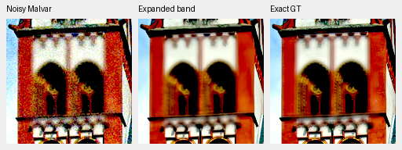
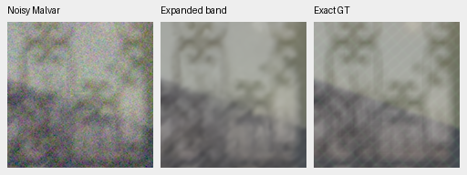

# Learning bounded spectral corrections from surrounding RAW

A wider-band head raises aligned ISO6400 wire response from **33.66% to
37.50%** over Corpus 100k, while increasing intact-increment error from
**207.82 to 211.35 DN16** and adding **11.49 DN16 RMS** inside known wire gaps.
Learning from frequency and direction separately improves response over a
head given only surrounding texture power. The learned corrections leave the
real sky smooth and the fine green cab crossings incomplete.
[Publication](results/learned-spectral-detail-v1/publication.json) ·
[Native crop provenance](images/learned-spectral-detail-v1/manifest.json).

## Training and frequency check

The head uses three measured proposals at each supported frequency in
overlapping 32-pixel windows. It can change the amplitude already present in
the parent, add the difference between RAW green samples and the parent's
corresponding greens, or add a coherent proposal where both physical green
planes agree. Each 1,763-parameter head predicts three bounded coefficients.
The overlap-add correction is achromatic in calibrated linear RGB and fades
at the query edge. Conditioning comes from RAW outside the query and its
16-pixel halo. The two heads in each run see the same local measurements and
initial weights. One also sees total exterior texture power. The other sees
exterior power at each frequency and direction. In the real review the
exterior search reads the full cached Bayer frame.
[Exterior spectrum and controls](scene-spectrum-detail.md#estimating-a-spectral-prior-from-the-surrounding-image) ·
[Drivers and receipts](results/learned-spectral-detail-v1/evidence.tar.xz).

The 320 sources come from the 90,692-photo ordinary training manifest,
with the protected GFX captures and families excluded and source disjointness
checked against the fixed photo, exact natural and wire evaluation panels.
There are 224 photo-only sources and 96 photos with a planted finite wire
pattern. Each supplies present, attenuated and flat targets in a jittered
256-pixel query within a 512-pixel Bayer context. Training covers four CFA
orders, ISO400 and ISO6400 with jittered exposure, and coupled and independent
noise. Corpus 100k EMA generated the shared frozen training predictions with
standard CUDA FP16 autocast and FP32 output in 40.19 s of forward time.
The parent checkpoint is
`87b96f3c487b9edaf1c477742b6c38f2a82cc6b20a94716d51cc8cf46a17a760`.
Each recipe trained two FP32 heads together for 480 updates, four photos
per update, six passes, 1,920 photo visits and 5,760 role queries per head.
Training uses AdamW with 24 warmup updates, cosine decay from 0.001 to 0.0001
and EMA 0.99. Loop times below exclude parent forwards and evaluation.
[Training plan, data hashes and optimizer receipts](results/learned-spectral-detail-v1/evidence.tar.xz).

| Experiment | Learned objective and support | Training loop | Checkpoint SHA256 |
| --- | --- | ---: | --- |
| Corrected paired | Complex residual, paired-increment loss and flat penalties. 0.112–0.244 cycles/native pixel | 13.08 s | `b5a74c0d42a93b81d817b3300688f1c74a1ba369decc540b67aa131031adde9a` |
| Corrected projection | Paired objective plus weight 9 on squared error projected onto the exact increment. Same band | 11.30 s | `e0a7db69ed62f1bd0dcf97f1a5b0ebcb9962ca4bafb94bb240696293aa508f5f` |
| Corrected wider band | Same projection objective with synthesis support expanded to 0.066–0.244 cycles/native pixel | 11.30 s | `ef931444c362a1acf0718c734b76fd345c732cc2b2464b991a4c705dfeee79c9` |

The initial three runs used packed-grid indices directly on the native
FFT grid, which sent negative modes to the wrong frequencies. All three
heads were retrained and reviewed after mapping signed frequencies explicitly.
Known waves in both orientations now retain at least 99.70% of their
projected amplitude. Of the 24 held-out wire fundamentals, 15 fall below
the narrow band's lower bound. In a diagnostic supplied with the true
increment, the narrow representation preserves 60.36% of it and the wider
one preserves 93.31%. The practical head estimates a much smaller fraction
from RAW measurements. The wider recipe retains the original narrow-band
exterior normalization. Its planted training wire fundamentals still span
0.113–0.206 cycles per native pixel. The added lower synthesis frequencies
receive natural-photo supervision and see no planted training fundamental
directly in that range.
[Corrected phase checks](results/learned-spectral-detail-v1/evidence.tar.xz) ·
[Superseded runs and their original receipts](results/learned-spectral-detail-v1/incorrect-frequency-mapping.tar.xz).

## Held-out exact targets

The natural panel uses 64 held-out photo sources with two noise profiles
and both coupled and independent draws, for 256 cases. Response measures
how much of the known fine increment aligns with the reconstructed difference
between present and attenuated inputs. Natural increment and flat RMS use
the same 96-pixel core and the native 1/8–1/3 cycles-per-pixel band. The wire panel uses 24 different photo backgrounds
at ISO400 and ISO6400 with known intact, gapped, weak-free and flat controls.
Its gap, flat and weak-free columns measure added or changed signal relative
to Corpus 100k. For V120 they include the entire change from Corpus 100k.
V120 EMA is the general recommendation, checkpoint
`a9d9b6b4f974e24a6b11e5e740aab32314233a7f53c056cf37c7d2aac1c589fb`.
Wire V120 uses CUDA FP32, with the central 256 pixels of a 320-pixel model
crop. The component weights shown are EMA. The archive also scores their raw
weights and evaluates the same directional EMA weights with transposed
exterior frequencies and local-only context.
[Panel bindings and per-case scores](results/learned-spectral-detail-v1/evidence.tar.xz).

| Natural, independent ISO6400 | Aligned response | Increment RMS, DN16 | Flat RMS, DN16 | Present sRGB PSNR |
| --- | ---: | ---: | ---: | ---: |
| V120 EMA | 65.47% | 124.715 | 5.100 | 34.819 dB |
| Corpus 100k EMA | 65.84% | 124.547 | 4.589 | 34.929 dB |
| Paired, directional | 63.88% | 124.175 | 4.498 | 34.916 dB |
| Projection, directional | 68.81% | 127.129 | 7.556 | 34.906 dB |
| Wider band, directional | 67.41% | 126.093 | 6.744 | 34.918 dB |

| Planted wire, ISO6400 | Aligned response | Intact-increment RMS, DN16 | Gap change, DN16 | Flat change, DN16 | Weak-free change, DN16 |
| --- | ---: | ---: | ---: | ---: | ---: |
| V120 EMA | 31.61% | 207.410 | 21.795 | 7.613 | 23.972 |
| Corpus 100k EMA | 33.66% | 207.815 | 0.000 | 0.000 | 0.000 |
| Shared Bayer gap fit | 59.60% | 206.548 | 47.963 | 0.000 | 0.000 |
| Paired, directional | 32.81% | 205.131 | 6.231 | 1.183 | 6.702 |
| Projection, directional | 37.17% | 212.126 | 14.469 | 5.188 | 14.816 |
| Wider band, directional | 37.50% | 211.350 | 11.487 | 5.572 | 12.061 |

The paired objective lowers increment RMS on both panels while attenuating
some of the actual signal. On the natural panel the projection objective
gains 2.97 response points and raises flat RMS by 2.97 DN16. Expanding the
band recovers more of the planted wire with less gap change, at the cost
of slightly more change on exact flat wire-panel controls. Its ISO6400 wire
response gain over the frozen parent is 3.85 points with a source-paired
95% interval of [3.24, 4.44]. The intact error rises 3.54 DN16
[2.55, 4.48]. At ISO400 the wider head raises wire response from 89.69%
to 92.37%, with intact error rising from 93.89 to 94.73 DN16. Raw weights
give similar tradeoffs.
[Complete scores](results/learned-spectral-detail-v1/evidence.tar.xz).

On the wire panel the wider directional head beats its separately trained
total-power control by 0.95 response points [0.68, 1.26] and 0.87 DN16
in intact error. Transposing the same head's exterior spectrum reduces
response from 37.50% to 37.06%. Restricting it to local power reduces
response to 35.93% and also reduces unwanted gap change. On natural
targets the direction-specific response gain over the total-power control
is 0.08 points, with 0.72 DN16 lower flat RMS. These results show a small
benefit from matching the surrounding spectrum. It supplies limited
evidence that a weak wire actually continues through the query.
[Context ablations](results/learned-spectral-detail-v1/evidence.tar.xz).

## Exact native comparisons

All panels show the same 160 × 160 pixels cut at `[48,48,160,160]`
within each native query. Both scenes use synthetic ISO6400
(shot 0.00128, read 0.0000065536, capture exposure 0.33, 16-bit ADC and
black level 0.03). Each scene uses the same display transform across all
methods and the exact target. The checkpoint table above binds the
denoised panels. The fine cathedral molding stays soft. Much of the
planted diagonal mesh remains missing.

**Limburg Cathedral**, Berthold Werner, public domain. BGGR at
`[22,250,256,256]` in the 4×-binned evaluation source. Display exposure
3.0303 and contrast 2.0.
[Source photo](https://commons.wikimedia.org/wiki/File:Limburger_Dom_BW_1.jpg) ·
[All methods](images/learned-spectral-detail-v1/exact/001-iso6400-independent-comparison.png) ·
[Paired triplet](images/learned-spectral-detail-v1/exact/001-iso6400-independent-paired-triplet.png) ·
[Projection triplet](images/learned-spectral-detail-v1/exact/001-iso6400-independent-aligned-triplet.png).

**Planted wire on the Lisbon iron-door photo**, Jules Verne Times Two,
CC BY-SA 4.0. GRBG at `[128,128,256,256]` in the scene box
`[146,12,512,512]`. Display exposure 2.0 and contrast 1.0. The rendered
comparison crops the source and adds the synthetic target and capture noise.
[Source photo](https://commons.wikimedia.org/wiki/File:Framed_iron_door,_Pra%C3%A7a_de_Londres,_Lisbon,_Portugal_julesvernex2.jpg) ·
[License](https://creativecommons.org/licenses/by-sa/4.0/) ·
[All methods](images/learned-spectral-detail-v1/exact/010-iso6400-wire-comparison.png) ·
[Paired triplet](images/learned-spectral-detail-v1/exact/010-iso6400-wire-paired-triplet.png) ·
[Projection triplet](images/learned-spectral-detail-v1/exact/010-iso6400-wire-aligned-triplet.png).

## Standing GFX100S comparisons

All eight boards were inspected at native scale. The learned outputs are
Corpus 100k followed directly by each directional EMA head. V120 and
the exterior-frequency colour fit are separate comparisons. The sky
remains smooth. Wide-band RGB changes are 1.50 DN16 RMS in sky, 5.69
in the building, 7.23 in foliage and 6.21 in the coarse fence, measured
before display. Coarse crossings stay coherent. Fine building wires
and leaves remain soft. In the cab crops the left lattice remains
diffuse and right crossings stay patchy under both noise profiles.
The three learned heads show no convincing new crossings, new false
colour or visible sky texture. Both ISO100 AHD captures provide
independent qualitative references and differ in exposure and aperture.
The cab comparisons also include both camera JPEGs.
[Main capture configuration](../configs/gfx-qualitative-20231231.json) ·
[Cab capture configuration](../configs/gfx-green-mesh-20231231.json) ·
[Coordinates, conditioning, exposures and hashes](images/learned-spectral-detail-v1/manifest.json).

| DSCF3879/3880 main scene | Native comparisons |
| --- | --- |
| ISO6400, nominal profile | [Sky](images/learned-spectral-detail-v1/standing/main-overcast-sky-main-overcast-sky.png) · [Building](images/learned-spectral-detail-v1/standing/main-building-detail-main-building-detail.png) · [Foliage](images/learned-spectral-detail-v1/standing/main-foliage-main-foliage.png) · [Coarse fence](images/learned-spectral-detail-v1/standing/main-chain-link-fence-main-chain-link-fence.png) |

| DSCF3842/3835 fine cab mesh | Native comparisons |
| --- | --- |
| Nominal ISO6400 profile | [Left](images/learned-spectral-detail-v1/standing/mesh-nominal-fine-green-mesh-left.png) · [Right](images/learned-spectral-detail-v1/standing/mesh-nominal-fine-green-mesh-right.png) |
| Transferred DSCF3879 profile | [Left](images/learned-spectral-detail-v1/standing/mesh-profile3879-fine-green-mesh-left.png) · [Right](images/learned-spectral-detail-v1/standing/mesh-profile3879-fine-green-mesh-right.png) |

Training, scoped exact-target evaluation and native-image review are
complete. The study evaluates small crop corrections and has no fixed
427-photo or known/unseen camera scores, or full-frame timing. The useful
gain is better planted-wire response from directional conditioning. The
error and leakage tradeoff and the real fence review leave V120 as the
general recommendation and Corpus 100k as the broad photo benchmark.
[Model guide](current-model.md) · [Broad evaluation](full-corpus-long100k.md).
