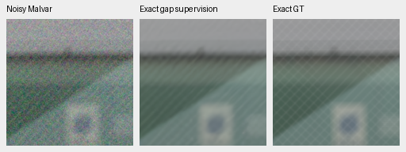
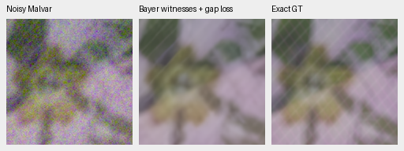

# Training spectral corrections on interruptions in weak wires

Exact gap supervision reduces ISO6400 paired error in true breaks from
**170.81 to 156.08 DN16** against a matched head, while intact response drops
from **40.53% to 30.79%**. A second trial checked the candidate phase with
separate Bayer samples. At similar levels of added texture, it lowers absolute
gap error by **0.37 DN16**, with an uncertain intact-response gain. Neither
trial produces convincing new crossings in the standing green cab mesh.
[Publication and checkpoint bindings](results/learned-spectral-gaps-v1/publication.json) ·
[Evidence and code](results/learned-spectral-gaps-v1/evidence.tar.xz).

## Data and training

The [wider spectral head](learned-spectral-detail.md) uses surrounding Bayer
power to condition a bounded luminance correction over 32-native-pixel
windows. This follow-up retains the same 0.066–0.244 cycles-per-pixel output
band and the same frozen Corpus 100k EMA
(`87b96f3c487b9edaf1c477742b6c38f2a82cc6b20a94716d51cc8cf46a17a760`).
It draws 448 new source photos from the protected-scene-excluding 90,692
ordinary-photo training manifest. Those are disjoint from the earlier
spectral training sources and the scored panels. The 224 ordinary-photo and
224 wire sources cover all four Bayer layouts and both ISO400 and ISO6400.
Each wire geometry uses 56 photos. Ellipses and strips remove the weak
orientation completely over part of the query. Smooth dips and contrast steps
retain it. Weak fundamentals span 0.071–0.201 cycles per native pixel.
The exterior Bayer image retains both orientations even when the query has
a break. Present, weak-free and flat views share the same disjoint exterior
crop. The present/weak-free pairs use coupled noise on 256 sources and
independent noise on 192. The three roles use the same exposure and CFA.
[Training plan](results/learned-spectral-gaps-v1/evidence.tar.xz).

The matched control uses the prior complex residual, paired and flat
losses, and projected exact-increment loss. Exact gap supervision adds
a spatially weighted paired error and absolute error (weights 3 and 1.5)
inside the known zero-support region. The gap correction penalty replaces
that added absolute error with a penalty on the size of the correction
in the same region. The mask weights training losses only. All three
heads see the same samples and gap-weighted window selection.

The Bayer witness heads add eight features. They infer a phase from the
green coefficients in the four adjacent disjoint 32-pixel windows and
check signed alignment with the center greens, red and blue. They also
measure center red and blue along the center-green phase. Phase selection
and the red/blue check use distinct CFA sites. The frozen parent still
observes all CFA channels. The larger head initializes the additional
feature weights to zero. It repeats the matched and exact-gap recipes
with the same samples and optimizer. The audit verifies the signed phase
in four Bayer layouts, exact zero-support targets and the gradient of the
spatial loss.
[Alignment, isolation and mask audit](results/learned-spectral-gaps-v1/evidence.tar.xz).

Each head trains 672 updates, six passes, four photos per update, 2,688 photo
visits and 8,064 role queries. An update uses 64 uniform, 14 exact-flat and
12 gap-weighted or uniform-fallback windows per photo. AdamW uses a
24-step warmup, cosine decay 0.001 to 0.0001, gradient cap 2 per head and
EMA 0.99. Optimization is FP32. Frozen parent features use standard CUDA
FP16 autocast with FP32 output and take 52.27 s for the initial collection.
The loop durations below exclude that collection, feature assembly and
all evaluation.

| Experiment | Joint training loop | Checkpoint SHA256 | Evaluated weights |
| --- | ---: | --- | --- |
| Matched plus exact-gap and correction-penalty heads | 27.95 s | `95337456e8697e741d38c794d5c10d837b95a99220b0fe6d0b65bf4c0d041686` | EMA and raw |
| Matched and exact-gap heads with Bayer witnesses | 16.59 s | `f1ef6679e3831fd92c7c500483fdcb17fcaae2dcec44371a68a97ebefe88ce2f` | EMA and raw |

## Held-out wire and photo comparisons

The primary wire panel has 24 independent photo backgrounds at ISO400
and ISO6400. Per profile there are 12 true gaps, six smooth dips and six
continuous contrast-step backgrounds. Intact response projects the
restored paired increment onto its exact target. The gap columns measure
change from Corpus 100k, absolute error against exact truth, and error in
the present-minus-absent pair. Dip response covers continuously present
regions where the true support lies between 0.01 and 0.65. All error
columns are in scene-luminance DN16. V120 EMA, the general recommendation,
uses checkpoint `a9d9b6b4f974e24a6b11e5e740aab32314233a7f53c056cf37c7d2aac1c589fb`.
[Source and precision bindings](results/learned-spectral-gaps-v1/evidence.tar.xz).

| ISO6400 wire comparison, EMA | Intact response | Intact RMS | Gap change | Absolute gap RMS | Paired gap RMS | Dip response |
| --- | ---: | ---: | ---: | ---: | ---: | ---: |
| V120 EMA | 31.61% | 207.41 | 21.80 | 154.01 | 163.67 | 31.82% |
| Corpus 100k EMA | 33.66% | 207.82 | 0.00 | 152.65 | 162.47 | 31.76% |
| Earlier wider-band head | 37.50% | 211.35 | 11.49 | 153.39 | 167.61 | 34.53% |
| Matched training | 40.53% | 213.42 | 18.75 | 153.36 | 170.81 | 36.26% |
| Exact gap supervision | 30.79% | 202.67 | 13.03 | 152.12 | 156.08 | 29.27% |
| Gap correction penalty | 30.57% | 202.46 | 13.76 | 152.17 | 155.76 | 29.15% |
| Bayer witnesses | 41.02% | 213.56 | 19.37 | 153.05 | 171.19 | 36.26% |
| Bayer witnesses and gap loss | 30.72% | 202.56 | 13.22 | 152.09 | 155.95 | 29.25% |

A separate 24-photo ISO6400 panel sets a single multiplier on the matched
head to reproduce each intervention's average added gap RMS. The scales go
onto the primary panel without retuning. At similar gap change, the
matched head scaled by 0.7243 retains 38.63% intact response versus
30.79% under exact gap supervision. Exact supervision reduces paired gap
error by 12.23 DN16 relative to this scaled control. The gain in paired
error comes with attenuation of actual weak signal, including a drop
of 5.76 response points within continuous dips. Compared with Corpus 100k,
exact supervision lowers intact error by 5.15 DN16 while losing 2.86
response points. ISO400 shows the same direction of tradeoff.

Adding Bayer witnesses to the matched recipe gains 0.49 intact-response
points and adds 0.62 DN16 in true gaps. Scaling the ordinary matched head
by 1.0359 reduces the gap change difference to 0.05 DN16. The witnesses
then lower absolute gap error by 0.37 DN16, with a source-paired 95%
interval of [0.20, 0.55] DN16 lower. The intact-response gain is 0.24
points and its interval includes zero. Adding the same measurements to
the gap-focused recipe changes intact response by −0.07 points and
paired gap error by −0.13 DN16. The benefit is small for this window and
phase representation.
[Calibration, per-case scores and intervals](results/learned-spectral-gaps-v1/evidence.tar.xz).

The natural panel uses 48 backgrounds outside the wire calibration set.
The archive retains the complete 64-photo replay, including the 16
shared sources. On independent ISO6400 photo draws the matched recipe
raises fine response from 67.45% to 69.54% over Corpus 100k, with 1.97
DN16 more fine-increment error and 2.58 DN16 more flat-region error.
Exact gap supervision lowers response to 64.96% and leaves flat error
0.08 DN16 higher than matched training. Adding witnesses to the matched
recipe changes natural response by 0.02 points and increases flat error
from 7.15 to 8.20 DN16. Raw-weight results are included in the archive.

## Exact native comparisons

Each panel shows 160 × 160 unresized pixels at `[48,48,160,160]`
in the native query. Both use synthetic ISO6400 shot/read
`0.00128/6.5536e-6`, capture exposure 0.33, 16-bit ADC, black level
0.03, display exposure ×2 and contrast 1.0. The same transform and
coordinates apply to all methods. The denoised images use EMA heads with
the checkpoint hashes above.
[Native provenance](images/learned-spectral-gaps-v1/manifest.json).

**St. Valentin railway**, GT1976, CC BY-SA 4.0. RGGB, source box
`[376,16,512,512]`, query `[128,128,256,256]`. The constructed
elliptical gap has the largest absolute error decrease under exact
supervision, 179.12 to 172.22 DN16. The central opening remains diffuse
and the mesh outside it is softer than exact truth.
[Source](https://commons.wikimedia.org/wiki/File:2018-05-04_(217)_33_53_9332_586-5_at_Bahnhof_St._Valentin.jpg) ·
[Loss comparison](images/learned-spectral-gaps-v1/exact/012-iso6400-comparison.png) ·
[Bayer witness comparison](images/learned-spectral-gaps-v1/witness-exact/012-iso6400-comparison.png).

**Dianthus superbus**, Uoaei1, CC BY-SA 4.0. GRBG, source box
`[66,32,512,512]`, query `[128,128,256,256]`. The planted wire is
continuous through a smooth dip. The bright petals and surrounding
foliage stay soft. Exact supervision reduces the already faint diagonal
modulation in the dip, which has the largest response loss in its group.
[Source](https://commons.wikimedia.org/wiki/File:Dianthus_superbus_Auernig_01.jpg) ·
[License for both photo crops](https://creativecommons.org/licenses/by-sa/4.0/) ·
[Loss comparison](images/learned-spectral-gaps-v1/exact/014-iso6400-comparison.png) ·
[Bayer witness comparison](images/learned-spectral-gaps-v1/witness-exact/014-iso6400-comparison.png).

| EMA head | St. Valentin triplet | Dianthus triplet |
| --- | --- | --- |
| Matched training | [Native crop](images/learned-spectral-gaps-v1/exact/012-iso6400-matched-triplet.png) | [Native crop](images/learned-spectral-gaps-v1/exact/014-iso6400-matched-triplet.png) |
| Exact gap supervision | [Native crop](images/learned-spectral-gaps-v1/exact/012-iso6400-triplet.png) | [Native crop](images/learned-spectral-gaps-v1/exact/014-iso6400-triplet.png) |
| Gap correction penalty | [Native crop](images/learned-spectral-gaps-v1/exact/012-iso6400-zero-add-triplet.png) | [Native crop](images/learned-spectral-gaps-v1/exact/014-iso6400-zero-add-triplet.png) |
| Bayer witnesses | [Native crop](images/learned-spectral-gaps-v1/witness-exact/012-iso6400-witness-matched-triplet.png) | [Native crop](images/learned-spectral-gaps-v1/witness-exact/014-iso6400-witness-matched-triplet.png) |
| Bayer witnesses and gap loss | [Native crop](images/learned-spectral-gaps-v1/witness-exact/012-iso6400-triplet.png) | [Native crop](images/learned-spectral-gaps-v1/witness-exact/014-iso6400-triplet.png) |

## Standing GFX100S comparisons

Both sets of eight native boards were inspected. Every new output uses
Corpus 100k followed directly by one EMA component. The earlier spectral
head and V120 are shown separately. The sky stays visibly smooth. The
coarse fence crossings stay coherent. Fine foliage and building details
remain soft. The left cab lattice remains diffuse and the right crossings
stay uneven and incomplete. No convincing additional crossings or
new false colour are visible on either noise profile. The two ISO100
AHD images and both cab camera JPEGs are qualitative references. Independent
captures differ in aperture, exposure and motion.
[Camera conditioning, exposure and coordinates](images/learned-spectral-gaps-v1/manifest.json) ·
[Main scene configuration](../configs/gfx-qualitative-20231231.json) ·
[Cab mesh configuration](../configs/gfx-green-mesh-20231231.json).

| Reviewed scene | Gap-loss boards | Bayer witness boards |
| --- | --- | --- |
| DSCF3879/3880 main | [Sky](images/learned-spectral-gaps-v1/standing/main-overcast-sky-main-overcast-sky.png) · [Building](images/learned-spectral-gaps-v1/standing/main-building-detail-main-building-detail.png) · [Foliage](images/learned-spectral-gaps-v1/standing/main-foliage-main-foliage.png) · [Coarse fence](images/learned-spectral-gaps-v1/standing/main-chain-link-fence-main-chain-link-fence.png) | [Sky](images/learned-spectral-gaps-v1/witness-standing/main-overcast-sky-main-overcast-sky.png) · [Building](images/learned-spectral-gaps-v1/witness-standing/main-building-detail-main-building-detail.png) · [Foliage](images/learned-spectral-gaps-v1/witness-standing/main-foliage-main-foliage.png) · [Coarse fence](images/learned-spectral-gaps-v1/witness-standing/main-chain-link-fence-main-chain-link-fence.png) |
| DSCF3842/3835 nominal | [Left](images/learned-spectral-gaps-v1/standing/mesh-nominal-fine-green-mesh-left.png) · [Right](images/learned-spectral-gaps-v1/standing/mesh-nominal-fine-green-mesh-right.png) | [Left](images/learned-spectral-gaps-v1/witness-standing/mesh-nominal-fine-green-mesh-left.png) · [Right](images/learned-spectral-gaps-v1/witness-standing/mesh-nominal-fine-green-mesh-right.png) |
| DSCF3842/3835 transferred DSCF3879 prior | [Left](images/learned-spectral-gaps-v1/standing/mesh-profile3879-fine-green-mesh-left.png) · [Right](images/learned-spectral-gaps-v1/standing/mesh-profile3879-fine-green-mesh-right.png) | [Left](images/learned-spectral-gaps-v1/witness-standing/mesh-profile3879-fine-green-mesh-left.png) · [Right](images/learned-spectral-gaps-v1/witness-standing/mesh-profile3879-fine-green-mesh-right.png) |

Training, scoped numerical evaluation and actual native-image review are
complete for both runs. These crop experiments have no fixed 427-photo or
known/unseen camera panel result. They support lower false paired response
with exact-gap supervision and a small absolute gap-error gain with Bayer
witnesses. V120 remains the general inference recommendation.
[Current model guide](current-model.md) ·
[Comparable PSNR history](performance-history.md).
