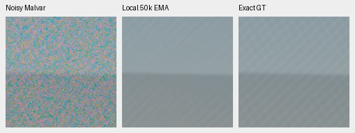
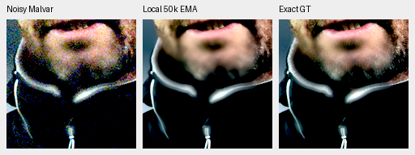
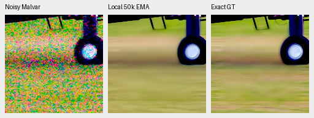
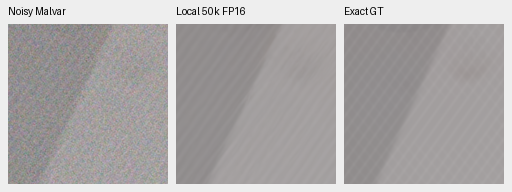
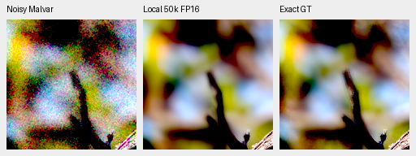

# Local-only 50k training and scoped quality review

The local-only arm completed **50,000 updates and 400,000 native
training queries**. The 50k EMA retains the 47.5k natural-photo
gains over Corpus 100k. Its fine-increment error is **1.111 DN16
lower** than Corpus 100k on 24 held-out ISO6400 photos and
0.008 DN16 higher than at 47.5k. On the wire panel it preserves
much of the flat-region benefit and still misses fine intersections
in the real cab fence.

[Training completion receipt](results/scene-full-epoch-v1/local-050000-training.json) ·
[Scoped results](results/local50000-scoped-v1/publication.json) ·
[Frozen drivers and receipts](results/local50000-scoped-v1/evidence.tar.xz) ·
[Native crop provenance](images/local50000-scoped-v1/manifest.json).

## Checkpoint and review status

The local-only run starts from Corpus 100k EMA
`87b96f3c487b9edaf1c477742b6c38f2a82cc6b20a94716d51cc8cf46a17a760`.
The final checkpoint SHA256 is
`62f4e9ce84075c8df1a254a1889033b5787133e8c98c63e0ec3d174a94734959`.
The stored raw and EMA states share that checkpoint file. The
loader explicitly evaluates EMA. The matched earlier local EMA is
`98b0c71988ff0c9540c9dd310b60cc324ef9642fc9d4c14c35d85b57522dba19`.
The general-reference V120 EMA is
`a9d9b6b4f974e24a6b11e5e740aab32314233a7f53c056cf37c7d2aac1c589fb`.

The frozen continuation uses two photo observations per update and
four 256-pixel queries per observation. It uses BF16 neural training,
AdamW, a 50,000-step cosine schedule, base and adapter learning
rates of `3e-6` and `1e-4`, and EMA `0.999`. The local arm uses
the local restoration route, with frozen DINO. The observation mix
sets the localized contrast fraction to 0.5 and the exact-flat
fraction to 0.25. The first pass visits all 90,692 eligible photos.
The second pass contains 9,308 distinct visits in the frozen
order, with 100,000 distinct noise seeds across both passes
combined. The retained training loop takes **24,213.00 s**.
[Full data and training recipe](scene-full-epoch.md).

Training is complete for both 50k arms. A scoped numerical and actual
native review is complete at this local-only EMA. The known/unseen
measured-camera panels score 54.22726/53.97844 dB. The common fixed
427-photo evaluation is running.
[Two-arm training audit](results/scene-full-epoch-v1/paired-prefix-050000.json) ·
[Fixed camera panels](scene-50000-cameras.md) ·
[Paired 47.5k review](green-covariance-refit.md) ·
[Comparable performance history](performance-history.md).

## Scoped exact-target results

The same 24 natural and 24 planted-wire backgrounds used in the
[blend study](local-band-mixture.md) are replayed unchanged.
The inputs, shot/read, 16-bit observation and native crop coordinates
are bound to the same receipts. Old numerical baselines use those
same observations and rendering policies. The 50k inference uses
CUDA IEEE FP32. For this scope the new exact-query forwards sum to
28.97 s and the standing forwards to 3.47 s. Those times are
separate from training.

| ISO6400 natural photos | Fine response | Increment RMS, DN16 | Fine-flat RMS, DN16 | Upper-flat RMS, DN16 |
| --- | ---: | ---: | ---: | ---: |
| V120 | 58.224% | 137.344 | 5.726 | 2.271 |
| Corpus 100k | 58.314% | 137.447 | 5.569 | 2.150 |
| Local-only 47.5k | 57.997% | 136.328 | 4.489 | 2.482 |
| Local-only 50k | 58.010% | 136.335 | 4.489 | 2.483 |

The ISO6400 fine-increment difference from Corpus 100k is −1.111
DN16 [−1.618, −0.546]. Fine-flat changes −1.080 DN16
[−2.262, −0.128], and upper-band flat RMS rises 0.333 DN16.
Mean fine response changes −0.304 points with an interval spanning
zero. The 47.5k-to-50k response change is +0.014 points
[+0.010, +0.018], with +0.008 DN16 of increment error.

| ISO6400 wire backgrounds | Weak response | Intact RMS, DN16 | Flat RMS, DN16 | Absolute gap RMS, DN16 |
| --- | ---: | ---: | ---: | ---: |
| V120 | 31.834% | 187.930 | 22.557 | 171.203 |
| Corpus 100k | 32.230% | 187.859 | 22.196 | 169.208 |
| Local-only 47.5k | 32.354% | 188.035 | 20.489 | 168.494 |
| Local-only 50k | 32.377% | 188.074 | 20.490 | 168.488 |

The 50k EMA gains 0.022 weak-response points and adds 0.039 DN16
intact error versus 47.5k. The continuing strong-wire component in
the twelve gaps falls 0.048 DN16 and weak-band gap error rises
0.003 DN16. Total gap error changes −0.006 DN16 with an interval
spanning zero. The absolute gap improvement versus V120 is 2.715
DN16. Relative to Corpus 100k the mean gap improvement is 0.719
DN16 with an interval spanning zero. Intervals resample photos.

## Native exact-target triplets

Each cell shows the same 160 × 160 native crop at
`[48,48,160,160]` in its query. The inputs use shot/read
`0.00128/6.5536e-6`, exposure ×0.33, 16-bit ADC and black level
0.03. The following triplets show the evaluated 50k EMA.

**Namib dune**, Daniel Kraft, CC BY-SA 3.0. BGGR, source box
`[338,100,512,512]`, query `[128,128,256,256]`, display ×2.
Absolute gap RMS falls 0.106 DN16 from 47.5k, the largest decrease
among the twelve gaps. The weaker wire direction stays soft.
[Source](https://commons.wikimedia.org/wiki/File:Dune_Namib_Naukluft_2.jpg) ·
[Comparison](images/local50000-scoped-v1/exact/04-wire-iso6400-comparison.png).

**Wiener Neustadt vs. Austria Klagenfurt**, Steindy, CC BY-SA 3.0.
GBRG, query `[142,246,256,256]`, display ×3.0303 and contrast ×2.
This is the largest of the small paired natural improvements. Fine
face detail in the shadow and fabric edges stay softer than the target.
[Source](https://commons.wikimedia.org/wiki/File:SC_Wiener_Neustadt_vs._SK_Austria_Klagenfurt_2015-10-20_(015).jpg) ·
[Comparison](images/local50000-scoped-v1/exact/38-natural-iso6400-comparison.png).

**Dornier Do 27 at Hahnweide**, Julian Herzog, CC BY 4.0. BGGR,
query `[446,282,256,256]`, display ×3.0303 and contrast ×2.
Fine-increment RMS increases 0.043 DN16 from 47.5k, the largest
natural increase. The field stays smooth and the tire edge holds.
[Source](https://commons.wikimedia.org/wiki/File:Dornier_Do-27A-4_D-EEPN_Hahnweide_2011.jpg) ·
[Comparison](images/local50000-scoped-v1/exact/33-natural-iso6400-comparison.png).

## Standing GFX100S comparisons

The full eight crop boards use the cached inputs, recorded raw
coordinates and identical transforms. Versus 47.5k, the main
DSCF3879 crops change 0.050–0.182 DN16 camera-RGB RMS and the
four cab crops change 0.054–0.066 DN16. The sky is smooth and
the coarse fence remains coherent. Fine building edges remain
soft. Both fine cab priors still show incomplete crossings and
some mottling. The transferred right diagonals are the clearest.
The ISO100 AHD and both cab JPEGs are qualitative references,
with differing aperture, exposure and subject motion.

DSCF3879 uses shot/read `0.00128/6.5536e-6` and display ×4.
DSCF3842 uses display ×16 with the nominal profile and the
transferred `0.0014635775921166604/1.0715704128646712e-6`.

[Sky](images/local50000-scoped-v1/standing/main-overcast-sky-main-overcast-sky.png) ·
[Building](images/local50000-scoped-v1/standing/main-building-detail-main-building-detail.png) ·
[Foliage](images/local50000-scoped-v1/standing/main-foliage-main-foliage.png) ·
[Coarse fence](images/local50000-scoped-v1/standing/main-chain-link-fence-main-chain-link-fence.png).

| Cab conditioning | Left ROI | Right ROI |
| --- | --- | --- |
| Nominal | [Native review](images/local50000-scoped-v1/standing/mesh-nominal-fine-green-mesh-left.png) | [Native review](images/local50000-scoped-v1/standing/mesh-nominal-fine-green-mesh-right.png) |
| Transferred | [Native review](images/local50000-scoped-v1/standing/mesh-profile3879-fine-green-mesh-left.png) | [Native review](images/local50000-scoped-v1/standing/mesh-profile3879-fine-green-mesh-right.png) |

## FP16 inference at fixed geometry

The same local 50k EMA ran in IEEE FP32 and standard FP16 autocast on
the GB10. Full-precision Bayer, camera transforms and the native RGB
output boundaries stay in place. Twelve interleaved timings of a
resident batch of four 512-pixel tiles give medians of **2,018.2 ms in
IEEE FP32 and 325.8 ms in FP16**, or a **6.19×** speedup
[5.52×, 7.15× across paired bootstrap draws]. This test repeats one
native RAW query across the batch with the same camera and shot/read
profile. RAW decode, tile packing and transfer, blending and TIFF
export are outside the measurement.
[Machine results](results/local50000-fp16-v1/publication.json) ·
[Frozen drivers and receipts](results/local50000-fp16-v1/evidence.tar.xz).

Across the same 24 natural and 24 wire contexts at ISO6400, the mean
shift in natural fine response is −0.0051 percentage points. The mean
shift in weak-wire response is −0.0096 points. Natural fine-increment
error changes by −0.0033 DN16, natural exact-flat fine RMS by +0.0066
DN16 and mean absolute error within the twelve true gaps by +0.0098
DN16. The largest camera-RGB difference in any 256-pixel natural
context is 0.822 DN16 RMS.

All eight native GFX crops were viewed side by side, with IEEE FP32 on
the left and FP16 on the right. Their RMS differences range from
0.049 to 0.154 DN16 in camera RGB. The sky stays smooth, and the
coarse lattice and fine cab retain the same visible crossings and
softness.
[Native comparison sheet](images/local50000-fp16-v1/standing.png) ·
[Corpus 100k full-frame FP16 benchmark](corpus100k-mixed-precision.md).

An 11-batch canonical excerpt checks shadows, ADC-only cases, highlights
across all four Bayer layouts, and two batches per measured-camera panel.
The largest absolute per-case PSNR shift is 0.01792 dB in the highlights
and 0.00294 dB on the camera crops. The most affected highlight batch
changes by 38.26 DN16 RMS and 424.08 DN16 at the largest camera-RGB
pixel difference. The excerpt uses the full panels' exact observations
and borders. The guarded follow-up completes the 102 MP restore and
repeats the four canonical highlight batches. The full FP16 photo
and camera panels remain open for this checkpoint.
[Canonical excerpt](results/local50000-fp16-v1/fixed-panel-excerpt.json) ·
[Frozen excerpt evidence](results/local50000-fp16-v1/fixed-panel-excerpt.tar.xz) ·
[Full-frame guarded precision](local50000-guarded-precision.md).

The FP16 wire and woodpecker triplets use the same targets, coordinates,
and display transforms as the scoped IEEE FP32 review. The wire ROI
is `[48,48,160,160]` in native query `[128,128,256,256]`, display ×2.
The woodpecker uses the same ROI in query `[14,320,256,256]`,
display ×3.03 and contrast ×2. Both use shot/read
`0.00128/6.5536e-6` and a 16-bit ADC. The modes show the same
softness around the faint diagonal and the foreground contour.
[Native crop provenance](images/local50000-fp16-v1/manifest.json).

