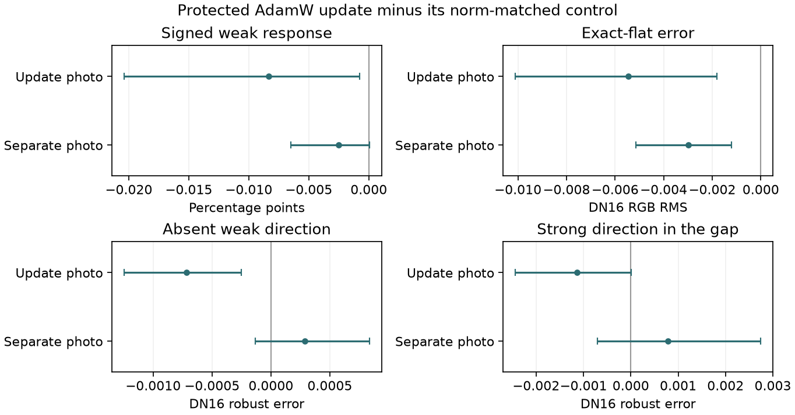

# Protecting flat and gap accuracy during a weak-detail AdamW update

The [regional training gradient audit](local-regional-wire-gradient-audit.md)
found that weak-detail supervision often opposed exact-flat and
absent-direction losses through shared weights. The completed
finite-step comparison finds that the correction lowers
exact-flat error on separate photos at matched update norm.
It also reduces weak response on the faintest half of those
photos. The gap gains on the update photos do not clearly carry over.
[Qualification and verified prefix](results/local-adam-protected-v1/launch.json) ·
[Frozen procedure and first eight pairs](results/local-adam-protected-v1/launch-evidence.tar.xz).

## Update comparison

Each replay starts from the raw regional 1,024-update checkpoint and
its AdamW state in
`bc633b61e30ac5bc708b7249c7885ca0c45591a2155882ba51ead94c97a6f445`.
The learning rate is the saved 7.5e−7. Training-side derivatives use
BF16 neural forwards and FP32 losses. The finite output comparison
uses IEEE FP32. All arms are evaluated before restoring the same raw
checkpoint for the next source.
[Parent checkpoint and native review](local-regional-wire-1024.md).

The shared step uses the original reconstruction, paired-band,
repeat, weak-absence and continuing-strand terms. The full step
adds the regional weak-response term. Both use the same saved
moments and clipping rule. Their parameter difference is the part
of the fused AdamW update attributable to weak-response supervision
for that step.

The protected variant projects that difference onto the set of
directions that have a nonpositive first-order change in the
update photo's exact-flat, weak-absence and strong-gap errors.
It makes the smallest Euclidean correction under those constraints.
The norm-matched control scales the original difference to approximately
the same realized size. Every variant preserves the shared step.
The evaluation measures both the rounded weight changes and the
finite loss on each photo.

There are 64 distinct approved source photos outside the earlier
continuation schedules and frozen comparison panels. Within each
pair, the update and separate evaluation photos share the nominal
noise regime, Bayer layout, coupling law and strong-continuation
status. Their backgrounds, wire geometry and sensor draws differ.
Neither protected GFX capture family enters the probe. The separate
photos measure transfer from a single update. They are held out of
the per-step gradients and projection.

## Verified implementation

The active-set calculation agrees with an independent constrained
solve on 240 problems, including repeated and opposed constraints.
In the first source pair, both shared and full functional replays
exactly reproduce PyTorch fused AdamW's 89 updated parameter
tensors, both moment tensors per parameter and optimizer clocks.
All 32 pairs have finite post-update outputs. The projection activates
on 31 update photos and retains 99.976% of the full weak increment's
L2 norm on average after FP32 rounding. The realized norms of the
projected and scaled increments differ by at most 0.107% of the full
increment norm. No protected first-order slope exceeds +0.005 after
normalizing by the control-gradient and original-increment norms.
The complete one-step replay takes 925.19 seconds wall while the
canonical photo workers share the GPU.

## Finite results on the update and separate photos

Adding the unmodified regional weak term to the shared update raises
weak response by 0.01895 percentage points on the update photos
and 0.00123 points on the separate photos. The separate-photo
95% interval is [+0.00005, +0.00292] points. Projection reduces
that response at nearly unchanged update norm. For the main
comparison below, a positive signed response difference means
more of the known weak signal. Lower values are favorable for
the other three measures.

| Protected minus norm-matched control | Update photo mean (95% CI) | Separate photo mean (95% CI) |
| --- | ---: | ---: |
| Signed weak response, points | −0.00834 [−0.02041, −0.00075] | −0.00249 [−0.00652, +0.00006] |
| Exact-flat camera-RGB RMS, DN16 | −0.00546 [−0.01011, −0.00180] | −0.00299 [−0.00513, −0.00120] |
| Absent weak-direction error, DN16 | −0.00071 [−0.00125, −0.00025] | +0.00029 [−0.00013, +0.00084] |
| Strong-direction gap error, DN16 | −0.00114 [−0.00244, +0.00001] | +0.00079 [−0.00071, +0.00275] |

The intervals use 8,000 paired source resamples. One separate
photo has no valid signed weak target and contributes to the
other three measures. The gap error measures are the robust
projection losses expressed in DN16.

Flat RMS is lower on 23 of 32 separate photos. Dropping any one
source leaves the mean change below zero. On the 16 separate
photos with the lowest planted weak amplitudes, flat RMS falls
0.00382 DN16 [−0.00774, −0.00080] and weak response falls
0.00500 points [−0.01227, −0.00026]. Both gap intervals still
span zero in that subset. The finite test supports a small flat
benefit across photos. It does not establish better weak-detail
reconstruction, and the weaker response remains a concern for
any cumulative training comparison.

[Machine summary](results/local-adam-protected-v1/publication.json) ·
[All 32 matched source pairs and replay code](results/local-adam-protected-v1/evidence.tar.xz).
