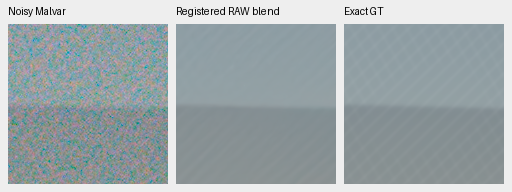
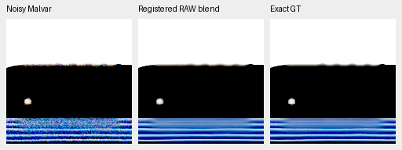

# Combining the local 47.5k model with Corpus 100k by frequency

On 24 new ISO6400 wire backgrounds, the RAW-gated blend lowers intact
increment error by **0.571 DN16** versus local-only 47.5k. It also
lowers error on the strong wire inside true gaps by **0.480 DN16**.
Exact-flat luma variation rises, and the fine-band wire response
barely changes. On a separate 24-photo panel most of the local
model's natural detail error reduction carries through. Both real
fence reviews still show incomplete fine cab crossings.

[Machine results](results/local-band-mixture-v1/publication.json) ·
[Frozen drivers and receipts](results/local-band-mixture-v1/evidence.tar.xz) ·
[Native crop provenance](images/local-band-mixture-v1/manifest.json).

## Fit and controls

The two frozen weights are local-only 47.5k EMA
`98b0c71988ff0c9540c9dd310b60cc324ef9642fc9d4c14c35d85b57522dba19`
and its starting Corpus 100k EMA
`87b96f3c487b9edaf1c477742b6c38f2a82cc6b20a94716d51cc8cf46a17a760`.
V120 EMA
`a9d9b6b4f974e24a6b11e5e740aab32314233a7f53c056cf37c7d2aac1c589fb`
is the general-reference control. All image predictions use CUDA
IEEE FP32. The experimental fit changes blend coefficients. Both
neural forwards are required. [Parent and 47.5k evaluations](green-covariance-refit.md).

The local model supplies the base. The low band of the Corpus–local
difference carries RGB. The fine band carries neutral luminance.
A radial transition splits the low and fine contributions at
0.105–0.132 cycles per native pixel. The fine contribution rolls
off at 0.295–0.342. The registered arm partitions each band using
the peak and jointly supported perpendicular directions from the
phase-aligned green power estimate. Its three empirical weights
sum to one at every pixel. They describe local RAW measurements of
directionality. The estimator also gives nonzero weights on some
noisy flats. The gated correction is filtered again before boundary
tapering. Summing the three fields recovers the ungated band to
within `1.2e-10` in camera RGB on the audited observation.

The 48 photographs from the previous 47.5k study form the development
set. Four methods share a constrained objective with 75% weight on
normalized intact-wire increment MSE and 25% on natural fine
increment MSE. Nine limits cover wire and photo flats, chroma,
natural fine error and absolute, strong, weak and exterior-only
gap error. Response must stay above the lower of the two parents'
mean responses in each development panel. All four fits choose zero
correction when these error limits equal the local-only values. A
second fit can spend a quarter of any error reduction the local
checkpoint gained versus Corpus 100k.

| Budgeted arm | Low coefficients | Fine coefficients |
| --- | --- | --- |
| Uniform blend | Whole-RGB coefficient 0.269510 | Same coefficient at all frequencies |
| Ungated subband | 0.343068 | 0 |
| Registered RAW blend | 0.105775 / 1.000000 / 0.188301 | 0 / 0 / 0 |
| Flipped RAW blend | 0.211075 / 0.756908 / 0.196912 | 0 / 0.031427 / 0 |

The three coefficients are for low measured support, one dominant
family and perpendicular support respectively. Confirmation uses
24 wire backgrounds and 24 new natural backgrounds outside the
development set, full427 and the scene training manifest. Source IDs
and cache hashes were also checked against 559,808 recorded
Corpus 100k training visits. Twelve wire cases have exact gaps.
Each role uses a new independent draw at ISO6400. The identical
plant geometry distributions allow matched comparisons with the
earlier 47.5k test. Only the background photographs, camera draws
and sensor noise change.

## Fresh results

| ISO6400 wire panel | Weak response | Intact RMS, DN16 | Exact-flat RMS, DN16 | Absolute gap RMS, DN16 |
| --- | ---: | ---: | ---: | ---: |
| V120 | 31.834% | 187.930 | 22.557 | 171.203 |
| Corpus 100k | 32.230% | 187.859 | 22.196 | 169.208 |
| Local-only 47.5k | 32.354% | 188.035 | 20.489 | 168.494 |
| Uniform blend | 32.321% | 187.712 | 20.753 | 168.334 |
| Ungated subband | 32.326% | 187.626 | 20.953 | 168.349 |
| Registered RAW blend | 32.302% | 187.464 | 20.946 | 168.400 |
| Flipped RAW blend | 32.301% | 187.556 | 20.973 | 168.395 |

The registered blend improves intact error **0.571 DN16**
[0.269, 0.899] versus local-only. The continuing strong component
inside gaps improves 0.480 DN16 [0.103, 0.881], and the weak-gap
component rises 0.079 DN16 with an interval spanning zero.
Total gap error falls 0.093 DN16 [−0.505, +0.664]. Exact-flat
luma RMS rises 0.457 DN16 while flat chroma RMS falls 0.501.
In the separate 1/8–1/3 wire-query band, increment error rises
0.035 DN16 [−0.015, +0.083] and response changes +0.001 points
[−0.121, +0.120]. The improvement lies predominantly below that
fine band.

An exploratory alignment check applies the registered coefficients
to the flipped RAW fields, holding the coefficients fixed. The
registered and flipped fields add 7.826 and 8.026 DN16 of luma
RMS. Registration lowers intact error by 0.058 DN16
[−0.037, +0.154] and continuing strong-wire error by 0.060 DN16
[−0.002, +0.131]. The available wire set gives limited evidence
for a gain from alignment itself.

| ISO6400 natural panel | Fine response | Fine-increment RMS, DN16 | Exact-flat fine RMS, DN16 | Flat chroma RMS, DN16 |
| --- | ---: | ---: | ---: | ---: |
| V120 | 58.224% | 137.344 | 5.726 | 34.852 |
| Corpus 100k | 58.314% | 137.447 | 5.569 | 34.263 |
| Local-only 47.5k | 57.997% | 136.328 | 4.489 | 32.498 |
| Uniform blend | 58.082% | 136.535 | 4.618 | 32.623 |
| Ungated subband | 58.012% | 136.352 | 4.559 | 32.727 |
| Registered RAW blend | 58.020% | 136.360 | 4.580 | 32.770 |
| Flipped RAW blend | 58.017% | 136.357 | 4.563 | 32.726 |

The registered blend keeps most of the local-only natural gain over
Corpus 100k. Fine-increment error rises 0.032 DN16 versus local 47.5k
and remains 1.087 DN16 lower than Corpus 100k. Exact-flat fine error
rises 0.091 DN16 versus local 47.5k and remains 0.989 DN16 lower than
Corpus 100k. Higher-band exact-flat RMS is 2.482 DN16 for local-only
and 2.483 for the registered blend, versus 2.150 for Corpus
100k. That difference remains a quality cost. This scoped component
review adds no full427 or measured-camera PSNR result.
[Comparable model history](performance-history.md).

## Native exact-target triplets

Each cell contains the same 160 × 160 native pixels at
`[48,48,160,160]` within its query. The camera simulation uses shot/read
`0.00128/6.5536e-6`, capture ×0.33, 16-bit ADC and black level 0.03.
Every column shares the display transform.

**Namib dune**, Daniel Kraft, CC BY-SA 3.0. BGGR, source box
`[338,100,512,512]`, query `[128,128,256,256]`, display ×2.
This constructed field has the largest intact-error reduction among
the twelve exact-gap captures. It gains 2.307 DN16. The weak diagonals
remain soft and the interruption remains harder to see than in the target.
[Source](https://commons.wikimedia.org/wiki/File:Dune_Namib_Naukluft_2.jpg) ·
[All methods](images/local-band-mixture-v1/exact/04-wire-iso6400-comparison.png).

**Mach3 razor cartridge**, Crisco 1492, CC BY-SA 4.0. RGGB, query
`[232,28,256,256]`, display ×3.0303 and contrast ×2.
Fine-increment RMS rises 0.145 DN16, the largest natural regression
against local-only on this panel. The narrow grooves and isolated
light dot look similar across the blends.
[Source](https://commons.wikimedia.org/wiki/File:Cartridge_for_Gillette_Mach3_razor,_2015-08-03.jpg) ·
[All methods](images/local-band-mixture-v1/exact/29-natural-iso6400-comparison.png).

## Standing GFX100S comparisons

All eight boards were viewed. The sky stays smooth and the coarse fence
crossings stay coherent. Foliage edges and building wires remain soft.
The main crops change 0.792–2.568 DN16 camera-RGB RMS versus local-only
47.5k. The four fine cab crops change 2.301–2.726 DN16. Transferred
conditioning shows the clearest right diagonals, with incomplete
intersections and background mottling. The ISO100 AHD and camera JPEG
comparison images are qualitative references with aperture, exposure
and motion differences.

The main capture uses shot/read `0.00128/6.5536e-6` and display ×4.
The fine cab views use display ×16 and either the nominal prior
or transferred `0.0014635775921166604/1.0715704128646712e-6`.

[Sky](images/local-band-mixture-v1/standing/main-overcast-sky-main-overcast-sky.png) ·
[Building](images/local-band-mixture-v1/standing/main-building-detail-main-building-detail.png) ·
[Foliage](images/local-band-mixture-v1/standing/main-foliage-main-foliage.png) ·
[Coarse fence](images/local-band-mixture-v1/standing/main-chain-link-fence-main-chain-link-fence.png).

| Cab conditioning | Left ROI | Right ROI |
| --- | --- | --- |
| Nominal | [Native board](images/local-band-mixture-v1/standing/mesh-nominal-fine-green-mesh-left.png) | [Native board](images/local-band-mixture-v1/standing/mesh-nominal-fine-green-mesh-right.png) |
| Transferred | [Native board](images/local-band-mixture-v1/standing/mesh-profile3879-fine-green-mesh-left.png) | [Native board](images/local-band-mixture-v1/standing/mesh-profile3879-fine-green-mesh-right.png) |
