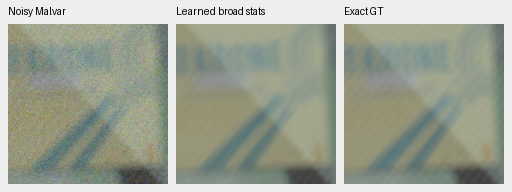
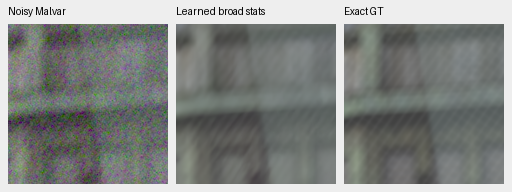

# Learning gains for Bayer-supported detail

A small learned gain boosts both weak-strand recovery and
continuing-strand accuracy at nominal strength. At comparable
weak recovery, the learned gain **raises continuing-strand RMS
by 6.25 DN16** versus the [fixed combined check](local-nested-support.md).
Giving it additional broad-window statistics has little effect
on the held-out wire errors. It reaches the amplitude cap for
4,016 of 4,612 accepted directions in the intact wire crops.
The real right-cab grid becomes more visible and more regular.
Incomplete fine crossings and background mottle remain.

## Model and matched training

Both 409-parameter heads modify the same Local 50k EMA
(`62f4e9ce84075c8df1a254a1889033b5787133e8c98c63e0ec3d174a94734959`).
The four exterior donor patches nominate the two directions.
Both the broad and center Bayer checks must admit a proposal.
Its sign, phase and maximum amplitude come from the same RAW fit
for both heads. The network can only vary each admitted waveform's
gain between zero and the measured amplitude cap. Overlap and
neutral linear-RGB delivery use the fixed combined check's
tapers. An output audit recreates that fixed check from the
same capped waveforms.

The center-statistics arm receives the paired 32-pixel held
scores, local activity and noise, carrier geometry and the
amplitude and phase relation between the common broad fit
and the parent. The broad-statistics arm also sees the paired
64-pixel held scores, green-lattice phase and amplitude
agreement, outside activity and the center-to-surround level
difference. Both start from the exact fixed gain and share the
same layer shapes, initial tensors and training sequence.

Six roles per source cover both wires, strong-only, flat core,
edge-only, uniform and the unplanted source photograph. They
share outer RAW context, with a separate marginal sensor draw
for each recipient. The source inventory supplies 192 training
and 24 separate internal qualification photographs. They come
from the approved Wikimedia training split, with the component
evaluation sources and protected capture families excluded.
The trained copies span σ 0, 0.55 and 0.85 native-pixel blur,
two noise profiles and all four Bayer layouts. The selected
periods are 6.8–10.3 pixels. There are 1,152 distinct training
crops, 27,648 crop presentations and 192 AdamW updates per head.
No component parameter receives pixels from the evaluation
cohort.

The exact loss is the luma MSE of the delivered crop, with an
additional penalty of weight 0.025 on squared luma distance
from the fixed correction. To retain overlapping-patch
interactions, the collector stores the Gram matrix of the
tapered basis waves and their dot product with the exact error
of the parent. The smoke run and periodic collector audits reproduce the
loss on actual rendered crops from those terms. Parent inference and data
preparation take 170.26 s for the full pass, which reuses the
eight smoke records. The two fits take 1.85 s wall in CPU FP32.
All endpoint reviews compose the small CPU FP32 EMA head with
the frozen CUDA IEEE FP32 Local 50k EMA. The fixed optical and
GFX replay takes 20.68 s CPU using saved parent predictions.

| Head | Updates | Raw and EMA checkpoint SHA256 |
| --- | ---: | --- |
| Center statistics | 192 | `de6a2cf3cdca569c6f93c58165a3ef72a95050f163332bf68acc7ebf255e63c8` |
| Broad statistics | 192 | `b9d735a6f6584f90f0c90f6703ca6c7c295c62d568ac18715fec50df6d1906bb` |

The archive contains each original checkpoint with raw and EMA
state dictionaries, the training trace, the source selection
and the loss-data hashes. [Training and evaluation receipts](results/local-bayer-gain-v1/evidence.tar.xz).

## Exact optical replay

The test reuses the 32 held-out sources and two independent
draws per source from the [combined support study](local-nested-support.md).
Sixteen sources contain hard gaps in the weak strand.
The reference includes the σ 0.85 pre-Bayer blur.
Every arm sees the same noisy recipient and donors. The target
projection uses exact support, with optical spill excluded from
the gaps.

| Nominal change versus Local 50k | Fixed combined | Learned center | Learned broad | V120 |
| --- | ---: | ---: | ---: | ---: |
| Weak response, percentage points of sharp target | +1.569 | +4.355 | +4.357 | −0.393 |
| Intact fundamental RMS, DN16 | −1.245 | −3.262 | −3.263 | +0.209 |
| Continuing-strand RMS in true gaps, DN16 | −22.077 | −28.879 | −28.875 | +6.339 |
| False weak projection in true gaps, DN16 | +0.016 | +0.039 | +0.037 | +0.034 |
| Exact-flat core RMS, DN16 | +0.003 | +0.045 | +0.045 | +2.065 |

Learned broad versus fixed is +2.787 weak-response points
[+1.879, +3.745] and −6.798 DN16 continuing-strand RMS
[−9.898, −3.860]. False weak projection differs by +0.021 DN16
[−0.021, +0.076]. The edge-only and wholly uniform recipient
outputs are identical to Local 50k. The broad and center heads
differ by +0.002 weak-response points [−0.002, +0.005] and
+0.005 DN16 continuing-strand error [−0.060, +0.063]. Intervals
are from paired source resampling after averaging the draws.

The response match sets the fixed blend at 0.500 and the broad
learned blend at 0.1713, using 32 earlier optical sources.
The separate 32-source replay then has a weak-response difference
of −0.038 points [−0.200, +0.091]. Continuing-strand RMS rises
**6.252 DN16** [4.249, 8.381] under the learned blend. The center
head gives nearly the same tradeoff. The false weak difference
spans zero for both.

### Gains at the cap

The learned center and broad heads reach their amplitude caps in
94.6% and 87.1% of the 4,612 admitted direction windows across
the two draws of the intact-wire role. Applying the full cap
to every admitted direction recovers another 0.189 points
[0.129, 0.253] beyond the broad head and adds 0.011 DN16 false
weak projection [0.0003, 0.0280]. Thus much of the gain comes
from increasing the permitted amplitude. The broad head trades
a small amount of that response for lower false gap projection.

An exact-target diagnostic selects separate bounded gains
in each held-out crop to minimize actual luma MSE with the
same basis and overlap. All 194 nonempty problems converge.
Relative to learned broad, it reduces false weak projection
by 0.047 DN16 [0.009, 0.101] and loses 0.152 weak-response
points [0.006, 0.316]. Its continuing-strand RMS difference
is +0.990 DN16 [−0.078, +2.051]. This calculation uses the
held-out clean target to measure what that objective prefers.

### Ordinary photo check

A new RAW draw from each of those 32 unplanted photos gives
zero nominated pairs when the donors come from the same scene.
With the same noisy recipients and parent outputs under the
planted exterior, 25 photos have an admitted carrier. The largest
RGB correction RMS rises from 2.55 DN16 for the fixed check to
4.69 DN16 for each learned head. The broad head increases mean
luma RMS versus Local 50k by 0.012 DN16 in that
deliberate context mismatch. The ordinary and mismatched
contexts share exact targets, exposure, camera, noise and
query samples.

## Native exact comparisons

Both triplets are noisy Malvar, the composed broad-statistics
EMA and exact post-optical ground truth. Each native 160 × 160
panel uses ROI `(48,48,160,160)` in the 256-pixel query at
`(128,128)`, the first noise draw, BGGR, exposure 0.33, shot/read
`0.00128 / 6.5536e-6`, black 0.03, and ×2 scene-linear display
followed by sRGB. The faint diagonal is more visible in the
restorations, with the crossings softer than the reference.

GT1976's Austrian baler photo, bin-four crop
`(410,44,512,512)`, adapted by binning, planting wires and
simulating optics and sensor noise.
[Original](https://commons.wikimedia.org/wiki/File:2019-06-04_%28204%29_Baler_Krone_R_10-16_in_Wilhersdorf%2C_St._Margarethen_an_der_Sierning%2C_Austria.jpg) ·
[CC BY-SA 4.0](https://creativecommons.org/licenses/by-sa/4.0/) ·
[All controls](assets/local-bayer-gain-v1/nested-01-comparison.png).

High Contrast's Munich customs office photo, bin-four crop
`(46,0,512,512)`, with the same adaptation. The larger dark
diagonal is clear and the second slope remains weaker than in
the exact target.
[Original](https://commons.wikimedia.org/wiki/File:Glaskuppel_des_Hauptzollamts_M%C3%BCnchen.jpg) ·
[CC BY 3.0 DE](https://creativecommons.org/licenses/by/3.0/de/deed.en) ·
[All controls](assets/local-bayer-gain-v1/nested-09-comparison.png).

## Standing GFX100S comparisons

The DSCF3879 ISO6400 crops use 512-pixel contexts, shot/read
`0.00128 / 6.5536e-6`, and ×4 display. Sky, building and foliage
match Local 50k exactly. The learned broad head changes the
coarse-fence crop by 6.16 DN16 RGB RMS versus Local 50k, compared
with 9.78 for the fixed check. Coarse crossings and the green
speck stay visible. DSCF3880 ISO100 AHD is an independently
demosaiced qualitative reference.
[Sky](assets/local-bayer-gain-v1/main-overcast-sky-main-overcast-sky-x4.png) ·
[Building](assets/local-bayer-gain-v1/main-building-detail-main-building-detail-x4.png) ·
[Foliage](assets/local-bayer-gain-v1/main-foliage-main-foliage-x4.png) ·
[Coarse fence](assets/local-bayer-gain-v1/main-chain-link-fence-main-chain-link-fence-x4.png).

The DSCF3842 ISO6400 views use 768-pixel contexts and the nominal
profile or the transferred DSCF3879 shot/read
`0.0014635775921166604 / 1.0715704128646712e-6`. All boards show
DSCF3835 ISO100 AHD and both straight-out-of-camera JPEGs.
The references differ in aperture, exposure time and motion.
At ×16 the stronger learned gain darkens the diagonal troughs
on the right and adds regularity over the green-gray mottle.
The left gains stronger fragments around the post and below
the horizontal strand. Both crops still have missing crossings.
The learned arms look very close, with no clear extra chroma
fringing between them.

| GFX native 160 × 160 crop | Nominal | Transferred prior |
| --- | --- | --- |
| Left `(806,6489)` | [×4](assets/local-bayer-gain-v1/mesh-nominal-fine-green-mesh-left-x4.png) · [×16](assets/local-bayer-gain-v1/mesh-nominal-fine-green-mesh-left-x16.png) | [×4](assets/local-bayer-gain-v1/mesh-profile3879-fine-green-mesh-left-x4.png) · [×16](assets/local-bayer-gain-v1/mesh-profile3879-fine-green-mesh-left-x16.png) |
| Right `(1026,6449)` | [×4](assets/local-bayer-gain-v1/mesh-nominal-fine-green-mesh-right-x4.png) · [×16](assets/local-bayer-gain-v1/mesh-nominal-fine-green-mesh-right-x16.png) | [×4](assets/local-bayer-gain-v1/mesh-profile3879-fine-green-mesh-right-x4.png) · [×16](assets/local-bayer-gain-v1/mesh-profile3879-fine-green-mesh-right-x16.png) |

Both training endpoints, exact replays and native reviews are
complete. The fixed 427-photo and measured-camera panels do
not cover these targeted components.
[Scores, basis audit and figure hashes](results/local-bayer-gain-v1/publication.json) ·
[Source, training trace and checkpoint files](results/local-bayer-gain-v1/evidence.tar.xz).
