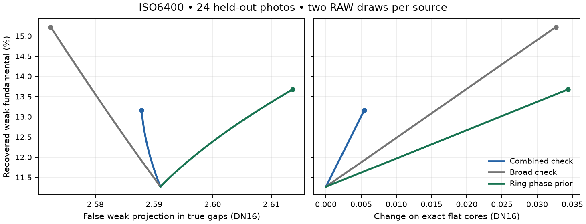
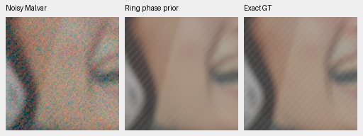
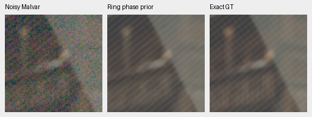

# A ring phase prior for weak Bayer detail

Estimating local support for zero, one or two wire directions gives a new opt-in crop restoration. Against the [combined broad and central check](local-nested-support.md), it gains **0.573 weak-response points** on the retained ISO6400 panel and **0.506 points** on 24 source-disjoint photos. The fresh interval spans zero, and faint projection into true gaps rises **0.026 DN16**. On the real right cab, one family becomes more visible in places while the second remains uneven. The sky and coarse fence retain their appearance.

## Separate discovery, context and delivery

All methods use the existing four 128-pixel Bayer frequency donors. On the photographic panel those start outside the 256-pixel query. For each 64-pixel fit window, the ring excludes its central 32×32 pixels. It estimates two signed quadratures per direction from the two native green lattices, each with its own smooth nuisance fit. The squared coefficient norm is reduced by its estimated noise energy. The result supplies a prior mean. The prior deviation is 0.00065 plus 0.60 times that estimated amplitude, in normalized sensor units.

The center fits a separate nuisance and compares four models using the same two green lattices. The models contain zero directions, either direction on its own, or both. The score integrates the continuous carrier coefficients under the Gaussian prior. The fit averages the four resulting conditional predictions. Each direction's delivered correction subtracts the corresponding parent projection, caps the change by the measured local amplitude, and ramps to zero below a model inclusion weight of 0.20. Native overlap, neutral camera-RGB transport and the 0.73 taper strength are shared.

The center-only control uses a zero-mean fixed prior. The ring-power control uses the ring-derived deviation with a zero mean. The ring-phase arm also passes the measured mean. Posterior weights are conditional model scores under a simplified noise/nuisance model. Both green lattices inside the center contribute evidence and coefficient estimates. The ring prior is disjoint from the current center, and the scores are empirical for the full selection procedure. Replacing all central samples preserves each ring fit bit for bit across all four Bayer layouts.

A 32-photo calibration compares four prior log-odds values and three inclusion cutoffs per prior family. It picks the largest weak response within the combined check's limits for flat RMS, added flat RMS and false weak projection. The selected ring-phase setting uses log-odds −6 per direction and cutoff 0.20, with full correction strength. Every untruncated policy exceeds the combined check's exact-zero mean added-flat result at each nonzero calibration strength. The cutoff suppresses that low-level spill on the calibration panel.

## ISO6400 optical comparisons

The 32 retained photos and 24 fresh photos use two independent input draws per source. The fresh set spans four CFA layouts, four geometries and six roles, including a strong-only view, flat core, edge-only view and uniform field. Source IDs and cache hashes were checked against earlier test sets and 559,808 recorded photographic training visits. Conditions are shot/read `0.00128 / 6.5536e-6`, exposure 0.33, black offset 0.03, σ 0.85 pre-Bayer blur and 16-bit ADC. The Local 50k and V120 EMA parent predictions use CUDA IEEE FP32. The metrics score the planted weak fundamental using the sharp target for response normalization and the post-optics target for errors.

| Fresh scene arm | Weak response | Intact weak RMS (DN16) | Continuing strong strand in true gaps (DN16) | False weak projection (DN16) |
| --- | ---: | ---: | ---: | ---: |
| Local 50k EMA | 11.269% | 46.065 | 82.372 | 2.591 |
| Broad check | 15.224% | 42.941 | 51.170 | 2.572 |
| Combined check | 13.169% | 44.528 | 59.576 | 2.588 |
| Center-only posterior | 12.304% | 45.186 | 67.590 | 2.602 |
| Ring power prior | 12.261% | 45.220 | 63.295 | 2.613 |
| Ring phase prior | **13.676%** | **44.081** | **57.744** | 2.614 |

At nominal strength, the ring-phase arm's fresh gain versus combined is **+0.506 points** `[−0.049, +1.090]` and the continuing-strand difference is **−1.831 DN16** `[−4.415, +0.558]`. Its false weak projection rises **0.026 DN16** `[+0.003, +0.049]`. The retained results are +0.573 points `[+0.114, +1.107]` and −2.747 DN16 `[−4.571, −1.090]` on the continuing strand, with +0.014 DN16 false projection `[−0.022, +0.051]`. Bootstrap intervals average both draws within a source and resample by geometry family.

Both combined and ring-phase deliver exact parent pixels on all 48 fresh edge-only crops. The ring changes two flat-core crops, by at most 0.903 DN16 RMS, versus three and 0.229 DN16 for combined. Each changes one completely uniform crop, with 0.966 DN16 for ring phase and 0.036 DN16 for combined. Broad recovers more of the weak direction and changes five flat-core crops, with up to 0.987 DN16 on those crops.

Scaling the ring arm to 0.720 of its nominal correction matches the combined arm's response on the earlier 32 calibration photos. At that locked scale, the fresh response difference is −0.167 points `[−0.624, +0.263]` and continuing-strand error **rises 4.353 DN16** `[+1.831, +7.093]`. The nominal advantage does not hold at matched response. The broad check also loses its continuing-strand advantage when scaled to the same calibration response.

### Where the gain stops

The retained donor search finds all 64 pairs. The fresh search finds 46/48, with median weak-frequency error 0.089 bins on the 128-pixel donor grid. Supplying the exact planted frequencies raises fresh weak response **0.021 points** for the ring arm, **0.037** for combined and **0.058** for broad. This diagnostic changes only the proposed frequencies. The remaining attenuation on these fixtures is mostly in local estimation and delivery.

## Native exact comparisons

Both triplets are 160×160 native pixels at `[48,48,160,160]` in the `[128,128,256,256]` query. Both use the first BGGR draw, the ISO6400 conditioning above and display exposure ×2 followed by sRGB. The restoration composes the ring-phase option with Local 50k EMA SHA256 `62f4e9ce84075c8df1a254a1889033b5787133e8c98c63e0ec3d174a94734959`. Exact GT is clean after optics and before Bayer sampling. The ring result strengthens some faint stripes in both views. The added crossing family remains well below the target in much of each crop.

The strip uses Steffen Prößdorf's Oberhof photograph at bin-four crop `[42,138,512,512]`, adapted by binning, planting the weak texture and simulating optics and RAW noise. [All methods](assets/local-bayer-presence-v1/presence-01-comparison.png) · [Source](https://commons.wikimedia.org/wiki/File:2022-03-13_Wintersport,_Skisprung-Weltcup_der_Frauen_in_Oberhof_1DX_7218_by_Stepro.jpg) · [CC BY-SA 4.0](https://creativecommons.org/licenses/by-sa/4.0).

The ellipse uses Eric Gaba's Maison Pfister photograph at bin-four crop `[96,328,512,512]` with the same adaptation. [All methods](assets/local-bayer-presence-v1/presence-09-comparison.png) · [Source](https://commons.wikimedia.org/wiki/File:Maison_Pfister_Colmar_2011-04.jpg) · [CC BY-SA 3.0](https://creativecommons.org/licenses/by-sa/3.0).

## Standing GFX100S comparisons

The ring-phase fit returns Local 50k on sky, building and foliage and keeps connected coarse-fence crossings. The coarse fence changes 6.82 DN16 RGB RMS versus the combined check. The left cab shows fainter, patchier changes than the combined fit at nominal conditioning. On the right, one diagonal is more pronounced through parts of the crop. The companion orientation is less continuous than the delivered texture suggests. The transferred prior retains a more visible grid, with incomplete crossings and broad green-gray mottle. The neutral correction introduces no visible new periodic chroma. The stronger diagonal alone is insufficient evidence of a more faithful lattice.

The parent is Local 50k EMA above, with V120 EMA SHA256 `a9d9b6b4f974e24a6b11e5e740aab32314233a7f53c056cf37c7d2aac1c589fb` as the general comparison. The nominals use shot/read `0.00128 / 6.5536e-6`. The transferred cab uses `0.0014635775921166604 / 1.0715704128646712e-6`. The DSCF3880 and DSCF3835 ISO100 AHD views and both cab JPEGs are separate qualitative references. Native coordinates, conditioning and exposure are recorded in the manifest.

| Capture and prior | Boards |
| --- | --- |
| DSCF3879 nominal ×4 | [Sky](assets/local-bayer-presence-v1/main-overcast-sky-main-overcast-sky-x4.png) · [Building](assets/local-bayer-presence-v1/main-building-detail-main-building-detail-x4.png) · [Foliage](assets/local-bayer-presence-v1/main-foliage-main-foliage-x4.png) · [Coarse fence](assets/local-bayer-presence-v1/main-chain-link-fence-main-chain-link-fence-x4.png) |
| DSCF3842 nominal | [Left ×4](assets/local-bayer-presence-v1/mesh-nominal-fine-green-mesh-left-x4.png) · [Right ×4](assets/local-bayer-presence-v1/mesh-nominal-fine-green-mesh-right-x4.png) · [Left ×16](assets/local-bayer-presence-v1/mesh-nominal-fine-green-mesh-left-x16.png) · [Right ×16](assets/local-bayer-presence-v1/mesh-nominal-fine-green-mesh-right-x16.png) |
| DSCF3842 transferred | [Left ×4](assets/local-bayer-presence-v1/mesh-profile3879-fine-green-mesh-left-x4.png) · [Right ×4](assets/local-bayer-presence-v1/mesh-profile3879-fine-green-mesh-right-x4.png) · [Left ×16](assets/local-bayer-presence-v1/mesh-profile3879-fine-green-mesh-left-x16.png) · [Right ×16](assets/local-bayer-presence-v1/mesh-profile3879-fine-green-mesh-right-x16.png) |

## Use the crop option

Call `demosaic.mesh_carrier_fit.refine_raw_mesh_carriers` with `method="ring-posterior"`. Pass the native 160×160 parent crop, its coordinates in the packed RAW scene, Bayer colors, shot/read and camera color transform. The method reads the surrounding RAW and defaults to a 16-pixel donor clearance. The parent-side projection uses the supplied crop. It takes no `parent_context` argument value. The standard inference recommendation is V120 Small.

The packaged path reproduces all **288** frozen fresh-role crop results and **eight** standing RAW results bit for bit. The median single-thread CPU crop time on GB10 is **10.62 ms** on the fresh panel at 48-pixel clearance. It includes donor nomination and fitting after the parent forward. The assets were inspected at native resolution. This inference-only replay uses frozen EMAs. The fixed 427-photo and known/unseen camera panels are outside this crop component study.

[Paired metrics](results/local-bayer-presence-v1/summary.json) · [Native manifest](assets/local-bayer-presence-v1/manifest.json) · [Publication hashes](results/local-bayer-presence-v1/publication.json) · [Frozen sources and receipts](results/local-bayer-presence-v1/evidence.tar.xz).
