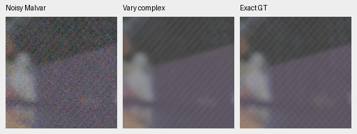
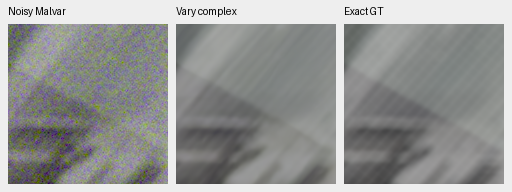

# Held Bayer checks for spatially varying wire phase

Allowing the amplitude and phase to vary within a measurement
window recovers **0.183 more weak-response points** than the
[fixed combined check](local-nested-support.md) on the warped
test fields. The gain falls to 0.017 points with amplitude
slopes alone. At comparable weak recovery the complex fit
raises continuing-strand error by **1.509 DN16**. It changes
only a few windows in the nominal fine cab crops. Fine
crossings remain incomplete.

## The varying fit

Both the fixed and varying fits use the same two directions
nominated from four 128-pixel RAW donors. The broad 64-pixel
fit estimates sine and cosine coefficients on one green lattice
with low-order cosine terms and the other planar direction
as nuisance predictors. The two complex slopes add one pair of
coefficients for each native image axis. The constant terms use
the ordinary least-squares penalty of zero. The slopes use a
ridge equal to 0.35 times their mean diagonal Gram value.
The amplitude variant restricts the slopes to the planar
coefficient's direction in sine/cosine space.

The other green lattice measures prediction improvement for
each candidate over the nuisance fit, both across the broad
window and in the central 32 pixels. The roles are reversed.
All delivery requires the existing absolute checks of six and
1.5 noise-weighted improvement units. The adaptive coefficient
also has to improve on the planar score by 1.5 broad units and
0.25 central units on **each fold**. The always-complex control
keeps the absolute checks and skips the comparison with the
planar score. Replacing every held-lattice sample leaves the
fitted coefficients bit-identical for all four Bayer layouts,
including odd ROI origins. The comparison shares held samples
between models, so the resulting gate is an empirical selector.

A passing field subtracts the parent projection in the
corresponding basis, retains the pointwise measured-amplitude
cap, and uses the same 32-pixel taper, 16-pixel stride, linear
camera-RGB neutral transform, and nominal 0.73 gain. The planar
arm reproduces the fixed combined crop correction. The main
parent is Local 50k EMA
`62f4e9ce84075c8df1a254a1889033b5787133e8c98c63e0ec3d174a94734959`.
The recommended comparison uses V120 Small EMA
`a9d9b6b4f974e24a6b11e5e740aab32314233a7f53c056cf37c7d2aac1c589fb`.
Both run with CUDA IEEE FP32. Capture and model replay take
86.38 s, followed by 34.44 s CPU for the crop experiment,
including scoring and rendering.

## Straight and warped exact targets

The 32 new validation photographs are distinct from the
earlier optical, combined-support and learned-gain panels.
A check against 559,808 photographic visits in the Local 50k
trace finds no source ID or cache hash overlap. Twelve photos
set the response-matching weights and 20 supply confirmation.
Ten confirmation sources contain hard weak-wire gaps. Each
photo has two separate Poisson/read draws at σ 0.85 native-pixel
optical blur. Thresholds and photographs were fixed before
scoring.

The strong direction stays planar. For the warped role, the
weak phase gains two linear tilt terms and a squared tangent
term, fading smoothly to zero outside the recipient. Both
states reuse bit-identical noisy exterior donors from the
straight capture. The donor boxes start beyond the complete
256-pixel recipient. The five recipient roles are the
two-wire image, strong-only, flat core, edge-only and uniform.
The clean target and its programmed phase enter the scoring
basis. Weak response is the signed projection of the
present-minus-strong-only image onto the exact post-optical
weak fundamental. False weak RMS uses both quadratures and
their affine envelopes inside the optically eroded hard gaps,
after removing the edge and continuing strong band.

| Nominal change versus Local 50k on the warped sources | Fixed combined | Vary amplitude | Vary complex | Always complex | V120 |
| --- | ---: | ---: | ---: | ---: | ---: |
| Weak response, percentage points | +0.889 | +0.906 | +1.072 | +1.042 | −0.271 |
| Intact fundamental RMS, DN16 | −0.641 | −0.654 | −0.758 | −0.762 | +0.360 |
| Continuing-strand RMS, DN16 | −17.486 | −17.546 | −17.546 | −16.666 | +4.629 |
| False weak-band RMS, DN16 | −0.000 | −0.008 | −0.014 | −0.013 | −0.094 |
| Exact-flat core RMS, DN16 | 0.000 | 0.000 | +0.001 | +0.000 | +1.881 |

The adaptive complex fit minus fixed combined on warped inputs
is +0.183 weak-response points [0.104, 0.265] and −0.116 DN16
intact fundamental error [−0.174, −0.062]. False weak-band
difference is −0.013 DN16 [−0.052, +0.011]. The complex fit
changes 45 weak-direction windows, versus 22 in the straight
pairing. The straight response gain over fixed is +0.099
points [0.042, 0.167]. Both states use the same backgrounds and
exterior context. On warped edge-only, flat-core and wholly
uniform crops, the adaptive complex fit admits 2, 1 and 0 of
40 crops respectively. The fixed check admits zero in all
three roles. Both maintain zero weak-direction admissions in
the strong-only role, and the always-complex control admits one
overlapping window there.

The warped calibration sets weights of 0.500 for the fixed
correction and 0.4133 for the adaptive complex one. On the
20 confirmation sources the weak-response difference is
−0.001 points [−0.068, +0.058]. Continuing-strand RMS is
**1.509 DN16 higher** [1.005, 1.938]. False weak-band RMS
differs by −0.006 DN16 [−0.021, +0.005]. This match scales
both directions together. Intervals resample sources within
the four fixture families after averaging their two draws.

### How much does knowing the phase help?

A separate synthetic diagnostic retains the donor's estimated
center frequency and supplies just the known inside-query
deformation. Both arms correct only the weak nominated direction
using the same broad fit and center tests. Supplying the shift
increases weak recovery by **0.920 points** [0.347, 1.578] and
lowers intact fundamental RMS by 0.630 DN16 [−1.126, −0.206].
It raises accepted weak windows from 129 to 209 over the 40
two-wire crops, from 23 to 26 crops with any pass. Both
configurations make no corrections on the strong-only, flat-core,
edge-only or uniform roles. The diagnostic measures conditional
headroom from knowing the shift. Its known phase enters only
synthetic analysis.

## Native exact comparisons

Each panel uses the original 160 × 160 pixels at
`(48,48,160,160)` within the 256-pixel recipient at
`(128,128)`. The first draw uses exposure 0.33, shot/read
`0.00128 / 6.5536e-6`, black offset 0.03, σ 0.85 blur and
identical ×2 scene-linear display followed by sRGB. Ground
truth is exact after optics and before sensor sampling. The
strong diagonal remains visible in both restorations, while
much of the faint curved crossing pattern remains subdued.

The ellipse overlays King of Hearts' Liberty Science Center
photograph, bin-four crop `(372,30,512,512)`, with RGGB.
Adapted by binning, planting wires and simulating optics and
sensor noise.
[Original](https://commons.wikimedia.org/wiki/File:Liberty_Science_Center_Jersey_City_July_2013_001.jpg) ·
[CC BY-SA 4.0](https://creativecommons.org/licenses/by-sa/4.0/) ·
[Full comparison](assets/local-carrier-envelope-v1/envelope-13-comparison.png).

The smooth-dip field overlays mattbuck's Bristol Temple Meads
photo, bin-four crop `(28,110,512,512)`, with BGGR and the same
adaptation. The faint second slope remains softer than the
reference near the horizontal feature.
[Original](https://commons.wikimedia.org/wiki/File:Bristol_Temple_Meads_railway_station_MMB_45_220003.jpg) ·
[CC BY-SA 3.0](https://creativecommons.org/licenses/by-sa/3.0/) ·
[Full comparison](assets/local-carrier-envelope-v1/envelope-14-comparison.png).

## Standing GFX100S comparisons

Donors begin outside a 16-pixel halo around the delivery
rectangle, clearing the entire reciprocal verification area.
The main DSCF3879 ISO6400 panels use 512-pixel contexts,
shot/read `0.00128 / 6.5536e-6`, and ×4 display. The sky,
building and foliage reproduce Local 50k exactly. The coarse
fence keeps its connected intersections and bright green speck.
Its RGB change versus Local 50k is 9.831 DN16 for the adaptive
complex fit and 9.780 for the fixed combined check. The
DSCF3880 ISO100 AHD image is the qualitative reference.
[Sky](assets/local-carrier-envelope-v1/main-overcast-sky-main-overcast-sky-x4.png) ·
[Building](assets/local-carrier-envelope-v1/main-building-detail-main-building-detail-x4.png) ·
[Foliage](assets/local-carrier-envelope-v1/main-foliage-main-foliage-x4.png) ·
[Coarse fence](assets/local-carrier-envelope-v1/main-chain-link-fence-main-chain-link-fence-x4.png).

The fine DSCF3842 ISO6400 cab uses 768-pixel contexts and both
the nominal prior and transferred DSCF3879 shot/read
`0.0014635775921166604 / 1.0715704128646712e-6`.
DSCF3835 ISO100 AHD and both camera JPEGs are qualitative
references with different aperture, exposure time and motion.
The adaptive complex fit changes four direction windows on
the nominal left and three on the nominal right. Fine branches
remain interrupted near the post. The right still has a regular
diagonal pattern over green-gray mottle, and the changed pixels
make little visible difference to intersections or chroma.

| Native 160 × 160 crop | Nominal | Transferred DSCF3879 prior |
| --- | --- | --- |
| Left `(806,6489)` | [×4](assets/local-carrier-envelope-v1/mesh-nominal-fine-green-mesh-left-x4.png) · [×16](assets/local-carrier-envelope-v1/mesh-nominal-fine-green-mesh-left-x16.png) | [×4](assets/local-carrier-envelope-v1/mesh-profile3879-fine-green-mesh-left-x4.png) · [×16](assets/local-carrier-envelope-v1/mesh-profile3879-fine-green-mesh-left-x16.png) |
| Right `(1026,6449)` | [×4](assets/local-carrier-envelope-v1/mesh-nominal-fine-green-mesh-right-x4.png) · [×16](assets/local-carrier-envelope-v1/mesh-nominal-fine-green-mesh-right-x16.png) | [×4](assets/local-carrier-envelope-v1/mesh-profile3879-fine-green-mesh-right-x4.png) · [×16](assets/local-carrier-envelope-v1/mesh-profile3879-fine-green-mesh-right-x16.png) |

This is an inference-only crop experiment on two frozen EMAs.
[Scores and image hashes](results/local-carrier-envelope-v1/publication.json) ·
[Source and original receipts](results/local-carrier-envelope-v1/evidence.tar.xz).
