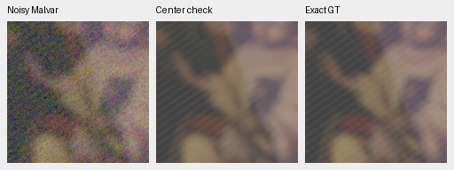
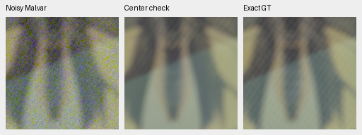

# Wide RAW fits with local support checks

Fitting a 64-pixel Bayer neighborhood and delivering its correction
only to the central 32 pixels retains the previous wide fit's weak-wire
recovery. Requiring the center itself to validate the broad coefficient
drops that gain from **4.365 to 0.213 weak-response points** over
Local 50k on the same 24 blurred exact targets. Refitting amplitude in
the center raises the gain to 0.410 points. The broad check makes the
real right-cab diagonals more visible and more regular. The center
checks primarily retain fragments.

## Fit, verification and delivery

All corrections use the [same four 128-pixel RAW frequency donors
and two-direction geometry gate](bayer-carrier-scale.md). In each
64 × 64 window a smooth cosine basis and the competing carrier are
fit to one green lattice. A least-squares sine/cosine pair measures
the tested carrier in the same lattice. The held-out green lattice
measures the reduction in prediction error attributable to the
tested carrier. A second pass swaps the two lattices. The parent
does see all sensor samples and is used only after this RAW check.

| Board label | Carrier estimate | Pixels that verify it |
| --- | --- | --- |
| Existing 64px | Free phase and amplitude in a 64 × 64 window, using the existing crop API | Held green in the 64 × 64 window |
| Broad evidence | Free phase and amplitude in a 64 × 64 window | Held green in the 64 × 64 window |
| Center check | Identical broad coefficient | Held green in the central 32 × 32, with the nuisance refit on the center's fitting lattice |
| Center amplitude | Broad phase, nonnegative amplitude refit on the central 32 × 32 fitting lattice | The same held center |

The last three arms all deliver to the same 32 × 32 patch on a
16-pixel stride with the same overlap taper and neutral camera-RGB
transport. Each uses the same six noise-weighted error-reduction
units on both folds, measured amplitude cap and nominal strength
0.73. The broad and center checks subtract the same broad carrier
fit to the parent. Center amplitude subtracts a fit to the parent
in the center. Changing the held center samples leaves the fitted
carrier coefficients bit-identical in all four Bayer layouts,
while changing the validation scores. The evidence is conditional
on the selected candidates and assumes sensor noise is sufficiently
independent across the two green lattices.

The parent is the Local-only 50k EMA,
`62f4e9ce84075c8df1a254a1889033b5787133e8c98c63e0ec3d174a94734959`,
replayed with CUDA IEEE FP32. The parent and existing 64-pixel
outputs reproduce the [earlier exact-target scores](local-exterior-phase-transfer.md)
on every source. The experimental correction and review took
21.05 seconds on CPU for 56 sources with four roles each, both
standing scenes, the existing fit and rendering. This reuses the
earlier parent forwards. The CPU time is for the review batch.

## Optical replay at σ 0.85 pixels

The panel reuses the held-out 24-source
[optical fixture](local-optical-mixture-1024.md#fresh-optical-confirmation),
with 12 erosion-masked true gaps and a separate flat role in each
scene. Each correction gets the exact same Bayer input within a role.
Calibration for the response-matched comparison uses 32 different
sources from the earlier optical study. Both sets were used in the
ring experiment.

| Change versus Local 50k at nominal strength | Existing 64px | Broad evidence | Center check | Center amplitude |
| --- | ---: | ---: | ---: | ---: |
| Weak response as percentage points of sharp target | +4.103 | +4.365 | +0.213 | +0.410 |
| Intact fundamental RMS, DN16 | −3.161 | −3.417 | −0.168 | −0.329 |
| Continuing-strand RMS in true gaps, DN16 | −30.626 | −30.233 | −10.519 | −9.719 |
| False weak projection in true gaps, DN16 | −0.026 | −0.015 | −0.011 | −0.003 |
| Exact-flat luma RMS, DN16 | 0.000 | 0.000 | 0.000 | 0.000 |

Broad evidence minus the existing 64-pixel API is +0.262 weak-response
points with paired 95% interval [−0.488, +1.010]. Changing only the
verification window to the central check loses 4.152 points
[−5.604, −2.814] and raises continuing-strand gap RMS by 19.713 DN16
[+10.707, +29.031]. False weak projection differs by +0.004 DN16
[−0.060, +0.056]. The weaker nominated direction passes in 335 of
1,944 overlapping intact windows with broad evidence, 31 with center
check and 33 with center amplitude. The 24 confirmation flats all
nominate exterior frequencies and none has a passing delivery
window. On the earlier 32 flats, three admit at least one window
under broad evidence and zero under either center check. These are
source-level counts for this full selection on these fixtures.

At the same low weak response, the center check does retain more of
the continuing strand. The earlier 32 sources choose weights 0.0248
for broad evidence and 0.500 for the center check relative to their
nominal corrections. On the 24 replay sources, the center check
minus broad evidence is −0.002 weak-response points [−0.038, +0.036]
and **−4.596 DN16** continuing-strand error [−6.655, −2.694]. The
false weak projection difference is −0.005 DN16 [−0.015, +0.005] and
flat RMS is equal. This operating point tests spatial selectivity
near the parent. The nominal broad fit has both higher weak
response and lower continuing-strand error.

### Cutoff sensitivity

An exploratory replay holds the fit and 32-pixel verifier fixed and
changes the cutoff and associated shrinkage scale together. At zero
the check delivers its capped correction whenever both scores are
positive. A positive cutoff uses the original smooth gain above the
threshold. This sweep uses the same inputs and optical panels.

| Center cutoff | Weak-response gain, points | Continuing-strand RMS change, DN16 | False weak projection change, DN16 | Exact-flat RMS change, DN16 | Flat source crops with any activation |
| --- | ---: | ---: | ---: | ---: | ---: |
| 0, hard positive | +22.595 | −34.242 | +1.235 | +2.051 | 24/24 |
| 1.5 | +5.541 | −25.621 | +0.038 | +0.007 | 15/24 |
| 3 | +1.927 | −19.242 | −0.008 | 0.000 | 0/24 |
| 6 | +0.213 | −10.519 | −0.011 | 0.000 | 0/24 |

The table uses the 24-source replay and measures changes from
Local 50k. On the earlier 32 sources, thresholds 1.5, 3 and 6
admit 22, zero and zero flat crops. Threshold 3 admits the weak
carrier in 163 of 1,474 wholly supported delivery windows and zero of
17 wholly absent windows on the 24-source replay. Three-pixel
mask expansion excludes optical spill when identifying those
absences. Positive support includes all signal levels. The windows
overlap and the number wholly inside a gap is small.

To compare threshold 3 with broad evidence at similar response,
weights of 0.500 and 0.2248 respectively match mean weak recovery
on the earlier 32 sources. On the separate 24 the central check
reduces continuing-strand RMS **2.650 DN16** [−4.560, −0.986] at
a weak-response difference of −0.018 points [−0.236, +0.187].
The false weak difference is −0.001 DN16 [−0.016, +0.017] and flat
RMS is equal. The same matching procedure at threshold 1.5 gives
higher continuing-strand error, +6.410 DN16 [3.774, 8.973],
and +0.020 DN16 false projection [0.001, 0.044]. The reversal
shows how the operating point affects the tradeoff on these data.
[Cutoff scores and paired intervals](results/local-center-guard-v1/cutoffs.json) ·
[Cutoff source and receipts](results/local-center-guard-v1/cutoff-evidence.tar.xz).

### Native exact views

Both 160 × 160 triplets use ROI `(48,48,160,160)` in the
256-pixel query at `(128,128)` in the source scene. Simulated
exposure is 0.33, shot/read is `0.00128 / 6.5536e-6` with black
offset 0.03, and display is ×2 scene-linear exposure followed by
sRGB. The reference is clean after applying σ 0.85 blur and
before Bayer sampling. In both cases broad evidence makes the
second slope easier to see. The center checks leave much of it
fainter than the target, particularly in the ellipse fixture.

The strip uses Palauenc05's church photograph, bin-four source
crop `(40,82,512,512)`. The adaptation adds the planted wire and
simulates optics and sensor noise.
[Source](https://commons.wikimedia.org/wiki/File:Viv%C3%A8s_%C3%89glise_Saint-Michel_madonna.jpg) ·
[CC BY-SA 4.0](https://creativecommons.org/licenses/by-sa/4.0/) ·
[All corrections](assets/local-center-guard-v1/fresh-02-comparison.png).

The ellipse uses Bernie's swallowtail photograph, bin-four source
crop `(156,26,512,512)`, with the same adaptation and render.
[Source](https://commons.wikimedia.org/wiki/File:Papilio_machaon_01_04102009.jpg) ·
[CC BY-SA 3.0](https://creativecommons.org/licenses/by-sa/3.0/) ·
[All corrections](assets/local-center-guard-v1/fresh-08-comparison.png).

Threshold 3 makes the weak slope faintly clearer in both fixtures
while the exact targets retain more contrast. Those boards use
identical native coordinates and display metadata.
[Strip triplet](assets/local-center-guard-v1/fresh-02-cutoffs-triplet.png) ·
[Strip sweep](assets/local-center-guard-v1/fresh-02-cutoffs-comparison.png) ·
[Ellipse triplet](assets/local-center-guard-v1/fresh-08-cutoffs-triplet.png) ·
[Ellipse sweep](assets/local-center-guard-v1/fresh-08-cutoffs-comparison.png).

## Standing GFX100S comparisons

The main boards use DSCF3879 ISO6400 with 512-pixel context,
shot/read `0.00128 / 6.5536e-6` and ×4 display. DSCF3880 ISO100
AHD is the independently demosaiced qualitative reference. The
sky, foliage and building equal the Local 50k source pixels.
The coarse fence retains its connected intersections and the
green speck. Broad and center evidence change it by 9.876 and
9.185 DN16 RGB RMS, respectively. Fine building cables and
foliage stay soft. Each panel is 160 × 160 native pixels.
[Sky](assets/local-center-guard-v1/main-overcast-sky-main-overcast-sky-x4.png) ·
[Building](assets/local-center-guard-v1/main-building-detail-main-building-detail-x4.png) ·
[Foliage](assets/local-center-guard-v1/main-foliage-main-foliage-x4.png) ·
[Coarse fence](assets/local-center-guard-v1/main-chain-link-fence-main-chain-link-fence-x4.png).

DSCF3842 ISO6400 uses 768-pixel context and both the nominal
conditioning and transferred DSCF3879 shot/read
`0.0014635775921166604 / 1.0715704128646712e-6`. Each view includes
DSCF3835 ISO100 AHD and both camera JPEGs as qualitative references.
Aperture, exposure time and motion differ across captures.

| Native 160 × 160 crop | Nominal | Transferred DSCF3879 prior |
| --- | --- | --- |
| Left `(806,6489)` | [×4](assets/local-center-guard-v1/mesh-nominal-fine-green-mesh-left-x4.png) · [×16](assets/local-center-guard-v1/mesh-nominal-fine-green-mesh-left-x16.png) | [×4](assets/local-center-guard-v1/mesh-profile3879-fine-green-mesh-left-x4.png) · [×16](assets/local-center-guard-v1/mesh-profile3879-fine-green-mesh-left-x16.png) |
| Right `(1026,6449)` | [×4](assets/local-center-guard-v1/mesh-nominal-fine-green-mesh-right-x4.png) · [×16](assets/local-center-guard-v1/mesh-nominal-fine-green-mesh-right-x16.png) | [×4](assets/local-center-guard-v1/mesh-profile3879-fine-green-mesh-right-x4.png) · [×16](assets/local-center-guard-v1/mesh-profile3879-fine-green-mesh-right-x16.png) |

At nominal conditioning the right crop's center check admits 43
and 15 of 81 overlapping windows in the two directions. The
broad check admits 81 and 65. The stricter check largely leaves
the diagonals toward the bottom and right as fragments. The
broad fit adds a more continuous and regular grid over the
underlying mottling. In the left crop, the broad fit strengthens
diagonal modulation around the horizontal strand and post,
with crossings still missing. The center checks make smaller
changes there. The transferred prior reveals more diagonals in
every arm. Green-gray splotches remain, and there is no clear
additional chroma fringe from the center check.

The cutoff sweep leaves sky, building and foliage equal to the
parent. Threshold 3 gives the right cab diagonals more definition
than threshold 6 and leaves more spacing irregularities visible
than broad evidence. The left still has interrupted intersections
next to the post. Neither cutoff removes the background splotches.
[Main sky](assets/local-center-guard-v1/main-overcast-sky-main-overcast-sky-x4-cutoffs.png) ·
[Building](assets/local-center-guard-v1/main-building-detail-main-building-detail-x4-cutoffs.png) ·
[Foliage](assets/local-center-guard-v1/main-foliage-main-foliage-x4-cutoffs.png) ·
[Coarse fence](assets/local-center-guard-v1/main-chain-link-fence-main-chain-link-fence-x4-cutoffs.png).

| Cab cutoff sweep | Nominal | Transferred DSCF3879 prior |
| --- | --- | --- |
| Left | [×4](assets/local-center-guard-v1/mesh-nominal-fine-green-mesh-left-x4-cutoffs.png) · [×16](assets/local-center-guard-v1/mesh-nominal-fine-green-mesh-left-x16-cutoffs.png) | [×4](assets/local-center-guard-v1/mesh-profile3879-fine-green-mesh-left-x4-cutoffs.png) · [×16](assets/local-center-guard-v1/mesh-profile3879-fine-green-mesh-left-x16-cutoffs.png) |
| Right | [×4](assets/local-center-guard-v1/mesh-nominal-fine-green-mesh-right-x4-cutoffs.png) · [×16](assets/local-center-guard-v1/mesh-nominal-fine-green-mesh-right-x16-cutoffs.png) | [×4](assets/local-center-guard-v1/mesh-profile3879-fine-green-mesh-right-x4-cutoffs.png) · [×16](assets/local-center-guard-v1/mesh-profile3879-fine-green-mesh-right-x16-cutoffs.png) |

This scoped component supplies no new fixed photo or camera
measurement. The current model recommendation remains in the
[model guide](current-model.md).
[Paired metrics, site counts and image hashes](results/local-center-guard-v1/publication.json) ·
[Source and receipts](results/local-center-guard-v1/evidence.tar.xz).
