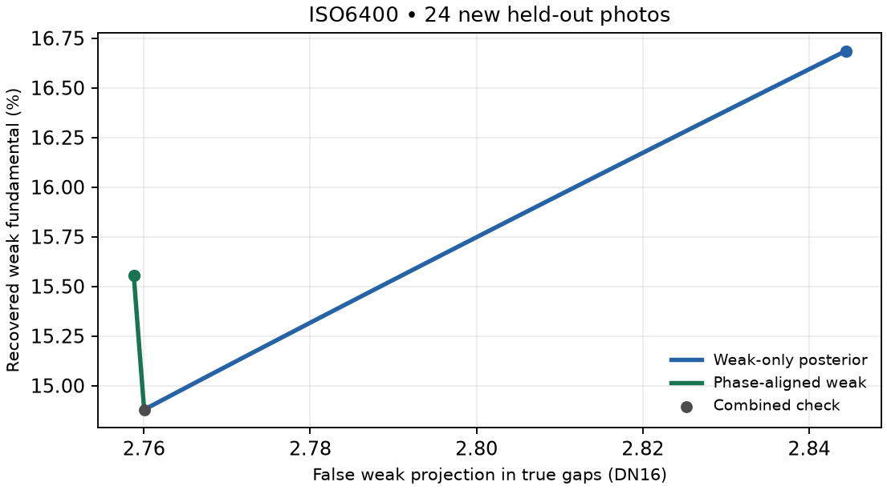
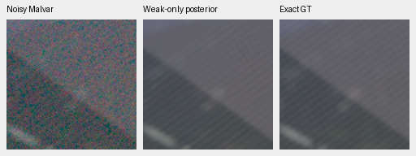
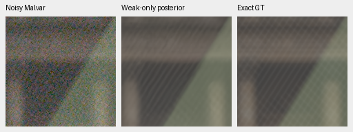

# Fitting the weaker Bayer direction separately

Holding the stronger correction fixed and estimating only the faint direction improves weak-wire recovery on three ISO6400 photo panels. The new `weak-posterior` crop option gains **1.807 percentage points** on 24 new source-disjoint photos and lowers intact weak error **1.323 DN16**. False weak projection into true gaps rises **0.084 DN16**. Error on the continuing strong strand changes by **0.001 DN16**. The nominal right GFX100S cab shows a slightly clearer second diagonal in places, with incomplete crossings.

The [local support follow-up](local-weak-support.md) reproduces the recovery gain on another 24 photos. Held green and color tapers show no added-gap advantage over uniform scaling at equal recovery, while known support nearly eliminates the added gap texture in a diagnostic.

## Separate frequency, rank and local evidence

The [joint ring posterior](local-bayer-presence.md) can change either carrier. This version starts from the [combined broad and central check](local-nested-support.md), retains its stronger correction, and offers a new fit only in the weaker direction. The four frequency-donor patches and the 64-pixel fit and 32-pixel delivery windows stay fixed. A separate attempt to infer rank from those exterior donors left all 32 calibration crops ambiguous. The calibration fixtures give both directions similar exterior amplitudes even where one is faint in the query.

The local rank instead uses the existing 24-pixel block measurements across the 192-pixel RAW footprint. Each green lattice removes background and estimated noise power. Both must agree which direction has at least 25% more median power. If they disagree, the combined check supplies both directions.

A disjoint 64-pixel ring supplies the prior mean and variance for the weaker phase. Each green lattice contributes a center likelihood after projecting out smooth background and the stronger carrier. The weaker direction compares a zero-carrier model with a two-quadrature Gaussian prior. After subtracting what the parent already reconstructed, its delivery uses the measured-amplitude cap and an inclusion ramp above 0.20. The calibration lock sets log prior odds to −5 and uses the full weak update. The phase-aligned comparison narrows the prior across the ring phase and requires both green folds to predict positive held improvement above 0.5. It also uses a different calibrated log-odds value of −3. The fold scores are conditional on the local ranking.

The 32-source calibration locks both methods using false weak projection, flat RMS and added-flat limits from the combined check. Each strength blends only the new weak correction relative to the combined output. A preliminary sweep scaled both directions when interpolating from Local 50k. Its original receipts are preserved, and the reported comparisons use the corrected weak-only blend.

## Exact-target results

All panels use ISO6400 shot/read `0.00128 / 6.5536e-6`, exposure 0.33, black offset 0.03 and σ 0.85 pre-Bayer blur. Two independent noise draws per photo use all four Bayer layouts. The 24 new photos cover six recipient roles per draw, including flat-core, edge-only and uniform controls. Their source IDs and cache hashes were checked against earlier evaluation photos and 559,808 recorded parent training visits. The frozen Local 50k and V120 predictions use CUDA IEEE FP32.

| 24 new photos | Weak response | Intact weak RMS (DN16) | Continuing strong RMS (DN16) | False weak RMS in gaps (DN16) |
| --- | ---: | ---: | ---: | ---: |
| Local 50k EMA | 13.216% | 40.473 | 81.122 | 2.718 |
| Combined check | 14.879% | 39.255 | 56.064 | 2.760 |
| Phase-aligned weak | 15.556% | 38.817 | 56.064 | 2.759 |
| Weak-only posterior | **16.686%** | **37.932** | 56.065 | 2.844 |

The weak-only gain over combined is **+1.807 points** `[+1.073, +2.615]`. The intact error difference is **−1.323 DN16** `[−1.956, −0.758]` and the false weak difference is **+0.084 DN16** `[+0.002, +0.239]`. The continuing-strand interval is `[−0.003, +0.007]` DN16. Intervals resample sources with both draws together, stratified by geometry. The phase-aligned arm gains **+0.677 points** `[+0.340, +1.053]`, with false weak difference −0.001 DN16 `[−0.004, +0.0001]`.

The weak-only fit also improves the 32-photo retained panel by **2.332 points** `[+1.505, +3.276]` and the previous 24-photo panel by **2.398 points** `[+1.679, +3.167]`. Changes in continuing-strand error are below 0.001 DN16 on those panels. The rank separates the planted directions in 158 of the 160 two-wire draws across the three panels. The two others use the combined check.

All new edge-only and uniform crops match the parent. Four flat-core crops retain the combined check's small changes, with 0.465 DN16 maximum added RMS. The weak-only fit reproduces the prior blank controls across all three panels. The phase-aligned fit adds a 4.01 DN16 uniform-crop change on one earlier draw. Including the stronger strand's second and third harmonics in the center nuisance changes the new weak-only response by just +0.006 points and false projection by +0.002 DN16.

## Native exact comparisons

Both native triplets use BGGR draw zero, a `[48,48,160,160]` crop in the `[128,128,256,256]` query, the ISO6400 conditions above and display exposure ×2 followed by sRGB. The restoration composes the weak-only posterior and Local 50k EMA SHA256 `62f4e9ce84075c8df1a254a1889033b5787133e8c98c63e0ec3d174a94734959`. The exact target is post-optics and pre-Bayer. The weak direction is easier to see in parts of the ellipse and remains much softer than the reference. The strip changes are subtler.

The strip uses kallerna's Cima di Terrarossa photograph at bin-four crop `[36,98,512,512]`. Adapted by binning, planting the wires and simulating optics and noise. [All methods](assets/local-conditional-posterior-v1/weak-side-01-comparison.png) · [Source](https://commons.wikimedia.org/wiki/File:Cima_di_Terrarossa_hike_2.jpg) · [CC BY-SA 4.0](https://creativecommons.org/licenses/by-sa/4.0).

The ellipse uses DXR's Val-de-Grâce photograph at bin-four crop `[92,208,512,512]` with the same adaptation. [All methods](assets/local-conditional-posterior-v1/weak-side-09-comparison.png) · [Source](https://commons.wikimedia.org/wiki/File:Eglise_du_Val-de-Gr%C3%A2ce,_Paris_5e,_West_View_140209_1.jpg) · [CC BY-SA 3.0](https://creativecommons.org/licenses/by-sa/3.0).

## Standing GFX100S comparisons

The sky, building and foliage return Local 50k. The coarse chain-link crop changes 4.74 DN16 RGB RMS from the combined check and retains connected crossings. Both left cab crops use the combined fit because the local rank is ambiguous. The right changes 4.94 DN16 in the nominal profile and 5.48 in the transferred profile versus combined. The weaker diagonal is more visible in parts of the lower and right portion of the crop, with regular texture and incomplete crossings elsewhere. The broad mottling and weak strands near the post remain visible. The neutral lift adds no obvious repeating color.

The parent is the Local 50k EMA above. V120 Small EMA SHA256 `a9d9b6b4f974e24a6b11e5e740aab32314233a7f53c056cf37c7d2aac1c589fb` is the recommended-model comparison. Nominal shot/read is `0.00128 / 6.5536e-6`. The transferred cab uses `0.0014635775921166604 / 1.0715704128646712e-6`. Both ISO100 AHD renders and the camera JPEGs are qualitative references from separate imaging conditions. Native coordinate and display metadata accompany the boards.

| RAW and profile | Native boards |
| --- | --- |
| DSCF3879 nominal ×4 | [Sky](assets/local-conditional-posterior-v1/main-overcast-sky-main-overcast-sky-x4.png) · [Building](assets/local-conditional-posterior-v1/main-building-detail-main-building-detail-x4.png) · [Foliage](assets/local-conditional-posterior-v1/main-foliage-main-foliage-x4.png) · [Coarse fence](assets/local-conditional-posterior-v1/main-chain-link-fence-main-chain-link-fence-x4.png) |
| DSCF3842 nominal | [Left ×4](assets/local-conditional-posterior-v1/mesh-nominal-fine-green-mesh-left-x4.png) · [Right ×4](assets/local-conditional-posterior-v1/mesh-nominal-fine-green-mesh-right-x4.png) · [Left ×16](assets/local-conditional-posterior-v1/mesh-nominal-fine-green-mesh-left-x16.png) · [Right ×16](assets/local-conditional-posterior-v1/mesh-nominal-fine-green-mesh-right-x16.png) |
| DSCF3842 transferred | [Left ×4](assets/local-conditional-posterior-v1/mesh-profile3879-fine-green-mesh-left-x4.png) · [Right ×4](assets/local-conditional-posterior-v1/mesh-profile3879-fine-green-mesh-right-x4.png) · [Left ×16](assets/local-conditional-posterior-v1/mesh-profile3879-fine-green-mesh-left-x16.png) · [Right ×16](assets/local-conditional-posterior-v1/mesh-profile3879-fine-green-mesh-right-x16.png) |

## Use the crop option

Use `method="weak-posterior"` in `demosaic.mesh_carrier_fit.refine_raw_mesh_carriers`. Pass a native 160×160 camera-linear parent, its 192×192 parent context, the packed RAW scene, Bayer colors and camera/noise metadata. Follow the [crop inference example](usage.md#repeating-mesh-crops).

The packaged implementation matches the research output within **0.002 DN16 peak** across 288 synthetic and eight real crops. The median single-thread CPU crop time on GB10 is **28.58 ms** at 48-pixel donor clearance, after the parent forward. The review includes all 12 standing boards and both exact triplets. This is a scoped inference component using frozen checkpoints. The fixed 427-photo and known/unseen camera panels are outside the scope of the crop replay.

[Source-level comparisons](results/local-conditional-posterior-v1/summary.json) · [Native manifest](assets/local-conditional-posterior-v1/manifest.json) · [Publication hashes](results/local-conditional-posterior-v1/publication.json) · [Frozen evidence](results/local-conditional-posterior-v1/evidence.tar.xz).
