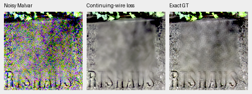
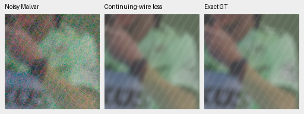

# Preserving the wire that continues through a gap

A signed loss on the continuing wire raises its recovered response from
**46.88% to 63.74%** inside fixed weak-wire gaps. Compared with the aligned
control, the new arm gains **3.16 weak-wire response points** and lowers
total gap RMS by **10.61 DN16**. On separate double-gap pairs it recovers
**8.04 more points** of true continuation, with a change of +0.095 DN16
in false strong-wire RMS and an interval spanning zero. Stronger recovery
comes with higher intact-wire error and more texture in exact-flat crops.
No convincing new fine cab crossings were visible.

[Machine results](results/local-continuing-wire-v1/publication.json) ·
[Native provenance](images/local-continuing-wire-v1/manifest.json) ·
[Previous signed weak-wire study](local-wire-response.md).

The [factored-luminance follow-up](local-factored-wire.md) freezes this
study's aligned control and measures a separate post-gate detail lift,
including apparent continuations in double gaps and both standing fences.

[Regional weak-wire training](local-regional-wire.md) extends the
matched comparison to 1,024 distinct sources and adds explicit
weak-direction absence supervision to both arms.

## Matched training

Both arms start from the repeat-loss EMA
`cc5a3cd5d33096f9696d250627d380ecc2f0ed53971da8c2d3f9772550cf9a7a`.
They update the full local restoration trunk and context projections with
frozen DINO. The 320 training and eight qualification photos are separate
from the preceding three trial schedules. The approved corpus supplies
160 natural and 160 wire training cases. In every wire cell, eight
sources have a strong wire that continues through the weak-wire gap,
and two have a gap in both directions. Each update uses two separately
redrawn present/absent pairs, an exact-flat crop and an ordinary crop.
The schedule balances ISO400 and ISO6400, all four Bayer layouts, and
coupled or independent noise within a pair.

Both models use the absolute, mean-first frequency, repeat variance and
signed weak-wire losses from the previous aligned model. The new arm
adds a weight of 1.6 to the signed error along the true strong waveform
inside the weak gap, averaged over the four observations. A tapered
support removes contributions outside that gap. The projection rejects
a plane and the first three weak-wire harmonics. Where both wires stop,
the exact target is the surviving photographic background. The labels
and multiple draws enter training only. Each model restores a single
noisy observation with the existing inference path.

| Arm | Updates | Native observations | Checkpoint SHA256 |
| --- | ---: | ---: | --- |
| Aligned control | 320 | 1,920 | `e1e706a7c5a49da96dfb77a7779126504a2aa85d8626567a09d4690b0b30b9ec` |
| Continuing-wire loss | 320 | 1,920 | `b28fe5d5cb7beaa25bb8e1b54e4df52ac7fab828cc17513660a80c0ec0f5f115` |

Interleaved GB10 training took 877.48 s with BF16 neural
forwards and FP32 camera arithmetic and losses. The duration includes
observation preparation and hashing. 306 of 320 paired
cores passed the full-band clipping check. Qualification confirms identical
initial predictions, finite gradients and both types of wire gap. The
checkpoints store raw and EMA weights separately. Evaluation uses EMA
with CUDA IEEE FP32. [Training audit](results/local-continuing-wire-v1/training.json) ·
[Frozen evidence](results/local-continuing-wire-v1/evidence.tar.xz).

## Can the RAW distinguish a continuing wire from a double gap?

The independent 16-background test renders both conditions with the same
known exterior wire geometry, plus an exact-flat control. It uses two
separate ISO6400 sensor draws in each condition at shot/read
`0.00128/6.5536e-6`, exposure ×0.33, black 0.03 and 16-bit ADC. The
backgrounds are outside the training manifests, fixed 48-field review,
and earlier redrawn wire panel. Each Bayer layout appears four times.

Given the true strong template, support and exact clean background, a
noise-weighted Bayer fit classifies all **32 continuing** and **32
double-gap** draws at half the clean amplitude. Fitting a separate local
plane for each Bayer phase keeps **25/32** true draws and produces
**8/32** false positives. The median predicted signal-to-noise ratio is
7.00 with the exact background and 6.73 after the affine projection.
On these fields the loss in classification accuracy is larger than
the drop in predicted SNR. Clean background bias alone predicts false
continuation on four source backgrounds and misses on four others at the
same threshold. Each of the observed false draws comes from those four
false-positive backgrounds. Both fits use exact waveform and gap geometry,
with the same noise weights computed at the simulated signal midpoint. [Per-draw Bayer evidence](results/local-continuing-wire-v1/raw-gap-evidence.json).

A separate fit estimates the background from a disjoint Bayer annulus,
while fitting the known strong and weak carriers there. The affine
exterior fit keeps 27/32 continuing draws and produces 11/32 false calls.
The quadratic exterior fit and the model order selected on held-out
exterior samples both keep 23/32 continuing draws with 8/32 false calls.
This larger context gives the polynomial fits more data and leaves the
background ambiguity in the interior. [Exterior results](results/local-continuing-wire-v1/exterior-background.json) ·
[Diagnostic sources](results/local-continuing-wire-v1/additional-diagnostics.json).
## Fixed exact ISO6400 observations

Twenty-four natural and 24 wire fields use the unchanged evaluation inputs.
The signed strong-band score uses the 12 true weak-wire gaps. Natural RMS
pools squared errors by source. Wire RMS averages source estimates.

| EMA | Natural fine response | Natural flat fine RMS (DN16) | Weak-wire response | Intact-wire RMS (DN16) | Wire flat RMS (DN16) | Weak gap RMS (DN16) | Total gap RMS (DN16) |
| --- | ---: | ---: | ---: | ---: | ---: | ---: | ---: | ---: |
| V120 | 58.224% | 5.726 | 31.834% | 187.930 | 22.557 | 9.463 | 171.203 |
| Corpus 100k | 58.314% | 5.569 | 32.230% | 187.859 | 22.196 | 9.801 | 169.208 |
| Local 50k | 58.010% | 4.489 | 32.377% | 188.074 | 20.490 | 9.615 | 168.488 |
| Repeat parent | 59.531% | 3.982 | 23.409% | 171.479 | 19.728 | 8.471 | 165.577 |
| Prior aligned wire | 56.691% | 3.985 | 22.284% | 161.192 | 18.569 | 8.316 | 173.966 |
| Aligned control | 56.925% | 4.110 | 24.911% | 168.166 | 19.190 | 8.339 | 170.256 |
| Continuing-wire loss | 58.404% | 5.037 | 28.071% | 180.937 | 23.828 | 8.602 | 159.650 |

Relative to the matched control, strong-band response rises 16.865
points [12.063, 22.398] and its target-aligned MSE drops 5,972 DN16²
[−9,063, −3,553]. Total gap RMS falls 10.606 DN16 [−18.026, −5.552],
and weak-direction gap RMS rises 0.263 DN16 [0.030, 0.518]. Intact-wire
RMS rises 12.771 DN16 and wire flat RMS rises 4.638 DN16. Natural fine
response gains 1.479 points, with 0.767 DN16 higher fine-increment RMS
and 0.927 DN16 higher exact-flat fine RMS. The intervals are paired
source bootstrap intervals.

Compared with the starting checkpoint, the new endpoint gains 4.662
weak-wire response points and 11.592 strong-band points in gaps. Total
gap RMS falls 5.926 DN16, with higher wire flat RMS and intact-wire RMS.
V120 retains more weak-wire response and cleaner wire flats. The new
endpoint has lower total gap and weak-direction gap RMS on these fields.

A component diagnostic replaces the aligned control's projection along
the exact continuing strong wire with the new model's projection. All
other error components keep their control values. Under that substitution,
mean gap RMS is 150.93 DN16, down 19.33 DN16 [−30.33, −11.25] from the
control. The full model delivers a 10.61 DN16 reduction. This calculation
uses the known gap and clean waveform to isolate the recovered component.
[Component calculation](results/local-continuing-wire-v1/continuing-component-bound.json).

### Calibrated output mixtures

Twelve wire sources set a mixture weight and twelve different sources
check transfer. A mix of the aligned control and 15.04% continuing-wire
output matches the starting model's flat RMS in calibration. On the
other half, weak response improves 1.826 points [0.435, 3.583] and flat
RMS changes by −0.204 DN16 [−0.840, 0.393]. Intact-wire RMS falls 3.197 DN16.
Total gap RMS rises 4.211 DN16 and strong response in the gaps falls 5.434
points.

Matching the new model's response with a mix of the starting model and
56.59% Local 50k leaves a −0.826 point difference on the held-out half
[−1.899, +0.209]. The new model has 9.125 DN16 less total gap error
[−18.054, −2.135] and 4.016 DN16 more exact-flat RMS [2.925, 5.294].
These comparisons use fixed interpolation of saved camera-RGB outputs.
[Source-disjoint mixture results](results/local-continuing-wire-v1/matched-mixtures.json).

## True continuation versus absence of both wires

The 16-background double-gap panel asks whether the model restores a
wire when the same exterior geometry also permits a true interruption.
The response is the measured difference between continuing and interrupted
fields along the strong template, divided by the corresponding clean
difference. The false strong and weak scores measure actual error on the
double-gap field while retaining the true photographic background.

| EMA | True strong response | Signed strong bias (DN16) | True strong error (DN16) | False strong RMS (DN16) | False weak RMS (DN16) | Flat RMS (DN16) |
| --- | ---: | ---: | ---: | ---: | ---: | ---: | ---: |
| Repeat parent | 66.160% | −41.852 | 52.430 | 16.768 | 34.439 | 10.547 |
| Aligned control | 67.200% | −40.257 | 50.928 | 17.152 | 34.604 | 11.195 |
| Continuing-wire loss | 75.241% | −30.431 | 45.587 | 17.246 | 34.997 | 13.590 |

True response gains 8.041 points [4.500, 13.055] and the bias improves
9.826 DN16 [4.656, 17.065] against the control. False strong RMS changes
+0.095 DN16 [−0.990, 1.271] and false weak RMS changes +0.393 DN16
[−0.786, 1.569]. Flat RMS rises 2.395 DN16 [1.408, 3.553].

The eight backgrounds where the clean Bayer plane residual has less
than half the strong-wire amplitude gain 12.00 response points
[5.80, 20.74]. The other eight gain 4.08 points [2.39, 6.22]. False
strong-wire RMS intervals include zero in both groups. The higher-error
group has a 3.00 DN16 increase in flat RMS, compared with 1.79 DN16
in the lower-error group. False strong-wire changes across individual
backgrounds range from −3.48 to +5.71 DN16. [Per-source and background-stratified results](results/local-continuing-wire-v1/publication.json).

## Transfer on the separate redrawn wire panel

A further 16 backgrounds with three ISO6400 draws per field repeat the
preceding study's physical inputs. Eight have true weak-wire gaps. The
new model gains **2.507 weak response points** [1.740, 3.231] over the
aligned control and **4.567 points** over the starting model. Total gap
RMS falls **5.774 DN16** [−8.898, −2.392] versus the aligned control and
4.739 DN16 versus the starting model. Weak-direction error in the gap
increases 0.328 DN16 [0.217, 0.465] over the aligned control. This shows
some additional leakage of the weak direction while the strong wire
contributes less total gap error.

The shared increment error falls 378 DN16² [−553, −208] against the
aligned control. Draw-sensitive variance rises 3,795 DN16² [2,904, 4,747],
or 18.8%. Intact-wire RMS rises 9.786 DN16 and exact-flat RMS rises
4.221 DN16. These transfer results show the added texture and variance
alongside the genuine signal gain. [Repeat measurements](results/local-continuing-wire-v1/publication.json).

## Native exact-target triplets

Each cell is 160 × 160 unchanged pixels at `[48,48,160,160]` inside
its 256-pixel query. The triplets show noisy Malvar, the continuing-wire
EMA `b28fe5d5…ec0f5f115`, and the exact target. Both use ISO6400 shot/read
`0.00128/6.5536e-6`, capture exposure ×0.33, 16-bit ADC and black 0.03.

**Historic centre in Wuppertal**, Frank Vincentz, CC BY-SA 3.0. BGGR
query `[548,58,256,256]`, display ×3.03 and contrast ×2 about the clean
linear colour mean. Fine stone grain and parts of the lettering remain
soft. [All methods](images/local-continuing-wire-v1/exact/27-natural-iso6400-comparison.png).

**Planted wires on a handball photo**, Steffen Prößdorf, CC BY-SA 4.0.
GRBG query `[128,128,256,256]` within the source field `[200,0,512,512]`,
display ×2 and ordinary contrast. Stronger parallel traces persist.
The weak crossing direction remains much fainter than the exact target.
[All methods](images/local-continuing-wire-v1/exact/21-wire-iso6400-comparison.png).

[Aircraft and grass](images/local-continuing-wire-v1/exact/33-natural-iso6400-comparison.png) ·
[Window and planted wires](images/local-continuing-wire-v1/exact/09-wire-iso6400-comparison.png) ·
[Source, licence and crop metadata](images/local-continuing-wire-v1/manifest.json).

## Standing GFX100S comparisons

All eight 160-pixel crops were viewed at native scale against the
starting model, earlier aligned EMA, matched control, V120 and Corpus 100k.
The main DSCF3879 scene uses the nominal shot/read `0.00128/6.5536e-6`
and display ×4. The sky remains visually smooth, while coarse chain-link
crossings remain coherent. Foliage and thin building lines stay soft.

The DSCF3842 cab scene uses display ×16 and both fixed noise profiles.
That includes the transferred shot/read `0.0014635775921166604/1.0715704128646712e-6`.
There is more contrast in existing diagonal traces in the nominal right
and transferred crops. The clearest right diagonals still lack many fine
crossings. The nominal left lattice is largely absent. The views show
no obvious new periodic sky texture or conspicuous colour blotches.
The independent ISO100 AHD and both camera JPEGs are qualitative references
from different aperture, exposure or scene timing.

| Capture and profile | Native comparisons |
| --- | --- |
| Main DSCF3879, nominal | [Sky](images/local-continuing-wire-v1/standing/main-overcast-sky-main-overcast-sky.png) · [Building](images/local-continuing-wire-v1/standing/main-building-detail-main-building-detail.png) · [Foliage](images/local-continuing-wire-v1/standing/main-foliage-main-foliage.png) · [Coarse fence](images/local-continuing-wire-v1/standing/main-chain-link-fence-main-chain-link-fence.png) |
| Cab DSCF3842, nominal | [Left](images/local-continuing-wire-v1/standing/mesh-nominal-fine-green-mesh-left.png) · [Right](images/local-continuing-wire-v1/standing/mesh-nominal-fine-green-mesh-right.png) |
| Cab DSCF3842, transferred | [Left](images/local-continuing-wire-v1/standing/mesh-profile3879-fine-green-mesh-left.png) · [Right](images/local-continuing-wire-v1/standing/mesh-profile3879-fine-green-mesh-right.png) |

[Standing main review map](gfx-qualitative.md) · [Fine cab review map](gfx-green-mesh.md) ·
[Inputs, coordinates, exposures and hashes](images/local-continuing-wire-v1/manifest.json).

## Fixed camera panels

Both measured-CFA panels are complete. The 72 known and 90 unseen crops
use the exact canonical Bayer arrays, scoring borders and CUDA IEEE FP32
policy. The V120 and repeat-parent references reuse their matching case
receipts. A separate eight-case qualification replays V120 against the
frozen CPU witness within 0.000008 dB in every case.

| EMA | Known CFA PSNR | Unseen CFA PSNR |
| --- | ---: | ---: |
| V120 | 54.31272 dB | 54.00872 dB |
| Corpus 100k | 54.33708 dB | 53.97826 dB |
| Repeat parent | 54.19868 dB | 54.01346 dB |
| Prior aligned wire | 54.24324 dB | 54.00481 dB |
| Aligned control | 54.24247 dB | 54.03699 dB |
| Continuing-wire loss | 54.22001 dB | 53.90793 dB |

The continuing-wire loss loses **0.02246 dB known and 0.12905 dB unseen**
against the aligned control. It gains 0.02133 dB known over its actual
parent and loses 0.10552 dB unseen. On this fixed camera panel it trails
V120 by 0.09271 dB known and 0.10079 dB unseen. The aligned control leads
V120 by 0.02826 dB unseen across five scenes. The stronger exact gap
response comes with a camera generalisation cost.

The fixed 427-photo replay is running on both saved EMAs. Those two
scores remain pending. V120 and Corpus 100k have completed fixed photo
results. [Camera summary](results/local-continuing-wire-camera-v1/publication.json) ·
[Per-case archive](results/local-continuing-wire-camera-v1/evidence.tar.xz) ·
[Comparable PSNR history](performance-history.md).
