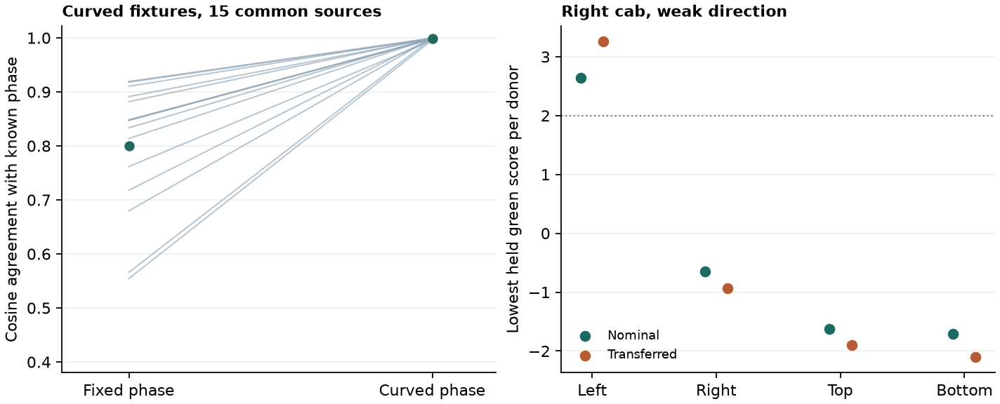
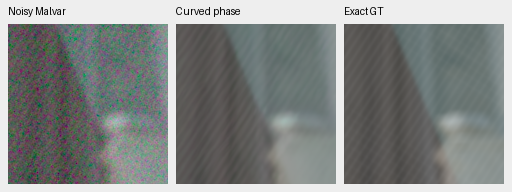
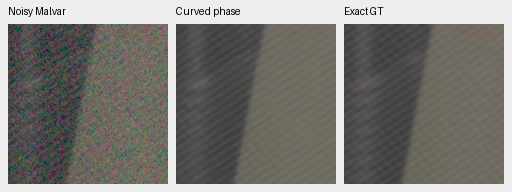

# Predicting curved weak detail from separate RAW patches

Allowing the exterior phase to curve raises mean agreement with the known weak phase from **0.799 to 0.999** on 15 comparable ISO6400 photo-based fixtures. Using that phase to taper the weak correction raises recovered contrast by **0.102 percentage points** versus the [fixed phase guard](local-phase-extent.md) on all 24 new fixtures, with an interval spanning zero. Refitting the weak correction in the curved basis adds a further 0.053 points in a diagnostic. Both real right cab profiles still lack a dependable phase prediction.

The [weak contrast follow-up](local-weak-contrast.md) finds a larger recovery gain by changing delivered amplitude within the existing support check.

## Predict phase from the exterior

The experiment keeps the existing two carrier directions, local rank and strong correction. Four 128-pixel RAW patches each supply 16 disjoint 32-pixel stations. Each station removes a quadratic background and the strong fundamental, then fits the weak direction's sine and cosine coefficients on each Bayer lattice. A refined planar model fits two phase gradients about the query center. The curved model adds three quadratic terms. Both fit inverse-noise-weighted coherent phase on the two green lattices and retain separate phase offsets for each Bayer site.

Both fitted phase fields must predict interleaved stations from the other half of the donors. Opposite sides must pass on both greens and both folds, with a held score of at least two noise units and phase alignment of at least 0.32 in each. The two fits must also agree within cosine 0.60 at five central query probes. Two alternatives fit just one opposing pair or one adjacent patch. The single-patch fit uses a tighter bound and stronger shrinkage on frequency changes because it extrapolates. The frequency nomination uses the full exterior, so donor-fold scores are conditional on that nomination. The query provides no samples to the geometry fit.

The accepted field checks local support in the same 16-pixel cells as the fixed guard. The main comparison only tapers the new weak-posterior increment. An earlier 32-photo calibration targets 75% of the unguarded increment and freezes a cutoff and weight for each method. Each failed phase check uses its fixed uniform blend. A perturbation audit changes all 65,536 query samples without changing the exterior coefficients on any Bayer layout. Changing held donor coefficients reverses held evidence and leaves the associated discovery fit identical. Noiseless drift and curvature controls recover the known query waveform with cosine above 0.9999 for the corresponding model.

## Fresh curved fixtures

Twenty-four source-disjoint photos cover strips, elliptical gaps, smooth dips and contrast steps, with 12 exact-gap scenes. The weak family curves continuously through the query and the donors. The strong family stays planar. Every photo uses two independent noise draws and six roles, including edge, flat-core and uniform controls. The training trace exclusion checks 559,808 photographic visits. Capture uses σ 0.85 optical blur, ISO6400 shot/read `0.00128 / 6.5536e-6`, exposure 0.33, black offset 0.03 and 16-bit ADC. The parents use CUDA IEEE FP32. The scoring basis includes the known curved phase and the exact optically eroded gap masks.

| 24 fresh photos, frozen strengths | Weak contrast recovered | Intact weak RMS (DN16) | False weak RMS in gaps (DN16) | Added gap luma RMS (DN16) |
| --- | ---: | ---: | ---: | ---: |
| Combined check | 15.045% | 44.334 | 2.744 | 0.000 |
| Full weak posterior | 17.272% | 42.467 | 2.728 | 0.108 |
| Uniform 75% | 16.716% | 42.933 | 2.732 | 0.081 |
| Fixed phase guard | 16.698% | 42.932 | 2.740 | 0.030 |
| Refined planar phase | 16.524% | 43.081 | 2.740 | 0.030 |
| Curved phase | 16.799% | 42.842 | 2.740 | 0.029 |
| Opposed pair | 16.531% | 43.074 | 2.740 | 0.029 |
| Single adjacent donor | 16.613% | 43.022 | 2.734 | 0.070 |

At frozen strength the curved arm gains **0.102 points** `[−0.090, +0.297]` over the fixed guard. At equal recovered contrast it changes added gap luma RMS by **−0.003 DN16** `[−0.007, +0.001]`. The two methods' absolute false weak projection differs by less than 0.001 DN16. The curved fit qualifies all 48 role-crops that had a selected weak window, compared with 34 for fixed phase. On 15 photos with both phases available in the intact role, the average template cosine rises from 0.799 to 0.999. The intervals resample whole sources within geometry families. Each output keeps the combined check's single 0.409 DN16 uniform-crop change, with zero added edge-only and flat-core changes.

Across the three earlier straight panels, the refined planar, curved and opposed donor fits change equal-response added gap texture by at most 0.006 DN16 versus the fixed guard. The single-donor increases are +0.073, +0.065 and +0.117 DN16. The combined, full weak and fixed guard scores reproduce all prior per-draw results exactly. [Earlier comparison](local-phase-extent.md).

### Refitting in the curved basis

A diagnostic on the same 24 scenes uses only the accepted exterior geometry to change the weak direction's basis. The 64-pixel ring and 32-pixel local measurements still determine phase offset, amplitude, inclusion and amplitude cap. The strong correction remains fixed. The refit gains **0.048** points `[+0.001, +0.096]` over the full weak posterior when restricted to its admitted windows. Refitting inclusion as well adds 14 windows and drops five over all roles, with a similar result. Adding the curved support taper to that refit reaches **16.852%**, up **0.053 points** `[+0.007, +0.099]` from the tapered flat-basis arm. Added gap luma remains 0.029 DN16. This diagnostic reuses the curved panel after the support comparison. [Refit results](results/local-phase-transport-v2/refit-summary.json).

## Native exact comparisons

Both triplets use BGGR draw zero, crop `[48,48,160,160]` in query `[128,128,256,256]`, the capture conditions above and identical display exposure ×2 followed by sRGB. Each restored cell composes the curved support taper with the fixed Local 50k EMA parent SHA256 `62f4e9ce84075c8df1a254a1889033b5787133e8c98c63e0ec3d174a94734959`. GT is the exact post-optics, pre-Bayer image. The differences between the taper methods are subtle at native scale. Both restored crops show softer weaker diagonals and crossings than the exact target.

The strip uses Tsui's Naxos Chora photograph at bin-four crop `[408,614,512,512]`, adapted by binning, adding wires and simulating optics and noise. [All methods](assets/local-phase-transport-v2/curved-phase-01-comparison.png) · [Source](https://commons.wikimedia.org/wiki/File:Naxos_Chora_2025-06-14_0505.jpg) · [CC BY-SA 4.0](https://creativecommons.org/licenses/by-sa/4.0).

The ellipse uses CEphoto, Uwe Aranas's Leica photograph at bin-four crop `[84,138,512,512]` with the same adaptation. [All methods](assets/local-phase-transport-v2/curved-phase-09-comparison.png) · [Source](https://commons.wikimedia.org/wiki/File:Leica-AF-C1-01.jpg) · [CC BY-SA 3.0](https://creativecommons.org/licenses/by-sa/3.0).

Refitting the same two native crops produces subtle differences in the weaker diagonal. Both remain softer than the exact target. [Refit strip triplet](assets/local-phase-transport-v2/refit-curved-phase-01-triplet.png) · [Refit ellipse triplet](assets/local-phase-transport-v2/refit-curved-phase-09-triplet.png) · [Refit strip comparison](assets/local-phase-transport-v2/refit-curved-phase-01-comparison.png) · [Refit ellipse comparison](assets/local-phase-transport-v2/refit-curved-phase-09-comparison.png).

## Standing GFX100S comparisons

All 12 boards were viewed at native scale. The sky, building and foliage reproduce Local 50k. The coarse fence keeps connected crossings with subtle contrast changes and no obvious new repeating color. The curved guard changes this fence by 4.70 DN16 RGB RMS relative to the combined check, versus 4.60 for fixed phase. The two left cab crops use the combined check because the local rank is ambiguous. On the right, only the left donor supports the weak family on held green. The single-patch extrapolations from the two discovery folds disagree at the query, with minimum phase cosines −0.33 and −0.28 under the two noise profiles. All phase guards on the right use their uniform fallback. Fine crossings and background mottle remain visible at ×16. In the refit diagnostic, only the coarse fence receives a curved-basis refit, changing the taper-only crop by 0.266 DN16 RGB RMS.

The 160-pixel main origins are sky `[5800,1400]`, building `[5790,2690]`, foliage `[8890,5570]` and fence `[2240,6000]`. Cab origins are `[806,6489]` and `[1026,6449]`. The Local 50k EMA above is the parent and V120 Small EMA SHA256 `a9d9b6b4f974e24a6b11e5e740aab32314233a7f53c056cf37c7d2aac1c589fb` supplies the general-model comparison. Nominal shot/read is `0.00128 / 6.5536e-6`. The transferred cab uses `0.0014635775921166604 / 1.0715704128646712e-6`. The separate ISO100 AHD and camera JPEGs provide qualitative references with different imaging conditions.

| RAW and profile | Native boards |
| --- | --- |
| DSCF3879 nominal ×4 | [Sky](assets/local-phase-transport-v2/main-overcast-sky-main-overcast-sky-x4.png) · [Building](assets/local-phase-transport-v2/main-building-detail-main-building-detail-x4.png) · [Foliage](assets/local-phase-transport-v2/main-foliage-main-foliage-x4.png) · [Coarse fence](assets/local-phase-transport-v2/main-chain-link-fence-main-chain-link-fence-x4.png) |
| DSCF3842 nominal | [Left ×4](assets/local-phase-transport-v2/mesh-nominal-fine-green-mesh-left-x4.png) · [Right ×4](assets/local-phase-transport-v2/mesh-nominal-fine-green-mesh-right-x4.png) · [Left ×16](assets/local-phase-transport-v2/mesh-nominal-fine-green-mesh-left-x16.png) · [Right ×16](assets/local-phase-transport-v2/mesh-nominal-fine-green-mesh-right-x16.png) |
| DSCF3842 transferred | [Left ×4](assets/local-phase-transport-v2/mesh-profile3879-fine-green-mesh-left-x4.png) · [Right ×4](assets/local-phase-transport-v2/mesh-profile3879-fine-green-mesh-right-x4.png) · [Left ×16](assets/local-phase-transport-v2/mesh-profile3879-fine-green-mesh-left-x16.png) · [Right ×16](assets/local-phase-transport-v2/mesh-profile3879-fine-green-mesh-right-x16.png) |

This is a frozen-checkpoint crop study. The fixed 427-photo and known/unseen camera panels are outside its scope. The supported crop fit from this line remains [`weak-phase-guard`](local-phase-extent.md#packaged-crop-fit).

[Paired results](results/local-phase-transport-v2/summary.json) · [Native manifest](assets/local-phase-transport-v2/manifest.json) · [Publication hashes](results/local-phase-transport-v2/publication.json) · [Frozen evidence](results/local-phase-transport-v2/evidence.tar.xz).
