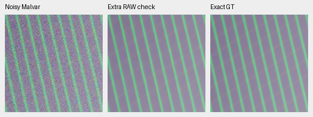
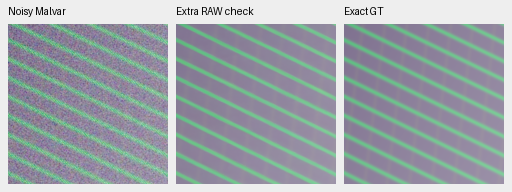

# Local RAW donors for the fine cab mesh

Small exterior RAW windows find both wire directions in the main coarse
fence where the [whole-surround phase check](joint-mesh-phase.md) rejected
the view. In the **left fine cab crop**, two localized donors also supply
a pair of frequencies. Restoring both directions with local support
makes a faint lattice visible at both noise priors. Each proposed
direction improves prediction on additional measured Bayer samples.
The right crop lacks the same support. The left lattice still has
uneven and overly regular sections, and the independent reference
captures cannot establish the location of every crossing.
[Bound data, native crops and executed code](results/local-donor-mesh-v1/publication.json).

## Donor frequencies and local evidence

An exterior window fits an affine background and noise scale on one
Bayer checkerboard half. It ranks windowed green spectral peaks and
checks their signed predictions on the other half, accounting for the
native offsets of both green phases. Two nonparallel frequencies must
occur together in at least two disjoint windows outside the query and
its 32-pixel margin. The frequency estimates pass to the query. The
phase estimates from the exterior windows stay with the donors.

A reserved quarter of the query finds phases and refines frequency.
The remaining two checkerboard subsets fit and check the front and
rear profiles with separate Bayer color amplitudes. An intervention
changed 49,152 native samples outside the reserve and left the
selected carriers and reserve scores identical. In the first test,
both reserve peaks also had to exceed a score of three. The follow-up
keeps the reserve-score requirement for the front and lets the
held-out fits decide whether to use the rear. It compares the first
frequency grid with a finer grid around the reserve-only result.

The follow-up on the standing cab crop uses 112-pixel donor windows
and a two-direction correction. The 80-pixel windows remain the
tested configuration on the main scene and full synthetic panel.
The local support mask interpolates smaller query fits and carries
the broad amplitude only where both directions have support.
An extra query check uses a separate quarter for validation after
fitting on two other quarters and selecting phases on the first
quarter. Each directional prediction must reduce sensor error against
the other-direction-only prediction. The rear prediction must also
beat a 0.31-cycle shift. This latter rule and the cab window size
were studied after viewing the first camera outputs. The measured
support is empirical, including possible real-sensor noise correlation.

## Exact-reference tests

The fresh panel has 72 pairs, six geometries, two noise priors and
two draws per layout. Additive, occluded and broken rear wires are
checked against front-only and independent flat inputs. The two
periodic directions occur only in bounded exterior donor fields.
The matched, rotated and quiet surrounds use the same query RAW.
All matching and unrelated surrounds propose a pair. The quiet
surrounds propose none. The first matched policy with the extra rear
reserve threshold changes one of 72 present roles. With the true
center frequencies it changes none. Phase and support remain limiting
even after finding both exterior frequencies.

The relaxed and refined fits improve recovery mainly at ISO400.
The table gives full weak-increment projection and RMS error for
12 pairs per row.

| ISO400 layout | Local trunk response / RMS | Relaxed rear fit | Finer reserve fit |
| --- | ---: | ---: | ---: |
| Additive | 32.1% / 51.82 | 75.5% / 32.30 | 90.2% / 27.73 |
| Occluded | 30.4% / 44.68 | 74.5% / 28.93 | 83.7% / 25.22 |
| Broken | 31.2% / 44.37 | 39.8% / 40.51 | 45.9% / 37.58 |

RMS is in DN16. A periodic fit still adds some structure inside
gaps. The matching refined fit changes four front-only outputs
across the 72 cases. The unrelated refined fit can also change a
few strong-only or present roles. The additional support and query
check are a separate 12-pair replay on the retained cases. On its
six ISO400 cases, the final correction recovers **66.0%** of the
weak increment versus **31.7%** for the trunk, reducing increment RMS
from 46.92 to 33.03 DN16. In this subset the two broken roles return
the parent, reducing their added gap RMS from **15.70 to 0 DN16**
versus the rear-only fit. The final check also returns the parent in
all six ISO6400 retained cases and all retained unrelated, quiet,
front-only and flat roles. [Per-layout and replay results](results/local-donor-mesh-v1/publication.json).

## Native comparisons

Both triplets use native ROI `[48,48,160,160]`, draw 0, ADC16 with
black fraction 0.03, identity WB/matrix, ISO400 shot/read
`8e-5/2.56e-8`, exposure ×1 and shared contrast ×8.
Case 94 is GRBG with additive wires. Case 91 is GBRG with occlusion.
The parent is the spatial 2k EMA with context disabled, SHA256
`97fd551bd0ae0b7aa97c67e1f6e8b513b722f70d5ad8b8814a96586b934eafac`.
[Exact crop and sensor bindings](results/local-donor-mesh-v1/publication.json).

[Broken-wire comparison](images/local-donor-mesh-v1/iso400-broken-g91-r0-comparison.png) ·
[ISO6400 comparison](images/local-donor-mesh-v1/iso6400-occluded-g94-r0-comparison.png).

## Standing GFX100S checks

The two 112-pixel windows supporting the left cab proposal lie to
one side of the query. The rear-only fit creates long diagonal
stripes. Delivering both directions shows a faint lattice. Local
support attenuates the broad correction, particularly toward the
upper edge. The additional query check admits that result on the
left at both priors; it rejects the right. The added camera-RGB
correction falls from 18.91 to 12.02 DN16 RMS at the nominal prior
and from 14.39 to 10.01 DN16 RMS at the transferred prior after
local support is applied.
Both priors condition the same DSCF3842 RAW observation.

| Fine cab crop | Extra RAW reduction, first direction | Extra RAW reduction, second direction | Shifted second direction |
| --- | ---: | ---: | ---: |
| Nominal left | +56.38 | +66.26 | +14.35 |
| Transferred left | +90.94 | +104.08 | +24.94 |
| Nominal right | −2.64 | −5.77 | −3.61 |
| Transferred right | −4.35 | −10.26 | −6.34 |

These are reductions in whitened squared prediction error on
16,384 extra measured Bayer samples. Each comparison retains the
other direction in its null. The noise scale and amplitudes come
from the fitting partitions. No neural output or ISO100/JPEG
reference enters the score. The stronger coarse-fence pair also
passes. The sky, building and foliage return to the local parent;
the extra check removes the candidate building correction.
The sky also rejects a forced coarse-fence pair in the diagnostic
cross-fits. [Extra-sample evidence and actual viewing](results/local-donor-mesh-v1/publication.json).

All eight boards retain V120, local-only 2k EMA
`ceb5ddaf23fce47806a01045bd86d34bb48d1f64031e382b0d5cfbabf0716880`,
and independent ISO100 AHD. Both cab JPEGs are shown. Differing
aperture and capture conditions limit those references to
qualitative comparisons. Main DSCF3879 exposure is ×4 at
`0.00128/6.5536e-6` shot/read. Cab DSCF3842 exposure is ×16.
[Sky](images/local-donor-mesh-v1/standing/main-overcast-sky-main-overcast-sky.png) ·
[Building](images/local-donor-mesh-v1/standing/main-building-detail-main-building-detail.png) ·
[Foliage](images/local-donor-mesh-v1/standing/main-foliage-main-foliage.png) ·
[Coarse fence](images/local-donor-mesh-v1/standing/main-chain-link-fence-main-chain-link-fence.png).

| Cab prior, shot/read | Native boards |
| --- | --- |
| Nominal, `0.00128/6.5536e-6` | [Left](images/local-donor-mesh-v1/standing/mesh-nominal-fine-green-mesh-left.png) · [Right](images/local-donor-mesh-v1/standing/mesh-nominal-fine-green-mesh-right.png) |
| Transferred, `0.0014635775921166604/1.0715704128646712e-6` | [Left](images/local-donor-mesh-v1/standing/mesh-profile3879-fine-green-mesh-left.png) · [Right](images/local-donor-mesh-v1/standing/mesh-profile3879-fine-green-mesh-right.png) |

The camera-driven choices and the small retained replay keep this a
scoped experimental result. The trial has no new training endpoint
or comparable [primary panel score](performance-history.md).
