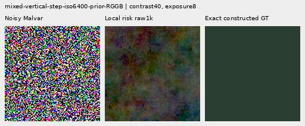
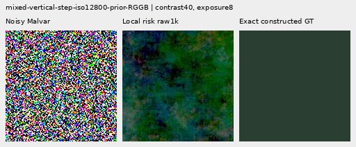

# V156: less quiet-region regression while retaining weak-mesh response

The local RGB-RMS regret loss lowers quiet-mask RMS **0.30–0.63% versus matched
delivered-RGB MSE**. All 32 mixed quiet inputs improve at both raw/EMA endpoints.
Mean excess over V143 is reduced by about 71–98%, though actual quiet RMS remains
**0.008–0.224% above V143**. Mesh response stays 5.59–10.52% above V143 but gives
up 5.24–5.81% versus MSE. **Fine real cab crossings remain missing and broad
colored mottle remains visible.** This is a useful local-error allocation gain,
not a visibly clean field or a solution to weak-detail restoration.

Both 1k heads/four fixed raw/EMA endpoints, 822 cases, 72 actual native figures and
independent audits are complete. The MSE control reproduces V154 trace/raw/EMA/
Adam and all 1,644 actual archived-output replays exactly. No source/data/noise
change accompanies the new loss. The [recipe](../configs/quality-v143-local-risk-v156.yaml)
fixes one local coefficient and final endpoints; no early selection occurs.

Use local regret as the next **learned late-head training control**, retaining
MSE/[V153](delivered-spectral-objective.md) as stronger mesh-response comparators,
[V154](robust-spectral-objective.md) for lower standalone-flat error and
[V150](objective-floor-training.md) for stronger ADC photos. Versus the quieter
[V151](noisy-objective-training.md) control, response rises 1.76–3.07% and mean
quiet RMS falls 0.03–0.18%; individual regressions still occur. That comparison
also changes input features/base spectral supervision, so it is not isolated
loss causality. [V120 Small](current-model.md) remains the general recommendation
and explicit V143 periodic detail retains its stronger real periodic gain.

## Quiet regions beside structure

Sixteen cases per prior contain a step, bar or patterned patch beside an exact
quiet dark neighbor. RMS is scene-linear camera RGB error in DN16. Whole-scene,
quiet-mask and quiet spatial errors remain separate; spatial error removes DC.

| Prior | Method | Whole RMS | Quiet RMS | Quiet spatial RMS |
| --- | --- | ---: | ---: | ---: |
|ISO6400|V143|27.105631|3.898845|3.268502|
|ISO6400|MSE raw|27.040450|3.932401|3.307233|
|ISO6400|MSE EMA|27.046026|3.917796|3.289952|
|ISO6400|Local risk raw|27.058155|3.907594|3.278527|
|ISO6400|Local risk EMA|27.065605|3.899175|3.268512|
|ISO12800|V143|36.747466|6.152652|5.341833|
|ISO12800|MSE raw|36.540356|6.186339|5.379674|
|ISO12800|MSE EMA|36.576072|6.176355|5.368321|
|ISO12800|Local risk raw|36.610153|6.162404|5.352693|
|ISO12800|Local risk EMA|36.643242|6.157827|5.347504|

Against MSE, all 16 inputs under each prior improve at both endpoints. Compared
with the original V143 parent, however, 29/32 raw and 20/32 EMA quiet inputs are
still worse. Maximum per-case increases over V143 are 0.02638 DN16 raw and
0.01677 EMA. The ISO6400 EMA mean is nearly back to the parent, while ISO12800
still regresses0.084%. A small mean regression is not a local safety guarantee.

The [paired-region audit](results/v156-local-risk-v1/paired-regions.json) retains
every case. Versus V151 noisy-only, raw improves 21/32 quiet cases and EMA 28/32;
worst increases are 0.00523/0.00304 DN16. Four CFA placements and reused recipes
are related observations, not 32 independent scenes or statistical significance.
Strong-edge whole RMS remains below V143, but is worse than MSE: the local loss
trades some global gain for less quiet-neighbor error.

## Mesh response and actual blank errors

There are 256 present and 256 absent cases. Template response is a projection
onto exact procedural GT, not accuracy or calibrated detection. Actual blank
RMS is output-versus-target error; added blank RMS measures change from parent.

| Method | Present full RMS | Response | Actual blank RMS | Blank spatial RMS | Added blank RMS |
| --- | ---: | ---: | ---: | ---: | ---: |
|V143|9.111243|0.02202090|5.523323|5.343113|0.00000000|
|MSE raw|9.065995|0.02583932|5.529598|5.349611|0.45695545|
|MSE EMA|9.073765|0.02453732|5.524094|5.343926|0.41348850|
|Local risk raw|9.080738|0.02433695|5.522763|5.342544|0.31564742|
|Local risk EMA|9.088409|0.02325169|5.519909|5.339598|0.28432343|
|Existing periodic detail|8.586126|0.07089755|5.523328|5.343118|0.00063557|

Absolute response reaches only 2.33–2.43% of GT. Present full RMS is 0.25–0.33%
below V143, less improvement than MSE. Actual blank RMS is 0.010–0.062% below
V143, where MSE regresses slightly. Absent full RMS is 5.23656/5.23404 raw/EMA,
versus 5.23791 parent and 5.24198/5.23738 MSE. Added blank correction energy falls
substantially, but actual error remains the relevant quality measure.

## Noisy flats and natural photographs

Flat groups contain 24 cases each. Full spatial RMS removes full-image DC.
Block32 error after32×32 averaging exposes coarse variation instead of fitting
it away. All means retain the same sources/conditions across methods.

|Flat test|V143|MSE raw|MSE EMA|Local risk raw|Local risk EMA|
| --- | ---: | ---: | ---: | ---: | ---: |
|Native512 ISO6400 full RMS|18.546808|18.526464|18.513829|18.525205|18.517628|
|Native512 ISO6400 spatial RMS|18.235130|18.214455|18.201512|18.213137|18.205378|
|Native512 ISO6400 block32 RMS|13.440561|13.440939|13.440410|13.440890|13.440523|
|Native512 ISO12800 full RMS|24.071890|24.048808|24.030195|24.041122|24.030574|
|Native512 ISO12800 spatial RMS|23.596861|23.573335|23.554204|23.565391|23.554538|
|Native512 ISO12800 block32 RMS|17.932544|17.931620|17.931519|17.931976|17.931945|
|Older native256 ISO12800 full RMS|27.233548|27.207559|27.182713|27.201136|27.186906|
|Older native256 ISO12800 spatial RMS|26.017191|25.990140|25.963698|25.983274|25.968052|
|Older native256 ISO12800 block32 RMS|19.539875|19.539392|19.539618|19.538875|19.539051|

Native 512 full RMS falls 0.116–0.172% versus V143. Changes versus MSE are mixed:
raw improves slightly, EMA is slightly worse. Coarse gains remain tiny or mixed,
and ISO12800 crop-block32 still exceeds V143. V154's0.45–0.50% standalone-flat
gain remains stronger, with much worse mixed quiet behavior. Native contrast 40
views still expose broad colored patches in all learned outputs.

Each photo group contains32 cases. Band metrics use native scene-linear
sRGB-luma target bands; response alone does not measure total restoration error.

|Photo test|V143|MSE raw|MSE EMA|Local risk raw|Local risk EMA|
| --- | ---: | ---: | ---: | ---: | ---: |
|Retained512 faint full RMS|33.963754|33.961085|33.962786|33.960603|33.962389|
|Retained512 faint band error|0.824639|0.824517|0.824672|0.824569|0.824698|
|Retained512 faint band response|0.298560|0.297382|0.297002|0.297855|0.297562|
|Retained512 dark full RMS|29.097715|29.093401|29.094114|29.094054|29.094977|
|Retained512 dark band error|0.661447|0.661406|0.661441|0.661410|0.661443|
|Retained512 dark band response|0.531446|0.529480|0.529353|0.530368|0.530279|
|Organic384 faint full RMS|37.469061|37.467960|37.473484|37.468319|37.472629|
|Organic384 faint band error|0.924117|0.924263|0.924464|0.924249|0.924407|
|Organic384 faint band response|0.150701|0.149739|0.149298|0.150037|0.149699|
|Organic384 dark full RMS|33.685796|33.684591|33.686215|33.684630|33.685973|
|Organic384 dark band error|0.781612|0.781602|0.781623|0.781617|0.781635|
|Organic384 dark band response|0.398945|0.397297|0.397081|0.397982|0.397824|

All four natural groups retain more band response than matched MSE, but remain
0.20–0.66% below V143. Full RMS and band-error changes are mixed and very small.
Retained-faint full RMS improves slightly more than MSE, while other groups do
not consistently improve. Feathers, branch texture and organic detail remain
visibly soft. Lower quiet regression does not establish recovered natural detail.

## ADC-only photographs and sloped fields

All 192 constant ADC predictions across the four endpoints are bit-exact to
their parents. Parent equality is not exact GT. Eight ADC photo cases and 16
sloped 512 fields remain separately measured with zero shot/read noise.

|ADC test|V143|MSE raw|MSE EMA|Local risk raw|Local risk EMA|
| --- | ---: | ---: | ---: | ---: | ---: |
|Photo full RMS|18.149871|18.162996|18.162011|18.152257|18.150549|
|Photo band error|0.101855|0.102076|0.102078|0.101954|0.101956|
|Photo band response|0.968329|0.966652|0.966671|0.967273|0.967277|
|Sloped512 full RMS|3.771369|3.760164|3.761401|3.766475|3.767035|
|Sloped512 spatial RMS|3.397249|3.384330|3.385732|3.391990|3.392570|
|Sloped512 block32 RMS|0.574652|0.575816|0.575689|0.576587|0.576247|
|Sloped512 crop block32 RMS|0.088145|0.088132|0.088133|0.088142|0.088143|
|Sloped512 worst absolute DC|11.176981|11.175606|11.175844|11.171241|11.172559|

The local loss reduces the MSE ADC-photo regression, but full RMS remains
0.0037–0.0131% above V143 and band error remains higher. V150's roughly3.06%
photo gain is stronger. Sloped full RMS remains0.115–0.130% below V143, less
improvement than MSE. Coarse block32 worsens0.278–0.337% versus V143, and is
also worse than MSE. Local supervision does not fix coarse ADC behavior.

## Native 100% comparisons

All 72 figures were actually viewed at original detail in 18 unscaled sheets.
Every cell is 160×160 original pixels, without resizing. The
[manifest](images/v156-local-risk-v1/manifest-v1.json) binds source/ROI, checkpoint
SHA256, noise conditioning, display exposure, common target anchor and contrast.
The48 boards plus24 repeated-cell triplets contain 32,332,800 independently
checked RGB channels. Repeated triplets add no observations.

Two quiet triplets for each improved endpoint: **noisy Malvar → local-risk
restoration → exact constructed GT**. Native 512 RGGB, ROI `[80,176,160,160]`,
vertical-step quiet neighbor, shared exposure8 and camera-linear contrast 40
about the exact quiet-target channel means. ISO6400 shot .00128/read variance
6.5536e-6; ISO12800 shot .00256/read variance2.62144e-5. The stress display clips
noisy pixels and exposes existing broad mottle. Changes from MSE are small.






| Endpoint | Mesh2302 | Mesh2309 | Flat ISO6400 | Flat ISO12800 | Quiet ISO6400 | Quiet ISO12800 |
| --- | --- | --- | --- | --- | --- | --- |
|mse-control-raw-step1000|[native](images/v156-local-risk-v1/comparison-00-mse-control-raw-step1000-triplet.png)|[native](images/v156-local-risk-v1/comparison-02-mse-control-raw-step1000-triplet.png)|[native](images/v156-local-risk-v1/comparison-19-mse-control-raw-step1000-triplet.png)|[native](images/v156-local-risk-v1/comparison-20-mse-control-raw-step1000-triplet.png)|[native](images/v156-local-risk-v1/comparison-26-mse-control-raw-step1000-triplet.png)|[native](images/v156-local-risk-v1/comparison-28-mse-control-raw-step1000-triplet.png)|
|mse-control-EMA-step1000|[native](images/v156-local-risk-v1/comparison-00-mse-control-EMA-step1000-triplet.png)|[native](images/v156-local-risk-v1/comparison-02-mse-control-EMA-step1000-triplet.png)|[native](images/v156-local-risk-v1/comparison-19-mse-control-EMA-step1000-triplet.png)|[native](images/v156-local-risk-v1/comparison-20-mse-control-EMA-step1000-triplet.png)|[native](images/v156-local-risk-v1/comparison-26-mse-control-EMA-step1000-triplet.png)|[native](images/v156-local-risk-v1/comparison-28-mse-control-EMA-step1000-triplet.png)|
|local-risk-raw-step1000|[native](images/v156-local-risk-v1/comparison-00-local-risk-raw-step1000-triplet.png)|[native](images/v156-local-risk-v1/comparison-02-local-risk-raw-step1000-triplet.png)|[native](images/v156-local-risk-v1/comparison-19-local-risk-raw-step1000-triplet.png)|[native](images/v156-local-risk-v1/comparison-20-local-risk-raw-step1000-triplet.png)|[native](images/v156-local-risk-v1/comparison-26-local-risk-raw-step1000-triplet.png)|[native](images/v156-local-risk-v1/comparison-28-local-risk-raw-step1000-triplet.png)|
|local-risk-EMA-step1000|[native](images/v156-local-risk-v1/comparison-00-local-risk-EMA-step1000-triplet.png)|[native](images/v156-local-risk-v1/comparison-02-local-risk-EMA-step1000-triplet.png)|[native](images/v156-local-risk-v1/comparison-19-local-risk-EMA-step1000-triplet.png)|[native](images/v156-local-risk-v1/comparison-20-local-risk-EMA-step1000-triplet.png)|[native](images/v156-local-risk-v1/comparison-26-local-risk-EMA-step1000-triplet.png)|[native](images/v156-local-risk-v1/comparison-28-local-risk-EMA-step1000-triplet.png)|

Mesh triplets: native 512 RGGB, ROI `[176,176,160,160]`, shot .00128/read variance
6.5536e-6, exposure8, contrast 1. Dark-gray flat triplets use that ROI at level .02,
exposure4/contrast 40 with the respective ISO priors above. The complete boards
retain the parent, MSE controls and periodic comparator, where applicable.

The noisy [feather](images/v156-local-risk-v1/comparison-13.png) view uses
Alexis Lours, CC BY4.0, SHA1 `02a76fd33b5e1414a0504f0b3f0aeb03a569b6f4`,
native 384, ROI `[112,112,160,160]`, exposure 14.388348 and contrast 8.
The [dark bird/branch](images/v156-local-risk-v1/comparison-25.png) uses
Andrew Mercer, CC BY-SA4.0, SHA1 `3e638bbb56ed80abc88939468783e3bf9b92ee77`,
native 512, ROI `[176,176,160,160]`, exposure 80.995917 and contrast 1.
Both use shot .00128/read 6.5536e-6. Fine texture remains missing.

Standing DSCF3879 ISO6400/DSCF3880 ISO100 views retain
[sky](images/v156-local-risk-v1/comparison-05.png),
[building](images/v156-local-risk-v1/comparison-06.png),
[foliage](images/v156-local-risk-v1/comparison-07.png) and
[chain-link fence](images/v156-local-risk-v1/comparison-08.png), exposure 4.
DSCF3842/3835 fine cab mesh retains both windows under
[nominal left](images/v156-local-risk-v1/comparison-09.png),
[nominal right](images/v156-local-risk-v1/comparison-10.png),
[profile3879 left](images/v156-local-risk-v1/comparison-11.png) and
[profile3879 right](images/v156-local-risk-v1/comparison-12.png) priors.
Native 768 contexts, left/right ROIs `[206,229,160,160]` / `[426,189,160,160]`,
exposure 16 and contrast 1. Both SOOC JPEGs stay native unboosted sRGB8.
Independent ISO100/AHD/JPEG references differ in aperture, shutter, processing
and motion: **qualitative references, not exact GT**, never pixelwise scored.
No convincing new fine cab wires appear. Protected captures, JPEGs and siblings
remain excluded from training; originals stay read-only and `/mnt/dataz` untouched.
The [quiet ROI](images/v156-local-risk-v1/comparison-26.png) at 40× and
[whole-edge view](images/v156-local-risk-v1/comparison-27.png) at 1× retain
the same coordinates across methods.

## Local RMS regret


For output `O`, supplied frozen parent `B`, exact training target `T` and the
existing per-image noise unit `s`, define `eB=(B−T)/s`, `eO=(O−T)/s` and
`d=(O−B)/s`. Each native 32×32 RGB box has:

```text
rB = sqrt(mean(eB²) + (1 / 65535 / s)²)
rO = sqrt(mean(eO²) + (1 / 65535 / s)²)
regret = mean(d × (2 eB + d)) / (rO + rB)
```

The last expression equals `rO−rB` without subtracting nearly equal squared
errors or RMS values. The one-DN16 term smooths the norm; it does not round the
image. Boxes overlap at native stride 16. Replicated boundary samples and the
same half-hop grid cover every image, including nondivisible rectangles.

A C1 hinge with transition `t=1e−4` penalizes positive regret:

```text
h(r) = 0                   if r ≤ 0
       r² / (2 t)          if 0 < r < t
       r − t/2            if r ≥ t
```

The new term is the mean over boxes and images, with fixed weight 1 inside the
unchanged domain multiplier. Improving boxes receive zero penalty. Parent,
target and noise units are detached in this term; only output receives its
derivative. Its value and first derivative are exactly zero at unchanged
parent output, including a perfect parent. Norm smoothing keeps derivatives
finite. The base pixel/gradient/spectral objective still drives initialization.

`s` remains the inherited whole-image RAW variance proxy with 16-DN16 floor.
Noise units and the hinge transition are training scales, **not calibrated RGB
covariance, confidence or expected excess risk**. There is no clean-target-power
mask. The loss permits changes that reduce actual target error, including
denoising an already mottled parent.

Zero penalty does not prove pixelwise correctness, absence of false structure,
or safety on unseen captures. A box average can hide redistribution within the
box, the parent can already be wrong, and a finite soft penalty is no hard
constraint. Actual quiet spatial/DC errors, weak responses and native images
remain necessary.

## Fixed matched comparison

The [recipe](../configs/quality-v143-local-risk-v156.yaml) fixes two fresh
33,713-parameter/13-tensor relative-phase heads: unchanged RGB-MSE control and
the same objective plus local regret. All 86 neural sources are byte-identical.
Delivered-RGB spectral MSE retains coefficient .25; pixel/gradient terms,
domain weights, physical conditioning, input evidence, frequency band/bound,
support, initialization, data/geometry, AdamW, clipping, LR and EMA stay fixed.
There is one local coefficient and two final raw/EMA endpoints per arm, with
no quality-driven coefficient or early-checkpoint selection.

Each head uses the same 1,000 cached V148 batches /4,000 old observations:
882 supervised batches and 118 zero-ADC-gradient batches. All 1,000 optimizer/EMA
clocks advance, including momentum/decay coasting. The five training domains and
source geometry retain the V147 controlled recipe; no new noise, parent/DINO
call, source lookup, RAW decode or `/mnt/dataz` access occurs.

The MSE control must reproduce every V154 control loss/component/gradient/LR
row, raw/EMA/Adam states and all 1,644 reviewed arrays exactly. Compatibility
checks precede two discarded ten-update CUDA runs with genuine 8+2 restoration.
Production starts fresh. A mandatory strict CPU check of the actual final
checkpoint precedes the review claim and CUDA collection.

## Completed checks and exact controls

Thirty-six tests pass in 1.07s: nine independent local-loss tests and 27 delivered
objective tests. Explicit NumPy coordinate enumeration checks both box values
and full two-image RGB adjoints, including repeated edges, small/nondivisible
geometries, saturated/quadratic hinges, finite zero derivatives, tiny positive
regret and a quiet-regression/global-improvement counterexample. These verify
the objective, not quality or safety on unseen captures.

Twenty-eight current/frozen compatibility contexts match archived outputs
exactly, 56 actual head evaluations. Two discarded ten-update CUDA checks include
genuine 8+2 model/EMA/Adam/RNG restoration; production starts fresh. All 26 tensors
receive finite nonzero gradients over the prefix. All 1,000 control trace rows,
raw/EMA/Adam states and 1,644 actual reviewed control outputs match V154 bitwise.
Strict CPU loading and 26 finite Adam states are checked before the review claim.
All 86 neural sources stay unchanged; the new target-dependent computation is
only a training loss. No target enters inference.

[Recorded gradient norms](results/v156-local-risk-v1/training-routing.json) have
no clipping. Noisy-batch median/max norms are .003421/.119038 for MSE and
.002986/.067385 for local loss. All 882 supervised batches have nonzero gradients;
all 118 ADC batches have zero total loss/gradients but retain optimizer/EMA
coasting. These norms are not Adam influence or causal quality attribution.

[Archived proposal/support means](results/v156-local-risk-v1/proposal-support.json)
fall together: mesh support .259/.230 raw/EMA versus .323/.303 MSE, and pre-support
coefficient RMS2.227e-5/1.978e-5 versus 2.616e-5/2.343e-5. These averages do not
establish spatial selectivity or calibrated confidence. Proposal/support changes
are coupled; the actual regional errors and retained weak response define the gain.

The [independent scalar audit](results/v156-local-risk-v1/independent-metrics-audit.json)
checks 40,210 scalars over 4,686 rows, maximum discrepancy 4.55e-13 and 476 Decimal
reductions. All 3,288 current head calls and 1,398 retained parent/periodic rows
are bound; all 30 real rows remain unscored. No scientific stage failed or restarted;
all 10 recorded controller/worker owners are terminal.

Actual work totals **5,364 head evaluations**: 56 compatibility, 20 discarded smoke,
2,000 production and 3,288 review. Unit tests are excluded. New parent/DINO calls,
noise draws, source/original lookups and RAW decodes are zero. Training/review
peak CUDA is 4.146/1.445GiB under 12GiB quota; RAM guards 52GiB launch/32GiB runtime.
Controls are re-evaluated and compared exactly before adopting their original
array files, avoiding duplicate prediction storage. New local raw/EMA arrays use
2.211GiB each on local/external SSDs, retaining 96/208GiB reserves. No old evidence
is moved or deleted, original media remains read-only and `/mnt/dataz` is unused.

The [final publication](results/v156-local-risk-final-v1.json) preserves 18 final
receipts byte-exact, alongside the unchanged12 preparation receipts, 28 source
texts, step500 audit and historical808-row live snapshot. Seven final reduction/
viewing/terminal helpers are retained. The
[publication verifier](results/v156-local-risk-publication-verification-v1.json)
checks source/public bytes, all 72 PNGs/24 triplets, exact controls, 192 exact ADC
fields, 205 rounded table cells and paired-region counts. Machine receipts keep
their original UTC timestamps.

## Next quality work

Retain local regret as the next learned-head training control while testing a
spatial path that can directly model coarse/affine residuals. The current
proposal removes affine and very low frequency modes; overlap and spatial
support can still mix frequencies, so coarse output is not literally frozen.
It lacks an unrestricted coarse prediction path. The parent already contains
false broad variation, and merely reducing added regression does not remove it.
Weak real wire recovery and clean quiet regions must improve together.

Current model choices retain each measured strength rather than freezing the
architecture at a historical study gate. No V157 implementation or training is
claimed here. The broader fine-dark-detail/clean-sky goal remains active. See the
[final local-time diary](../diary/2026-11-03-20-59-49-v156-final-local-regret.md).
