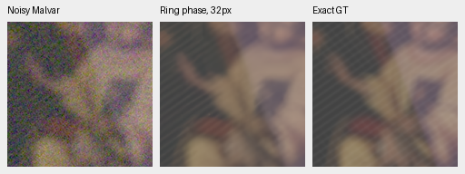
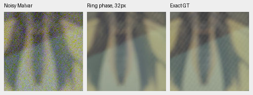

# Exterior phase transfer and local wire recovery

A wider RAW query can validate faint wire phase when the exterior
guide agrees with the local signal. On the nominal right GFX cab crop,
a 64-pixel window with fixed exterior phase passes both green-lattice
checks at nine of nine stations for the first direction and five of
nine for the second. The corresponding counts at 32 pixels are four
and zero. On the left crop, the first direction still fails every
64-pixel exterior-phase check. Its local phase differs from the
nearby exterior estimate by 87.8° at the median.

An inference-only correction that estimates phase from a closer ring
and checks it inside a 32-pixel patch gives a modest recovery gain
over Local 50k. It lowers continuing-strand error at comparable
weak response to the 32- and 64-pixel local fits. The full-strength
64-pixel fit recovers substantially more weak detail. The smaller
ring correction leaves fine real crossings incomplete.

## Disjoint RAW evidence on the standing GFX scenes

The test reuses the [four 128-pixel donor frequency
nominations](bayer-carrier-scale.md). Four separate adjacent
64-pixel patches fit phase for the same two nominated directions.
Both donor banks lie outside the complete 160-pixel query. The
corresponding near and far banks can share exterior pixels.
Replacing all query pixels leaves both estimates and the frequency
nominations bit-identical.

Within the query, one green lattice fits a low-frequency background
and a competing carrier, plus a nonnegative amplitude for the tested
carrier. The other lattice measures the reduction in squared
prediction error against the same fit without that carrier. A second
pass swaps the roles. The local control fits both phase quadratures
from the fitting lattice. The rotated control adds a quarter cycle
to the near guide. The table counts stations above six noise-weighted
error-reduction units on **both** folds. Stations overlap and their
counts describe these crops.

| Nominal RAW crop | 32 px, local phase | 64 px, local phase | 32 px, nearby exterior phase | 64 px, nearby exterior phase | 64 px, quarter cycle |
| --- | ---: | ---: | ---: | ---: | ---: |
| Overcast sky | 0 / 0 | 0 / 0 | 0 / 0 | 0 / 0 | 0 / 0 |
| Building | 4 / 1 | 5 / 5 | 0 / 0 | 0 / 0 | 2 / 0 |
| Foliage | 6 / 4 | 8 / 7 | 2 / 1 | 0 / 1 | 2 / 0 |
| Coarse fence | 9 / 9 | 9 / 9 | 9 / 9 | 9 / 9 | 0 / 1 |
| Left cab | 0 / 0 | 6 / 4 | 0 / 0 | 0 / 3 | 6 / 0 |
| Right cab | 4 / 0 | 9 / 6 | 4 / 0 | 9 / 5 | 2 / 0 |

The first/second direction follows positive/negative vertical
frequency in the nominated pair. On the right, the 64-pixel median
absolute local-minus-near phase difference is 23.6°/15.4°, versus
87.8°/37.2° on the left. With transferred conditioning the right
near-phase checks pass nine and six stations at 64 pixels. The
different priors reweight the same Bayer measurements. The left
quarter-cycle control shows that an exterior carrier can have the
right frequency and poor phase at the delivery site. The building
and foliage controls show that a local fit can predict structure
other than a repeating fence. The restoration below retains the
existing two-direction donor geometry gate.

## Ring-guided restoration on exact targets

The correction fits both carriers in a 64-pixel RAW window with
its central 32 × 32 pixels excluded. It delivers to that center
using the fitted phase and nonnegative amplitude estimated on one
green lattice and verified on the other, in both directions. A
fixture changes the entire delivered patch and reproduces the
ring coefficients exactly. The local-phase controls fit phase in
their own 32- or 64-pixel delivery windows. All use the existing
exterior frequency nomination and geometry gate, six-unit
reciprocal cutoff, taper, neutral camera-RGB transport, measured
amplitude cap and nominal gain 0.73. The 64-pixel control uses the
[existing crop API](bayer-carrier-scale.md).

The common parent is the Local-only 50k CUDA IEEE FP32 EMA
`62f4e9ce84075c8df1a254a1889033b5787133e8c98c63e0ec3d174a94734959`.
The parent reads the entire noisy query. The split checks validate
the Bayer fit before the measured carrier deficit is applied to
the parent. The earlier 32 optical sources fix response-matching
weights. The other 24 sources supply confirmation on σ 0.85, with
12 true weak gaps. These are the [bound optical fixtures](local-optical-mixture-1024.md#fresh-optical-confirmation)
and their shared-photon captures.

| Change versus Local 50k at nominal gain | Ring phase, 32 px | Local phase, 32 px | Local phase, 64 px |
| --- | ---: | ---: | ---: |
| Sharp-normalized weak response, points | +0.396 | +0.474 | +4.103 |
| Intact fundamental RMS, DN16 | −0.320 | −0.373 | −3.161 |
| Continuing-strand RMS in true gaps, DN16 | −9.643 | −8.934 | −30.626 |
| False weak projection in true gaps, DN16 | −0.012 | −0.024 | −0.026 |
| Exact-flat luma RMS, DN16 | 0.000 | 0.000 | 0.000 |

The ring gain over the parent has a paired 95% interval of
+0.166 to +0.669 weak-response points. Within the faintest half,
the gain is +0.117 points [−0.023, +0.291]. The ring's false-gap
difference spans zero. At nominal strength its 32-pixel
comparison has −0.079 weak-response points [−0.167, +0.009] and
−0.709 DN16 continuing-strand error [−1.476, +0.042] versus local32.

### At comparable weak-strand recovery

The earlier panel selects weights along each correction relative to
its nominal strength. Ring receives weight 0.500, local32 0.279 and
local64 0.0369. The three reach the same mean weak response on those
32 sources. The same-width comparison is a follow-up diagnostic. On
the separate confirmation set, the ring's residual response advantage
over local32 is 0.065 points [+0.007, +0.129].
At this comparison its continuing-strand RMS falls **2.361 DN16**
[−3.286, −1.486], with a false weak projection difference of
+0.001 DN16 [−0.022, +0.023]. Against the dose-reduced local64,
continuing-strand RMS falls **3.761 DN16** [−5.305, −2.360] and the
weak-response difference is +0.047 points [−0.071, +0.189]. Exact
flat RMS stays equal in both comparisons. The strongest weak
recovery is still the nominal local64 fit.
[Matched-width evidence](results/local-exterior-phase-transfer-v1/matched-width.json).

The parent capture takes 88.41 seconds on the shared GPU. Separate
correction, scoring and rendering take 20.34 seconds for this replay.
This inference component is scoped to native synthetic crops and the
standing real scenes. The [Local 50k photo and camera
scores](scene-50000-cameras.md) refer to the parent.

## Native exact crops

Each triplet shows noisy Malvar, the ring correction on Local 50k at
nominal strength, and exact post-optical GT. All cells use the same
unresized `(48,48,160,160)` ROI in the central 256 query, ISO6400 shot/read
`0.00128 / 6.5536e-6`, black 0.03, simulated σ 0.85 and exposure 0.33.
Display uses ×2 scene-linear exposure and sRGB.

Strip fixture based on Palauenc05's church photo, bin-four source box
`(40,82,512,512)`. The stronger slope remains clear and the faint strand
still breaks near the middle. Adapted by binning, planting lines and
simulating optics and sensor noise before cropping and rendering.
[Original](https://commons.wikimedia.org/wiki/File:Viv%C3%A8s_%C3%89glise_Saint-Michel_madonna.jpg) ·
[CC BY-SA 4.0](https://creativecommons.org/licenses/by-sa/4.0/) ·
[All methods](assets/local-exterior-phase-transfer-v1/fresh-02-comparison.png).

Ellipse fixture based on Bernie's swallowtail photo, bin-four source box
`(156,26,512,512)`. The local64 fit makes the dominant slope more
continuous, with relatively weak crossings in the green area.
[Original](https://commons.wikimedia.org/wiki/File:Papilio_machaon_01_04102009.jpg) ·
[CC BY-SA 3.0](https://creativecommons.org/licenses/by-sa/3.0/) ·
[All methods](assets/local-exterior-phase-transfer-v1/fresh-08-comparison.png).

## Standing GFX100S comparisons

DSCF3879 ISO6400 uses 512-pixel contexts, the retained nominal
conditioning and ×4 display. Sky, building and foliage reproduce
the parent pixels for all correction arms, and the coarse-fence
crossings remain connected. The ring changes the coarse fence by
15.31 DN16 RGB RMS relative to Local 50k. DSCF3880 ISO100 AHD is the
independently demosaiced qualitative reference.
[Sky](assets/local-exterior-phase-transfer-v1/main-overcast-sky-main-overcast-sky-x4.png) ·
[Building](assets/local-exterior-phase-transfer-v1/main-building-detail-main-building-detail-x4.png) ·
[Foliage](assets/local-exterior-phase-transfer-v1/main-foliage-main-foliage-x4.png) ·
[Coarse fence](assets/local-exterior-phase-transfer-v1/main-chain-link-fence-main-chain-link-fence-x4.png).

DSCF3842 ISO6400 uses 768-pixel contexts and nominal or transferred
DSCF3879 shot/read `0.0014635775921166604 / 1.0715704128646712e-6`.
All views contain DSCF3835 ISO100 AHD and both camera JPEGs.
They are qualitative references with different aperture, exposure
time and motion. The ring changes the four cab crops by
1.89–6.48 DN16 RGB RMS versus the parent, compared with
6.52–18.97 for local64. Both 32-pixel fits make small local changes.
Local64 gives more visible crossings and more regular-looking grid
structure on the right. The left remains interrupted near the
post, and none of the variants fully connects the fine mesh.

| Native 160 × 160 crop | Nominal prior | Transferred prior |
| --- | --- | --- |
| Left `(806,6489)` | [×4](assets/local-exterior-phase-transfer-v1/mesh-nominal-fine-green-mesh-left-x4.png) · [×16](assets/local-exterior-phase-transfer-v1/mesh-nominal-fine-green-mesh-left-x16.png) | [×4](assets/local-exterior-phase-transfer-v1/mesh-profile3879-fine-green-mesh-left-x4.png) · [×16](assets/local-exterior-phase-transfer-v1/mesh-profile3879-fine-green-mesh-left-x16.png) |
| Right `(1026,6449)` | [×4](assets/local-exterior-phase-transfer-v1/mesh-nominal-fine-green-mesh-right-x4.png) · [×16](assets/local-exterior-phase-transfer-v1/mesh-nominal-fine-green-mesh-right-x16.png) | [×4](assets/local-exterior-phase-transfer-v1/mesh-profile3879-fine-green-mesh-right-x4.png) · [×16](assets/local-exterior-phase-transfer-v1/mesh-profile3879-fine-green-mesh-right-x16.png) |

[Paired results and images](results/local-exterior-phase-transfer-v1/publication.json) ·
[RAW readouts, code and receipts](results/local-exterior-phase-transfer-v1/evidence.tar.xz).
