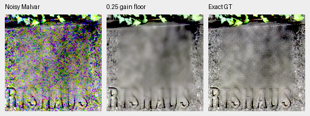
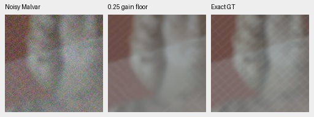

# A separate luminance correction for weak wire detail

The two original confidence gates nearly shut off their luminance
corrections. A 0.25 minimum gate gain recovers **0.49 percentage
points of weak-wire response** and lowers total gap RMS by **0.32
DN16** on the fixed exact replay. Exact-flat wire RMS rises **0.35
DN16**. The main fence keeps its coarse crossings. Fine cab crossings
remain incomplete.

[Machine results](results/local-factored-wire-v1/publication.json) ·
[Native crop provenance](images/local-factored-wire-v1/manifest.json) ·
[Frozen drivers and receipts](results/local-factored-wire-v1/evidence.tar.xz).

The [separate phase and support study](local-wire-gate-support.md) reuses the
frozen parent and compares confidence labels with an ungated signed loss.

## A frozen restoration and a separate correction

Both original arms freeze the aligned-control EMA from the
[continuing-wire study](local-continuing-wire.md). A 74,088-parameter
head receives the actual Bayer residual divided by its conditioned
noise scale, per-phase noise and color, and local luminance and
contrast from the frozen output. It predicts a signed luminance proposal
and a confidence gate. The delivered proposal scales with noise and
vanishes around clipped Bayer samples. The camera transform makes the
addition neutral in linear working RGB. The guide comes from the
native tile and its neighborhood.

The direct arm delivers the bounded, gated proposal. The band-limited
arm subtracts a broad Gaussian blur from a narrow Gaussian blur after
gating. It removes constant corrections and gives an interior
27.69-pixel sinusoid 0.544 axial or 0.528 diagonal gain, with about
0.94 gain at a 12-pixel period. The separate replay imposes a 0.25
minimum gain on the band-limited arm. All other training inputs and
losses match.

The approved 90,692-photo training manifest supplies 480 distinct
sources outside the four preceding paired schedules. The cells balance
natural and wire crops, ISO400 and ISO6400, all four Bayer layouts, and
coupled or independent within-pair noise. Wire cases have true strong
continuation on 192 sources and double gaps on 48. Two redraw pairs,
one flat crop and one ordinary crop give 2,880 native observations per
arm. The eight qualification sources are separate. Across the original
and floor runs every observation hash matches. Inference takes one Bayer
frame and its noise conditioning.

The same absolute, mean-first paired-band, independent-repeat, signed
weak-response and signed continuing-gap losses apply to each arm. A
small penalty limits the delivered lift on the exact-flat and ordinary
controls. The optimizer, schedule, initial head tensors and 0.985 EMA
are matched. Training uses BF16 neural layers and FP32 camera arithmetic,
projection and loss. Final evaluation uses CUDA IEEE FP32 with the EMA
correction and frozen parent EMA.

The frozen aligned-control parent is
`e1e706a7c5a49da96dfb77a7779126504a2aa85d8626567a09d4690b0b30b9ec`.
Each component checkpoint stores raw and EMA weights separately, along
with the parent binding. The interleaved two-arm run took 640.02 s.
The single-arm gain-floor replay took 683.31 s on the shared GPU. These
are training times including observation preparation and hashing.

| Correction | Updates | Native observations | Checkpoint SHA256 |
| --- | ---: | ---: | --- |
| Direct | 480 | 2,880 | `9b309fb244e563a42faa423c1bbdb3d0f5bb8abc131272ae69ecb6b20ef37272` |
| Band-limited | 480 | 2,880 | `cf6e3c92bc0800185ae2c2a0c6cc2781e13dcc7ca9d0c694c916ef2ea0d28cba` |
| Band-limited with 0.25 gain floor | 480 | 2,880 | `25007a508af93c43ce441127598fe44d8293bc97a4a2f0e5aea79973508a5fde` |

[Training audit](results/local-factored-wire-v1/training.json).

## The learned gates nearly close

On the 24 exact photograph crops, the median crop has sigmoid gain
below 1% at 99.86% of pixels for the direct head and 100% for the
band-limited head. Median delivered luminance RMS is 0.405 and
0.00444 DN16. On the 24 wire crops those values are 0.828 and
0.0116 DN16. In the 12 fixed weak-wire gaps, the direct head adds
0.02693 strong-response points and lowers total gap RMS 0.1194 DN16.
The band-limited head changes those quantities by +0.00043 points
and −0.00032 DN16. For comparison, the full-trunk continuing-wire loss
adds 16.86 strong-response points and lowers gap RMS 10.61 DN16.
Median natural-photo gain logits are −8.43 and −11.38. The corresponding
median fraction of saturated detail logits is under 0.1%, which
locates the dominant suppression in the confidence path.

## Exact ISO6400 crops

| Fixed replay metric | Aligned control | Direct | Band-limited | 0.25 gain floor | Full-trunk continuing-wire loss | V120 EMA |
| --- | ---: | ---: | ---: | ---: | ---: | ---: |
| Strong response in the 12 weak gaps | 46.88% | 46.90% | 46.88% | 47.19% | 63.74% | 53.65% |
| Weak-wire response, 24 crops | 24.91% | 24.92% | 24.91% | 25.40% | 28.07% | 31.83% |
| Total gap RMS in the 12 weak gaps | 170.26 | 170.14 | 170.26 | 169.94 | 159.65 | 171.20 |
| Intact wire increment RMS | 168.17 | 168.23 | 168.17 | 168.69 | 180.94 | 187.93 |
| Exact-flat wire RMS | 19.19 | 19.22 | 19.19 | 19.54 | 23.83 | 22.56 |
| Natural fine response, 24 crops | 56.92% | 56.93% | 56.92% | 57.10% | 58.40% | 58.22% |
| Natural fine-increment RMS | 134.81 | 134.81 | 134.81 | 134.86 | 135.58 | 137.34 |
| Natural exact-flat fine RMS | 4.11 | 4.12 | 4.11 | 4.31 | 5.04 | 5.73 |

RMS is in DN16. The gain floor moves strong response +0.309 points
with a paired 95% source-bootstrap interval of +0.277 to +0.340. Weak
response moves +0.494 points [+0.451, +0.537] and total gap RMS moves
−0.319 DN16 [−0.468, −0.168]. Intact-wire RMS rises 0.527 DN16.
The natural fine RMS rises 0.053 DN16. The median gain-floor
luminance lift is 3.76 DN16 in the natural crop and 2.42 DN16 in
the wire crop. The median natural crop has 0.59 DN16 of correction
RMS below 1/40 cycle per pixel after Hann weighting. Flat chroma agrees
with the frozen control to 0.00001 DN16 across these probes.

Each triplet below is noisy Malvar, the composed gain-floor EMA and exact
GT. All panels use untouched 160×160 pixels from ROI `(48,48,160,160)`
in the 256×256 query, with ISO6400 shot/read `0.00128/6.5536e-6`,
16-bit ADC and black 0.03. The stone comes from *Wuppertal Barmen –
Historisches Zentrum 01 ies.jpg*, query `(548,58,256,256)`, with display
exposure ×3.03 and contrast ×2 around the reference mean. The wire is
planted on *Gaston d’Orléans Louvre RF 1227.jpg*, query
`(128,128,256,256)`, with exposure ×2 and contrast ×1. The manifest
records the source, parent and component hashes and exact Bayer inputs.

[All exact and standing crops with source and transforms](images/local-factored-wire-v1/manifest.json).

In those 12 gaps, the learned lift has mean RMS 2.56 DN16. Its
projection along the exact continuing strong wire is 0.62 DN16 RMS
and accounts for 5.47% of pooled lift energy. Retaining only that
projection with its actual learned coefficient would give 169.90 DN16
gap RMS, close to 169.94 with the delivered correction. This diagnostic
uses the exact target direction. It identifies the part of the learned
lift that advances measured reconstruction and shows how little of its
energy is devoted to that direction.
[Per-gap attribution](results/local-factored-wire-v1/aligned-lift.json).

## Separate redraw panels

On 16 disjoint backgrounds that contain a true continuing wire or
a double gap, the floor raises true strong response from 67.20% to
67.65%, with a paired interval of +0.334 to +0.573 points. Each of the
16 backgrounds gains true response.
False strong-line RMS in the double gap moves from 17.152 to
17.046 DN16 [−0.548, +0.243]. Flat-region RMS rises from 11.195
to 11.622 DN16 [+0.373, +0.484]. The full-trunk continuing-wire
loss reaches 75.24% there with 13.590 DN16 flat-region RMS.

On a different 16-source wire panel with three independent draws,
the gain floor adds 0.536 weak-response points [0.482, 0.597] and
reduces total gap RMS by 0.259 DN16 [−0.425, −0.092]. Exact-flat wire
RMS rises 0.346 DN16. The RMS associated with draw variance rises
from 141.90 to 142.85 DN16. The full-trunk arm recovers 2.51 points
and reduces gap RMS 5.77 DN16, with a 4.22 DN16 flat increase.

## Standing GFX100S comparisons

The cached DSCF3879 ISO6400 query and independently demosaiced DSCF3880
ISO100 reference use the fixed main scene coordinates, nominal
`0.00128/6.5536e-6` conditioning and the configured ×4 linear display exposure.
The gain-floor correction is 0.92 DN16 luminance RMS in the overcast sky,
2.62 in the building, 2.82 in foliage and 2.37 in the coarse fence. The
sky remains visually smooth and the coarse crossings remain coherent.
Thin cables, bracing and leaf subdivisions stay soft against the ISO100
reference. The ISO100 reference differs in aperture and moving subjects.

- [Overcast sky](images/local-factored-wire-v1/gain_floor/standing/main-overcast-sky-main-overcast-sky.png)
- [Building detail](images/local-factored-wire-v1/gain_floor/standing/main-building-detail-main-building-detail.png)
- [Foliage](images/local-factored-wire-v1/gain_floor/standing/main-foliage-main-foliage.png)
- [Chain-link fence](images/local-factored-wire-v1/gain_floor/standing/main-chain-link-fence-main-chain-link-fence.png)

For DSCF3842 ISO6400 and DSCF3835 ISO100, both fine-mesh ROIs use the
established nominal and transferred DSCF3879 noise profiles. The boards
use the configured ×4 linear display exposure and the established brighter
×16 exposure. Both camera JPEGs and the independent ISO100 AHD render
appear at each exposure.
The extra luminance correction is 0.73–1.12 DN16 RMS. The transferred
right view still has the strongest existing diagonal traces, with
incomplete crossings. The nominal left mesh remains mostly unresolved.
All three corrections leave the same visible crossing gaps and keep the
color and mottling close to the aligned control. The ISO100 capture and JPEGs are
qualitative references.

- At ×16 [Nominal left](images/local-factored-wire-v1/gain_floor/standing/mesh-nominal-fine-green-mesh-left.png) · [Nominal right](images/local-factored-wire-v1/gain_floor/standing/mesh-nominal-fine-green-mesh-right.png)
- At ×16 [Transferred left](images/local-factored-wire-v1/gain_floor/standing/mesh-profile3879-fine-green-mesh-left.png) · [Transferred right](images/local-factored-wire-v1/gain_floor/standing/mesh-profile3879-fine-green-mesh-right.png)

- At ×4 [Nominal left](images/local-factored-wire-v1/configured/configured-mesh/mesh-nominal-fine-green-mesh-left-configured.png) · [Nominal right](images/local-factored-wire-v1/configured/configured-mesh/mesh-nominal-fine-green-mesh-right-configured.png)
- At ×4 [Transferred left](images/local-factored-wire-v1/configured/configured-mesh/mesh-profile3879-fine-green-mesh-left-configured.png) · [Transferred right](images/local-factored-wire-v1/configured/configured-mesh/mesh-profile3879-fine-green-mesh-right-configured.png)

[Both arms of the original comparison and all gain-floor boards](images/local-factored-wire-v1/manifest.json) ·
[Main scene capture configuration](../configs/gfx-qualitative-20231231.json) ·
[Cab mesh capture configuration](../configs/gfx-green-mesh-20231231.json).

## Fixed camera panels

These scores use the exact canonical inputs and the fixed measured-CFA
target, with 72 known and 90 unseen camera crops. The frozen parent
predictions reproduce their saved fingerprints on every batch. The
numbers are mean sensor PSNR in dB.

| Composed endpoint | Known camera | Unseen camera |
| --- | ---: | ---: |
| V120 EMA | 54.31272 | 54.00872 |
| Aligned control EMA | 54.24247 | 54.03699 |
| Full-trunk continuing-wire loss EMA | 54.22001 | 53.90793 |
| Direct correction | 54.24653 | 54.03459 |
| Band-limited correction | 54.24255 | 54.03704 |
| Band-limited with 0.25 gain floor | 54.24268 | 54.03296 |

The gain-floor mean moves +0.00021 dB on known cameras and −0.00403 dB
on unseen cameras against the aligned control. Its largest unseen
per-crop loss is 0.05579 dB. It trails V120 by 0.07004 dB on known
cameras and leads by 0.02424 dB on unseen cameras. V120 is the
general-use recommendation.

Training, scoped numerical replay and native-image viewing are complete.
The frozen-component study has no fixed 427-photo measurement. Its
camera scores are recorded in the scoped receipt. The full-model photo
replays have separate coverage in the [PSNR history](performance-history.md).
