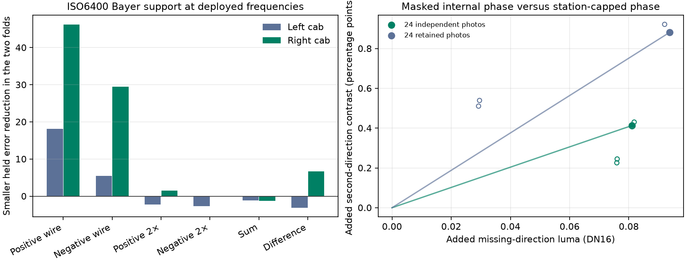
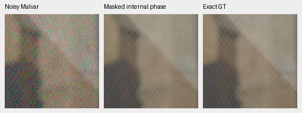
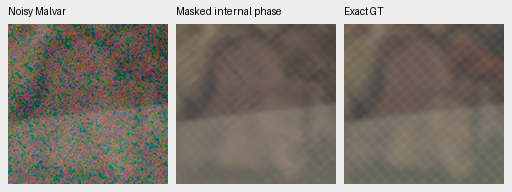

# Checking cab phase with separate Bayer samples inside the crop

Both wire directions in the fine GFX cab predict held ISO6400 Bayer samples at the current frequencies. A nearby frequency search fails to improve both held folds on the cab. The new opt-in `weak-internal-phase` crop fit uses the existing frequencies and estimates phase inside the crop, leaving the test station and its neighbors out of that fit. On 24 new photo-based tests it gains **0.413 points** of second-direction contrast and reduces intact-strand error **0.756 DN16** versus [station-capped phase](local-replicated-phase.md). It changes the real left diagonals subtly, with fine crossings still incomplete.

## What the two camera exposures support

The camera diagnostic freezes each ISO6400 proposal before reading the separate ISO100 RAW. The existing four exterior donors nominate the frequency pair. Within the delivered crop, alternate complete Bayer cells form two folds. Each fold estimates its own smooth nuisance field, rival carrier and camera-noise weight. A Hann taper sets the spatial weights. A narrow fit can move either frequency coordinate by up to 0.0039 cycles per pixel. Both proposals must agree within 0.00195 cycles per pixel and improve the opposite fold by three weighted squared-error units with both green lattices positive. These are empirical checks on the same capture. The coarse fence accepts a move in its negative-slope frequency. Neither fine cab ROI accepts a move under either noise profile.

The ISO100 probe uses the established integer registration and fits frequencies to its own native Bayer samples. All four fine-cab frequencies are within 0.00218 cycles per pixel of the exterior ISO6400 proposals. Both directions give positive ISO6400 held gains with either frequency source. Fitting both wavelengths before testing higher orders gives this pattern at the existing frequencies and nominal ISO6400 conditioning:

| Tested term | Left held gains | Right held gains |
| --- | ---: | ---: |
| Positive fundamental | +18.8 / +18.1 | +72.1 / +46.3 |
| Negative fundamental | +5.4 / +9.9 | +29.5 / +30.6 |
| Positive second harmonic | −2.2 / −0.1 | +3.4 / +1.5 |
| Negative second harmonic | +2.6 / −2.7 | +8.7 / +0.0 |
| Sum of the two frequencies | −1.2 / −0.8 | −1.1 / −1.2 |
| Difference of the two frequencies | +2.4 / −3.1 | +6.7 / +13.8 |

Values sum the two green lattices in each held fold. At the ISO100 frequencies, the ISO6400 fundamental amplitudes after normalization by each crop's mean green level are **0.60 / 0.66** of the left reference and **0.59 / 0.65** of the right. These are descriptive ratios across different apertures, exposure times and potential movement. The separate capture also differs in phase. Its pixels supply no reconstruction input or target.

A signed scalar difference-frequency template derived from each discovery fold's two fundamental phases gives held gains of **+7.83 / +15.53** on the right cab. Rotating that same template by a quarter cycle gives **−1.10 / −1.71**. The fitted relative phase is near opposition in both captures on the right. The left locked gain is smaller at +5.62 / +1.12. The coarse fence has much stronger held second harmonics. The cab results support the fundamental directions and some right-cab interaction energy. They leave explicit local junction shape unresolved. The crop option retains the original two fundamental corrections.

## Pool phase with a held neighborhood

The new phase bank fits both fundamental quadratures in 25 disjoint 32×32 patches inside the 160×160 crop. It removes a per-CFA quadratic background. Each 16×16 test station excludes any donor that touches its own 3×3 station neighborhood. The remaining coefficients are pooled using inverse noise variance and Gaussian widths of 50 pixels across and 75 along the wire. The fit removes expected noise power when estimating typical donor amplitude. Both fitted greens must reach four standard deviations, keep at least 55% of this typical amplitude and have phase cosine at least 0.5.

Each held station projects out its own smooth field and the rival wave. The pooled signed score is capped by the weaker green score plus 1.5 and by twice that score. The correction ramps from score 1.5 to 3.5. The [within-station cap](local-replicated-phase.md) prevents interpolation from exceeding the containing station's evidence. The new support supplements the previous fit when the rank is ambiguous, or conditions a fuller correction of the nominated weak direction when distant phase is unreliable. The full posterior keeps its measured amplitude cap. An odd-origin audit replaces the entire 48×48 held neighborhood on all four CFA layouts and reproduces its phase bit for bit. The same audit preserves frequency proposals when only the opposite Bayer reserve is replaced. Delivery amplitudes and the neural parent see the original RAW.

Calibration on 32 retained photos compares the inner-only pool with a pool that adds the exterior collar, and compares held center scores with neighboring support. The inner-only center at full dose has the best recovery within the prior limits for mean and peak absent-direction luma, false projection and peak quiet change. The mixed center offers a slightly higher calibration gain, with a 0.921 DN16 flat-core change. The independent panel uses 24 new validation sources and 48 ISO6400 draws. Half the sources balance both direction amplitudes before noise and half retain the earlier weaker second direction. The six roles, CFA layouts and masks use the established optical recipe with σ 0.85, exposure 0.33, ADC16, black level 0.03 and shot/read `0.00128 / 6.5536e-6`. Source IDs and cache hashes are disjoint from the calibration and retained panels and were checked against 559,808 photographic training visits.

| 24 new sources | Second-direction contrast | Intact second RMS (DN16) | False second RMS in gaps (DN16) | Added absent luma (DN16) |
| --- | ---: | ---: | ---: | ---: |
| Station-capped phase | 35.489% | 41.203 | 3.048 | 0.000 |
| Internal phase, locked | 35.901% | 40.447 | 3.049 | 0.081 |
| Internal phase with neighboring check | 35.714% | 40.786 | 3.055 | 0.076 |
| Internal phase plus collar, neighboring check | 35.734% | 40.751 | 3.054 | 0.076 |

The paired improvement is **+0.413 points** `[+0.175, +0.678]` with **−0.756 DN16** intact RMS `[−1.224, −0.324]`. The continuing strand in exact gaps improves by 0.745 DN16. Added luma from the absent direction is **0.081 DN16** on average and **0.750 DN16** at peak. False projection changes by +0.0008 DN16 with an interval spanning zero. All flat-core, edge-only and uniform controls reproduce the prior crop outputs. Intervals resample whole photos within geometry families.

Of 48 intact draws, 25 retain their existing reliable distant phase. The 13 ambiguous-rank draws gain 1.581 points when giving each of their eight photos equal weight, whereas the ten ranked fallback draws gain 0.059 points across seven photos. The previously retained 24 near-balanced sources gain 0.881 points and add 0.094 DN16 of missing-direction luma. On 48 ordinary photos, authentic surroundings and planted mismatched surroundings both reproduce the prior crop fit. The earlier frequency nomination still adds 1.420 DN16 RGB RMS on average in the mismatch condition.

## Native exact comparisons

Both 160×160 triplets use native crop `[48,48,160,160]` inside query `[128,128,256,256]`, display exposure ×2 followed by sRGB and the simulation above. The crop fit composes Local 50k EMA SHA256 `62f4e9ce84075c8df1a254a1889033b5787133e8c98c63e0ec3d174a94734959` with the Bayer correction. Exact GT includes the optical blur before Bayer sampling. The strip and smooth dip show the largest response gains in the exact-gap and continuous subsets. The dip shows slightly clearer diagonal texture. Both recovered crossing patterns remain softer than the exact target.

The strip uses GBRG draw zero, Berthold Werner's Zeitz photograph and bin-four source crop `[28,202,512,512]`. It is adapted by binning, planting wires and simulating optics and sensor noise. [All methods](assets/cab-local-frequency-v1/internal-phase-03-comparison.png) · [Source](https://commons.wikimedia.org/wiki/File:Zeitz_BW_2012-09-09_18-02-33.JPG) · [CC BY-SA 3.0](https://creativecommons.org/licenses/by-sa/3.0).

The smooth dip uses GBRG draw one, Alberto.Bravo's public-domain photograph of the Toma de Túnez tapestry and bin-four source crop `[122,92,512,512]`, with the same adaptation. [All methods](assets/cab-local-frequency-v1/internal-phase-15-comparison.png) · [Source and rights](https://commons.wikimedia.org/wiki/File:Real_Alc%C3%A1zar._Sala_de_los_Tapices._Pa%C3%B1o_IX._Toma_de_T%C3%BAnez_(detalle).jpg).

## Standing GFX100S comparisons

Sky, building and foliage reproduce Local 50k. The coarse fence reproduces station-capped phase and keeps its crossings. On the nominal left cab, existing collar phase is eligible in 24 and 50 stations for the two directions. The inner bank qualifies 100 and 80 respectively; the held center checks limit usable support to 28 and 16. Left RGB RMS changes by **2.159 / 2.305 DN16** under nominal and transferred noise. The corresponding right-cab changes are **0.885 / 0.617 DN16**. Some left diagonals below the rail are slightly clearer at ×16. The right changes are harder to see, both crops retain mottling and fine crossings remain incomplete. No visible new repeating color appears in the native boards.

The standing crop origins are sky `[5800,1400]`, building `[5790,2690]`, foliage `[8890,5570]`, coarse fence `[2240,6000]` and cab `[806,6489]` and `[1026,6449]`. The transferred shot/read profile is `0.0014635775921166604 / 1.0715704128646712e-6`. V120 Small EMA SHA256 `a9d9b6b4f974e24a6b11e5e740aab32314233a7f53c056cf37c7d2aac1c589fb` is the general-model comparison. The ISO100 AHD and both JPEGs provide qualitative reference views. The original RAFs remain read-only.

| RAW and profile | Native boards |
| --- | --- |
| DSCF3879 nominal ×4 | [Sky](assets/cab-local-frequency-v1/main-overcast-sky-main-overcast-sky-x4.png) · [Building](assets/cab-local-frequency-v1/main-building-detail-main-building-detail-x4.png) · [Foliage](assets/cab-local-frequency-v1/main-foliage-main-foliage-x4.png) · [Coarse fence](assets/cab-local-frequency-v1/main-chain-link-fence-main-chain-link-fence-x4.png) |
| DSCF3842 nominal | [Left ×4](assets/cab-local-frequency-v1/mesh-nominal-fine-green-mesh-left-x4.png) · [Right ×4](assets/cab-local-frequency-v1/mesh-nominal-fine-green-mesh-right-x4.png) · [Left ×16](assets/cab-local-frequency-v1/mesh-nominal-fine-green-mesh-left-x16.png) · [Right ×16](assets/cab-local-frequency-v1/mesh-nominal-fine-green-mesh-right-x16.png) |
| DSCF3842 transferred | [Left ×4](assets/cab-local-frequency-v1/mesh-profile3879-fine-green-mesh-left-x4.png) · [Right ×4](assets/cab-local-frequency-v1/mesh-profile3879-fine-green-mesh-right-x4.png) · [Left ×16](assets/cab-local-frequency-v1/mesh-profile3879-fine-green-mesh-left-x16.png) · [Right ×16](assets/cab-local-frequency-v1/mesh-profile3879-fine-green-mesh-right-x16.png) |

## Packaged crop fit

Use `method="weak-internal-phase"` with the existing 160×160 restored crop, its 192×192 context, the packed RAW scene and the camera/noise inputs. The public method reproduces the replay exactly on 288 synthetic and eight standing crops. On a single GB10 CPU thread after the parent forward, median crop time is 34.88 ms versus 28.98 for station-capped phase, or 68.45 versus 52.54 ms on crops whose output changes. [Crop usage](usage.md#repeating-mesh-crops).

This work uses frozen checkpoints. The fixed 427-photo and known/unseen camera scores are outside the crop study. [Summary and phase measurements](results/cab-local-frequency-v1/summary.json) · [Native provenance](assets/cab-local-frequency-v1/manifest.json) · [Publication hashes](results/cab-local-frequency-v1/publication.json) · [Frozen receipts and operators](results/cab-local-frequency-v1/evidence.tar.xz).
