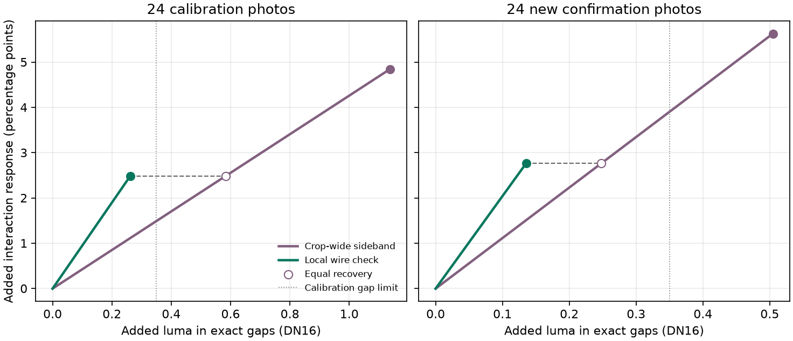
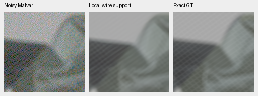
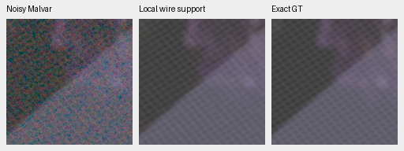

# Checking both wires before delivering a crossing sideband

The opt-in `weak-junction-phase` crop mode adds a signed difference-frequency term where both wire directions have local Bayer support. On 24 new exact-target photo fixtures it gains **2.768 percentage points** of interaction contrast and reduces junction increment error by **1.121 DN16** versus [masked internal phase](local-internal-phase.md). At equal recovered interaction, the local check reduces added luma in exact gaps from **0.248 to 0.136 DN16** compared with applying the same sideband crop-wide. Right-cab modulation changes subtly and fine crossings remain uneven.

## A fixed sideband and a separate check on the wires

The [checked Bayer harmonic study](query-checked-junctions.md) found evidence for a difference-frequency term on the real right cab. The newer [native RAW witness](local-internal-phase.md#what-the-two-camera-exposures-support) finds that this term predicts both held folds, while the quarter-cycle control loses support. This study reuses the checked harmonic estimator with the current crop's exterior frequency pair and the masked internal phase restoration. It delivers the difference term only. The second harmonics and sum term remain available as nuisance regressors.

The 256-pixel query has four disjoint groups of complete Bayer cells. The first group supplies fundamental phases, a signed difference term, a local noise estimate and a smooth background with an optional step. The two held groups must support each fundamental and the fixed sideband. The sideband needs a pooled score of 3.25 and at least 0.9 in each held group. The first group stays out of the spatial amplitude fit. The fit shrinks unsupported amplitudes, subtracts the aligned term already in the restored image and caps the residual at 1.5 times the discovery amplitude.

For each 16×16 station, the new gate tests the two fixed-phase fundamentals on the held Bayer groups. Each test conditions separately on a quadratic background and the rival wave on each green lattice. Its pooled evidence is capped by the lower green score plus 1.5. The weaker direction determines the gate, which ramps from zero to full strength over 1.5 score units. Interpolation stays below the station's own strength. The amplitude estimate reuses the held sensor samples, so the image-level false activation results describe the complete empirical procedure. Replacing held cells in one station leaves the discovery phase, sign, amplitude and every other station's scores bit-identical on all four layouts. The delivery cap assigns zero correction outside an isolated supporting station in the audit.

## Exact junctions and matched additive controls

Each of 24 calibration and 24 new photo sources supplies two ISO6400 draws. The independent photos are source-disjoint by ID and bin-four cache hash and were checked against 559,808 photographic training visits. Both arms use the same fixed parents. Scenes contain the same foreground and rear wire profiles in the interaction role and its matched additive control. The interaction role also contains a signed difference wave whose amplitude varies across the scene and fades with the rear wire. The injected sign varies across sources. The paired roles share Poisson counts at the lower per-site rate and share the read-noise draw, with separate Poisson excess for each marginal. The other controls retain both wires throughout, one direction, a flat core, a clean edge or a uniform field. They keep the same nominated exterior geometry.

The recipe uses pre-Bayer blur σ 0.85, exposure 0.33, 16-bit ADC, black 0.03 and ISO6400 shot/read `0.00128 / 6.5536e-6`. Interaction response projects the present-minus-additive restoration onto the corresponding exact increment with both wires present. Junction RMS evaluates that increment at known crossings. Added gap luma measures only the change from the masked internal phase fit, in optically eroded masks where the rear wire is absent.

Calibration selects treatments under 0.350 DN16 mean added gap luma, 0.100 DN16 mean added luma on each additive control, and 0.650 DN16 peak change on the four remaining controls. It compares gating on local wires, locally measured sideband, and both. The two-wire gate selects full dose, and the otherwise identical crop-wide term selects 30% dose. All selection settings stay fixed on the independent photos.

| 24 new photos | Interaction response | Junction increment RMS (DN16) | Intact increment RMS (DN16) | Added gap luma (DN16) |
| --- | ---: | ---: | ---: | ---: |
| Masked internal phase | 11.766% | 34.707 | 31.290 | 0.000 |
| Full crop-wide sideband | 17.397% | 32.462 | 29.301 | 0.505 |
| Crop-wide sideband, locked 30% | 13.455% | 34.000 | 30.658 | 0.151 |
| Crop-wide sideband, matched recovery | 14.533% | 33.562 | 30.269 | 0.248 |
| Local two-wire check | 14.533% | 33.586 | 30.277 | 0.136 |

The local fit gains **2.768 response points** `[+1.509, +4.219]` and reduces junction increment RMS **1.121 DN16** `[−1.825, −0.541]` versus its parent. Relative to the locked crop-wide fit it gains 1.078 points `[+0.400, +1.892]` with 0.016 DN16 less gap luma `[−0.072, +0.029]`. At matched recovery its added gap luma falls **0.113 DN16** `[−0.300, −0.001]`. Junction increment RMS at that recovery differs by +0.024 DN16 `[−0.175, +0.228]`. Bootstrap intervals resample photos by geometry and keep the two draws together. The gap result uses 12 sources with exact missing regions.

The detector admits 21 of 48 interaction draws, two of the 48 matched additive draws and one of the 48 continuous additive draws. The local fit adds mean luma of **0.0005 / 0.0065 DN16** on the two additive controls, with peaks of 0.020 and 0.313 DN16. Its maximum gap luma is 1.419 DN16. All strong-only, flat-core, edge-only and uniform draws reproduce masked internal phase. The local sideband-only and combined gates have lower nominal interaction recovery under the same calibration limits. The combined gate adds 0.073 DN16 mean gap luma. On 48 previously retained ordinary photos, both sideband deliveries reproduce their input restoration with authentic and with incompatible planted far context.

## Native exact comparisons

Both 160×160 triplets use crop `[48,48,160,160]` inside the `[128,128,256,256]` query, the same ISO6400 capture recipe and display exposure ×2 followed by sRGB. The crop fit composes Local 50k EMA SHA256 `62f4e9ce84075c8df1a254a1889033b5787133e8c98c63e0ec3d174a94734959`, masked internal phase and the new term. Exact GT includes pre-Bayer optics. The ellipse shows the largest gap-luma reduction versus the equal-recovery crop-wide fit. Its remaining wire stays visible through the gap, with soft crossings outside it. The contrast step has the largest junction error reduction among scenes without an exact gap. Its modulation is a little stronger, and the exact target still has sharper junctions.

The ellipse uses GRBG draw zero, Jebulon's *BMW K1300R a*, and bin-four source crop `[80,0,512,512]`. The sources are adapted by binning, planting the wire patterns and simulating optics and sensor noise. [All methods](assets/local-junction-support-v1/junction-independent-10-comparison.png) · [Source](https://commons.wikimedia.org/wiki/File:BMW_K1300R_a.jpg) · [CC0](https://creativecommons.org/publicdomain/zero/1.0/).

The contrast step uses RGGB draw one, Bff's *Knautia arvensis*, and bin-four source crop `[28,122,512,512]` with the same adaptation. [All methods](assets/local-junction-support-v1/junction-independent-20-comparison.png) · [Source](https://commons.wikimedia.org/wiki/File:Knautia_arvensis20170711_8389.jpg) · [CC BY-SA 4.0](https://creativecommons.org/licenses/by-sa/4.0).

## Standing GFX100S comparisons

Sky, building and foliage reproduce masked internal phase. The coarse fence gains a small 1.425 DN16 RGB RMS modulation and retains connected crossings. Left cab changes are 0.405 and 0.598 DN16 under nominal and transferred conditioning. The right changes by **2.668 and 2.767 DN16**. Some right-side crossings are slightly more defined at ×16, with uneven contrast and gaps in the fine lattice still visible. The full crop-wide term produces a stronger regular ripple. Mottle remains and no new repeating color is apparent in the gated crop.

The main origins are sky `[5800,1400]`, building `[5790,2690]`, foliage `[8890,5570]` and fence `[2240,6000]`. Cab origins are `[806,6489]` and `[1026,6449]`. The transferred noise profile uses shot/read `0.0014635775921166604 / 1.0715704128646712e-6`. The general comparison is V120 Small EMA SHA256 `a9d9b6b4f974e24a6b11e5e740aab32314233a7f53c056cf37c7d2aac1c589fb`. The separate ISO100 AHD renders and JPEGs are qualitative references with independent exposure, aperture and subject motion.

| RAW and profile | Native boards |
| --- | --- |
| DSCF3879 nominal ×4 | [Sky](assets/local-junction-support-v1/main-overcast-sky-main-overcast-sky-x4.png) · [Building](assets/local-junction-support-v1/main-building-detail-main-building-detail-x4.png) · [Foliage](assets/local-junction-support-v1/main-foliage-main-foliage-x4.png) · [Coarse fence](assets/local-junction-support-v1/main-chain-link-fence-main-chain-link-fence-x4.png) |
| DSCF3842 nominal | [Left ×4](assets/local-junction-support-v1/mesh-nominal-fine-green-mesh-left-x4.png) · [Right ×4](assets/local-junction-support-v1/mesh-nominal-fine-green-mesh-right-x4.png) · [Left ×16](assets/local-junction-support-v1/mesh-nominal-fine-green-mesh-left-x16.png) · [Right ×16](assets/local-junction-support-v1/mesh-nominal-fine-green-mesh-right-x16.png) |
| DSCF3842 transferred | [Left ×4](assets/local-junction-support-v1/mesh-profile3879-fine-green-mesh-left-x4.png) · [Right ×4](assets/local-junction-support-v1/mesh-profile3879-fine-green-mesh-right-x4.png) · [Left ×16](assets/local-junction-support-v1/mesh-profile3879-fine-green-mesh-left-x16.png) · [Right ×16](assets/local-junction-support-v1/mesh-profile3879-fine-green-mesh-right-x16.png) |

## Packaged crop fit

Use `method="weak-junction-phase"` with the 160×160 native parent crop, packed Bayer scene and a **256×256 RGB `parent_context`** with a 48-pixel halo. It matches the research replay bit for bit on 336 synthetic and eight standing crops. Single-thread CPU time after the parent forward has medians of 44.03 ms versus 35.65 ms for masked internal phase across all crops, and 113.91 versus 46.28 ms when the sideband changes the result. [Crop usage](usage.md#repeating-mesh-crops).

The evaluation uses frozen weights. Fixed 427-photo and known/unseen camera scores fall outside this crop study. [Paired results](results/local-junction-support-v1/summary.json) · [Native provenance](assets/local-junction-support-v1/manifest.json) · [Publication hashes](results/local-junction-support-v1/publication.json) · [Frozen receipts and operators](results/local-junction-support-v1/evidence.tar.xz).
