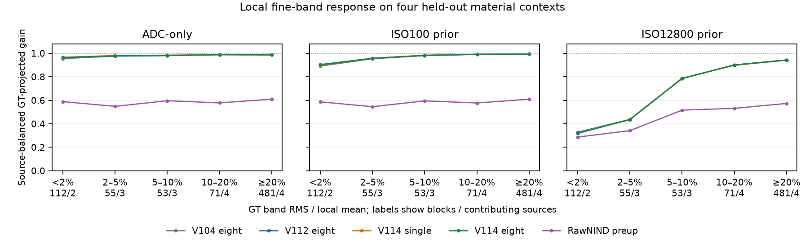
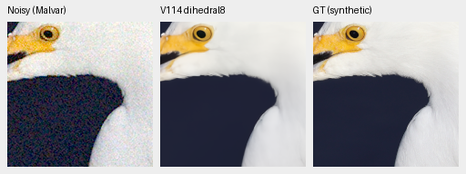
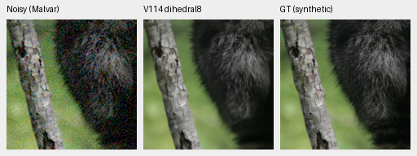

# Local fine-detail response

**High whole-patch detail gain hides much weaker local structure at high noise.**
In the weakest fine-contrast group, V114 eight-view's source-balanced projected
gain is **.31813** at ISO12800, versus **.94254** in the strongest group. The
weakest group contains only112 blocks from two sources: white feathers and fur.
This is an exploratory diagnostic of the existing four held-out material
contexts, not a new benchmark or a change to the current model choice.

[All results, model hashes and original array bindings](results/local-material-detail-v1.json) ·
[Native images and display receipts](images/local-material-detail-v1/manifest.json) ·
[Complete V114 eight-view pilot](v114-eight-view.md).

[SVG](images/local-material-detail-v1/local-detail-response.svg) ·
[PDF](images/local-material-detail-v1/local-detail-response.pdf).
Gain is averaged equally across contributing sources, after pooling blocks
within each source. Coverage differs between contrast groups; lines do not
represent the same material mixture at each point.

## Fixed inputs and definition

Reuse the exact12 photographic observations and five saved methods from the
V114 pilot: four sources at ADC-only/ISO100/ISO12800, RGGB. There are no new
model calls, optimizer updates, noise draws or RAW decodes. The analysis uses
linear luminance after the common WB/matrix, before clipping or display.

Each native256 context has a240px interior, partitioned into225 disjoint16×16
blocks. An orthonormal DCT-II measures the radial1/8–1/3-cycle band, with
frequency coordinates k/(2N). There is no Hann window or window-power scaling.
For GT coefficients t and predicted coefficients p, projected gain is
`sum(p*t)/sum(t*t)`. Orthogonal RMS removes this fitted GT component; band
error RMS compares p directly with t. Neither is a percentage of recovered
independent details.

Bins use **GT band RMS / local mean luminance**, not analytic carrier peak
contrast. Eligibility requires GT mean.02–.9, band RMS≥1e-5 and all GT linear
RGB samples inside[0,1]. Rules and bins were frozen before this output analysis.
All900 source blocks remain in the private receipt, including128 exclusions;
the same772 eligible blocks occur in each noise condition, not2316 independent
material samples.

| Relative GT fine-band RMS | Blocks per condition | Contributing sources |
| --- | ---: | ---: |
| <2% | 112 | 2 |
| 2–5% | 55 | 3 |
| 5–10% | 53 | 3 |
| 10–20% | 71 | 4 |
| ≥20% | 481 | 4 |

There are84 weak blocks in the egret context and28 in fur. Bark and canopy
contribute none to the<2% group. These four photographic contexts mix contrasts;
they are not four globally low-contrast images.

## Weakest group and remaining tradeoff

Source-balanced projected gain for the112 weak blocks:

| Noise | V104 eight | V112 eight | V114 single | V114 eight | Stronger RawNIND |
| --- | ---: | ---: | ---: | ---: | ---: |
| ADC-only | .95498 | .96335 | .96674 | .96354 | .58894 |
| ISO100 | .89182 | .90394 | .90211 | .90307 | .58735 |
| ISO12800 | .32464 | .32798 | .32161 | .31813 | .28701 |

At high noise, V114 eight-view gain is.22029 in the feather context and.41596
in fur. It falls slightly versus V114 single in both. Across all112 blocks,
pooled orthogonal RMS falls.00361068→.00349961 and band-error RMS
.00717149→.00715576. Lower error and lower fitted detail gain can coexist.
These pooled RMS values weight blocks equally; the gain table weights sources
equally. None of these methods resolves the weak high-noise detail problem.

The earlier whole-patch/Hann high-noise gain of.92550 uses a different support,
window and weighting. It cannot establish performance in these weak subregions;
the two numbers are not interchangeable measurements or a version regression.

Noisy → V114 eight-view → exact synthetic GT, unchanged160×160 cells from the
same feather/fur contexts. They mix contrasts and illustrate the materials;
they do not isolate the16px blocks used for the table. Fine white feather
structure is smoothed while the eye and outline remain clear. Fur retains
coarse orientation but loses fine hairs.

The cells use ROI[48,48,160,160], shot.00256, read variance.0000262144,
WB[2,1,1.5], the shared matrix and display exposure×1. Pixels are at the8×-binned
evaluation resolution, with no resizing. Both triplets were actually viewed.
V114 checkpoint SHA256:
`2285c84b7015bcf122e71b890723f80aaf216bde849256c77f070c2493f9d2d2`.
Full source, prediction, conditioning and display records accompany each image.

## Interpretation and verification

This supports measuring weak local detail separately from photographic PSNR
and strong edges. It does not establish a new loss, data intervention or
deployable correction. Local coarse structure and block boundaries can project
into the selected band; finite noise can correlate with GT. There is no noise
debiasing, controlled carrier phase, uncertainty estimate or real-camera claim.
The lowest bin represents only two materials and one draw per condition.
Held-out blocks remain diagnostic data and are not added to training.

The [analysis script](../scripts/diagnose_local_material_detail.py) checks every
explicit cosine transform against a separate even-extension FFT formulation;
the maximum absolute coefficient difference is1.41e-14. A closed-form fixture
recovers gain.75 and orthogonal RMS.0001, with independent spatial Parseval
verification. Target fingerprints match across all three conditions. The actual
frozen script, plan, all2700 block records and original outputs are retained.
Torch is never imported. V116's original training and recipe remain unchanged;
its [complete trained-quality review](v116-quality.md) is now available.

## Full-photo follow-up

The [additive archive audit is complete](results/v114-v116-local-detail-v1.json)
after the exact original V114/V116 matched-review owner. Its
[original queue receipt](results/local-detail-archive-queued-v1.json) remains preserved.
It applies the same
GT-only local definitions to **all427 photographic sources**, three noise
priors and four Bayer phases:5124 paired source/condition/CFA observations,
with96075 unique16px source blocks. The16 analytic sources in the full suite
are excluded. Four CFAs are pooled within each source/condition before equal
source weighting; stratum coverage is reported explicitly.

The [archive analyzer](../scripts/diagnose_archive_local_detail.py) requires
identical observation/input fingerprints and actual saved target/WB/matrix
values across endpoints. It uses the full archives' own matched GT. Those
targets differ from the earlier CPU pilot by up to1.19e-7, so the pilot's
measurements remain a separate numerical record. No target or noisy input is
regenerated. This follow-up adds no model/encoder calls, noise draws, optimizer
updates, RAW decodes or default changes.

Nine tests cover closed-form gains, CFA/source pooling, changed physical inputs,
targets, missing fields, duplicate rows and unsupported policies. A completed
readiness check also joins48 genuine retained V114 observations across all four
CFAs, with exactly zero self-differences in15 summary groups. Explicit cosine
and FFT coefficients agree within1.47e-14. That proves engineering readiness;
the actual full audit then checked2,401,875 block transforms, with maximum
explicit-cosine/even-FFT difference1.83e-14. Execution took40.79s without Torch,
neural inference, noise generation or RAW decoding.

The weakest stratum now contains **326 contributing photos and15,008 unique
GT blocks**. These counts describe independent source/block support; the four
CFAs and three noise priors reuse the same GT blocks. Source-balanced gains are:

| Noise prior, weakest GT relative band RMS below2% | V114 | V116 |
| --- | ---: | ---: |
| ADC-only | .94581 | .94688 |
| ISO100 | .78329 | .78293 |
| ISO12800 | .36334 | .36302 |

At ISO12800, the complete contrast stratification is:

| GT local band contrast | Unique eligible GT blocks | Photos | V114 gain | V116 gain |
| --- | ---: | ---: | ---: | ---: |
| Below2% | 15,008 | 326 | .36334 | .36302 |
| 2–5% | 6,946 | 374 | .68485 | .68441 |
| 5–10% | 9,712 | 412 | .85959 | .85933 |
| 10–20% | 18,864 | 423 | .93385 | .93374 |
| At least20% | 35,679 | 425 | .96866 | .96865 |

V116's weakest high-noise band-error RMS is.00318291 versus V114's.00318289;
orthogonal RMS falls slightly from.00198759 to.00198121. Its larger analytic
eight-pixel carrier gain does not produce a broader weak natural-detail gain.
The older four-source/eight-view pilot remains separate: policy, targets,
sampling and source support differ. No noise-debiasing, training-seed interval,
four-pixel carrier recovery or real-camera superiority follows from this audit.

The active [V117/V118 loss pair](band-loss-training.md) has a separate
[queued saved-output review](results/band-loss-matched-review-queued-v1.json).
It repeats these GT-only definitions for the isolated V117/V118 contrast and
for both endpoints against retained V114. Each must cover all427 photos,
three priors/four CFAs and5124 paired cases, with actual input/supervision
matching. The same96,075 GT blocks are reused across contrasts; this does not
multiply independent sources. No new inference, noise generation or RAW decode
is added by the local audit. Both original20k runs are complete; results remain
pending while full-quality collection and its downstream audits proceed.

A separate [unequal-coverage fixture](results/local-detail-source-weighting-proof-v1.json)
gives two sources225 versus15 eligible blocks, with candidate gains.75 and.25.
The equal-source result is.5; the energy/block-pooled result is.71875. Both
reproduce the closed form, checking that a source with more eligible blocks
does not dominate the reported source-balanced gain. These artificial archive
identities are engineering fixtures, not trained-model observations.

The waiting CPU controller starts only after the original matched comparison
successfully exits. It requires16GiB available RAM and2GiB output headroom,
with an8GiB runtime RAM floor and600s analysis bound. Failures preserve evidence
without automatic retry. Original training/evaluation/audit/comparison jobs
continue unchanged; their native review still follows the completed results.

Sources: [Serebit, egret](https://commons.wikimedia.org/wiki/File:Snowy_egret_in_profile.jpg),
[CC BY-SA4.0](https://creativecommons.org/licenses/by-sa/4.0/), and
[Korall, raccoon](https://commons.wikimedia.org/wiki/File:Racoon_clinging_to_a_tree.JPG),
[CC BY3.0](https://creativecommons.org/licenses/by/3.0/).
Modified by binning, cropping, simulated noise, restoration and common display.
