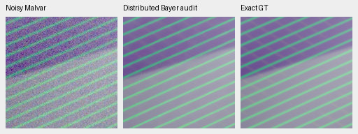
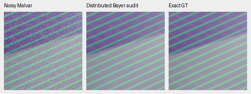

# Distributing the Bayer samples used to audit mesh gaps

The distributed audit reduces mean added texture from **9.76 to 5.42 DN16 RMS**
across six fresh ISO400 strip gaps at nearly equal measured wire response.
It also attenuates one of 12 continuous wires, beside an intensity step.
Both standing GFX scenes reproduce the earlier crossed audit pixel for pixel.
[Machine evidence and viewing record](results/local-mesh-distributed-audit-v1/publication.json).

## Sample assignment

The wider RAW surround supplies the two candidate wire directions and their
projective geometry. The near crop controls whether a candidate gap can
reduce the already accepted correction. The earlier assignment reserves
every fourth packed Bayer column for phase, with each remaining column
group assigned to one of the two crossed predictions or the final audit.
The distributed assignment keeps the phase reserve fixed and cycles the
other three labels across consecutive packed rows. Every role still uses
all Bayer parities, and the final audit stays outside gap nomination.
The thresholds, gap bank, refinement and base predictions are shared.

On the earlier synthetic panel, supplying the exact gap mask with the
measured carrier phase raises the ISO400 strip masks that pass all three
checks from one to five of six and the disk masks from three to five of
six. Those counts diagnose the check with a supplied mask. In normal
replay the method must nominate a gap, and it can reduce only an active
broad correction. Ranking shapes with the exact nuisance model had mixed
results on the earlier panel. The fresh comparison retains the original
nomination score. [Source and development archive](results/local-mesh-distributed-audit-v1/evidence.tar.xz).

## Fresh exact-target results

The panel uses 30 new paired observations with six geometries. Each
ISO400 layout has six cases. Six further gaps use the ISO6400 prior.
Half of each group adds modest shared row and column variation after
ADC as a synthetic stress test. Matching and rotated exteriors share
the same local Bayer observations. The two policies use the same
13-placement broad correction and can only attenuate it. All reported
metrics were reproduced exactly from the saved predictions.

| ISO400 layout | Policy | Weak recovery | Added gap RMS | Total gap RMS |
| --- | --- | ---: | ---: | ---: |
| Continuous | Both audits | 93.90% | — | — |
| Continuous with step | Column audit | 94.91% | — | — |
| Continuous with step | Distributed audit | 93.33% | — | — |
| Strip gap | Wide support | 55.52% | 10.70 | 83.33 |
| Strip gap | Short support | 51.03% | 1.33 | 83.55 |
| Strip gap | Column audit | 55.36% | 9.76 | 83.49 |
| Strip gap | Distributed audit | 55.49% | 5.42 | 83.64 |
| Round gap | Wide support | 79.67% | 39.70 | 96.31 |
| Round gap | Short support | 72.90% | 13.11 | 88.45 |
| Round gap | Column audit | 79.67% | 37.95 | 96.10 |
| Round gap | Distributed audit | 78.70% | 31.21 | 94.82 |

RMS is in camera-linear DN16. The distributed audit improves two round
gaps and three strip gaps relative to the column audit. Some round-gap
texture persists, including 68.83 DN16 added in g143. Total strip-gap
error stays near 84 DN16 because these corrections are small relative to
the local prediction error. Layered texture over the g145 intensity step
is continuous. Its response falls from 112.83% to 103.34%, with a local
false cut and higher group mean weak-wire error. Every rotated exterior,
flat control and front-wire-only control returns its parent. Neither
audit activates on the six ISO6400 cases, where weak response averages
24.95%. [Per-case recomputed metrics](results/local-mesh-distributed-audit-v1/summary.json).

In an exploratory replay after viewing the fresh outcomes, both
forecasts shared an intensity step estimated on the phase reserve.
This restores the continuous g145 output exactly to the wide correction.
Mean added texture rises to 9.50 DN16 in strip gaps and 35.18 in round
gaps. The additional nuisance is sensitive to real texture loss as well
as background changes. The packaged crop helper retains its column
audit. [Exploratory replay](results/local-mesh-distributed-audit-v1/step-replay.json).

The g141 strip and disk triplets use the same native `[80,80,160,160]`
ROI in their 320-pixel fields, noisy Malvar, BGGR, ADC16 black fraction
0.03 and shot/read `8e-5/2.56e-8`. Both use identity white balance and
color transform, exposure ×1 and shared reference-centered display
contrast ×8. The parent is spatial 2k EMA with context bypassed,
SHA256 `97fd551bd0ae0b7aa97c67e1f6e8b513b722f70d5ad8b8814a96586b934eafac`.

[Strip g141 comparison](images/local-mesh-distributed-audit-v1/iso400-band-g141-comparison.png) ·
[Disk g141 comparison](images/local-mesh-distributed-audit-v1/iso400-disk-g141-comparison.png) ·
[Missed round gap g143](images/local-mesh-distributed-audit-v1/iso400-disk-g143-comparison.png) ·
[Continuous step g145](images/local-mesh-distributed-audit-v1/iso400-step-g145-comparison.png).

## Standing GFX100S review

All eight native crops were viewed. The columns and distributed variants
are pixel-identical in all eight. The wider-donor fit retains the coarse
fence crossings and faint lattice on the left of the cab post under both
profiles. Fine crossings remain incomplete. The right cab crops keep the
same soft diagonals and background unevenness. Sky, foliage and building
keep their local parent, including the smooth sky and soft thin braces.

The parent is local-only 2k EMA
`ceb5ddaf23fce47806a01045bd86d34bb48d1f64031e382b0d5cfbabf0716880`
with the archived wider-donor correction before the audit. Main DSCF3879
uses ×4 exposure and shot/read `0.00128/6.5536e-6`. Cab DSCF3842 uses ×16
with the nominal prior and transferred `0.0014635775921166604/1.0715704128646712e-6`
shot/read. The DSCF3880 and DSCF3835 ISO100 AHD images and both cab camera
JPEGs are qualitative references. Each displayed cell is 160×160 native
pixels, with matched camera rendering and coordinates within each board.
[Viewing and crop provenance](results/local-mesh-distributed-audit-v1/viewing.json).

[Sky](images/local-mesh-distributed-audit-v1/main-overcast-sky-main-overcast-sky.png) ·
[Building](images/local-mesh-distributed-audit-v1/main-building-detail-main-building-detail.png) ·
[Foliage](images/local-mesh-distributed-audit-v1/main-foliage-main-foliage.png) ·
[Coarse fence](images/local-mesh-distributed-audit-v1/main-chain-link-fence-main-chain-link-fence.png).

| Cab prior | Native comparisons |
| --- | --- |
| Nominal | [Left](images/local-mesh-distributed-audit-v1/mesh-nominal-fine-green-mesh-left.png) · [Right](images/local-mesh-distributed-audit-v1/mesh-nominal-fine-green-mesh-right.png) |
| Transferred | [Left](images/local-mesh-distributed-audit-v1/mesh-profile3879-fine-green-mesh-left.png) · [Right](images/local-mesh-distributed-audit-v1/mesh-profile3879-fine-green-mesh-right.png) |

The experiment is a scoped correction replay. Full checkpoint results are
recorded in the [PSNR history](performance-history.md).
