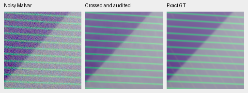
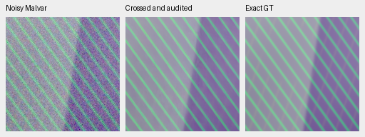

# Attenuating mesh corrections where RAW supports a gap

The gap detector cuts added texture in two of six fresh ISO400 round gaps
and preserves the broad correction on all 12 continuous cases and all
eight standing GFX crops. It misses the six rotated strip gaps. The
short-window correction suppresses more gap texture overall and fades
some continuous crossings. [Native boards, metrics and sources](results/local-mesh-gap-support-v1/publication.json).

## Test a break against a continuing wire

The existing donor fit supplies a two-direction phase model. The first
Bayer column group selects phase. Two further groups each nominate a
gap using a bank of tapered strips and disks. A proposal must improve
prediction on the opposite group. The final estimate pools these two
groups and forecasts on a fourth, unused column group. Each comparison
fits separate camera-color amplitudes, a smooth background, the front
direction and an intensity term for the gap region. The two predictions
share those nuisance terms. The hypothesized gap tapers the rear profile
behind the front wire.

The crossed and audited policy requires standardized predictive gain
above 0.75 in both crossed checks and 1.5 on the pooled candidate's
audit. A separate ablation uses just the final audit. The local-deficit
comparison estimates expected wire amplitude outside each short window
and checks for a smaller response inside it. It pools local scores into
a mask and tests that fixed mask on the final column group. The margins
are empirical. Each policy can attenuate the existing 13-shift correction
within a region. It has no additive image term. If the broad correction
returns its parent, the parent is also the output of the gap policy.

The thresholds were frozen before collection of the fresh panel. The
earlier 24-pair replay motivated pooling for nomination because
independent folds often nominated different shapes even when both
helped predict the opposite fold. [Development and fresh evidence](results/local-mesh-gap-support-v1/publication.json).

## Fresh exact-target pairs

Thirty pairs span six new geometries. The ISO400 groups each have six
pairs, covering continuous mesh, continuous mesh over a step, rotated
strip gaps and disk gaps. Six additional gap pairs use ISO6400. The
exterior is matching or rotated while the local values stay fixed.
The strong-only and flat roles share the same fitting and control path.
All 180 role/exterior outputs match the evaluated crossed policy after
porting its detector into the package.

| ISO400 layout | Policy | Weak recovery | Weak-wire RMS | Added gap RMS |
| --- | --- | ---: | ---: | ---: |
| Continuous with a step | Wide support | 104.43% | 41.43 | — |
| Continuous with a step | Short support | 101.81% | 41.10 | — |
| Continuous with a step | Crossed and audited | 104.43% | 41.43 | — |
| Strip gap | Wide support | 53.16% | 54.09 | 15.61 |
| Strip gap | Short support | 48.71% | 55.33 | 2.63 |
| Strip gap | Crossed and audited | 53.16% | 54.09 | 15.61 |
| Round gap | Wide support | 91.27% | 42.81 | 49.89 |
| Round gap | Short support | 88.37% | 42.60 | 20.71 |
| Round gap | Crossed and audited | 91.00% | 42.86 | 46.34 |

RMS is in camera-linear DN16. The two accepted round gaps have added
RMS of 20.07 → 6.57 and 7.79 → 0.00 DN16. Average total error inside
round gaps stays near 101 DN16 because the parent still has errors there.
Four round gaps retain the wide correction, including g131 with 85.66
DN16 RMS added in the gap. The final-audit-only ablation reduces g130's
strip-gap spill from 50.28 to 11.13 DN16 and suppresses a continuous
wire beside the step in g135. The local-deficit rule reduces mean round
gap spill to 45.07 DN16 and attenuates two continuous step cases.
All six ISO6400 pairs, rotated-exterior roles, front-only roles and flat
controls return their parents. [Per-case measurements](results/local-mesh-gap-support-v1/summary.json).

The two triplets show g132 (RGGB) and g135 (GBRG), the accepted round
gaps. Both use the exact 160×160 native ROI `[80,80,160,160]` in the
320-pixel field, noisy Malvar, identity white balance and color matrix,
ADC16 black fraction 0.03, ISO400 shot/read `8e-5/2.56e-8`, exposure ×1
and shared reference-centered contrast ×8. The synthetic parent is the
spatial 2k EMA with context bypassed, SHA256
`97fd551bd0ae0b7aa97c67e1f6e8b513b722f70d5ad8b8814a96586b934eafac`.

[g132 comparison](images/local-mesh-gap-support-v1/iso400-disk-g132-comparison.png) ·
[g135 comparison](images/local-mesh-gap-support-v1/iso400-disk-g135-comparison.png) ·
[Missed round gap](images/local-mesh-gap-support-v1/iso400-disk-g131-comparison.png) ·
[Strip gap with mixed evidence](images/local-mesh-gap-support-v1/iso400-band-g130-comparison.png) ·
[Continuous wire and step ablation](images/local-mesh-gap-support-v1/iso400-step-g135-comparison.png).

## Standing GFX100S review

The crossed and audited policy returns the wider-donor output exactly
in all eight native crops. The left cab keeps its faint lattice under
both profiles. The final audit alone attenuates part of that lattice
under the transferred profile, changing the crop by 2.63 DN16 RMS.
The local-deficit rule changes the coarse fence by 2.66 DN16 RMS. The
visible coarse crossings remain coherent. The right remains soft with
incomplete crossings. Sky, building and foliage equal their local-only
parent in all variants. All boards were viewed at native size.

The matched raw-domain parent is local-only 2k EMA
`ceb5ddaf23fce47806a01045bd86d34bb48d1f64031e382b0d5cfbabf0716880`.
Main DSCF3879 is shown at exposure ×4 using `0.00128/6.5536e-6` shot/read.
Cab DSCF3842 is shown at ×16 with both this prior and the transferred
`0.0014635775921166604/1.0715704128646712e-6` profile. Both profiles use
the same RAW. The DSCF3880 and DSCF3835 ISO100 AHD and both cab camera
JPEGs are qualitative references. Matching ROI and camera bindings are
recorded in the evidence.
[Sky](images/local-mesh-gap-support-v1/main-overcast-sky-main-overcast-sky.png) ·
[Building](images/local-mesh-gap-support-v1/main-building-detail-main-building-detail.png) ·
[Foliage](images/local-mesh-gap-support-v1/main-foliage-main-foliage.png) ·
[Coarse fence](images/local-mesh-gap-support-v1/main-chain-link-fence-main-chain-link-fence.png).

| Cab profile | Native comparisons |
| --- | --- |
| Nominal | [Left](images/local-mesh-gap-support-v1/mesh-nominal-fine-green-mesh-left.png) · [Right](images/local-mesh-gap-support-v1/mesh-nominal-fine-green-mesh-right.png) |
| Transferred | [Left](images/local-mesh-gap-support-v1/mesh-profile3879-fine-green-mesh-left.png) · [Right](images/local-mesh-gap-support-v1/mesh-profile3879-fine-green-mesh-right.png) |

## Optional crop inference

Use `suppress_gaps=True` in `refine_local_raw_mesh` to add the crossed
check to the planar crop helper. It evaluates the original central
Bayer query once after the broad correction has passed overlap
consensus. Enabling it returns the same pixels on all eight archived
planar-helper GFX crops. The direct crop test reduces added texture in
an exact synthetic gap while preserving most of the measured wire
outside it. The limited recall in the fresh projected-geometry panel
supports experimental use. This component has scoped numerical and
native evidence. Comparable primary scores concern the full checkpoints.
[Implementation](../src/demosaic/mesh_refinement.py) ·
[Primary panel history](performance-history.md).
