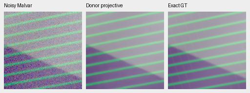
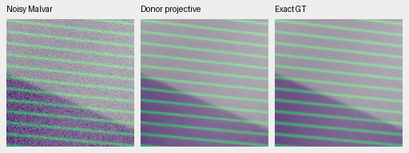
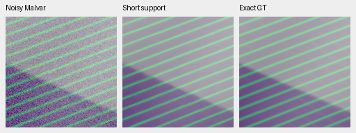
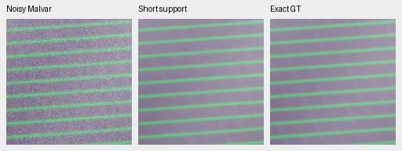

# Estimating weak mesh geometry from exterior Bayer windows

On six fresh ISO400 broken-wire pairs, measuring projected geometry in
exterior RAW and requiring support in smaller query windows cuts the
added gap texture from **3.34 to 0.16 DN16 RMS** at nearly the same
weak-wire response. The short support costs response on the continuous
mesh and fades the faint real cab lattice. A wider donor region helps
estimate perspective on the coarse GFX fence. The fine cab never has
enough supporting tiles for that estimate.

## Where the earlier fit loses the weak direction

The local crop uses the same 48 observations as the anchored mesh study.
All Bayer and target fingerprints match. The exact projected geometry
raises the number of ISO400 broken-wire pairs that pass the separate RAW
prediction check from **1 to 12 of 12**. At ISO6400, exact geometry passes
only **5 of 12** occluded and **2 of 12** broken pairs. The test uses the
earlier additive rear-profile check, including the shifted phase control.
These are central-window results before footprint and overlap consensus.

A signed fit across the three Bayer colors on the phase reserve lowers
mean wire-template agreement in three of the four profile/layout groups.
A separate diagnostic holds the geometry fixed and changes how the rear
amplitude is validated. It learns a
signed color direction from exterior RAW, then fits one scalar along
that direction. At ISO6400 with exact occluded geometry, the signed donor
color approves 11/12 present occluded pairs and 1/12 front-only controls.
Three independent amplitudes approve 8/12 present and 0/12 controls.
For broken geometry, the respective counts are 8/12 and 3/12 present,
with no front-only approvals. These color diagnostics use the occluded
rear profile in both policy arms. The measured geometry recovers little
of the same advantage. Signed color was evaluated as evidence only.

## Shared geometry from scene measurements

The existing donor pair supplies its supporting tile coordinates and
per-tile frequencies. A corroborated half-frequency can replace a higher
harmonic. A projective model estimates separate center frequencies and
one shared denominator for the two directions. At each exterior tile it
predicts a local frequency from the gradient of projected phase. A fit
must improve its pooled prediction across both carriers on disjoint
alternate donor tiles in each train-and-check direction. The two estimated
perspective vectors must also agree.

The query measures phase on the existing fixed Bayer reserve and searches
a smaller frequency range around the donor prediction. An unwarped arm
uses the same narrow search around the donor mean. Those arms use the
same extra Bayer check, two-direction amplitudes and broad local mask.
The translated queries recenter the projective geometry analytically and
reuse the anchored sample partitions. The phase from the donor stays
outside the delivery fit.

## Replay with known targets

With matching exterior donors, the central projected geometry passes
the RAW check on 8/12 ISO400 broken roles, compared with 7/12 with the
tighter planar search and 1/12 in the original central box. After local
support, both new arms change 7/12 present roles. Rotated donors and
the front-only and flat controls keep the parent in the full delivery.
The table averages 12 cases per row at ISO400. Increment RMS is measured
on the supported weak-wire locations. The first three columns report
recovery as a percentage of the exact weak increment and error in DN16.

| ISO400 case | Prior anchored median | Donor-centered planar | Donor projective |
| --- | ---: | ---: | ---: |
| Occluded | 76.32% / 32.05 | 79.35% / 31.90 | 90.69% / 32.63 |
| Broken | 32.84% / 43.06 | 40.37% / 40.94 | 44.38% / 39.47 |

The new replay columns evaluate the central query. The fresh panel uses
the same 13 shifts for each policy. In the replay, the projective arm
adds 5.70 DN16 RMS in known gaps on average, reaching 18.71 DN16 in one
case. The tighter planar arm adds 3.42 DN16. The prior anchored median
adds 0.38 DN16. The ISO6400 replay shows essentially the parent response,
including a 0.01 DN16 increase in occluded-wire error.

The two broken-wire comparisons use cases g110 and g111, draw 0. Every
cell is 160 native pixels per side, ROI `[80,80,160,160]` in the 320-pixel
field. Preview uses noisy Malvar, ADC16 black fraction 0.03, identity WB
and matrix, shot/read `8e-5/2.56e-8`, exposure ×1 and common contrast ×8.
The composed parent is spatial 2k EMA with global context disabled,
SHA256 `97fd551bd0ae0b7aa97c67e1f6e8b513b722f70d5ad8b8814a96586b934eafac`.
The projective result shows more of the faint second direction on both
cases. The true gap is still difficult to see in the reconstruction.

[g110 comparison](images/local-mesh-projective-v1/iso400-broken-g110-r0-comparison.png) ·
[g111 comparison](images/local-mesh-projective-v1/iso400-broken-g111-r0-comparison.png) ·
[Occluded case](images/local-mesh-projective-v1/iso400-occluded-g115-r0-comparison.png).

## Fresh pairs and shorter support

Six new geometries, two layouts and two noise priors give 24 exact
present/absent pairs. Every arm uses the same 13 anchored query shifts.
The short-support variant attenuates the projective correction with a
second local check. It tests the rear direction in windows 76 native
pixels across using the same two Bayer folds and tent interpolation.
The broad support checks use 112-pixel windows. The shorter check has
less signal and reduces how far an admitted wire extends into a gap.

| ISO400 layout | Prior anchored median | Projective median | Short support |
| --- | ---: | ---: | ---: |
| Occluded recovery / wire RMS | 52.99% / 37.93 | 56.59% / 38.03 | 48.98% / 38.24 |
| Broken recovery / wire RMS | 36.54% / 42.26 | 39.37% / 41.79 | 36.72% / 42.16 |
| Added RMS in known gaps | 3.34 | 2.21 | 0.16 |
| Largest added RMS in a gap | 10.92 | 10.69 | 0.81 |

The total gap error stays near the local parent's 79 DN16 and rises from
79.05 to 79.23 DN16 against the prior anchored result. The short mask
suppresses the correction's added pattern while much of the inherited
error remains. It activates on two broken and three occluded ISO400
present roles, the same counts as the other policies. Every ISO6400
case, front-only or flat role and rotated or quiet exterior retains its
parent. [Fresh panel measurements](results/local-mesh-projective-v1/fresh-summary.json).

The fresh native triplets show g120 broken (RGGB) and g121 occluded
(BGGR), selected by wire RMS change within each ISO400 layout. They use
the same coordinates, checkpoint and display as the replay above. The
short support fades the added traces inside the g120 gap. It softens
some of the continuous crossings in the occluded scene.

[g120 comparison](images/local-mesh-projective-v1/iso400-broken-g120-comparison.png) ·
[g121 comparison](images/local-mesh-projective-v1/iso400-occluded-g121-comparison.png) ·
[Worst projective gap in the fresh panel](images/local-mesh-projective-v1/iso400-broken-g123-comparison.png).

## Standing GFX100S review

The original donor region supplies too few matching windows for a
perspective fit on the fine cab mesh. The coarse fence supplies four
tiles in one column and its perspective checks also fail. A wider test
keeps the original pair and extends the donor grid through cached RAW
up to 730 native pixels from the fitting center. Each extra tile must
contain both nearby frequencies. The broader region adds 21 matching
coarse-fence tiles, and the fitted geometry passes both exterior checks.
The coarse fence crossings look similar. No additional tile qualifies
for the fine cab mesh. Both left crops keep a faint lattice with broad
support. Short support visibly weakens it. The sky, building, foliage
and the two right cab crops return their parents exactly.

| Native crop | Prior anchored median | Wider donors | Short support |
| --- | ---: | ---: | ---: |
| Coarse fence | 31.86 | 32.97 | 32.97 |
| Fine cab left, nominal | 11.62 | 10.50 | 5.66 |
| Fine cab left, transferred | 10.00 | 9.18 | 6.36 |

Values are correction RMS in camera-linear DN16. The sky stays smooth,
the coarse mesh stays coherent, and the fine hardware and leaves remain
soft. The right cab shows incomplete diagonals. All eight wider-donor
boards were viewed at native size. They show the local-only 2k EMA
`ceb5ddaf23fce47806a01045bd86d34bb48d1f64031e382b0d5cfbabf0716880`,
V120, the same noisy inputs and the independently demosaiced ISO100
references. Both cab JPEGs are shown. Their exposure, aperture and
moving subjects limit the lower-noise captures to qualitative comparison.
Main DSCF3879 uses exposure ×4 and nominal `0.00128/6.5536e-6` shot/read.
Cab DSCF3842 uses exposure ×16, this nominal prior and the transferred
`0.0014635775921166604/1.0715704128646712e-6` prior. All panel coordinates
and RAW bindings are recorded in the evidence.
[Sky](images/local-mesh-projective-v1/main-overcast-sky-main-overcast-sky.png) ·
[Building](images/local-mesh-projective-v1/main-building-detail-main-building-detail.png) ·
[Foliage](images/local-mesh-projective-v1/main-foliage-main-foliage.png) ·
[Coarse fence](images/local-mesh-projective-v1/main-chain-link-fence-main-chain-link-fence.png).

| Cab prior | Native views |
| --- | --- |
| Nominal | [Left](images/local-mesh-projective-v1/mesh-nominal-fine-green-mesh-left.png) · [Right](images/local-mesh-projective-v1/mesh-nominal-fine-green-mesh-right.png) |
| Transferred | [Left](images/local-mesh-projective-v1/mesh-profile3879-fine-green-mesh-left.png) · [Right](images/local-mesh-projective-v1/mesh-profile3879-fine-green-mesh-right.png) |

The prototype is a scoped inference experiment. Training and canonical
primary-panel scores are outside this comparison.
[Executed sources and exact bindings](results/local-mesh-projective-v1/publication.json) ·
[Comparable broad panel history](performance-history.md).
