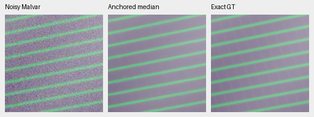
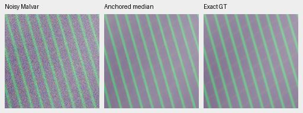

# Crop placement and weak mesh recovery

The [local donor correction](local-donor-mesh.md) can reconstruct weak detail
when two nearby parts of the scene supply the wire frequencies and the local
RAW supplies phase and amplitudes. Holding the donors and the Bayer sample
partitions fixed across overlapping query windows makes that fit less sensitive
to a crop origin. On the standing GFX100S reviews, the combined fit preserves
the faint left cab lattice and the coarse fence changes. The sky, building,
foliage and both right-cab outputs equal their local-only parents.
[Executed code, inputs and results](results/local-mesh-stability-v1/publication.json).

## What changes when the crop moves

All 13 placements retain the same native 160×160 output region and the same
neural prediction. The 256×256 query moves by ±2, ±8 or ±16 native pixels along
one axis. The nominal query supplies the exterior donor pair. Holding the pair
fixed keeps coarse-fence support in 13 placements. Recomputing the donor pair
as the query moves drops coarse-fence support in three placements. These
results measure the correction on a fixed field, independent of neural tile
placement.

Anchoring the reserved phase and verification columns to the nominal sensor
coordinates preserves their membership in overlapping windows. The nominal
placement is identical to the earlier fit. At the two-pixel horizontal shift,
the left cab correction's cosine similarity to center rises from 0.796 to 1.000
at the nominal prior and from 0.774 to 1.000 at the transferred prior, rounded
to three decimals. The worst cosine across all shifts improves from 0.796 to
0.884 and from 0.774 to 0.893. Other shifts still change the fitted amplitudes
and support footprints. The coarse fence's minimum cosine stays at 0.967.

A shift that fails the RAW tests proposes a zero correction. The delivered
correction is the signed pixelwise median, with a strict majority of shifts
required to contribute. Foliage passes at five of 13 placements with fixed
donors, up to 2.31 DN16 RMS. The majority rule removes those corrections. The
overlapping fits share sensor data. Their agreement is a stability check.
[Per-placement checks and correction similarities](results/local-mesh-stability-v1/publication.json).

## Fresh exact-reference panel

48 paired tests use six unseen synthetic geometries, two noise priors, two
draws, and occluded or broken rear wires. Each local sample has a matching,
rotated or quiet 768×768 exterior. The same 320×320 noisy field and parent enter
all three comparisons. The evaluation projects the recovered present-minus-
absent weak increment onto its exact target. RMS measures increment error on
the supported weak-wire mask. Means below are over 12 cases per row.

| Case | Parent response / RMS DN16 | Original box | Moving median | Anchored median |
| --- | ---: | ---: | ---: | ---: |
| ISO400 occluded | 31.02% / 43.70 | 77.04% / 32.53 | 75.67% / 31.85 | 76.32% / 32.05 |
| ISO400 broken | 31.22% / 43.75 | 31.22% / 43.75 | 32.50% / 43.14 | 32.84% / 43.06 |
| ISO6400 occluded | 27.19% / 45.91 | 27.19% / 45.91 | 27.19% / 45.91 | 27.19% / 45.91 |
| ISO6400 broken | 24.75% / 47.43 | 24.75% / 47.43 | 24.75% / 47.43 | 24.75% / 47.43 |

The anchored median changes all 12 ISO400 occluded present roles and one
ISO400 broken present role. The latter adds 4.51 DN16 RMS inside a known gap
while reducing supported-wire error from 45.16 to 36.92 DN16. Every ISO6400
role, unrelated or quiet exterior, front-only input and flat control keeps its
parent under the anchored median. The exterior test proposes a pair in all
48 matching and all 48 rotated surrounds, leaving the query check to reject
the rotated pair. Quiet surrounds yield no pair. Compared with the original
box, the anchored median slightly reduces mean occluded increment error and
attenuates some crossings. Against the moving median, it gives similar
synthetic results and more consistent left-cab phase.
[Full paired results and controls](results/local-mesh-stability-v1/publication.json).

The two triplets show the ISO400 occluded cases g110 (GRBG) and g115 (GBRG),
draw 0. Both use native ROI `[80,80,160,160]` in the 320-pixel field, Malvar RAW
preview, ADC16 black fraction 0.03, identity white balance and color matrix,
shot/read `8e-5/2.56e-8`, exposure ×1 and shared reference-centered contrast ×8.
The parent is spatial 2k EMA with scene context disabled, SHA256
`97fd551bd0ae0b7aa97c67e1f6e8b513b722f70d5ad8b8814a96586b934eafac`.

[All methods on g110](images/local-mesh-stability-v1/iso400-occluded-g110-r0-comparison.png) ·
[All methods on g115](images/local-mesh-stability-v1/iso400-occluded-g115-r0-comparison.png) ·
[Broken case with a correction](images/local-mesh-stability-v1/iso400-broken-g111-r0-comparison.png) ·
[Broken case returning the parent](images/local-mesh-stability-v1/iso400-broken-g115-r0-comparison.png) ·
[ISO6400 case](images/local-mesh-stability-v1/iso6400-occluded-g115-r0-comparison.png).

## Standing GFX100S crops

All eight boards were viewed at native size. The left fine cab still shows the
faint lattice at both priors, with less contrast than the independent ISO100
AHD and JPEG and some overly regular crossings. The light green post and soft
horizontal wire remain visible. There is little visible difference between
the medians. The right has the same incomplete crossings and soft diagonals
as the parent. The coarse fence keeps its visible crossings and the small
bright speck already present in the parent. The flat sky, dark foliage and fine
building hardware retain the parent's pixels, including its soft features.

| Native crop | Original correction RMS DN16 | Moving median | Anchored median |
| --- | ---: | ---: | ---: |
| Main coarse fence | 32.32 | 31.68 | 31.86 |
| Fine cab left, nominal | 12.02 | 11.26 | 11.62 |
| Fine cab left, transferred | 10.01 | 9.96 | 10.00 |
| Other five crops | 0 | 0 | 0 |

The camera boards retain noisy Malvar, V120 EMA, local-only 2k EMA, and the
independently demosaiced ISO100 AHD. Both cab board pairs also show the two
camera JPEGs. The local parent SHA256 is
`ceb5ddaf23fce47806a01045bd86d34bb48d1f64031e382b0d5cfbabf0716880`.
Main DSCF3879 is exposure ×4 at `0.00128/6.5536e-6` shot/read with
80-pixel donor tiles. Fine cab DSCF3842 is exposure ×16 with 112-pixel tiles
and both priors below. The two priors use the same noisy RAW. DSCF3880 and
DSCF3835 differ in exposure, aperture and movement and serve as qualitative
references. Exact native coordinates and display bindings are in the receipt.
[Sky](images/local-mesh-stability-v1/main-overcast-sky-main-overcast-sky.png) ·
[Building](images/local-mesh-stability-v1/main-building-detail-main-building-detail.png) ·
[Foliage](images/local-mesh-stability-v1/main-foliage-main-foliage.png) ·
[Coarse fence](images/local-mesh-stability-v1/main-chain-link-fence-main-chain-link-fence.png).

| Cab shot/read | Native crops |
| --- | --- |
| Nominal `0.00128/6.5536e-6` | [Left](images/local-mesh-stability-v1/mesh-nominal-fine-green-mesh-left.png) · [Right](images/local-mesh-stability-v1/mesh-nominal-fine-green-mesh-right.png) |
| Transferred `0.0014635775921166604/1.0715704128646712e-6` | [Left](images/local-mesh-stability-v1/mesh-profile3879-fine-green-mesh-left.png) · [Right](images/local-mesh-stability-v1/mesh-profile3879-fine-green-mesh-right.png) |

## Applying the crop correction to V120 and Corpus 100k

The same input and fit preserve the left cab lattice with both V120 and
Corpus 100k EMA predictions. The nominal correction is 11.55 and 11.04 DN16
RMS respectively, and the transferred result is 10.39 and 9.76 DN16 RMS.
For both left crops and both parents, the signed correction has cosine
similarity above 0.999 to the local-only 2k correction. The coarse fence
correction also remains visible, with magnitudes of 29.86 and 26.66 DN16 RMS.
Both parents are returned bit for bit on the two right views and the sky,
building and foliage. All eight composed boards were viewed. The faint left
crossings remain weaker and more regular than in the qualitative references.

V120 EMA SHA256 is `a9d9b6b4f974e24a6b11e5e740aab32314233a7f53c056cf37c7d2aac1c589fb`.
Corpus 100k EMA SHA256 is
`87b96f3c487b9edaf1c477742b6c38f2a82cc6b20a94716d51cc8cf46a17a760`.
The extension uses the same ROIs, exposures and shot/read settings above.
[Coarse fence](images/local-mesh-stability-v1/parent-transfer/main-chain-link-fence-main-chain-link-fence.png) ·
[Nominal left](images/local-mesh-stability-v1/parent-transfer/mesh-nominal-fine-green-mesh-left.png) ·
[Transferred left](images/local-mesh-stability-v1/parent-transfer/mesh-profile3879-fine-green-mesh-left.png) ·
[Transfer receipt](results/local-mesh-stability-v1/parent-transfer.json).

## Experimental inference

`demosaic.mesh_refinement.refine_local_raw_mesh` accepts a camera-linear RGB
parent, packed RAW, its variance map and CFA, and returns a native output crop.
The inputs must share their scene coordinates and the fitting box must be even
aligned. It reproduces the anchored result bit for bit on all eight archived
camera crops. The three supported corrections each took about 3.7 seconds
on the CPU with one BLAS thread, excluding the neural inference. The
experimental function requires the `eval` extra. Its
correction covers repeating two-direction structures with evidence in nearby
exterior windows. Discontinuities and perspective changes still limit it.
A full-image inference run would also need consistent donor selection across
regions and a way to limit fits to relevant surface neighborhoods. The code
implements crop inference only. [Crop API](../src/demosaic/mesh_refinement.py).

The numerical panel and actual native review are complete. The experiment adds
an inference component with no new training endpoint or primary-panel score.
[Comparable primary panel history](performance-history.md).
