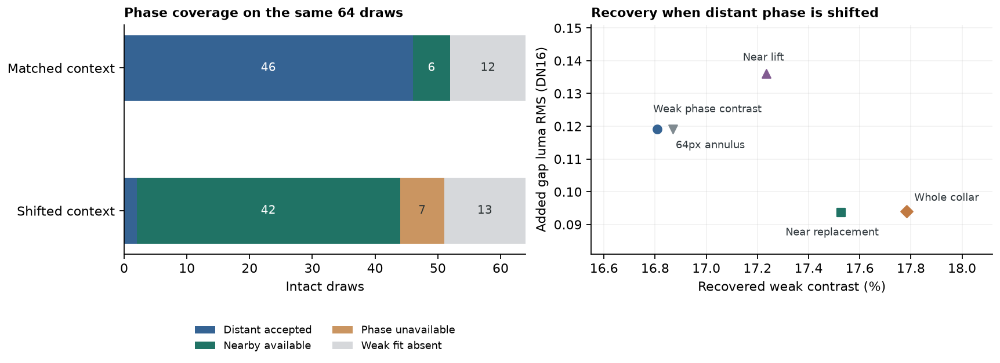
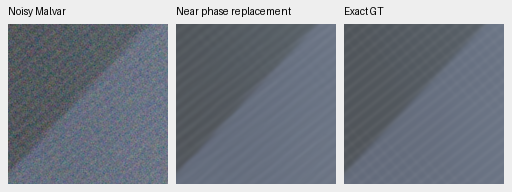
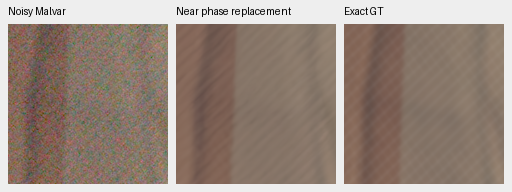

# Nearby RAW phase when the distant phase check fails

The opt-in `weak-near-phase` crop method checks nearby Bayer samples when the [distant phase guard](local-weak-contrast.md) cannot supply a coherent phase. On 32 new ISO6400 photo-based fixtures with shifted distant phase, it recovers **0.719 percentage points** more faint contrast and lowers intact weak error by **0.568 DN16**. Added gap luma falls from **0.119 to 0.094 DN16**, with an interval spanning zero. It changes the weak diagonal in both real right-cab views, with fine crossings still incomplete.

## Measure phase just outside the crop

The nearby fit uses 20 disjoint 32-pixel patches in the collar immediately outside the 160-pixel crop. For each Bayer phase it removes a quadratic background and the competing fundamental before fitting the two weak quadratures. The phase is pooled separately at each 16-pixel evaluation station. The weights decay with distance from the donor patch, with Gaussian scales of 100 pixels along the wire and 50 perpendicular to it. Both green lattices must support a coherent phase and agree with each other.

The 16-pixel query stations test the fixed prediction on native Bayer samples after removing the local background and stronger direction. Pooled color evidence is limited by the lower of the two green scores plus 1.5. The replacement uses the full fitted weak amplitude, tapered by the new support score. It can reduce as well as increase the weak correction. Stations without eligible phase retain the existing correction. A separate lift variant only increases the correction at stations with positive support. Other comparisons use uniform pooling over the collar or a 64-pixel annulus that excludes the tested center. All keep the same frequency nomination, original weak admission and parent restoration. The nearby phase always omits the tested crop in the packaged method. Phase scores remain conditional on frequency nomination and weak admission.

The 48 earlier photo backgrounds set the rules. Each delivery family chooses the largest mean recovery with no increase in mean added gap luma against `weak-phase-contrast` in the shifted context. The two winning variants use the same direction-weighted 32-pixel collar. The packaged option uses replacement with the score ramp reaching full strength at 2.5. An audit on all four Bayer layouts preserves the collar fit when all 25,600 query crop samples are changed. Replacing the 32-pixel region around an annular station preserves its fitted phase and can change its held score.

## Same recipient under two distant contexts

The 32 new sources include strips, ellipses, smooth dips and contrast steps. They exclude earlier evaluation sources and overlap none of the 559,808 recorded photographic visits for Local 50k. Each source supplies two sensor draws and six roles, including edge-only, uniform and flat-core controls. The recipe uses σ 0.85 pre-Bayer blur, ISO6400 shot/read `0.00128 / 6.5536e-6`, exposure 0.33, black offset 0.03 and 16-bit ADC. Parent inference uses CUDA IEEE FP32.

One replay uses the matching planted exterior. The other shifts the exterior weak carrier on each side by a different phase and generates a fresh distant sensor draw. The complete 256×256 noisy recipient, including the entire nearby collar, is bit-identical across each pair. Restoration uses its original parent and exact target in both conditions. Distant frequency pairs stay identical in 58 of 64 confirmation draws. The other six change by at most one frequency bin, or 0.001953 cycles per pixel. At fixed frequencies the audit reproduces the nearby scores bit for bit when switching far context.

| 32 new photos with shifted distant phase | Weak contrast recovered | Intact weak RMS (DN16) | False weak RMS in gaps (DN16) | Added gap luma RMS (DN16) |
| --- | ---: | ---: | ---: | ---: |
| Combined check | 14.819% | 41.766 | 2.686 | 0.000 |
| Full weak posterior | 16.856% | 40.252 | 2.679 | 0.122 |
| Weak phase contrast | 16.807% | 40.287 | 2.679 | 0.119 |
| Direction-weighted collar, replacement | 17.527% | 39.720 | 2.680 | 0.094 |
| Direction-weighted collar, lift only | 17.234% | 39.952 | 2.678 | 0.136 |
| 64-pixel annulus, replacement | 16.871% | 40.235 | 2.679 | 0.119 |
| Whole 32-pixel collar, replacement | 17.783% | 39.520 | 2.678 | 0.094 |

Relative to `weak-phase-contrast`, the packaged replacement gains **0.719 points** `[+0.386, +1.110]` and lowers intact RMS by **0.568 DN16** `[−0.900, −0.291]`. The added gap difference is **−0.025 DN16** `[−0.067, +0.007]`. This measures every luma change from the combined check inside the exact missing masks, while false weak RMS measures projection along the absent direction. The latter differs by +0.0009 DN16 `[−0.0024, +0.0045]`. Scaling the original contrast correction to 78.7% to match the measured gap luma gives a retrospective recovery difference of **+1.143 points** `[+0.735, +1.611]`. Intervals resample photos by geometry with both draws kept together.

The replacement changes matched-context recovery by only +0.011 points. With shifted phase, the distant guard qualifies two of 51 intact draws with a weak fit. The direction-weighted collar supplies eligible phase in 42 of the other 49. Seven shifted outside-only draws and three strong-only draws have a weak admission from the original pipeline, and none qualify for the new phase check. The new method inherits the combined check's 0.273 DN16 flat change and 0.032 DN16 uniform change on one crop each. The whole-collar alternative recovers 0.976 more points than `weak-phase-contrast` on the shifted panel. It finds no eligible weak phase in either right cab view, where pooling along the wire supplies a local check.

The 48 separate ordinary-photo controls all reproduce their parents with natural surroundings. With the same noisy originals and the shifted planted exterior, the existing nomination test admits 16 weak fits. The nearby method reproduces the prior crop-level scores on those mismatches, including mean 1.420 DN16 added RGB RMS relative to Local 50k. The original false nominations still matter.

## Native exact comparisons

Both 160×160 triplets show the replacement in the shifted context. They use BGGR draw zero, crop `[48,48,160,160]` inside query `[128,128,256,256]`, the ISO6400 recipe above and common display exposure ×2 followed by sRGB. The examples are the largest replacement gains among the BGGR draw-zero strip and ellipse subsets. The frozen Local 50k EMA parent has SHA256 `62f4e9ce84075c8df1a254a1889033b5787133e8c98c63e0ec3d174a94734959`. Exact GT includes optical blur before Bayer sampling. The strip shows a somewhat clearer secondary diagonal. The ellipse still lacks the clean crossing contrast of GT.

The strip uses W.carter's Sun in fog in Lysekil photograph at bin-four crop `[250,32,512,512]`, adapted by binning, adding wires and simulating optics and noise. [All methods](assets/local-near-phase-v1/weak-contrast-05-comparison.png) · [Source](https://commons.wikimedia.org/wiki/File:Sun_in_fog_in_Lysekil.jpg) · [CC BY-SA 4.0](https://creativecommons.org/licenses/by-sa/4.0).

The ellipse uses Renée Kools's Sint-Martinuskerk photograph at bin-four crop `[188,236,512,512]` with the same adaptation. [All methods](assets/local-near-phase-v1/weak-contrast-13-comparison.png) · [Source](https://commons.wikimedia.org/wiki/File:Breda_Sint-Martinuskerk_kruisweg_Jezus_6.jpg) · [CC BY 4.0](https://creativecommons.org/licenses/by/4.0).

## Standing GFX100S comparisons

All 12 native boards were viewed. Sky, building and foliage reproduce Local 50k. The coarse fence uses distant phase, retaining its connected crossings. The left cab still has ambiguous local rank. Both right cab views use the nearby fallback, changing the existing contrast result by **2.44 DN16 RGB RMS** with nominal conditioning and **1.60 DN16** with transferred conditioning. Thirty-five of 100 stations have eligible nearby phase in each, and five and eight respectively reach the full-strength local score. The replacement redistributes weak diagonal contrast, softening some regular traces near the rail. Fine crossings remain incomplete and the transferred view retains mottle. No new repeating color is apparent.

The main 160-pixel origins are `[5800,1400]` sky, `[5790,2690]` building, `[8890,5570]` foliage and `[2240,6000]` coarse fence. Cab origins are `[806,6489]` and `[1026,6449]`. Nominal shot/read is `0.00128 / 6.5536e-6`. The transferred cab uses `0.0014635775921166604 / 1.0715704128646712e-6`. V120 Small EMA SHA256 `a9d9b6b4f974e24a6b11e5e740aab32314233a7f53c056cf37c7d2aac1c589fb` supplies the general-model comparison. The separate ISO100 AHD and camera JPEGs are qualitative references with different exposure, aperture and motion. The standing captures use 16-pixel distant clearance. Some of their distant windows overlap the outer half of the nearby collar, while both exclude the delivered crop.

| RAW and profile | Native boards |
| --- | --- |
| DSCF3879 nominal ×4 | [Sky](assets/local-near-phase-v1/main-overcast-sky-main-overcast-sky-x4.png) · [Building](assets/local-near-phase-v1/main-building-detail-main-building-detail-x4.png) · [Foliage](assets/local-near-phase-v1/main-foliage-main-foliage-x4.png) · [Coarse fence](assets/local-near-phase-v1/main-chain-link-fence-main-chain-link-fence-x4.png) |
| DSCF3842 nominal | [Left ×4](assets/local-near-phase-v1/mesh-nominal-fine-green-mesh-left-x4.png) · [Right ×4](assets/local-near-phase-v1/mesh-nominal-fine-green-mesh-right-x4.png) · [Left ×16](assets/local-near-phase-v1/mesh-nominal-fine-green-mesh-left-x16.png) · [Right ×16](assets/local-near-phase-v1/mesh-nominal-fine-green-mesh-right-x16.png) |
| DSCF3842 transferred | [Left ×4](assets/local-near-phase-v1/mesh-profile3879-fine-green-mesh-left-x4.png) · [Right ×4](assets/local-near-phase-v1/mesh-profile3879-fine-green-mesh-right-x4.png) · [Left ×16](assets/local-near-phase-v1/mesh-profile3879-fine-green-mesh-left-x16.png) · [Right ×16](assets/local-near-phase-v1/mesh-profile3879-fine-green-mesh-right-x16.png) |

## Packaged crop fit

Use `method="weak-near-phase"` with the existing 160×160 camera-linear crop, 192×192 parent context and packed Bayer scene. The API matches the tested replacement within 0.002 DN16 peak across 768 synthetic crop/context combinations and eight standing crops. On GB10 single-thread CPU after the parent forward, median time on the shifted panel is 27.53 ms versus 27.47 ms for `weak-phase-contrast`. On 48 crops that qualify for nearby phase across the two contexts, the medians are 52.45 and 38.96 ms. [Crop usage](usage.md#repeating-mesh-crops).

The study uses frozen weights. Fixed 427-photo and known/unseen camera panels fall outside this crop evaluation. [Paired results](results/local-near-phase-v1/summary.json) · [Native provenance](assets/local-near-phase-v1/manifest.json) · [Publication hashes](results/local-near-phase-v1/publication.json) · [Frozen evidence](results/local-near-phase-v1/evidence.tar.xz).
