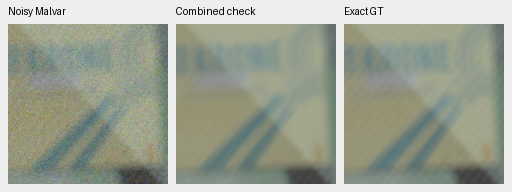
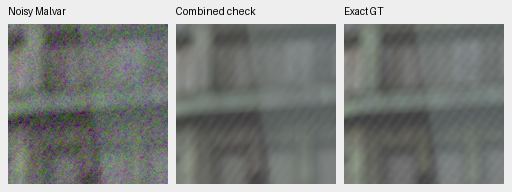

# Combining broad and central RAW support

Independent testing of the [earlier central check](local-center-guard.md)
confirms its advantage when the broad 64-pixel fit and the central
32-pixel check are scaled to similar recovery of the faint strand.
Combining both checks lowers error on the strand that continues
through a gap by **4.203 DN16** versus broad verification alone
[−5.935, −2.627]. The combined check makes no corrections on 64
edge-only and 64 uniform recipient crops. It still admits two
of 64 crops with a flat core and detail farther out. At full
strength the broad check retains more of the faint strand. The
real fine cab crossings remain incomplete.

## Fit and verification

All arms estimate the same sinusoidal coefficients in a 64-pixel
window, one Bayer green lattice at a time. They use the competing
direction and low-order cosine terms as nuisance predictors. The
64-pixel check tests the other lattice over the entire window. The
32-pixel check tests only the central half-width and refits the
nuisance basis on the fitting lattice in that center. Swapping
green lattices creates a second fold. The weaker fold sets the
score. The guide nomination uses four 128-pixel patches outside
any tested samples. The implementation supports a donor setback
so the 16-pixel fitting halo is disjoint as well as the delivery
patch. No held sample enters the fitted carrier on the fold that
tests it.

The combined check caps the broad gain at six noise-weighted
error-reduction units by the central gain at 1.5 units. For a
threshold `c` and the weaker held score `s`, either gain is
`max(0,s−c)/(max(0,s−c)+c)`. The combined gain is the smaller
one and therefore requires positive support from both windows.
The checks share some validation pixels. All arms subtract the
same broad carrier fitted to the neural parent, cap the
correction by measured RAW amplitude, and deliver to the same
central 32 pixels with overlapping tapers and nominal gain 0.73.
The parent sees all of its input pixels.

The parent is the [Local 50k EMA](local-50000-scoped.md),
`62f4e9ce84075c8df1a254a1889033b5787133e8c98c63e0ec3d174a94734959`,
and the comparison model is [V120 Small](v120-v121-primary.md),
`a9d9b6b4f974e24a6b11e5e740aab32314233a7f53c056cf37c7d2aac1c589fb`.
Both use CUDA IEEE FP32. Their shared GPU review took 120.96
seconds for 384 RAW query inputs per model. The CPU
corrections, scoring and rendering took 27.88 seconds.

## Fresh optical and negative controls

The 32 new validation photos are distinct from the 56 earlier
wire crops and the matched continuation schedules. The audited
Local 50k trace has 559,808 photographic visits with no matching
source ID or cache hash. Eight photos each use a strip, ellipse,
smooth dip or contrast step, including 16 hard-gap sources.
Both noise draws use ordinary independent Poisson shot and signed
read noise followed by 16-bit ADC after σ 0.85 pre-Bayer blur.
Within each draw the six recipient roles see identical outer
donors. Those donors begin outside the whole 256-pixel query
(48 pixels beyond the 160-pixel delivery rectangle). Replacing
all query pixels leaves the nominations identical. Each recipient
uses its own native draw and all correction arms share that draw.

| Nominal change versus Local 50k | Broad check | Center 3 | Combined check | Center 1.5 |
| --- | ---: | ---: | ---: | ---: |
| Weak response, percentage points of sharp target | +3.177 | +1.449 | +1.569 | +4.660 |
| Intact fundamental RMS, DN16 | −2.417 | −1.116 | −1.245 | −3.265 |
| Continuing-strand RMS in true gaps, DN16 | −28.736 | −17.512 | −22.077 | −23.120 |
| False weak projection in true gaps, DN16 | +0.014 | +0.028 | +0.016 | +0.117 |
| Exact-flat core luma RMS, DN16 | +0.011 | +0.005 | +0.003 | +0.051 |

The fixed gain from the previous center-only study reproduces a
2.059 DN16 continuing-strand improvement versus broad at similar
weak response. The combined check was calibrated before scoring
the fresh sources. On the earlier 32 sources its gain weight 0.500
matches the broad gain at 0.2396. Every row below averages both
draws within each source before a paired, family-stratified
bootstrap. Intervals are 95%.

| At matched weak recovery | Weak response, points | Continuing-strand RMS, DN16 | False weak projection, DN16 |
| --- | ---: | ---: | ---: |
| Center 3 minus broad, earlier weights | +0.010 [−0.131, +0.171] | −2.059 [−3.455, −0.715] | +0.011 [−0.006, +0.030] |
| Combined minus broad | +0.023 [−0.097, +0.171] | −4.203 [−5.935, −2.627] | +0.005 [−0.007, +0.017] |
| Combined minus Center 3, follow-up | +0.013 [−0.097, +0.139] | −1.931 [−2.633, −1.257] | −0.007 [−0.019, +0.003] |

The direct Center 3 match uses 0.500 for Center 3 and 0.4699 for
the combined check from the earlier sources. At full nominal
strength, broad verification keeps a 1.608-point weak-response
advantage over the combined check and lowers continuing-strand
RMS 6.659 DN16. The gain match compares more selective delivery
at a lower correction strength.

| No target carrier in the recipient | Broad check | Center 3 | Combined check | Center 1.5 |
| --- | ---: | ---: | ---: | ---: |
| Flat core, any activation in 64 crops | 4 | 9 | 2 | 42 |
| Edge-only, any activation in 64 crops | 3 | 6 | 0 | 46 |
| Uniform, any activation in 64 crops | 1 | 4 | 0 | 44 |
| Weak-direction admissions in strong-only crops | 2 | 1 | 0 | 48 |

The last row counts overlapping verification windows in the
second nominated direction. A detected continuing strong strand
is expected in that role. An activation only means a window
passes the gate. The other three rows count each crop once at
nominal settings. On the two repeated crops from each source,
the combined check never repeats a flat-core admission. The
fresh 9/64 result for Center 3 shows why the earlier zero count on
56 reused flat crops needed confirmation. Synthetic Poisson and
read noise do not measure false activation under real sensor
correlation, nor do these counts bound arbitrary natural textures.

## Native exact views

Each panel is 160 × 160 native pixels at `(48,48,160,160)` within
the 256-pixel query at `(128,128)). The triplets use the first
noise draw, BGGR CFA, simulated exposure 0.33, shot/read
`0.00128 / 6.5536e-6`, ADC black offset 0.03, and identical ×2
scene-linear display followed by sRGB. Ground truth is exact
after the optical simulation and before Bayer sampling.

The strip uses GT1976's baler photograph at bin-four
`(410,44,512,512)`.
The broad check strengthens parallel lines toward the lower right.
The combined check makes a smaller change and leaves the faint
slope below the target. Adapted by binning, inserting wires and
simulating optics and sensor noise.
[Original](https://commons.wikimedia.org/wiki/File:2019-06-04_%28204%29_Baler_Krone_R_10-16_in_Wilhersdorf%2C_St._Margarethen_an_der_Sierning%2C_Austria.jpg) ·
[CC BY-SA 4.0](https://creativecommons.org/licenses/by-sa/4.0/) ·
[Full comparison](assets/local-nested-support-v1/nested-01-comparison.png).

The ellipse uses High Contrast's Munich customs office photograph
at bin-four `(46,0,512,512)`, with the same adaptation and display.
The stronger diagonal remains visible at the shaded edge. The
combined check leaves the crossing slope faint and the exact
reference retains more wire structure.
[Original](https://commons.wikimedia.org/wiki/File:Glaskuppel_des_Hauptzollamts_M%C3%BCnchen.jpg) ·
[CC BY 3.0 DE](https://creativecommons.org/licenses/by/3.0/de/deed.en) ·
[Full comparison](assets/local-nested-support-v1/nested-09-comparison.png).

## Standing GFX100S comparisons

For both GFX scenes the donors start just outside the 16-pixel
verification halo. The 48-pixel setback used for the shared
synthetic context rejects both fine cab ROIs in a recorded
sensitivity replay. At 16 pixels, both pass and the right
nominated frequencies shift slightly versus the zero-setback
variant. Substituting all native samples in the held footprint
leaves the 16-pixel nominations unchanged.

The DSCF3879 ISO6400 main crops use 512-pixel contexts, shot/read
`0.00128 / 6.5536e-6` and ×4 display. The DSCF3880 ISO100 AHD
column uses an independently demosaiced qualitative reference.
Sky, building and foliage equal the parent pixels. The coarse
fence retains its connected intersections and bright green speck.
The combined check changes it by 9.780 DN16 RGB RMS versus
Local 50k.
[Sky](assets/local-nested-support-v1/main-overcast-sky-main-overcast-sky-x4.png) ·
[Building](assets/local-nested-support-v1/main-building-detail-main-building-detail-x4.png) ·
[Foliage](assets/local-nested-support-v1/main-foliage-main-foliage-x4.png) ·
[Coarse fence](assets/local-nested-support-v1/main-chain-link-fence-main-chain-link-fence-x4.png).

The DSCF3842 ISO6400 cab crops use 768-pixel contexts, the nominal
conditioning or transferred DSCF3879 shot/read
`0.0014635775921166604 / 1.0715704128646712e-6`. The boards
include DSCF3835 ISO100 AHD and both straight-out-of-camera JPEGs.
They are qualitative references with different aperture, exposure
time and motion. On the nominal right, the combined check
admits 73 and 49 windows across the directions, versus 81 and 68
with broad verification and 65 and 40 with Center 3. It brings
back some right-cab diagonal continuity that Center 3 leaves
faint, with less blanket grid contrast than broad verification.
The left remains broken near the post, and green-gray mottle
persists under both priors. No extra chroma fringe is evident.

| Native 160 × 160 crop | Nominal prior | Transferred DSCF3879 prior |
| --- | --- | --- |
| Left `(806,6489)` | [×4](assets/local-nested-support-v1/mesh-nominal-fine-green-mesh-left-x4.png) · [×16](assets/local-nested-support-v1/mesh-nominal-fine-green-mesh-left-x16.png) | [×4](assets/local-nested-support-v1/mesh-profile3879-fine-green-mesh-left-x4.png) · [×16](assets/local-nested-support-v1/mesh-profile3879-fine-green-mesh-left-x16.png) |
| Right `(1026,6449)` | [×4](assets/local-nested-support-v1/mesh-nominal-fine-green-mesh-right-x4.png) · [×16](assets/local-nested-support-v1/mesh-nominal-fine-green-mesh-right-x16.png) | [×4](assets/local-nested-support-v1/mesh-profile3879-fine-green-mesh-right-x4.png) · [×16](assets/local-nested-support-v1/mesh-profile3879-fine-green-mesh-right-x16.png) |

This is a scoped crop component. The fixed photo and camera
panels have no new result for this prototype.
[Scores, counts and image hashes](results/local-nested-support-v1/publication.json) ·
[Source and receipts](results/local-nested-support-v1/evidence.tar.xz).
