# V172 local noise matching: completed quality

Local feature/output noise units remove most of V171's added quiet-color error and give small mean gains over V169. **V172 EMA quiet RMS is 4.033561/6.295703 DN16** under the ISO6400/12800 priors: **−0.311/−0.767% versus V169 EMA**, and **−23.744/−21.103% versus V171 EMA**. Quiet DC RMS is 1.991393/2.780697, **−1.329/−2.545% versus V169**, and −48.351/−49.563% versus V171. Total quiet error decreases on 24 of 32 inputs versus V169; eight worsen. Quiet spatial RMS changes +0.047/−0.036%, so the benefit comes mainly from color mean accuracy, with spatial mottle still unresolved. Raw also reduces quiet means slightly versus V169; both endpoints are reported.

EMA signed mesh response is **0.03877185, or 3.877185% of exact constructed GT amplitude**: **+1.058% versus V169**, −0.197% versus V171. Present-image RMS is 8.955686 DN16, nearly unchanged from V169 (−0.007%); all 256 present images are worse than V171. Absent-image RMS is 5.309113, **+0.060% versus V169** and +1.162% versus V171. A small signed absent-template mean does not establish absence of false structure. Natural faint/dark photographic results remain close to V169: faint mean RMS changes −0.002/−0.004%, while dark means rise about0.005% in both cohorts. These are small reused-cohort changes, not evidence of broad superiority.

EMA native512 standalone-flat RMS is **18.607969/24.198471 DN16**, **−0.059/−0.085% versus V169**; coarse32 RMS is **13.435593/17.921661**, **−0.021/−0.050%**. Full RMS improves on28 of48 inputs and coarse RMS on40 of48. V171's larger flat gains are lost: all48 full/coarse inputs worsen versus V171 EMA, with means +1.161–1.458% full and +1.715–1.739% coarse. Keep V171 as the stronger standalone-flat option, V161 as the stronger learned-mesh option and earlier quiet choices visible. V172 is a useful local-unit/quiet-color variant for further work; V120 remains the general recommendation.

All60 native figures were actually viewed at original detail. The mixed vertical/slanted/striped quiet windows visibly lose much of V171's extra purple/blue cast, returning close to V169; green/purple broad mottle and fine texture remain against the exact uniform targets. The standalone-flat changes are subtle. Synthetic mesh seed2302 remains mostly blank at ordinary display; seed2309 retains mainly one diagonal family, with missing crossing strands. The protected DSCF3879/3880 sky/building/foliage/coarse-fence views stay near V169; no clear new sky pattern is apparent in these views. The additional DSCF3842/3835 cab windows at both priors still miss much of the fine crossed lattice. Organic faint/dark controls remain over-smoothed. ADC-only bark/fur/planes retain V169 exactly. This establishes neither noisy-flat safety nor a recovery of the real fine crossings. ISO100/AHD/JPEG references differ in capture/processing and are qualitative, not exact GT.

The frozen V172 review accidentally emitted inherited `V171-raw`/`V171-EMA` method strings and filenames, despite using the correct local-noise class, V172 checkpoint and V172 output directory. Three CPU reporting initializers rejected those labels before writing a completed audit or any figure. The [label-only derived view](results/v172-local-noise-matching-v1/method-label-normalization-v2.json) maps method strings and native dictionary keys to V172; a reverse mapping reproduces every original record exactly. All scalar fields, actual array paths/hashes and original journals remain unchanged. The current script fixes that one method string; the actual frozen runner remains preserved. No training or inference repeats. The [reporting recovery](results/v172-postprocess-recovery-v2.json) binds revised sources before metric/native-image review. The original postprocess receipt was recorded after review launch because a check of the already-reaped training PID raised `NoSuchProcess`; that timing is explicitly recorded and no prelaunch receipt is claimed.

[Final evidence and exact sources](results/v172-local-noise-matching-final-v1.json) · [Native pixels, source ROIs, checkpoint, noise and display metadata](images/v172-local-noise-matching-v1/manifest-v1.json).

## Mesh response and actual blank error

| Metric | V143 parent | V169 EMA | V171 EMA | V172 raw | V172 EMA |
| --- | ---: | ---: | ---: | ---: | ---: |
| Present full RMS | 9.111243 | 8.956287 | 8.909846 | 8.954388 | 8.955686 |
| Present signed template gain | 0.02202090 | 0.03836594 | 0.03884819 | 0.03868372 | 0.03877185 |
| Present actual blank RMS | 5.523323 | 5.609300 | 5.544439 | 5.609065 | 5.610812 |
| Present blank spatial RMS | 5.343113 | 5.431940 | 5.361961 | 5.428938 | 5.429880 |
| Present blank DC RMS | 1.289621 | 1.289568 | 1.300170 | 1.299402 | 1.299983 |
| Absent full RMS | 5.237910 | 5.305929 | 5.248144 | 5.306838 | 5.309113 |
| Absent signed template gain | 0.00003236 | -0.00000719 | 0.00001071 | 0.00000204 | 0.00000519 |
| Absent actual blank RMS | 5.237910 | 5.305929 | 5.248144 | 5.306838 | 5.309113 |
| Absent blank spatial RMS | 5.099652 | 5.169538 | 5.102240 | 5.166786 | 5.167332 |
| Absent blank DC RMS | 1.098115 | 1.098120 | 1.135453 | 1.117627 | 1.122982 |

## Quiet fields beside detail

| Metric | V143 parent | V169 EMA | V171 EMA | V172 raw | V172 EMA |
| --- | ---: | ---: | ---: | ---: | ---: |
| iso6400-prior whole RMS | 27.105631 | 26.806949 | 27.302897 | 26.807286 | 26.801695 |
| iso6400-prior quiet RMS | 3.898845 | 4.046127 | 5.289473 | 4.045632 | 4.033561 |
| iso6400-prior quiet spatial RMS | 3.268502 | 3.439626 | 3.429768 | 3.439756 | 3.441249 |
| iso6400-prior quiet DC RMS | 2.016074 | 2.018205 | 3.855646 | 2.016266 | 1.991393 |
| iso12800-prior whole RMS | 36.747466 | 35.462223 | 36.176612 | 35.437906 | 35.435967 |
| iso12800-prior quiet RMS | 6.152652 | 6.344343 | 7.979617 | 6.315794 | 6.295703 |
| iso12800-prior quiet spatial RMS | 5.341833 | 5.559786 | 5.525857 | 5.558352 | 5.557772 |
| iso12800-prior quiet DC RMS | 2.849060 | 2.853327 | 5.513166 | 2.805201 | 2.780697 |

## Native 512-pixel standalone flats

| Metric | V143 parent | V169 EMA | V171 EMA | V172 raw | V172 EMA |
| --- | ---: | ---: | ---: | ---: | ---: |
| iso6400-prior full RMS | 18.546808 | 18.618871 | 18.394478 | 18.609444 | 18.607969 |
| iso6400-prior spatial RMS | 18.235130 | 18.308796 | 18.067235 | 18.305668 | 18.308685 |
| iso6400-prior coarse32 RMS | 13.440561 | 13.438463 | 13.205937 | 13.434064 | 13.435593 |
| iso12800-prior full RMS | 24.071890 | 24.219097 | 23.850667 | 24.191330 | 24.198471 |
| iso12800-prior spatial RMS | 23.596861 | 23.747288 | 23.431650 | 23.744005 | 23.747758 |
| iso12800-prior coarse32 RMS | 17.932544 | 17.930574 | 17.619500 | 17.919591 | 17.921661 |

## Natural photographic detail

| Metric | V143 parent | V169 EMA | V171 EMA | V172 raw | V172 EMA |
| --- | ---: | ---: | ---: | ---: | ---: |
| retained512/photo-faint full RMS | 33.963754 | 33.966492 | 33.965750 | 33.964786 | 33.965651 |
| retained512/photo-faint band response | 0.298560 | 0.298025 | 0.298141 | 0.298163 | 0.298194 |
| retained512/photo-faint band error | 0.824639 | 0.824693 | 0.824595 | 0.824648 | 0.824629 |
| retained512/photo-dark full RMS | 29.097715 | 29.094009 | 29.115518 | 29.095003 | 29.095378 |
| retained512/photo-dark band response | 0.531446 | 0.530900 | 0.531020 | 0.530938 | 0.530919 |
| retained512/photo-dark band error | 0.661447 | 0.661251 | 0.661223 | 0.661241 | 0.661241 |
| organic384/photo-faint full RMS | 37.469061 | 37.483612 | 37.498859 | 37.481652 | 37.482240 |
| organic384/photo-faint band response | 0.150701 | 0.149160 | 0.149403 | 0.149363 | 0.149407 |
| organic384/photo-faint band error | 0.924117 | 0.925058 | 0.924904 | 0.924963 | 0.924935 |
| organic384/photo-dark full RMS | 33.685796 | 33.685928 | 33.717351 | 33.686918 | 33.687728 |
| organic384/photo-dark band response | 0.398945 | 0.397799 | 0.398053 | 0.397906 | 0.397914 |
| organic384/photo-dark band error | 0.781612 | 0.781691 | 0.781667 | 0.781683 | 0.781679 |

## ADC-only controls

| Metric | V143 parent | V169 EMA | V171 EMA | V172 raw | V172 EMA |
| --- | ---: | ---: | ---: | ---: | ---: |
| Photo full RMS | 18.149871 | 18.142182 | 18.142182 | 18.142182 | 18.142182 |
| Photo band error | 0.101855 | 0.101800 | 0.101800 | 0.101800 | 0.101800 |
| fresh-flat512 full RMS | 3.322910 | 3.322910 | 3.322910 | 3.322910 | 3.322910 |
| fresh-flat512 coarse32 RMS | 0.538587 | 0.538587 | 0.538587 | 0.538587 | 0.538587 |
| adc-sloped512 full RMS | 3.771369 | 3.776943 | 3.776943 | 3.776943 | 3.776943 |
| adc-sloped512 coarse32 RMS | 0.574652 | 0.573442 | 0.573442 | 0.573442 | 0.573442 |

RMS values are camera-RGB DN16. Signed template gain 1 means exact constructed mesh amplitude; a small signed absent mean does not certify absence of artifacts. Coarse32 is spatially centered block-mean error. All paired differences and decrease/increase counts are retained. The reused, adaptively studied cohort does not establish blind generalization or training-seed uncertainty.

## Local units and matched training

The new transform centers parent RGB on each 2×2 Bayer-cell mean, which is also supplied. The quartet's mean physical variance defines its noise RMS and 16-DN16 input-unit floor. RAW innovations, variance ratios and level coordinates use these local units. The cell noise RMS scales its native RGB correction. All 39 coordinates remain. No image-wide mean/noise statistic enters this transform; the frozen V169/DINO result and matching network still use spatial context. The unit is an amplitude convention, not calibrated post-demosaic RGB covariance.

The 2,088,906 parameters/141 tensors, seeded initial state, frozen V169 EMA, V168 1,000-row cache, pair units, V171 criterion, AdamW/LR/clipping/EMA and schedule match V171. Preparation verifies the training/runtime/resource/restoration ASTs, criterion bytes and recipe fields. Only input coordinates and output amplitude change together; their individual effects are not isolated. The unchanged criterion still uses image-wide pixel/gradient units. No released V170 weights are loaded, and all 95 prior neural sources remain unchanged.

The matching core retains the [pinned NLFeMF definitions](https://github.com/MIA-UIB/nonlocal-matchfilter), width 16, nine neighbors per scale and three scales. A zero RGB tail gives exact initial V169 output. Zero supplied local variance retains V169 at that cell, including signed zero; wholly ADC-only rows bypass matching. Targets, clean masks and pairs enter only the unchanged training loss. This is not a noisy-flat guarantee or whole-pipeline locality claim.

The fixed cache contains 341 mesh, 243 photo, 156 mixed, 153 flat and 107 weak-detail rows, including V168's fine-wire/contrast ladder. The criterion combines pixel/gradient reconstruction, paired differences/common error, clean-flat anchoring and local/DC regret. It is byte-identical to V171. Original captures/JPEGs/siblings remain excluded; no source/noise draws, original/dataz reads or new parent/DINO calls occur.

The schedule completes 900 optimizer updates and 100 ADC-only skips, totaling 3,600 training images. A real step-8 checkpoint restores model, Adam, EMA and RNG state exactly, then continues at step 9 without prefix replay. All 141 trainable tensors receive nonzero gradients during training; 141 final Adam states and both endpoint tensors are finite and strictly checked. The sampler's unchanged CUDA input-gradient is atomic and warns under warn-only deterministic mode; exact restoration does not imply bit-exact retraining.

All 126 relevant CPU tests pass, including 12 new checks of independent NumPy cell statistics, four CFAs, native phase output units, zero/signed-zero routing, uniform-field equivalence, feature locality and identical initial tensors. New synthetic admission uses three batch-4 native 512 backward calls and one native 768 inference. Unchanged primitive/core sources inherit V171's independent CPU/CUDA adjoint and parity evidence; those old calls are not repeated or counted as new work. The frozen metric runtime is constructed successfully without CUDA before training launch.

A current-preparer style correction adds explicit `check=False` and parentheses around its probe string after freezing. Its training/review/runtime/model functions are unchanged, and both source versions are bound. [Original protocol](results/v172-local-noise-matching-v1/original-protocol-v1.md) · [Prepared sources](results/v172-local-noise-matching-preparation-v1.json) · [CPU and runtime readiness](results/v172-CPU-runtime-readiness-v1.json).

All 1,000 training input/parent/unit bindings and durable rows are audited. NumPy FP32 independently checks 900 actual weighted loss totals. Clean-mask fingerprints reproduce V168's previously independently audited masks on identical targets; this is inheritance validation, not a fresh mask construction. Both raw/EMA states load strictly in the training and quality audits.

Quality completes 1,644 composed calls, each with frozen V169 evaluation; matching runs 1,500 times with 7,500 nested sampling forwards. All 1,644 V169 outputs replay their existing fingerprints exactly. All 144 ADC final outputs retain V169 exactly. V171 comparisons use its previously audited scores on the identical cached design, not new V171 inference. All 6,576 actual input fingerprints, durable rows and event bindings are checked. Independent in-process FP32 addition covers 1,186,725,888 channels.

Full new arrays cover only 36 preselected native cases: 72 RGB plus 72 residuals, totaling 430,196,736 bytes. Independent posthoc metrics/addition cover those arrays, 582 scalar values and 53,772,288 RGB channels. Other outputs were scored/fingerprinted and independently norm/decomposition/addition checked in process but not retained. No complete new full-array archive or all-822 new-array posthoc audit is claimed. Decimal arithmetic checks 661 grouped means. The adaptively reused cohort does not establish blind generalization or training-seed uncertainty.

New matching work totals 2,404 CUDA calls and no new CPU matching-core calls. Frozen-component CUDA calls total 2,548; they are nested components, not DINO-parent calls. New admission adds four CUDA composed calls/13 images and three discarded synthetic updates; inherited primitive checks are not counted again. All three recorded owners are terminal, with no failed scientific phase or repeated prefix. Training/quality CUDA peaks are 6.278757/2.786150 GiB. There is no new full-frame/100MP or ten-second claim.

The bounded trial reserves 52/114 GiB local/external plus a 0.5 GiB projection margin, 32 GiB runtime RAM and 24 GiB CUDA, with 52 GiB launch RAM. Older guards and receipt bytes remain unchanged. Existing MIT and embedded sampler Caffe notices remain in provenance.

## Fixed native comparisons

All 60 figures were actually viewed in 15 original-detail sheets: 48 boards and 12 noisy/restored/exact constructed GT triplets. Every cell is 160×160 native pixels without resizing. Sources/ROIs, checkpoint hashes, noisy-input conditioning, display exposure, camera transform, contrast and anchor are in the manifest. Mesh uses RGGB 512, ROI `[176,176,160,160]`, shot 0.00128/read variance 6.5536e-6, exposure 8 and contrast 1/40. Quiet fields use ROI `[80,176,160,160]`, exposure 8 and contrast 40; flats use ROI `[176,176,160,160]`, exposure 4 and contrast 40. ISO12800 uses shot 0.00256/read variance 2.62144e-5. Photographic credits/licenses remain in the [V168 source report](fine-mesh-training.md#photographic-credits).

Main DSCF3879 ISO6400/DSCF3880 ISO100 includes sky, building, foliage and coarse fence at exposure 4. Cab DSCF3842/3835 includes both priors, both windows `[206,229,160,160]`/`[426,189,160,160]` in 768-pixel contexts, exposure 16, and both camera JPEGs. ISO100/AHD/JPEG references differ in aperture, shutter, motion and processing; they are qualitative references, not exact GT, and are not pixelwise scored. Originals remain read-only and scene families excluded from training. [Main scene](../configs/gfx-qualitative-20231231.json) · [Fine cab mesh](../configs/gfx-green-mesh-20231231.json).

### All native comparison boards

mesh-seed2026112302-present-iso6400-prior-RGGB; ROI `[176, 176, 160, 160]`, exposure 8, contrast 1.

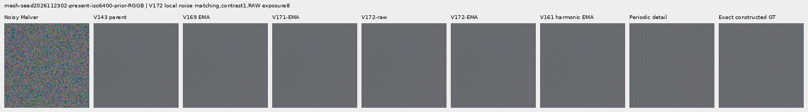

mesh-seed2026112302-present-iso6400-prior-RGGB; ROI `[176, 176, 160, 160]`, exposure 8, contrast 40.

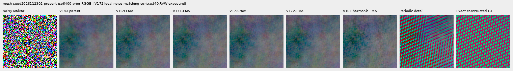

mesh-seed2026112309-present-iso6400-prior-RGGB; ROI `[176, 176, 160, 160]`, exposure 8, contrast 1.

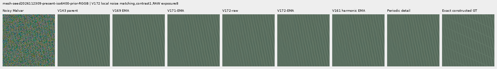

mesh-seed2026112309-present-iso6400-prior-RGGB; ROI `[176, 176, 160, 160]`, exposure 8, contrast 40.

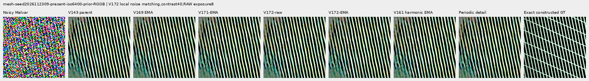

mesh-seed2026112304-absent-iso6400-prior-RGGB; ROI `[165, 0, 160, 160]`, exposure 8, contrast 40.

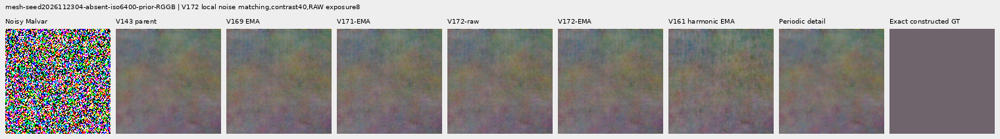

main-overcast-sky; ROI `[176, 176, 160, 160]`, exposure 4, contrast 1.

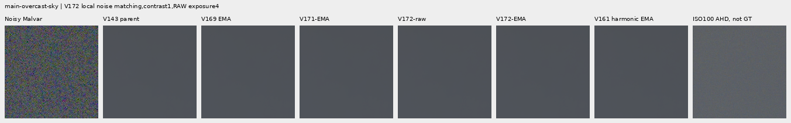

main-building-detail; ROI `[176, 176, 160, 160]`, exposure 4, contrast 1.

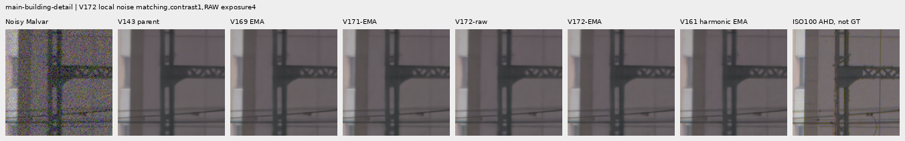

main-foliage; ROI `[176, 176, 160, 160]`, exposure 4, contrast 1.

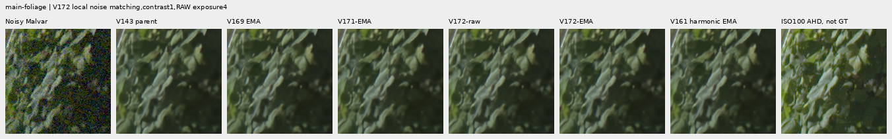

main-chain-link-fence; ROI `[176, 176, 160, 160]`, exposure 4, contrast 1.

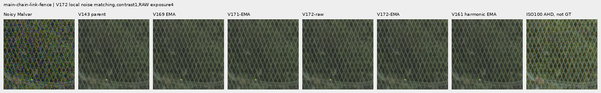

mesh-nominal; ROI `[206, 229, 160, 160]`, exposure 16, contrast 1.

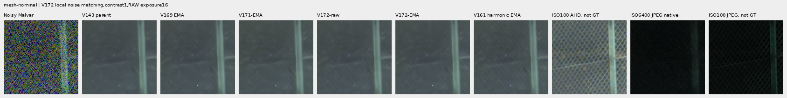

mesh-nominal; ROI `[426, 189, 160, 160]`, exposure 16, contrast 1.

mesh-profile3879; ROI `[206, 229, 160, 160]`, exposure 16, contrast 1.

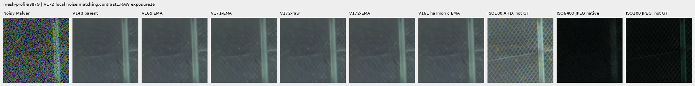

mesh-profile3879; ROI `[426, 189, 160, 160]`, exposure 16, contrast 1.

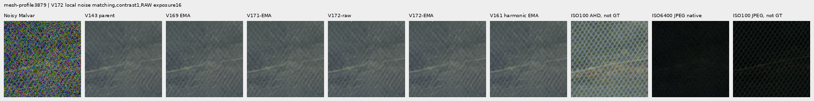

organic-02a76fd33b5e1414a0504f0b3f0aeb03a569b6f4-photo-faint-RGGB; ROI `[112, 112, 160, 160]`, exposure 14.3883, contrast 8.

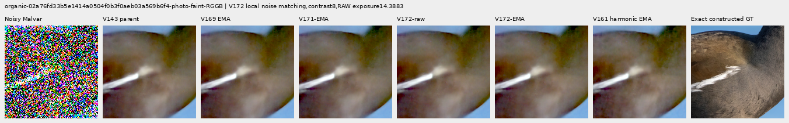

organic-dabacecd4780a1c230f8e9fce6ca1a604bdeab4c-photo-dark-RGGB; ROI `[112, 112, 160, 160]`, exposure 102.758, contrast 1.

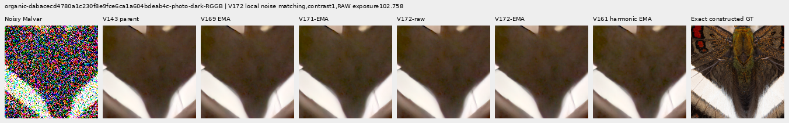

organic-6b3920bceba82d95ecf9351d47f6f94267694bd0-photo-dark-RGGB; ROI `[112, 112, 160, 160]`, exposure 64.0491, contrast 1.

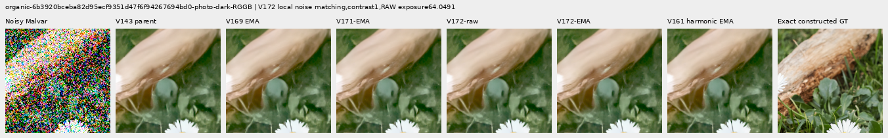

gray-l0.02-adc-only-RGGB; ROI `[48, 48, 160, 160]`, exposure 4, contrast 40.

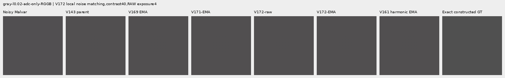

gray-l0.02-iso12800-prior-RGGB; ROI `[48, 48, 160, 160]`, exposure 4, contrast 40.

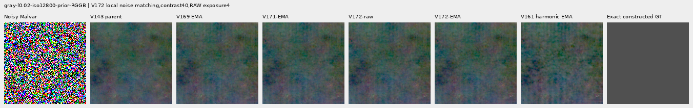

flat512-gray-l0.02-adc-only-RGGB; ROI `[176, 176, 160, 160]`, exposure 4, contrast 40.

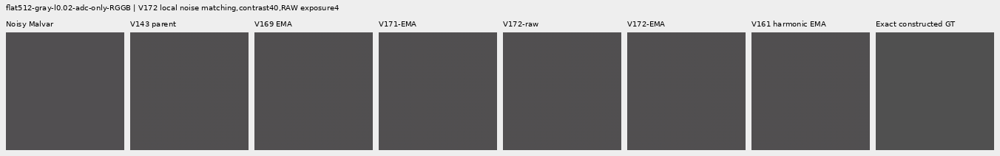

flat512-gray-l0.02-iso6400-prior-RGGB; ROI `[176, 176, 160, 160]`, exposure 4, contrast 40.

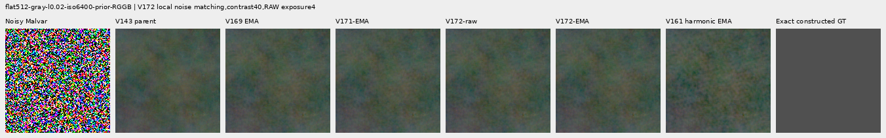

flat512-gray-l0.02-iso12800-prior-RGGB; ROI `[176, 176, 160, 160]`, exposure 4, contrast 40.

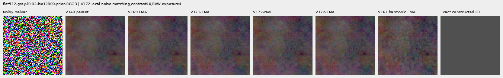

flat512-h210-s0.50-l0.02-iso6400-prior-RGGB; ROI `[176, 176, 160, 160]`, exposure 4, contrast 40.

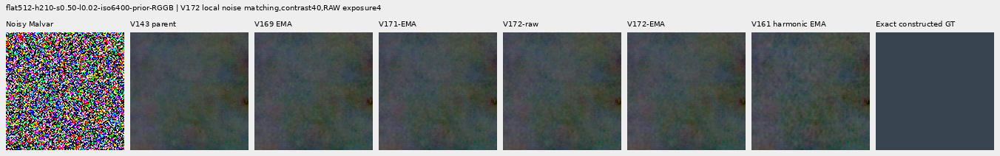

flat512-gray-l0.18-iso12800-prior-RGGB; ROI `[176, 176, 160, 160]`, exposure 1, contrast 8.

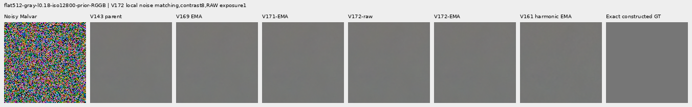

flat512-gray-l0.90-iso12800-prior-RGGB; ROI `[176, 176, 160, 160]`, exposure 1, contrast 4.

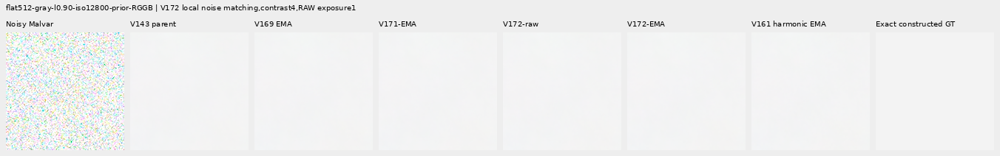

photo-3e638bbb56ed80abc88939468783e3bf9b92ee77-photo-faint-RGGB; ROI `[176, 176, 160, 160]`, exposure 12.1494, contrast 8.

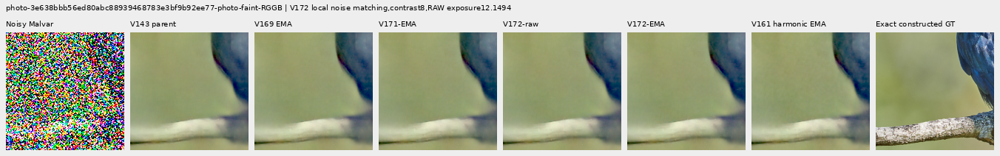

photo-3e638bbb56ed80abc88939468783e3bf9b92ee77-photo-dark-RGGB; ROI `[176, 176, 160, 160]`, exposure 80.9959, contrast 1.

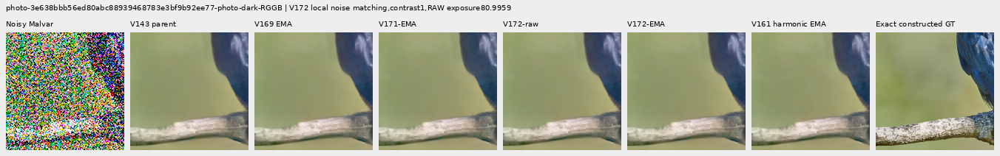

mixed-vertical-step-iso6400-prior-RGGB; ROI `[80, 176, 160, 160]`, exposure 8, contrast 40.

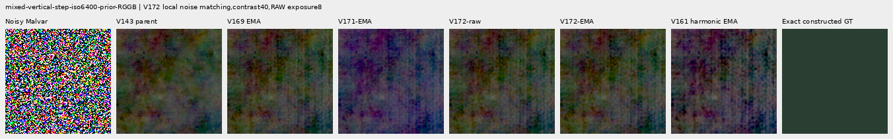

mixed-vertical-step-iso6400-prior-RGGB; ROI `[240, 176, 160, 160]`, exposure 8, contrast 1.

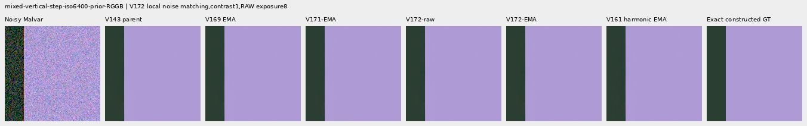

mixed-vertical-step-iso12800-prior-RGGB; ROI `[80, 176, 160, 160]`, exposure 8, contrast 40.

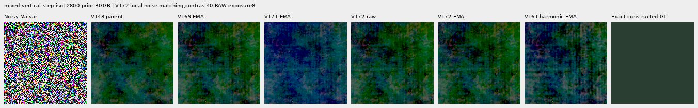

mixed-vertical-step-iso12800-prior-RGGB; ROI `[240, 176, 160, 160]`, exposure 8, contrast 1.

mixed-narrow-bar-iso6400-prior-RGGB; ROI `[80, 176, 160, 160]`, exposure 8, contrast 40.

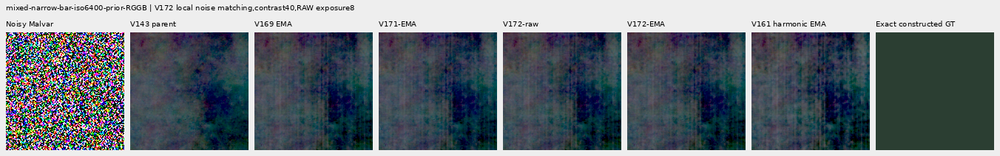

mixed-narrow-bar-iso6400-prior-RGGB; ROI `[240, 176, 160, 160]`, exposure 8, contrast 1.

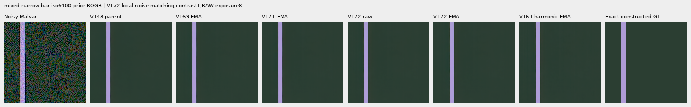

mixed-narrow-bar-iso12800-prior-RGGB; ROI `[80, 176, 160, 160]`, exposure 8, contrast 40.

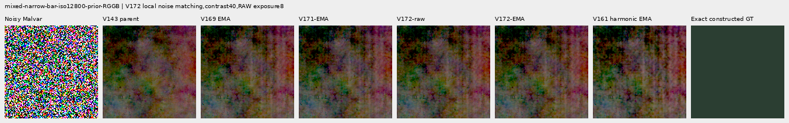

mixed-narrow-bar-iso12800-prior-RGGB; ROI `[240, 176, 160, 160]`, exposure 8, contrast 1.

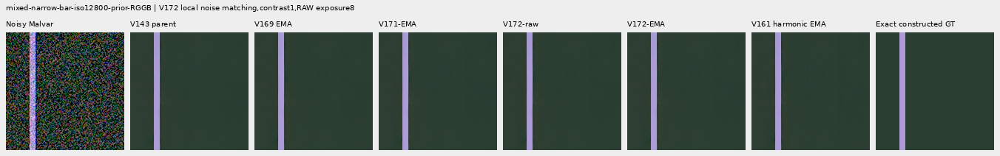

mixed-slanted-step-iso6400-prior-RGGB; ROI `[80, 176, 160, 160]`, exposure 8, contrast 40.

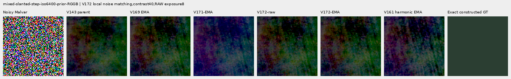

mixed-slanted-step-iso6400-prior-RGGB; ROI `[240, 176, 160, 160]`, exposure 8, contrast 1.

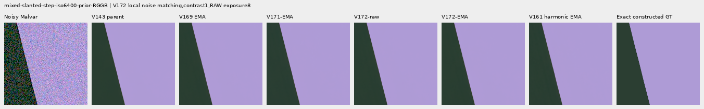

mixed-slanted-step-iso12800-prior-RGGB; ROI `[80, 176, 160, 160]`, exposure 8, contrast 40.

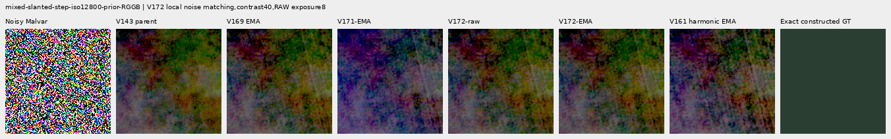

mixed-slanted-step-iso12800-prior-RGGB; ROI `[240, 176, 160, 160]`, exposure 8, contrast 1.

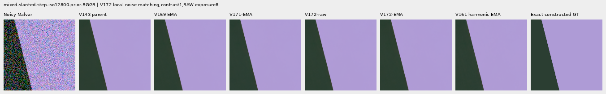

mixed-striped-patch-iso6400-prior-RGGB; ROI `[80, 176, 160, 160]`, exposure 8, contrast 40.

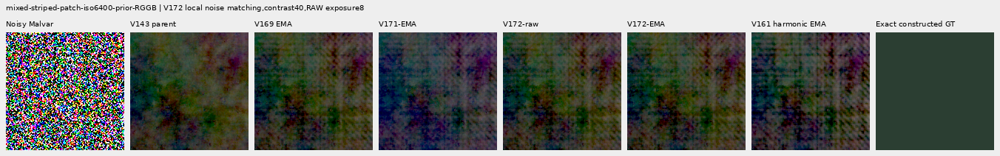

mixed-striped-patch-iso6400-prior-RGGB; ROI `[240, 176, 160, 160]`, exposure 8, contrast 1.

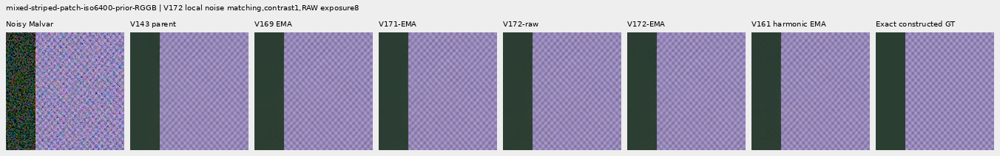

mixed-striped-patch-iso12800-prior-RGGB; ROI `[80, 176, 160, 160]`, exposure 8, contrast 40.

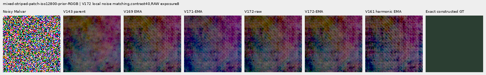

mixed-striped-patch-iso12800-prior-RGGB; ROI `[240, 176, 160, 160]`, exposure 8, contrast 1.

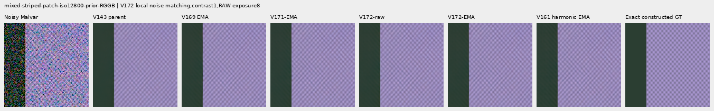

V150-control-bark-contrast0p025-adc-RGGB; ROI `[48, 48, 160, 160]`, exposure 1, contrast 40.

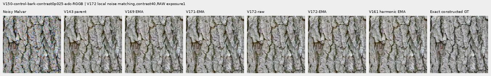

V150-control-raccoon-fur-contrast0p025-adc-RGGB; ROI `[48, 48, 160, 160]`, exposure 1, contrast 40.

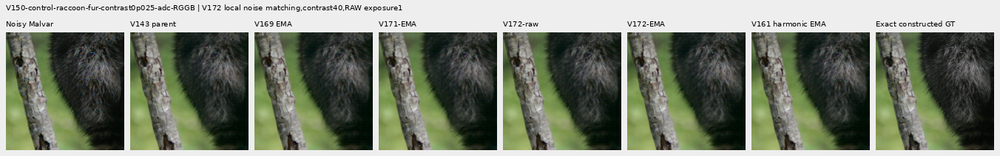

V150-control-ADC-plane0-RGGB; ROI `[176, 176, 160, 160]`, exposure 45, contrast 8.

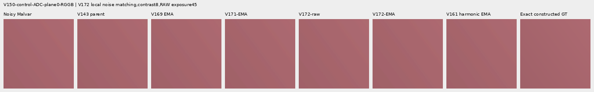

V150-control-ADC-plane1-RGGB; ROI `[176, 176, 160, 160]`, exposure 9, contrast 8.

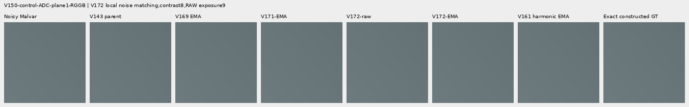

V150-control-ADC-plane2-RGGB; ROI `[176, 176, 160, 160]`, exposure 1, contrast 8.

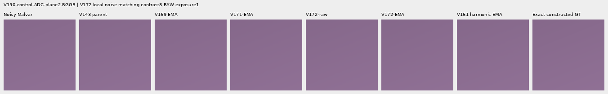

V150-control-ADC-plane3-RGGB; ROI `[176, 176, 160, 160]`, exposure 0.24, contrast 8.

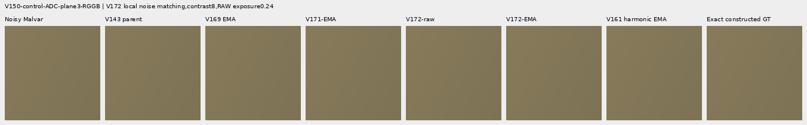

### Noisy, restored and exact constructed GT triplets

mesh-seed2026112302-present-iso6400-prior-RGGB; ROI `[176, 176, 160, 160]`, exposure 8, contrast 1.

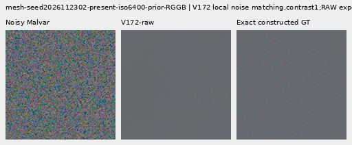

mesh-seed2026112302-present-iso6400-prior-RGGB; ROI `[176, 176, 160, 160]`, exposure 8, contrast 1.

mesh-seed2026112309-present-iso6400-prior-RGGB; ROI `[176, 176, 160, 160]`, exposure 8, contrast 1.

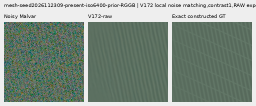

mesh-seed2026112309-present-iso6400-prior-RGGB; ROI `[176, 176, 160, 160]`, exposure 8, contrast 1.

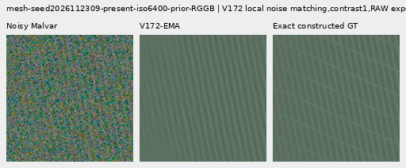

flat512-gray-l0.02-iso6400-prior-RGGB; ROI `[176, 176, 160, 160]`, exposure 4, contrast 40.

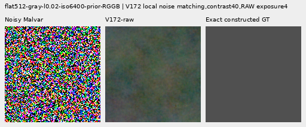

flat512-gray-l0.02-iso6400-prior-RGGB; ROI `[176, 176, 160, 160]`, exposure 4, contrast 40.

flat512-gray-l0.02-iso12800-prior-RGGB; ROI `[176, 176, 160, 160]`, exposure 4, contrast 40.

flat512-gray-l0.02-iso12800-prior-RGGB; ROI `[176, 176, 160, 160]`, exposure 4, contrast 40.

mixed-vertical-step-iso6400-prior-RGGB; ROI `[80, 176, 160, 160]`, exposure 8, contrast 40.

mixed-vertical-step-iso6400-prior-RGGB; ROI `[80, 176, 160, 160]`, exposure 8, contrast 40.

mixed-vertical-step-iso12800-prior-RGGB; ROI `[80, 176, 160, 160]`, exposure 8, contrast 40.

mixed-vertical-step-iso12800-prior-RGGB; ROI `[80, 176, 160, 160]`, exposure 8, contrast 40.

[Independent publication verification](results/v172-local-noise-matching-publication-verification-v1.json).
