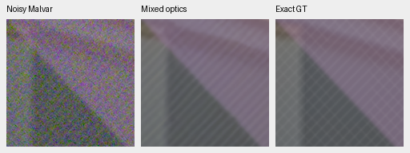
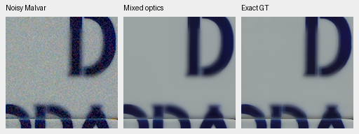
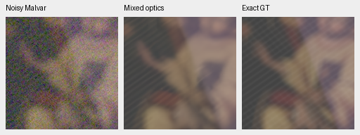
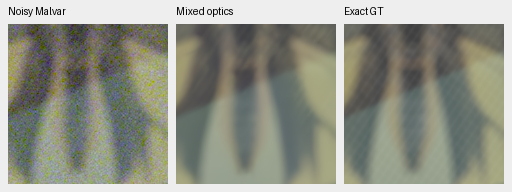

# Completed mixed-optics weak-wire continuation

On the 24 fixed natural cases, the mixed arm lowers fine-band flat
RMS by 0.085 DN16 versus the matched sharp regional model and raises
fine-increment error by 0.251 DN16. On the 24 fixed wire cases it
retains the regional model’s improvement on the continuing strand,
with a weaker second strand and higher flat error than Local 50k.
On 24 fresh optical sources, the primary σ 0.85 response differs
by −0.030 points [−0.219, +0.167], with higher exact-flat RMS.
The standing GFX crops still show incomplete fine cab crossings.

## Endpoint and evaluation

The [mixed-optics training recipe](local-optical-mixture.md) starts
from Local 50k and uses the same ordered 1,024 photos as the sharp
regional control. The 6,144 native observations contain 512 original
sharp groups, 256 at σ 0.40, and 256 at σ 0.65. Training takes
**1,472.71 seconds** wall time, including data preparation, checkpoints
and hashes. The final checkpoint is
`469c6797616875495654f0425f2f92f762f04920079bbab990bc1cd328e0c81e`.
The matched sharp-only regional checkpoint is
`bc633b61e30ac5bc708b7249c7885ca0c45591a2155882ba51ead94c97a6f445`.
The training audit checks raw and EMA weights, AdamW tensors, the
unchanged frozen DINO checksum and every scheduled source. The fixed
review uses **EMA weights and CUDA IEEE FP32** local inference.
The fixed-panel review wall time is 68.34 seconds, including
rendering and reuse of hash-matched controls.
[Training receipt](results/local-optical-mixture-v1/training-1024.json).

The paired intervals resample source photos. Response changes are
percentage points and RMS changes are DN16. The exact panels use
the retained clean targets.

| Measure | Mixed optics | Mixed minus sharp regional (95% CI) | Mixed minus Local 50k (95% CI) |
| --- | ---: | ---: | ---: |
| Natural fine response (%) | 58.505 | +0.217 [−0.046, +0.440] | +0.495 [−0.254, +1.306] |
| Natural fine-increment RMS | 116.158 | +0.251 [+0.047, +0.454] | −0.121 [−0.870, +0.524] |
| Natural fine-flat RMS | 3.834 | −0.085 [−0.136, −0.037] | −0.347 [−0.537, −0.195] |
| Planted-wire weak response (%) | 30.650 | +0.339 [−0.336, +1.028] | −1.727 [−3.208, −0.259] |
| Wire continuing-strand RMS in gaps | 79.900 | −0.420 [−3.097, +1.922] | −17.165 [−25.170, −10.600] |
| Wire false weak-direction RMS in gaps | 8.782 | −0.034 [−0.261, +0.190] | −0.833 [−1.396, −0.309] |
| Wire exact-flat RMS | 23.646 | +0.305 [−0.160, +0.848] | +3.155 [+2.093, +4.423] |

Against V120 and Corpus 100k, natural fine-increment RMS falls
1.213 and 1.109 DN16, respectively. On the fixed wires,
continuing-strand RMS falls 20.179 and 16.374 DN16, while weak
response is lower by 1.184 and 1.580 points. The source-paired
intervals for both latter weak-response changes include zero.
The [fixed review receipt](results/local-optical-mixture-v1/fixed-1024.json)
includes all metrics and both reference comparisons.

## Native exact comparisons

Each panel is an unresized 160 × 160 crop at `(48,48,160,160)` in
the 256-pixel query. The triplets show noisy Malvar, the mixed
EMA at update 1,024, and exact clean ground truth. The ISO6400
inputs use shot `0.00128`, read variance `6.5536e-6`, normalized
exposure 0.33 and black 0.03. Display uses ×2 scene-linear exposure
and sRGB. All models use the same camera transform, observation,
crop coordinates and render.

The planted-wire field uses RGGB, bin-four source crop
`(248,138,512,512)`, and central query `(128,128,256,256)`. The
stronger diagonal remains visible and the faint crossing direction
continues to fade below the edge. The mixed arm lowers false weak
projection by 0.923 DN16 versus the sharp regional arm for this
case. Source photograph by A.Savin, Wikipedia. Adapted through
binning, synthetic wire and sensor noise, cropping and rendering.
[Original](https://commons.wikimedia.org/wiki/File:Rhodes_Kremasti_06-13_Church.jpg) ·
[CC BY-SA 3.0](https://creativecommons.org/licenses/by-sa/3.0/) ·
[Full comparison](assets/local-optical-mixture-endpoint/wire-16-comparison.png).

The lettering uses GBRG and bin-four query `(250,352,256,256)`.
Both regional models retain the broad stroke and soften the thin
edge. Fine-increment RMS falls 0.738 DN16 for the mixed model on
this case. The street sign photograph is by Fernando Losada
Rodríguez. Adapted through binning, synthetic noise, cropping and
rendering. [Original](https://commons.wikimedia.org/wiki/File:Recanto_de_Ferradores.001_-_Ribadeo.jpg) ·
[CC BY-SA 4.0](https://creativecommons.org/licenses/by-sa/4.0/) ·
[Full comparison](assets/local-optical-mixture-endpoint/photo-25-comparison.png).

- The frame-and-window wire case increases false weak projection by
  0.722 DN16. The faint strand still breaks into short sections. Image
  by Renée Kools via Wikimedia Commons, adapted by binning, adding
  planted wires and simulated noise, cropping and rendering.
  [Original](https://commons.wikimedia.org/wiki/File:Dorpsstraat_41,_Wagenberg_voorkant.jpg) ·
  [CC BY 4.0](https://creativecommons.org/licenses/by/4.0/) ·
  [Triplet](assets/local-optical-mixture-endpoint/wire-09-triplet.png) ·
  [Full comparison](assets/local-optical-mixture-endpoint/wire-09-comparison.png).
- The stone case increases fine-increment RMS by 1.273 DN16. Small
  marks on the masonry remain soft. Source by Sumitsurai,
  adapted by binning, synthetic noise, cropping and rendering.
  [Original](https://commons.wikimedia.org/wiki/File:Para_Stone_Deul_Remaining_Works_%282%29.jpg) ·
  [CC BY-SA 3.0](https://creativecommons.org/licenses/by-sa/3.0/) ·
  [Triplet](assets/local-optical-mixture-endpoint/photo-34-triplet.png) ·
  [Full comparison](assets/local-optical-mixture-endpoint/photo-34-comparison.png).

## Fresh optical confirmation

The 24 source images were frozen before training and reserved for
the endpoint. The three blur doses share photon counts and read noise
within each scene and role. Matching treatments use the same Bayer
inputs. All 24 enter the intact and flat comparisons, with 12 true
gaps scored after a three-pixel erosion. The primary comparison is
sharp-normalized weak response at σ 0.85.

| Mixed minus sharp regional (95% CI) | σ 0 | σ 0.55 | σ 0.85 |
| --- | ---: | ---: | ---: |
| Weak response, percentage points of sharp clean | −0.286 [−0.550, −0.027] | −0.132 [−0.361, +0.095] | −0.030 [−0.219, +0.167] |
| Continuing-strand RMS in true gaps, DN16 | +1.298 [+0.119, +2.383] | +0.723 [−0.954, +2.068] | −0.119 [−2.570, +1.974] |
| False weak projection in true gaps, DN16 | +0.073 [−0.012, +0.159] | +0.061 [−0.017, +0.139] | +0.051 [−0.028, +0.131] |
| Exact-flat luma RMS, DN16 | +0.647 [+0.235, +1.108] | +0.671 [+0.288, +1.097] | +0.677 [+0.333, +1.039] |

The weak-response difference improves by 0.256 points from sharp to
σ 0.85 [0.090, 0.410]. At σ 0.85 the overall response and both gap
intervals span zero. The faintest half gains 0.103 points
[−0.158, +0.386]. On this dose the mixed checkpoint recovers 3.038
points less than Local 50k and 2.144 less than V120. It lowers
continuing-strand RMS by 14.157 and 22.417 DN16 versus those two
controls, respectively. The [confirmation receipt](results/local-optical-mixture-v1/confirmation-1024.json)
also includes Corpus 100k, post-optical response and intact error.

The two held-out views show noisy Malvar, the final mixed EMA and
exact post-optical ground truth at σ 0.85. They use the same
`(48,48,160,160)` native ROI in the 256 query, simulated exposure
0.33 and the ISO6400 shot/read/black settings above. Display uses
×2 scene-linear exposure and sRGB. The stronger slope remains
visible on both scenes and the faint crossing slope is subdued.

The strip fixture is based on Palauenc05’s church photo, with bin-four
source crop `(40,82,512,512)`. The adaptation uses binning, planted wire,
optical and sensor simulation, and cropping.
[Original](https://commons.wikimedia.org/wiki/File:Viv%C3%A8s_%C3%89glise_Saint-Michel_madonna.jpg) ·
[CC BY-SA 4.0](https://creativecommons.org/licenses/by-sa/4.0/) ·
[Full comparison](assets/local-optical-mixture-endpoint/fresh-02-sigma-0.85-comparison.png).

The ellipse fixture is based on Bernie’s swallowtail photo, with bin-four
source crop `(156,26,512,512)`. It uses the same simulation and render.
[Original](https://commons.wikimedia.org/wiki/File:Papilio_machaon_01_04102009.jpg) ·
[CC BY-SA 3.0](https://creativecommons.org/licenses/by-sa/3.0/) ·
[Full comparison](assets/local-optical-mixture-endpoint/fresh-08-sigma-0.85-comparison.png).

## Standing GFX100S comparisons

DSCF3879 ISO6400 uses 512-pixel contexts and shot/read
`0.00128 / 6.5536e-6`. Every column is native 160 × 160 and display
exposure ×4. The independently demosaiced DSCF3880 ISO100 capture
supplies the qualitative reference. The sky remains smooth. The
coarse fence crossings and the bright green speck are visible in
both regional outputs. Building cables and fine foliage remain
soft. The mixed arm changes the sky by 1.73 DN16 RGB RMS and the
coarse fence by 7.41 versus the sharp regional arm.
[Sky](assets/local-optical-mixture-endpoint/main-overcast-sky-main-overcast-sky-x4.png) ·
[Building](assets/local-optical-mixture-endpoint/main-building-detail-main-building-detail-x4.png) ·
[Foliage](assets/local-optical-mixture-endpoint/main-foliage-main-foliage-x4.png) ·
[Coarse fence](assets/local-optical-mixture-endpoint/main-chain-link-fence-main-chain-link-fence-x4.png).

DSCF3842 ISO6400 uses 768-pixel contexts. The nominal profile
matches the main comparison. The transferred DSCF3879 profile
uses shot/read `0.0014635775921166604 / 1.0715704128646712e-6`.
Both ROIs and profiles were viewed at ×4 and ×16. Each board
includes DSCF3835 ISO100 AHD and both camera JPEGs. Differences in
aperture, exposure time and motion make these qualitative references.

| Native cab crop | Nominal prior | Transferred DSCF3879 prior |
| --- | --- | --- |
| Left `(806,6489,160,160)` | [×4](assets/local-optical-mixture-endpoint/mesh-nominal-fine-green-mesh-left-x4.png) · [×16](assets/local-optical-mixture-endpoint/mesh-nominal-fine-green-mesh-left-x16.png) | [×4](assets/local-optical-mixture-endpoint/mesh-profile3879-fine-green-mesh-left-x4.png) · [×16](assets/local-optical-mixture-endpoint/mesh-profile3879-fine-green-mesh-left-x16.png) |
| Right `(1026,6449,160,160)` | [×4](assets/local-optical-mixture-endpoint/mesh-nominal-fine-green-mesh-right-x4.png) · [×16](assets/local-optical-mixture-endpoint/mesh-nominal-fine-green-mesh-right-x16.png) | [×4](assets/local-optical-mixture-endpoint/mesh-profile3879-fine-green-mesh-right-x4.png) · [×16](assets/local-optical-mixture-endpoint/mesh-profile3879-fine-green-mesh-right-x16.png) |

The nominal left crop mainly retains the post and the thicker
horizontal strand. The nominal right keeps soft diagonal fragments.
The transferred prior makes the diagonals clearer on both sides,
with broad green-gray patches. The mixed endpoint shows a slight
contrast change on the right and fine crossings stay incomplete
on both sides. Both regional outputs are close at display scale.
The four mixed-versus-sharp differences span 3.09–4.52 DN16 RGB RMS.

## Earlier optical replay and response matching

On the 32 earlier development sources at σ 0.85, the mixed-minus-sharp
weak response is −0.011 points [−0.202, +0.195]. Continuing-strand
RMS falls 2.569 DN16 [−5.017, −0.338] and flat RMS rises 0.558 DN16
[+0.002, +1.144]. The continuing-strand benefit has an interval
spanning zero on the 24 fresh sources.

The response-matched diagnostic blends each model with the same
Local 50k prediction. Calibration on the earlier 32 photos at
σ 0.85 selects 0.500 sharp-regional weight and 0.498 mixed-optics
weight for equal mean recovery. Applying those weights to the
24 separate confirmation photos gives the following paired effects.

| Mixed blend minus sharp blend | Difference and 95% CI |
| --- | ---: |
| Weak response, percentage points of sharp clean | −0.008 [−0.101, +0.089] |
| Continuing-strand RMS inside true gaps, DN16 | −0.398 [−1.740, +0.738] |
| False weak projection inside true gaps, DN16 | +0.023 [−0.016, +0.063] |
| Exact-flat luma RMS, DN16 | +0.296 [+0.147, +0.452] |

The extra flat error persists at matched response. The optical
blend diagnostic uses two model forwards in each arm.
[Earlier replay and matched response](results/local-optical-mixture-v1/optical-replay-1024.json) ·
[Replay archive](results/local-optical-mixture-v1/optical-replay-1024-evidence.tar.xz).

## Fixed camera panels

Both complete camera panels use the final CUDA IEEE FP32 EMA and the
canonical measured-CFA samples. The known panel balances four scenes
and 72 native crops. The unseen panel balances five scenes and 90
crops. Every comparison reuses only control observations whose
checkpoint, input and measured reference match the archive.

| EMA | Known CFA PSNR | Unseen CFA PSNR |
| --- | ---: | ---: |
| V120 | 54.31272 dB | 54.00872 dB |
| Corpus 100k | 54.33708 dB | 53.97826 dB |
| Local 50k | 54.22726 dB | 53.97844 dB |
| Sharp regional | 54.22037 dB | 53.99397 dB |
| Mixed optics | 54.22068 dB | 53.97366 dB |

Mixed minus sharp is +0.00031 dB known and −0.02032 dB unseen.
The largest unseen differences are −0.07010 dB on *Coulicoco* and
−0.04612 dB on *top of Expedit*. Both mixed means trail V120 by
0.09204 and 0.03507 dB. These are small measured-camera panels.
[Camera audit](results/local-optical-mixture-camera-v1/publication.json) ·
[Camera cases](results/local-optical-mixture-camera-v1/evidence.tar.xz).

The fixed 427-photo panel is running. The training, fixed exact, both
optical panels, both standing GFX reviews and both camera panels are complete.
[Training trace archive](results/local-optical-mixture-v1/training-1024-evidence.tar.xz) ·
[Fixed-panel and native evidence](results/local-optical-mixture-v1/fixed-1024-evidence.tar.xz) ·
[Fresh optical evidence](results/local-optical-mixture-v1/confirmation-1024-evidence.tar.xz).
