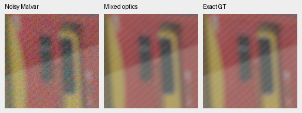
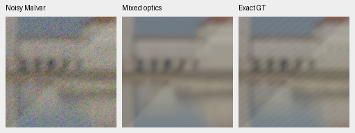

# Mixed-optics development checkpoint at update 128

The [matched optics continuation](local-optical-mixture.md) compares a
mixture of sharp and optically softened inputs with the earlier
sharp-only regional training recipe. This review compares the two
128-update EMAs on the 32 sources already used for optical development.
The study’s 24 fresh confirmation sources are reserved for the endpoint.

Both EMAs started from the same Local 50k checkpoint. The mixed
checkpoint is `8394d93cd72a8e3510bb8dd4b4fd2ca1299b4085b5ad2d211dbfb323379e827d`
and the sharp regional checkpoint is
`079b96e25e65a79dcccec9f9f87a574d2b012bfea527f7c93c9826cfb299d67c`.
Inference is CUDA IEEE FP32. A direct zero-blur replay of the sharp
control matched its archived four-role output exactly. Local 50k
reference scores come from the [shared-noise replay](sensor-optical-transfer.md)
using the same Bayer inputs and metric masks.

## Recovery and false detail on the development panel

The table gives source-paired changes with 95% bootstrap intervals,
resampling sources within each of the four footprint families.
Weak response and flat RMS use all 32 sources. Gap RMS uses the 16
with a true weak gap and a shared three-pixel erosion margin.

| Mixed optics minus sharp regional | σ 0 | σ 0.55 | σ 0.85 |
| --- | ---: | ---: | ---: |
| Weak response, sharp-normalized points | +0.381 [+0.313, +0.451] | +0.321 [+0.263, +0.380] | +0.247 [+0.200, +0.296] |
| Weak response, post-optical points | +0.381 [+0.314, +0.451] | +0.348 [+0.285, +0.413] | +0.304 [+0.246, +0.365] |
| Continuing-strand RMS in true gaps, DN16 | −0.198 [−0.393, −0.002] | −0.255 [−0.435, −0.083] | −0.199 [−0.405, −0.023] |
| False weak projection in true gaps, DN16 | +0.044 [+0.025, +0.064] | +0.042 [+0.026, +0.058] | +0.031 [+0.005, +0.053] |
| Exact-flat luma RMS, DN16 | +0.006 [−0.036, +0.049] | +0.006 [−0.036, +0.049] | +0.006 [−0.036, +0.048] |

At σ 0.85, the weak-response gain over the sharp regional EMA is
+0.242 [+0.181, +0.301] points in the faintest
half, ranked by original clean amplitude. The change in the
sharp-normalized gain from σ 0 to 0.85 is −0.134 [−0.161, −0.109] points.
The gain is smaller under blur than on sharp inputs. The mixed checkpoint
also adds a small false weak projection inside the true gaps. The flat
intervals span zero at all three doses.

Relative to the Local 50k starting EMA at σ 0.85, the mixed arm changes
sharp-normalized response by −0.586 [−0.724, −0.454]
points, false weak projection by −0.088 [−0.132, −0.046]
DN16, continuing-strand RMS by +0.342 [−0.487, +1.108]
DN16 and exact-flat luma RMS by −0.198 [−0.318, −0.078] DN16.

## What the training blur changed

The audit regenerated both versions of every blurred planted-wire
training group and verified the sharp array hashes against the archived
control. It projected the clean weak contrast through the same
regional quadrature operators used in training. All 256 groups kept
exact flat-core targets and clean presence/absence equality inside the
true weak gap after erosion by the kernel radius.

| Training σ (native pixels) | Groups | Median weak period (pixels) | Weak contrast retained, median | Median in the shortest-period quarter |
| ---: | ---: | ---: | ---: | ---: |
| 0.40 | 128 | 15.73 | 99.33% | 98.06% |
| 0.65 | 128 | 16.45 | 96.65% | 88.48% |

Among the blurred wire groups, **21 of 256** have weak periods
between 7.20 and 9.25 pixels, the same span used by the optical
evaluation. The milder width changes typical weak-carrier contrast
by less than one percent. Stronger attenuation in the shortest group
makes it important to read performance there as well as across the
whole panel.

## Native crops

Each panel is an unresized 160 × 160 patch of the long-present
role at σ 0.85. The stitched triplets show noisy Malvar, the mixed
optics EMA at update 128, and exact post-optical GT. Each triplet uses
`(48, 48, 160, 160)` relative to the central 256 query. All renders use
×2 scene-linear display exposure and the sRGB transfer. The capture
exposure is 0.33, shot coefficient `0.00128`, read coefficient
`6.5536e-6` and black `0.03`. The machine receipt records the common-noise
input hash, the camera transform, and the source geometry.

Strip fixture `long-01`, Nottingham railway station by mattbuck. The
displayed origin is `(396, 202)` in the bin4 source. The red window area
shows the stronger slope in both predictions, and the opposite slope
rarely connects into crossings. Derived with binning, synthetic wire
and sensor data, and cropping. [Full four-column comparison](assets/local-optical-mixture-development/long-01-sigma-0.85-comparison.png) ·
[Source photo](https://commons.wikimedia.org/wiki/File:Nottingham_railway_station_MMB_36_156401.jpg) ·
[CC BY-SA 3.0](https://creativecommons.org/licenses/by-sa/3.0/).

Ellipse fixture `long-10`, Nymphenburg Palace. The displayed origin is
`(528, 178)` in the bin4 source. Both predictions keep part of one
slope near the roof and leave most faint crossings missing away from the
hole. Derived with binning, synthetic wire and sensor data, and cropping.
Diego Delso, delso.photo, License CC BY-SA 3.0.
[Full four-column comparison](assets/local-optical-mixture-development/long-10-sigma-0.85-comparison.png) ·
[Source photo](https://commons.wikimedia.org/wiki/File:Exterior_del_Palacio_de_Nymphenburg,_M%C3%BAnich,_Alemania61.JPG) ·
[delso.photo](https://delso.photo/) · [License](https://creativecommons.org/licenses/by-sa/3.0/).

## Endpoint comparison

The endpoint review includes a diagnostic for false detail at equal
weak response. It calibrates interpolation from Local 50k toward each
regional EMA on the 32 development sources at σ 0.85, then applies
the fixed fractions to the 24 confirmation sources. The result will
report the actual held-out response difference alongside gap and flat
costs. This diagnostic supplements the two unblended EMA comparisons.
The fixed photo, camera and both real GFX comparisons remain part of
the full endpoint review.

[Source-paired scores](results/local-optical-mixture-v1/development-0128.json) ·
[Native provenance, training audit and replay scripts](results/local-optical-mixture-v1/development-0128-evidence.tar.xz).
