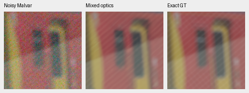
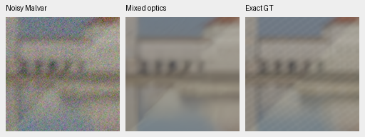

# Mixed-optics development checkpoint at update 512

This is the second checkpoint comparison from the [matched optics
continuation](local-optical-mixture.md). It uses the same 32 development
sources as the [128-update comparison](local-optical-mixture-128.md).
The 24 fresh confirmation sources remain reserved for the endpoint.

The comparison uses CUDA IEEE FP32 EMA weights. The mixed checkpoint is
`67d909183c447afcf73df2081724d063733fe9869fe288622f81232c1bc1581a` and the sharp regional checkpoint is `b7612259677b61a62edc461bc3a144568e372c6671130a052839dc7a1bee954e`.
The review directly reproduced the archived sharp regional output for
one four-role zero-blur input. Local 50k is the shared starting point.
The replay reuses its scores from the [shared-noise optical test](sensor-optical-transfer.md)
on the same Bayer inputs and score masks.

## Weak recovery and error

Brackets give paired 95% bootstrap intervals from resampling sources within
footprint families. Recovery and flat RMS use all 32 sources. Gap scores
use the 16 true gaps, with the same three-pixel erosion at both checkpoints.

| Mixed optics minus sharp regional | σ 0 | σ 0.55 | σ 0.85 |
| --- | ---: | ---: | ---: |
| Weak response, sharp-normalized points | −0.812 [−0.957, −0.663] | −0.619 [−0.757, −0.478] | −0.361 [−0.461, −0.260] |
| Weak response, post-optical points | −0.812 [−0.958, −0.665] | −0.671 [−0.817, −0.525] | −0.444 [−0.567, −0.324] |
| Continuing-strand RMS in true gaps, DN16 | +1.269 [+0.583, +1.875] | +1.704 [+0.889, +2.444] | +2.264 [+1.207, +3.341] |
| False weak projection in true gaps, DN16 | −0.106 [−0.174, −0.040] | −0.103 [−0.175, −0.029] | −0.099 [−0.155, −0.039] |
| Exact-flat luma RMS, DN16 | +1.062 [+0.621, +1.569] | +1.064 [+0.629, +1.573] | +1.069 [+0.638, +1.569] |

At σ 0.85, the mixed arm’s weak-response difference from the sharp
control changes by −0.607 [−0.725, −0.494]
points between updates 128 and 512. Over that interval the mixed arm’s
own recovery changes −1.315 [−1.939, −0.697] points.
The faintest half gives a difference of −0.361 [−0.477, −0.246] points at update 512.

The mixed checkpoint recovers less weak signal than the sharp regional
checkpoint at all three doses. The deficit is smaller as the simulated
blur increases. At σ 0.85 the mixed checkpoint has lower false weak
projection, higher continuing-strand error and higher flat RMS.

On the same blurred captures, the mixed EMA differs from the Local 50k
starting point by −1.902 [−2.504, −1.313] points of weak response and
−13.762 [−18.240, −9.435] DN16 of continuing-strand error.

## Finer wire spacing in the training data

The [first development review](local-optical-mixture-128.md) found only
21 blurred training wires in the optical replay’s 7.2–9.25 pixel period
range. A prepared data variant remaps the weak period to 6.5–11.5
pixels for half the wire groups in each ISO, CFA, noise-law and optical
width stratum. It retains the original draw’s percentile. The other
wire groups keep the broader 6–25 pixel range. The variant uses the
same 1,024 source groups, order, camera seeds and blur schedule.

| Source groups with weak period 7.2–9.25 pixels | Current recipe | Fine-period variant |
| --- | ---: | ---: |
| All 512 wire groups | 55 | 130 |
| Sharp wires, 256 groups | 34 | 67 |
| Blurred wires, 256 groups | 21 | 63 |

The CPU audit checked all 512 matched wire groups. For each changed
group the strong period, pre-optical weak amplitude, orientation, phase, duty
cycle and gap shape are identical. Clean absent-wire and flat targets
are bit-identical, as are the flat and ordinary noisy observations.
The scored interior of each true gap remains exact after erosion by
the optical kernel radius. The weak wire narrows when its period
falls because its width is specified as a fraction of the period.
The source-bound receipt includes the generated schedule, every
wire's coverage, and the executable generator.

For the newly assigned fine groups, the median fundamental passing
through the simulated optics is 98.07% at σ 0.40 and 90.75% at σ
0.65. These figures describe clean training targets. Model performance
from this data variant remains to be measured.

## Native crops

Each image panel is an unresized 160 × 160 patch at σ 0.85. The
triplets show noisy Malvar, the mixed checkpoint at update 512, and
exact post-optical ground truth. The ROI is `(48, 48, 160, 160)` in
the central 256 query. The capture exposure is 0.33, shot coefficient
`0.00128`, read coefficient `6.5536e-6` and black `0.03`. The display
uses ×2 scene-linear exposure and the sRGB transfer. The machine
record binds the RAW, camera transform, checkpoints and render.

Strip fixture `long-01`. Display origin `(396, 202)` in the bin4 image.
Both EMAs show the stronger slope on the red window area. On the faint
slope, visible fragments rarely connect into crossings. The photo of
Nottingham railway station is by mattbuck and was adapted with
binning, synthetic wire, sensor simulation and cropping.
[Four-column comparison](assets/local-optical-mixture-midpoint/long-01-sigma-0.85-comparison.png) ·
[Source photo](https://commons.wikimedia.org/wiki/File:Nottingham_railway_station_MMB_36_156401.jpg) ·
[CC BY-SA 3.0](https://creativecommons.org/licenses/by-sa/3.0/).

Ellipse fixture `long-10`. Display origin `(528, 178)` in the bin4 image.
Both predictions retain part of one slope near the roof. The clean
target contains more of the weak crossing slope away from the hole.
Adapted with binning, synthetic wire, sensor simulation and cropping.
Diego Delso, delso.photo, License CC BY-SA 3.0.
[Four-column comparison](assets/local-optical-mixture-midpoint/long-10-sigma-0.85-comparison.png) ·
[Source photo](https://commons.wikimedia.org/wiki/File:Exterior_del_Palacio_de_Nymphenburg,_M%C3%BAnich,_Alemania61.JPG) ·
[delso.photo](https://delso.photo/) · [License](https://creativecommons.org/licenses/by-sa/3.0/).

[Machine summary](results/local-optical-mixture-v1/development-0512.json) ·
[Paired source data, generator and input audit](results/local-optical-mixture-v1/development-0512-evidence.tar.xz).
