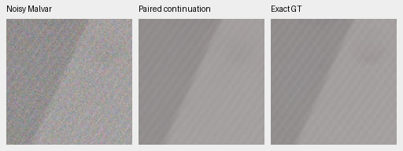
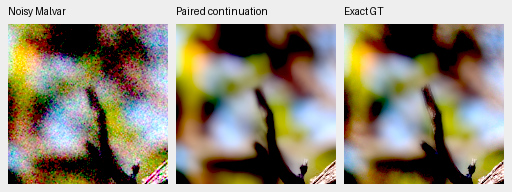

# Paired fine-detail supervision on the local 50k trunk

Paired supervision reduced natural fine-increment error by **0.70 DN16
with independent sensor noise** and by 2.76 DN16 with coupled noise
versus the absolute-loss control. On planted wires it lowered intact
error by 12.30 DN16 while attenuating the weak direction by 5.98
percentage points. The fine cab crossings remain incomplete. This
is a short continuation of the full restoration trunk from the local
50k EMA. Both arms use the same frozen DINO weights.

[Machine results](results/local-paired-continuation-v1/publication.json) ·
[Frozen drivers and receipts](results/local-paired-continuation-v1/evidence.tar.xz) ·
[Native crop provenance](images/local-paired-continuation-v1/manifest.json).

The two-draw follow-up separates the timing of averaging from the
paired loss itself. [Mean versus individual redraw loss](local-redraw-average.md).

## Training and review coverage

Both arms start from [Local 50k EMA](local-50000-scoped.md), SHA256
`62f4e9ce84075c8df1a254a1889033b5787133e8c98c63e0ec3d174a94734959`.
They see the same 512 distinct source photos from its 90,692-photo
training pool, with new crops, augmentations and noise draws. Each update
uses one source with four 256-pixel observations. The present and absent
versions share a natural background. Wire examples retain a continuing
strong direction through an exact gap in the weak direction. The other
observations supply an exact flat core and an ordinary crop. Training
balances content, ISO400 and ISO6400, four Bayer layouts and coupled or
independent noise. Both protected GFX families and their siblings remain
outside the source pool.

Both arms use the existing camera-valid, rendered, gradient and clean
mosaic losses on all four observations. The paired arm also penalizes the
signed present-minus-absent luminance error at 1/32–1/8 and 1/8–1/3
cycles/pixel. The loss uses an RMS-normalized Hann window on the central
96 pixels. The complete core is valid in 486/512 pairs. Both arms use
BF16 neural training, FP32 image arithmetic, AdamW with peak learning rate
`8e-6`, 32 warmup steps and EMA 0.99. They pass eight qualification
updates from separate sources and produce identical starting predictions.

| Arm | Updates | Native observations | Checkpoint SHA256 |
| --- | ---: | ---: | --- |
| Absolute continuation | 512 | 2,048 | `41d235523c50a133574269801d01e7f95da0414750f48a7acc6189ed2d1620e7` |
| Paired continuation | 512 | 2,048 | `1aba4571faa5436ccff3419c5a7226a8f2df7babc2d0bad6fc76feaf6ccff00a` |

The checkpoints store separate raw and EMA weights. Training the
interleaved arms took **322.31 s** including the shared reader and input
hashes. The scoped evaluation used EMA with CUDA IEEE FP32. Exact-target
and actual native-image reviews are complete. The fixed known/unseen
camera panels gain 0.04198/0.07490 dB against the absolute continuation.
The fixed 427-photo evaluation is running with the matched 50k endpoints.
[Fixed camera panels](scene-50000-cameras.md) ·
[Comparable PSNR history](performance-history.md) ·
[Full-epoch training](scene-full-epoch.md).

## Held-out ISO6400 results

The first panel replays the same 24 natural and 24 planted-wire
backgrounds used at local 50k. The 16-photo redraw panel uses separate
held-out sources and three complete draws of each present, absent and
flat triplet under each coupling law. Parent and V120 predictions on
the first panel use the same inputs and inference policy.

| Arm | Natural fine response | Natural fine increment RMS, DN16 | Natural exact-flat fine RMS, DN16 | Wire weak response | Intact wire RMS, DN16 | Wire gap RMS, DN16 |
| --- | ---: | ---: | ---: | ---: | ---: | ---: |
| V120 | 58.224% | 137.344 | 5.726 | 31.834% | 187.930 | 171.203 |
| Corpus 100k | 58.314% | 137.447 | 5.569 | 32.230% | 187.859 | 169.208 |
| Local 50k | 58.010% | 136.335 | 4.489 | 32.377% | 188.074 | 168.488 |
| Absolute continuation | 57.796% | 135.973 | 4.186 | 30.072% | 185.766 | 161.512 |
| Paired continuation | 58.329% | 135.842 | 4.177 | 24.091% | 173.470 | 163.959 |

Against the matched control, natural fine-increment error changes
−0.131 DN16 [−0.729, +0.469] and response changes +0.533 points
[−0.467, +1.660]. Natural exact-flat chroma RMS falls 0.895 DN16 from
the control, with 1.349 DN16 more chroma error than the local 50k parent.
Intact wire error falls 12.296 DN16 [−13.696, −10.809]. The mean weak
response falls 5.981 points [−7.059, −4.889]. In the true gaps,
weak-direction error falls 0.370 DN16 and continuing strong-wire error
rises 10.970 DN16. Total gap error rises 2.446 DN16 against the absolute
continuation and falls 4.529 DN16 against local 50k. The lower intact
error comes with more attenuation of actual crossings.

| Coupling law, 16 sources each | Local 50k increment RMS, DN16 | Absolute increment RMS, DN16 | Paired increment RMS, DN16 | Paired minus absolute | Paired minus absolute exact-flat RMS |
| --- | ---: | ---: | ---: | ---: | ---: |
| Coupled | 76.467 | 77.306 | 74.543 | −2.764 [−4.190, −1.610] | +0.108 DN16 |
| Independent | 93.505 | 93.454 | 92.758 | −0.696 [−1.141, −0.298] | +0.156 DN16 |

The independent-noise gain comes from a smaller error component shared
across redraws. The redraw-sensitive component rises by 286.1 DN16²
versus the control. Absolute error in the present fine band falls
0.638 DN16. Aligned natural response changes +0.720 points with a
confidence interval spanning zero. Intervals in both panels resample
source photos.

## Native exact-target triplets

Each panel shows 160 × 160 native pixels at `[48,48,160,160]`, from
noisy Malvar through the paired EMA to the exact synthetic target.
The fixed camera simulation uses ISO6400 shot/read
`0.00128/6.5536e-6`, capture exposure ×0.33, 16-bit ADC and black
level 0.03. All arms use the same display transform within each crop.

**Wire fixture** on Tobias “ToMar” Maier's *Concord Eye-Q 1M Camera rear
view*, CC BY-SA 3.0. Native query `[128,128,256,256]`, display ×2.
The paired render softens the continuous diagonals. The exact target
shows the weak crossings more clearly.
[Source](https://commons.wikimedia.org/wiki/File:Concord_Eye-Q_1M_Camera_rear_view.jpg) ·
[Matched methods](images/local-paired-continuation-v1/exact/12-wire-iso6400-comparison.png).

**Natural crop** from Charles J. Sharp's *Cuban green woodpecker*, CC
BY-SA 4.0. Native query `[14,320,256,256]`, display ×3.03 and
contrast ×2. The foreground contour remains coherent while the small
tips stay soft.
[Source](https://commons.wikimedia.org/wiki/File:Cuban_green_woodpecker_(Xiphidiopicus_percussus_percussus)_female.JPG) ·
[Matched methods](images/local-paired-continuation-v1/exact/30-natural-iso6400-comparison.png).

A sign from Dominicus Johannes Bergsma's *Informatiebord. Locatie,
Oostvaardersplassen 01*, CC BY-SA 4.0, shows the other side of the
tradeoff. The upper text is legible and lower text remains soft.
[Source](https://commons.wikimedia.org/wiki/File:Informatiebord._Locatie,_Oostvaardersplassen_01.jpg) ·
[Matched methods](images/local-paired-continuation-v1/exact/45-natural-iso6400-comparison.png) ·
[Native triplet](images/local-paired-continuation-v1/exact/45-natural-iso6400-triplet.png).

## Standing GFX100S comparisons

The main DSCF3879/3880 scene uses the fixed four native crops and
display ×4. The sky stays smooth and the coarse chain-link intersections
stay coherent. Thin building wires and fine foliage remain soft. The
paired EMA changes the four camera-linear crops by 2.16–19.29 DN16
RGB RMS versus local 50k.
[Sky](images/local-paired-continuation-v1/standing/main-overcast-sky-main-overcast-sky.png) ·
[Building](images/local-paired-continuation-v1/standing/main-building-detail-main-building-detail.png) ·
[Foliage](images/local-paired-continuation-v1/standing/main-foliage-main-foliage.png) ·
[Chain link](images/local-paired-continuation-v1/standing/main-chain-link-fence-main-chain-link-fence.png).

The DSCF3842/3835 cab boards use display ×16, both ROIs, and both
established noise profiles. The transferred profile keeps the clearest
right diagonals. The paired result slightly softens the lattice and
leaves intersections missing. The paired EMA changes the four cab crops
by 4.17–11.98 DN16 RGB RMS versus local 50k. Both ISO100 AHD
renders and the cab camera JPEGs are qualitative references with
capture and rendering differences.

| Cab profile | Left native crop | Right native crop |
| --- | --- | --- |
| Nominal `0.00128/6.5536e-6` | [Left](images/local-paired-continuation-v1/standing/mesh-nominal-fine-green-mesh-left.png) | [Right](images/local-paired-continuation-v1/standing/mesh-nominal-fine-green-mesh-right.png) |
| Transferred `0.0014635775921166604/1.0715704128646712e-6` | [Left](images/local-paired-continuation-v1/standing/mesh-profile3879-fine-green-mesh-left.png) | [Right](images/local-paired-continuation-v1/standing/mesh-profile3879-fine-green-mesh-right.png) |
