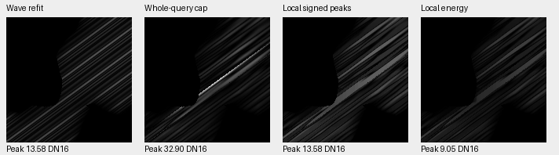
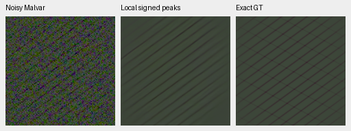
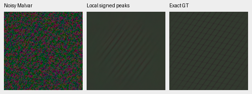

# Signed local bounds on phase-averaged RAW corrections

The [whole-query phase cap](surface-phase-aggregation.md) recovered
slightly more ISO400 faint wire, with similar rail RMS and larger
isolated rail errors. This replay changes only the final correction.
The phase-average predictor, both fitted query boundaries, its
selected guides, the independent wave gate and the neural parent
come from the same saved run.

The [flexible-background follow-up](flexible-query-edges.md)
tests whether the RAW gate admits fewer false guides after it
accounts for bends, wedges and pairs of rails.

## Two native bounds

The signed-peak arm clips each color's correction to the range of
the paired wave refit's correction in a centered 9×9 neighborhood.
The range always includes zero. This limits both magnitude and
polarity using only the previously accepted wave correction.
The radius is four native pixels, including at crop edges where
the neighborhood uses the available samples.

The local-energy arm starts with the same signed clip. Each
centered 33×33 window then computes the scale needed to keep its
squared correction sum within the refit's sum. Each pixel takes
the minimum of the scales from windows that contain it. As a
result, every such window satisfies its energy bound before
rounding to the parent dtype. Both operations keep colors separate.
The peak bound applies to the full query. Peaks inside a reporting
crop can differ from the paired crop's peak when a contributing
refit pixel lies just outside that crop.

Both arms use only the parent, the paired wave refit and the
tangent estimate. There is no new training, change to the RAW
decision, or target-assisted gate. The original comparison scale
is retained or reduced for the measured quiet ceiling. The two
window sizes and the new null recipes were fixed in the run plan
before the replays.

## Weak-wire response at the paired quiet ceiling

The original wave refit's quiet RMS sets the ceiling for each panel
and guide. Each group contains eight geometries per noise level.
The two archived geometry sets use disjoint source indices and
different guide-selection histories. They share the V143 parent,
per-profile delivery scale and native scoring method. Weak response
is the projection onto the known weak-wire increment. Increment
RMS is the error of that paired difference.

| ISO400 full-frame guides | Method | Weak response | Quiet RMS (DN16) | Increment RMS (DN16) |
| --- | --- | ---: | ---: | ---: |
| Main, sources 88–95 | V143 EMA | 0.888% | 2.43489 | 11.20201 |
| | Wave refit | 4.801% | 2.45083 | 11.18019 |
| | Whole-query energy | 5.034% | 2.44014 | 11.18149 |
| | Local signed peaks | 4.970% | 2.44109 | 11.18457 |
| | Local energy and peaks | 4.256% | 2.44054 | 11.18408 |
| Disjoint, sources 80–87 | V143 EMA | 1.146% | 2.33652 | 11.23632 |
| | Wave refit | 6.436% | 2.34032 | 11.20227 |
| | Whole-query energy | 6.984% | 2.33846 | 11.20132 |
| | Local signed peaks | 6.973% | 2.33852 | 11.20219 |
| | Local energy and peaks | 6.256% | 2.33840 | 11.20518 |

The signed peak bound retains most of the whole-query cap's response
gain at ISO400 and gives up its small increment-RMS advantage on
the disjoint panel. The energy bound is quieter with weaker response
than the paired refit. With exact nominal guide centers at ISO400,
the signed peak bound raises response from 9.005% to 9.950% and
increment RMS from 11.15730 to 11.16599 DN16. At ISO6400, the main
full-frame arm still recovers less than 1%. On the disjoint panel
the signed peak bound raises response from 2.464% to 2.844% with a
small increment-error increase, 22.94546 to 22.94781 DN16.
[Full metrics and both gate settings](results/local-phase-bounds-v1/summary.json).

## False structure with assigned guides

The retained panel repeats all 36 flat, step and straight-rail
controls, with every paired refit, tangent and prior cap metric
reproduced exactly. The fresh panel adds 32 cases with disjoint
seeds and all four Bayer patterns per structure and profile.
It includes sloped flats, widening wedges, bent rails and pairs
of rails. Edge signals are area-integrated before shot/read noise
and ADC rounding. The controls use exact delivery parents and
deliberately supply two periodic guides, so the errors measure
only the correction in a native 160×160 crop.

Each cell gives aggregate correction RMS followed by the largest
absolute pixel error, in DN16, at the original gate.

| False structure | Wave refit | Whole-query energy | Local signed peaks | Local energy and peaks |
| --- | ---: | ---: | ---: | ---: |
| Retained rail, 12 cases | 0.789 / 13.58 | 0.802 / 32.90 | 1.059 / 13.58 | 0.681 / 9.05 |
| Fresh sloped flat, 8 cases | 0.144 / 4.59 | 0.120 / 5.04 | 0.183 / 4.67 | 0.128 / 3.38 |
| Fresh wedge, 8 cases | 3.768 / 29.69 | 3.688 / 72.57 | 5.145 / 29.69 | 3.282 / 21.03 |
| Fresh bent rail, 8 cases | 4.089 / 32.60 | 3.989 / 69.67 | 5.912 / 32.60 | 3.589 / 26.22 |
| Fresh two rails, 8 cases | 7.000 / 46.56 | 6.464 / 119.24 | 9.332 / 46.55 | 6.131 / 38.36 |

Signed peaks remove the isolated high errors of the whole-query cap
while spreading more correction across each fresh rail type. Over
all 24 fresh rail cases, the local-energy arm lowers aggregate RMS
from 5.161 to 4.518 DN16 against the paired refit and peak error
from 46.56 to 38.36 DN16. All 24 still produce a correction, even
at the stricter gate. The bound limits the size of artifacts while
the independent decision continues to admit these wrong guides.

The residual board uses the single retained ISO6400 rail where the
previous cap peaked at 32.90 DN16. Each pixel shows maximum
absolute correction across RGB, on the same 0–36 DN16 grayscale
scale. The long diagonal spreads in the signed-peak arm and becomes
dimmer with the local energy bound.

## Native exact-target crops

The two triplets show noisy Malvar, local signed peaks with the
full-frame guide and exact GT. The native ROI is
`[176,176,160,160]`; display exposure is ×2 and contrast ×5.
The ISO400 source shot/read are `8e-5 / 2.56e-8`, with a 16-bit ADC.
The V143 EMA checkpoint SHA256 is
`96d146d017c54196288c585f8b7eddcf030e8a235061049c31e985b9380b7ce4`.
Both use scale 0.82212 and gate threshold 2 with the same display
transform. The stronger diagonals remain visible and the second
direction remains faint or absent.

[Source 88 with all methods](images/local-phase-bounds-v1/iso400-source88-RGGB-comparison.png) ·
[Source 89 with all methods](images/local-phase-bounds-v1/iso400-source89-BGGR-comparison.png).

## Native GFX100S review

With full-frame guides, the sky, building and foliage are bit-exact
V120. Both local variants preserve existing coarse fence crossings.
The signed peak correction changes the coarse fence by 12.41 DN16
RMS from V120, while the energy-bound version changes it by 8.34
DN16. The paired refit changes it by 8.99 DN16. Fine crossings
remain incomplete on the four cab views, where both local variants
return to exact V120.

With the fixed spectral building guide, the signed peak and
local-energy changes from V120 are 3.19 and 2.53 DN16 RMS,
respectively. The prior whole-query cap is only 0.36 DN16 here.
The local fits have no convincing new building or foliage detail.

The panels use fixed native 160×160 coordinates with parent V120
EMA, SHA256
`a9d9b6b4f974e24a6b11e5e740aab32314233a7f53c056cf37c7d2aac1c589fb`.
Main exposure is ×4 and cab exposure ×16. Nominal shot/read are
`0.00128 / 6.5536e-6`. The second cab profile uses
`0.0014635775921166604 / 1.0715704128646712e-6`.
The ISO100 DSCF3880 and DSCF3835 AHD images and both cab JPEGs
are independent qualitative references.

| RAW and profile | Native comparisons |
| --- | --- |
| DSCF3879 nominal | [Sky](images/local-phase-bounds-v1/main-overcast-sky.png) · [Building](images/local-phase-bounds-v1/main-building-detail.png) · [Foliage](images/local-phase-bounds-v1/main-foliage.png) · [Coarse fence](images/local-phase-bounds-v1/main-chain-link-fence.png) |
| DSCF3842 nominal | [Left](images/local-phase-bounds-v1/mesh-nominal-left.png) · [Right](images/local-phase-bounds-v1/mesh-nominal-right.png) |
| DSCF3842 transferred | [Left](images/local-phase-bounds-v1/mesh-profile3879-left.png) · [Right](images/local-phase-bounds-v1/mesh-profile3879-right.png) |

The 40 saved positive and camera cases took 8.95 seconds to collect
from cached arrays on CPU. The retained and fresh forced-guide
panels took 118.39 and 174.25 seconds. The full review checks 280
retained prediction arrays bit for bit. Ten comparisons, two
standalone triplets and the single rail residual board were viewed.
The study adds no neural training or standard full427 and
known/unseen camera panel scores.

[Native provenance](images/local-phase-bounds-v1/manifest.json) ·
[Measured results](results/local-phase-bounds-v1/summary.json) ·
[Publication hashes](results/local-phase-bounds-v1/publication.json) ·
[Frozen scripts and receipts](results/local-phase-bounds-v1/evidence.tar.gz).
