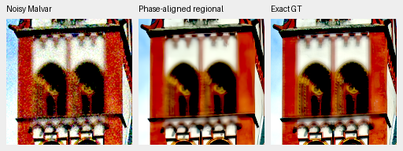
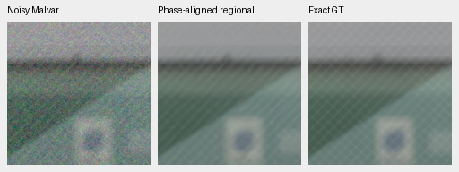

# Where the Bayer phase correction lands

The correction from the [conditional phase blend](phase-correction-mixture.md)
adds 20.71 DN16 RMS inside the annotated weak-wire gaps. **65.02% of its
energy there belongs to the strong wire that continues through the gap.**
The missing weak-wire family accounts for **0.13%**, including phase-shifted
versions of the measured waves. At matched correction strength, localizing
the existing correction within each Fourier window adds little fine signal
and slightly increases absolute gap error. Both real fence scenes retain
incomplete fine crossings.
[Results and model bindings](results/local-phase-envelope-v1/publication.json) ·
[Drivers and receipts](results/local-phase-envelope-v1/evidence.tar.xz).

## Strong-wire repair and false weak signal

The held-out wire panel places a strong near-periodic carrier and a weaker
carrier on natural photo backgrounds. Only the weak carrier disappears
inside each annotated gap. The retained weak template has a signed
projection of **0.22 DN16 RMS** in the conditional blend's correction
inside the gap. A phase-shifted or distorted recurrence can still be false,
so a second diagnostic measures a larger subspace of known frequencies.

For each gap, the diagnostic first projects out the affine tone and
constructed edge. It then assigns sine and cosine components to the
strong fundamental and its first four orders, followed by the weak
fundamental and its first four orders and the sum and difference
bands with the strong fundamental. Frequencies outside the native
Nyquist square are excluded. Each band is orthogonal to the preceding
ones on the actual gap footprint. The remaining correction is measured
separately. The plant geometry and masks are used in this scoring step.

| Conditional correction in ISO6400 gaps | Pooled energy share |
| --- | ---: |
| Tone and edge | 0.04% |
| Continuing strong wire | 65.02% |
| Missing weak-wire family | 0.13% |
| Remaining correction | 34.81% |

Rotating the strong-frequency control by ±0.31 radians gives **0.48%
and 0.27%** of the same correction energy. The conditional blend lowers
continuing-wire error from 79.09 to 67.73 DN16 RMS. Weak-family error
moves from 7.09 to 7.10 DN16. Error outside the three fitted spaces
rises from 125.36 to 128.13 DN16.

In the following diagnostic the projected corrections are edited
inside the exact gaps in linear luminance. The edits do not enter
the rendered outputs.

| ISO6400, 12 known gaps | Absolute gap RMS, DN16 |
| --- | ---: |
| Local-only 20k or suppress the entire conditional correction in the gap | 151.80 |
| Full conditional correction | 148.22 |
| Retain the known strong-band correction in the gap | 145.86 |
| Remove the known strong-band correction from the gap | 154.06 |
| Remove the known weak-band correction from the gap | 148.22 |

This separates improvement to real strong structure from added texture
around it. A loss that charges every change inside the weak gap would
also charge the useful strong-wire correction. The measured weak-band
share describes the planted frequencies on this panel. Unmodeled or
spatially varying false detail can still lie in the remaining band.

## Localizing the phase correction within a window

The current correction uses one complex coefficient per 32-pixel window
and nominated frequency. This comparison uses four overlapping
20-pixel regions within that window. The exterior phase, split
Bayer samples and full-window discovery edge remain fixed. Each
region checks the same waveform on the reserved green sites,
projecting out the affine background and the discovery edge on its
own coordinates. A cubic ramp turns the weaker reciprocal score into
a gain. The four synthesized regions blend with smooth weights that
sum to one.

The regional arm redistributes each existing coefficient by
subtracting the four-region mean gain before modulation. The flipped
control reverses the region assignments with the same local gains.
A phase-aligned variant redistributes only the positive projection
along the nominated exterior phase. A damping variant applies
the local gains to that projection and retains the complementary
coefficient. Applying the mean gain to the tile provides another
control. The projected-score audit agrees with direct computation
within 1.8 × 10⁻⁷. Identical regional coefficients reproduce the
original synthesis within 3.8 × 10⁻⁹ in linear RGB.

The frozen paths are local-only 20k EMA
`b892a08c8ebbccb05c000e4f42d1f86c3a7d1d5870721ccd6e1c8fe9e82c3889`,
Bayer phase EMA
`069de3a3d3f18ab0f32cf9b242daa1fb859d03762086ee27244557aced803e54`
and conditional mixture EMA
`273bddd1862dfb6fa8a1c994e1796ee19c068b9f3fdd4bbea9b0cd216d7ca518`.
No new neural weights are fitted. The 24 wire calibration backgrounds
and 16 independent natural calibration backgrounds set scalar matches
to added-gap and added-flat RMS respectively.

| ISO6400 wires, 24 held-out backgrounds | Intact response | Intact error, DN16 | Added gap RMS, DN16 | Absolute gap RMS, DN16 |
| --- | ---: | ---: | ---: | ---: |
| Local-only 20k | 33.41% | 207.87 | 0.00 | 151.80 |
| Conditional blend | 39.85% | 210.24 | 20.71 | 148.22 |
| Regional redistribution | 39.96% | 210.59 | 21.12 | 148.43 |
| Conditional scaled to regional gap change | 39.98% | 210.30 | 21.11 | 148.18 |
| Flipped redistribution | 39.76% | 210.10 | 20.76 | 148.08 |
| Phase-aligned redistribution | 39.90% | 210.57 | 21.04 | 148.43 |
| Tile-mean phase-aligned damping | 38.78% | 209.97 | 19.07 | 148.56 |
| Regional phase-aligned damping | 38.83% | 210.32 | 19.44 | 148.78 |

Versus scaled conditional, regional redistribution changes intact
response by −0.012 points [−0.068, +0.043] and increases absolute
gap error by 0.248 DN16 [0.153, 0.366]. Added gap RMS differs by
0.016 DN16. The registered gain contributes 0.207 intact-response
points over flipping [0.101, 0.316], with higher intact and gap
errors. On independent ISO6400 natural photos, the corresponding
response gain over scaled conditional is 0.035 points [0.013, 0.064]
at similar flat and fine-increment error. Regional damping
does not improve gap accuracy over its tile-mean control.
The archived measurements include both wire noise profiles,
the known gap rims and interiors, and the independent ISO6400
natural replay of 48 held-out backgrounds.
[Matched contrasts and band projections](results/local-phase-envelope-v1/evidence.tar.xz).

## Native crops

Both triplets use 160 × 160 native pixels at `[48,48,160,160])
with the same white balance, transform and display across methods.
The middle panels use phase-aligned regional redistribution.
ISO6400 shot/read are `0.00128/6.5536e-6`, capture exposure 0.33,
16-bit ADC and black level 0.03. The composed checkpoints are above.
[Image provenance](images/local-phase-envelope-v1/manifest.json).

**Limburg Cathedral**, Berthold Werner, public domain. BGGR,
query `[22,250,256,256]`, display exposure ×3.0303 and contrast ×2.
The stone arch outlines stay clear, with soft bricks and molding.
[Source](https://commons.wikimedia.org/wiki/File:Limburger_Dom_BW_1.jpg) ·
[All methods](images/local-phase-envelope-v1/exact/001-iso6400-independent-comparison.png).

**St. Valentin railway**, GT1976, CC BY-SA 4.0. RGGB, source scene
`[376,16,512,512]`, query `[128,128,256,256]`, display exposure ×2
and contrast 1.0. The stronger diagonal remains visible.
The interrupted weaker lattice and its gap boundary stay diffuse.
[Source](https://commons.wikimedia.org/wiki/File:2018-05-04_%28217%29_33_53_9332_586-5_at_Bahnhof_St._Valentin.jpg) ·
[License](https://creativecommons.org/licenses/by-sa/4.0/) ·
[All methods](images/local-phase-envelope-v1/exact/012-iso6400-comparison.png) ·
[Continuous-dip fixture](images/local-phase-envelope-v1/exact/014-iso6400-comparison.png).

## Standing GFX100S comparisons

All eight boards were viewed with V120, Corpus 100k, local-only 20k
and the conditional blend. The conditional display exactly reproduces
its archived pixels. Across the new variants the overcast sky stays
smooth, both coarse directions remain coherent, and fine foliage and
building lines stay soft. Fine cab changes are subtle under both
profiles. Some existing right diagonals persist. The left lattice
and fine junctions remain incomplete. No clear new fringe appears.
The ISO100 AHD and both cab JPEG references are independent qualitative
comparisons with different exposure, aperture and motion.

| Capture and conditioning | Native comparisons |
| --- | --- |
| DSCF3879/3880, nominal | [Sky](images/local-phase-envelope-v1/standing/main-overcast-sky-main-overcast-sky.png) · [Building](images/local-phase-envelope-v1/standing/main-building-detail-main-building-detail.png) · [Foliage](images/local-phase-envelope-v1/standing/main-foliage-main-foliage.png) · [Coarse fence](images/local-phase-envelope-v1/standing/main-chain-link-fence-main-chain-link-fence.png) |
| DSCF3842/3835, nominal | [Left](images/local-phase-envelope-v1/standing/mesh-nominal-fine-green-mesh-left.png) · [Right](images/local-phase-envelope-v1/standing/mesh-nominal-fine-green-mesh-right.png) |
| DSCF3842/3835, transferred DSCF3879 | [Left](images/local-phase-envelope-v1/standing/mesh-profile3879-fine-green-mesh-left.png) · [Right](images/local-phase-envelope-v1/standing/mesh-profile3879-fine-green-mesh-right.png) |

Scoped numerical evaluation and native viewing are complete. The
fixed 427-photo and measured-camera panels are outside this crop
diagnostic. The archived early runs preserve the raw-luma calibration
loading failure and the standing-board caption and import fixes.
[Earlier receipts](results/local-phase-envelope-v1/earlier-audits.tar.xz) ·
[Current model guide](current-model.md) · [Comparable PSNR history](performance-history.md).
