# Local phase-evidence trial: completed quality

V180's local measured-phase fields produce a useful mesh-response gain at a
higher quiet-field cost. Raw/EMA reach **4.52194% / 4.54843% of exact constructed
GT amplitude**, versus global V178's 3.92428% / 3.92355%. That is **+15.230% /
+15.926% relative response** at the same 3,120-adapter-weight budget and cached
900-update recipe. Gains are uneven: 122/256 raw and 142/256 EMA inputs increase;
the others decrease. Relative to the unchanged matching control, gains are
16.290% / 16.987%. Against V172 EMA, local EMA gains **17.313%**, with 184/256
inputs increasing. The mean still retains less than one twentieth of exact
constructed amplitude. This is a useful detail architecture to build on, with
V172 and the earlier quiet/flat/detail options retained for their strengths.
V120 Small remains the broad photo/camera recommendation.

The cost is clear. Against same-endpoint global V178, local EMA quiet spatial
RMS rises **1.054% / 0.786%** for ISO6400/12800; 16/16 and 15/16 inputs worsen.
Quiet total RMS rises **0.844% / 0.511%**, with 16/16 and 14/16 worsening.
DC RMS changes +0.272% / −0.279%. Raw has the same tradeoff: quiet spatial
+1.016% / +0.758%, total +0.816% / +0.500%. Mesh-present blank RMS rises
0.098% raw / 0.104% EMA, and absent full RMS rises 0.038% / 0.042%. Near-zero
signed absent-template gain does not rule out mottling or false fine texture.

Standalone512 EMA full-flat RMS changes −0.030% / +0.001% versus global V178,
while spatial RMS rises 0.021% / 0.042% and coarse32 RMS changes +0.007% /
−0.010%. Relative to V172 EMA, local EMA full-flat RMS rises 0.086% / 0.016%,
quiet total RMS rises 0.753% / 0.458%, and quiet spatial RMS rises 1.106% /
0.760%. Thus the higher mesh response does not combine the earlier quiet/flat
strengths. V161 still has stronger learned response, about 5.24% of GT, with
larger quiet errors. V173 retains its stronger quiet-spatial gain, V171 its
standalone-flat gain, V175 raw its small quiet-total gain, and global V178 its
smaller mesh-response gain at a smaller quiet cost.

Natural photo response changes are small. Local EMA band response rises
0.252%, 0.084%, 0.136% and 0.008% across retained faint/dark and organic faint/dark
means versus global EMA. Relative band error changes +0.0054%, +0.0077%,
−0.0009%, +0.0073%. Stronger band response alone is not better fine-band fidelity.
There is no broad photographic quality or safety claim.

All **60 actual native figures in 15 original-detail sheets** were inspected,
including 12 unresized noisy/restored/exact constructed-GT triplets. Mesh2302
still looks nearly uniform at ordinary display. At contrast40 the local outputs
show stronger fine periodic modulation under broad colored error, without a
clearly recovered complete lattice. Mesh2309 retains mostly one orientation
and still misses the weaker crossing. Both fine green cab ROIs remain soft and
incomplete under both supplied noise profiles; changes are subtle and do not
clearly recover the independent reference's crossings. Coarse fence strands
survive, while building/foliage and natural bird/butterfly/bark detail remain soft.

The main sky looks smooth at ordinary exposure4. Noisy gray/color flats retain
broad green/purple mottle at contrast40. Quiet regions beside steps, narrow bars
and stripe patches acquire somewhat stronger fine mottled/striped error on top
of the broad field, consistent with their higher spatial RMS. At ordinary
contrast these fields look nearly smooth. ADC bark/fur and four ADC planes keep
the exact frozen output. These controls do not establish noisy-sky safety.

The report includes both protected scenes: DSCF3879 ISO6400 / independent
DSCF3880 ISO100 f/5.6 for sky/building/foliage/coarse fence, and DSCF3842 ISO6400 /
independent DSCF3835 ISO100 f/5.6 plus both straight-out-of-camera JPEGs for the
fine green mesh. **ISO100/AHD and JPEGs are qualitative references, not exact GT**;
aperture, exposure time, processing and moving subjects differ. No real-reference
pixelwise scores are used. Captures, JPEGs and siblings remain outside training.
Cached arrays and cached parent predictions are used; originals and unavailable
`/mnt/dataz` remain untouched.

The mesh triplets retain native ROI `[176,176,160,160]` in 512px RGGB contexts,
display exposure8/contrast1, shot .00128/read variance 6.5536e−6. Fine cab crops
retain the cached `[600,6260,768,768]` context and native ROIs
`[206,229,160,160]` / `[426,189,160,160]`, display exposure16. Other views keep
their exact prior source, noise, ROI, exposure, contrast and anchor in the
manifest. Training checkpoint SHA256 is
`9c749aa681260bb79ec11b077c596c7dc68bb35c099ddcf44670d8bcfe8e6af8`.
Both endpoint exports record class/config/source, source checkpoint, raw/EMA
state and module hash; four existing V178 viewer states retain separate metadata.

One actual continuation adds 900 updates/3,600 noisy images across the same
1,000 cached rows with 100 ADC skips, starting from V172's real raw/Adam/EMA
history. Existing 141 network clocks finish at 1,800; the adapter finishes at
900. The exact frozen V178 training engine is configured explicitly with the
local factory and paths. Genuine row8 restoration resumes at row9. Independent
training audit passes the full trace, 900 FP32 loss totals and all five raw/EMA/
Adam/frozen/RNG checkpoints. Peak allocation is about 6.28 GiB. The two earlier
fresh-Adam admission probes are separate from this initializer.

All 822 fixed cases are reviewed at both endpoints: 1,644 wrapper/frozen calls,
1,500 matching/projection calls and 7,500 samplers. All 1,644 exact frozen replays
and 144 ADC identities pass. The independent quality audit checks 6,576 input
fingerprints, 72 RGB plus 72 residual arrays, 53,772,288 addition channels,
582 native metric scalars, 278 Decimal means and 750 exact input-only raw/EMA
local metadata pairs. It checks geometry and finite local powers without
independent spectral recomputation or confidence calibration. No parent/DINO,
new sensor/source draw or RAW decode occurs during this continuation/review.

All 15 comparison methods, both V175 endpoints, four V178 endpoints, 12,330
rows, 22 contrasts and 882 table cells remain available. Completed V178 outputs
are reused, not rerun or bit-exact paired retraining; sampler atomic backward
retains the existing warn-only nondeterminism. Local windowed nuisance fits,
aggregation and interpolation change together, so equal parameter counts do
not isolate a single mathematical cause. Defaults followed a training-only
support diagnostic. This reused development stream has no blind or seed-uncertainty
estimate. [Execution, preparation and actual viewing provenance](results/v180-local-phase-completion-execution-v1.json).

[Exact evidence](results/v180-local-phase-evidence-final-v1.json) · [Native-pixel viewer](images/v180-local-phase-evidence-v1/native-viewer.html).

# Matched local/global/control comparison tables

RMS values are camera-RGB DN16. Signed gain 1 is exact constructed amplitude. Real ISO100 references are unscored. This reused development suite is not blind validation.

## Local/global/control at the same continuation budget

### Mesh response and blank error

| Metric | V178-control-raw | V178-control-EMA | V178-evidence-raw | V178-evidence-EMA | V180-local-phase-raw | V180-local-phase-EMA |
| --- | ---: | ---: | ---: | ---: | ---: | ---: |
| Present full RMS | 8.954916 | 8.957374 | 8.950154 | 8.953061 | 8.876450 | 8.877083 |
| Present signed template gain | 0.03888490 | 0.03887981 | 0.03924275 | 0.03923549 | 0.04521940 | 0.04548425 |
| Present blank RMS | 5.610388 | 5.613564 | 5.610671 | 5.614318 | 5.616159 | 5.620176 |
| Present blank spatial RMS | 5.428461 | 5.428190 | 5.429207 | 5.429165 | 5.435846 | 5.437361 |
| Present blank DC RMS | 1.302865 | 1.315066 | 1.301321 | 1.314366 | 1.297771 | 1.306773 |
| Absent full RMS | 5.308835 | 5.311586 | 5.308666 | 5.311814 | 5.310667 | 5.314059 |
| Absent signed template gain | 0.00001722 | 0.00001355 | 0.00001755 | 0.00001511 | 0.00008047 | 0.00009106 |
| Absent blank RMS | 5.308835 | 5.311586 | 5.308666 | 5.311814 | 5.310667 | 5.314059 |
| Absent blank spatial RMS | 5.166172 | 5.165967 | 5.166425 | 5.166424 | 5.169570 | 5.170659 |
| Absent blank DC RMS | 1.128316 | 1.139692 | 1.126611 | 1.138905 | 1.121278 | 1.130202 |

### Quiet fields beside detail

| Metric | V178-control-raw | V178-control-EMA | V178-evidence-raw | V178-evidence-EMA | V180-local-phase-raw | V180-local-phase-EMA |
| --- | ---: | ---: | ---: | ---: | ---: | ---: |
| iso6400-prior whole RMS | 26.807064 | 26.802756 | 26.805698 | 26.801574 | 26.783953 | 26.770305 |
| iso6400-prior quiet RMS | 4.036107 | 4.031506 | 4.034977 | 4.029954 | 4.067919 | 4.063950 |
| iso6400-prior quiet spatial RMS | 3.442433 | 3.441227 | 3.443856 | 3.443032 | 3.478830 | 3.479326 |
| iso6400-prior quiet DC RMS | 1.992752 | 1.988387 | 1.988485 | 1.983280 | 1.994619 | 1.988680 |
| iso12800-prior whole RMS | 35.438505 | 35.433998 | 35.432874 | 35.427920 | 35.277377 | 35.253643 |
| iso12800-prior quiet RMS | 6.297270 | 6.292864 | 6.297440 | 6.292439 | 6.328901 | 6.324568 |
| iso12800-prior quiet spatial RMS | 5.556405 | 5.555426 | 5.557017 | 5.556344 | 5.599142 | 5.600006 |
| iso12800-prior quiet DC RMS | 2.777805 | 2.774289 | 2.778281 | 2.773895 | 2.772617 | 2.766157 |

### Standalone 512-pixel flats

| Metric | V178-control-raw | V178-control-EMA | V178-evidence-raw | V178-evidence-EMA | V180-local-phase-raw | V180-local-phase-EMA |
| --- | ---: | ---: | ---: | ---: | ---: | ---: |
| iso6400-prior full RMS | 18.631764 | 18.629767 | 18.632121 | 18.629596 | 18.624531 | 18.624026 |
| iso6400-prior spatial RMS | 18.303915 | 18.303283 | 18.302926 | 18.302710 | 18.306471 | 18.306564 |
| iso6400-prior coarse32 RMS | 13.431766 | 13.432282 | 13.432070 | 13.432578 | 13.433240 | 13.433568 |
| iso12800-prior full RMS | 24.202722 | 24.199457 | 24.205429 | 24.202115 | 24.206583 | 24.202340 |
| iso12800-prior spatial RMS | 23.741963 | 23.740972 | 23.740806 | 23.740427 | 23.749890 | 23.750376 |
| iso12800-prior coarse32 RMS | 17.915130 | 17.915920 | 17.915587 | 17.916187 | 17.915837 | 17.914310 |

### Natural photographic detail

| Metric | V178-control-raw | V178-control-EMA | V178-evidence-raw | V178-evidence-EMA | V180-local-phase-raw | V180-local-phase-EMA |
| --- | ---: | ---: | ---: | ---: | ---: | ---: |
| retained512/photo-faint full RMS | 33.964565 | 33.965091 | 33.964381 | 33.964993 | 33.965056 | 33.965822 |
| retained512/photo-faint band response | 0.298162 | 0.298158 | 0.298217 | 0.298218 | 0.298853 | 0.298969 |
| retained512/photo-faint band error | 0.824616 | 0.824613 | 0.824628 | 0.824625 | 0.824678 | 0.824669 |
| retained512/photo-dark full RMS | 29.094201 | 29.094373 | 29.094067 | 29.094435 | 29.097274 | 29.097995 |
| retained512/photo-dark band response | 0.530784 | 0.530763 | 0.530842 | 0.530826 | 0.531147 | 0.531274 |
| retained512/photo-dark band error | 0.661241 | 0.661240 | 0.661242 | 0.661241 | 0.661293 | 0.661292 |
| organic384/photo-faint full RMS | 37.480380 | 37.481906 | 37.480903 | 37.482130 | 37.481665 | 37.482521 |
| organic384/photo-faint band response | 0.149424 | 0.149428 | 0.149414 | 0.149424 | 0.149544 | 0.149626 |
| organic384/photo-faint band error | 0.924915 | 0.924907 | 0.924921 | 0.924914 | 0.924930 | 0.924906 |
| organic384/photo-dark full RMS | 33.685298 | 33.685606 | 33.685377 | 33.685832 | 33.687261 | 33.687290 |
| organic384/photo-dark band response | 0.397869 | 0.397863 | 0.397874 | 0.397876 | 0.397806 | 0.397910 |
| organic384/photo-dark band error | 0.781673 | 0.781672 | 0.781676 | 0.781676 | 0.781730 | 0.781733 |

### ADC controls

| Metric | V178-control-raw | V178-control-EMA | V178-evidence-raw | V178-evidence-EMA | V180-local-phase-raw | V180-local-phase-EMA |
| --- | ---: | ---: | ---: | ---: | ---: | ---: |
| Photo full RMS | 18.142182 | 18.142182 | 18.142182 | 18.142182 | 18.142182 | 18.142182 |
| Photo band error | 0.101800 | 0.101800 | 0.101800 | 0.101800 | 0.101800 | 0.101800 |
| fresh-flat512 full RMS | 3.322910 | 3.322910 | 3.322910 | 3.322910 | 3.322910 | 3.322910 |
| fresh-flat512 coarse32 RMS | 0.538587 | 0.538587 | 0.538587 | 0.538587 | 0.538587 | 0.538587 |
| adc-sloped512 full RMS | 3.776943 | 3.776943 | 3.776943 | 3.776943 | 3.776943 | 3.776943 |
| adc-sloped512 coarse32 RMS | 0.573442 | 0.573442 | 0.573442 | 0.573442 | 0.573442 | 0.573442 |

## Earlier strengths and both endpoints

### Mesh response and blank error

| Metric | parent | V161-EMA | V169-EMA | V171-EMA | V172-EMA | V173-EMA | V174-EMA | V175-raw | V175-EMA | V178-control-raw | V178-control-EMA | V178-evidence-raw | V178-evidence-EMA | V180-local-phase-raw | V180-local-phase-EMA |
| --- | ---: | ---: | ---: | ---: | ---: | ---: | ---: | ---: | ---: | ---: | ---: | ---: | ---: | ---: | ---: |
| Present full RMS | 9.111243 | 8.979201 | 8.956287 | 8.909846 | 8.955686 | 8.948849 | 8.955665 | 8.956087 | 8.949633 | 8.954916 | 8.957374 | 8.950154 | 8.953061 | 8.876450 | 8.877083 |
| Present signed template gain | 0.02202090 | 0.05239854 | 0.03836594 | 0.03884819 | 0.03877185 | 0.03723868 | 0.03867667 | 0.03879218 | 0.03878479 | 0.03888490 | 0.03887981 | 0.03924275 | 0.03923549 | 0.04521940 | 0.04548425 |
| Present blank RMS | 5.523323 | 5.816396 | 5.609300 | 5.544439 | 5.610812 | 5.590872 | 5.609727 | 5.610388 | 5.601944 | 5.610388 | 5.613564 | 5.610671 | 5.614318 | 5.616159 | 5.620176 |
| Present blank spatial RMS | 5.343113 | 5.645413 | 5.431940 | 5.361961 | 5.429880 | 5.410955 | 5.428378 | 5.421000 | 5.420632 | 5.428461 | 5.428190 | 5.429207 | 5.429165 | 5.435846 | 5.437361 |
| Present blank DC RMS | 1.289621 | 1.287310 | 1.289568 | 1.300170 | 1.299983 | 1.294365 | 1.300955 | 1.326118 | 1.300870 | 1.302865 | 1.315066 | 1.301321 | 1.314366 | 1.297771 | 1.306773 |
| Absent full RMS | 5.237910 | 5.501669 | 5.305929 | 5.248144 | 5.309113 | 5.291708 | 5.308678 | 5.311212 | 5.302362 | 5.308835 | 5.311586 | 5.308666 | 5.311814 | 5.310667 | 5.314059 |
| Absent signed template gain | 0.00003236 | 0.00039787 | -0.00000719 | 0.00001071 | 0.00000519 | -0.00003993 | -0.00000498 | -0.00000001 | 0.00000192 | 0.00001722 | 0.00001355 | 0.00001755 | 0.00001511 | 0.00008047 | 0.00009106 |
| Absent blank RMS | 5.237910 | 5.501669 | 5.305929 | 5.248144 | 5.309113 | 5.291708 | 5.308678 | 5.311212 | 5.302362 | 5.308835 | 5.311586 | 5.308666 | 5.311814 | 5.310667 | 5.314059 |
| Absent blank spatial RMS | 5.099652 | 5.367749 | 5.169538 | 5.102240 | 5.167332 | 5.151649 | 5.166379 | 5.161086 | 5.160891 | 5.166172 | 5.165967 | 5.166425 | 5.166424 | 5.169570 | 5.170659 |
| Absent blank DC RMS | 1.098115 | 1.111598 | 1.098120 | 1.135453 | 1.122982 | 1.113479 | 1.125281 | 1.155025 | 1.121672 | 1.128316 | 1.139692 | 1.126611 | 1.138905 | 1.121278 | 1.130202 |

### Quiet fields beside detail

| Metric | parent | V161-EMA | V169-EMA | V171-EMA | V172-EMA | V173-EMA | V174-EMA | V175-raw | V175-EMA | V178-control-raw | V178-control-EMA | V178-evidence-raw | V178-evidence-EMA | V180-local-phase-raw | V180-local-phase-EMA |
| --- | ---: | ---: | ---: | ---: | ---: | ---: | ---: | ---: | ---: | ---: | ---: | ---: | ---: | ---: | ---: |
| iso6400-prior whole RMS | 27.105631 | 26.972453 | 26.806949 | 27.302897 | 26.801695 | 26.860185 | 26.797020 | 26.795723 | 26.796191 | 26.807064 | 26.802756 | 26.805698 | 26.801574 | 26.783953 | 26.770305 |
| iso6400-prior quiet RMS | 3.898845 | 4.615625 | 4.046127 | 5.289473 | 4.033561 | 4.012548 | 4.026601 | 4.028107 | 4.033524 | 4.036107 | 4.031506 | 4.034977 | 4.029954 | 4.067919 | 4.063950 |
| iso6400-prior quiet spatial RMS | 3.268502 | 3.772120 | 3.439626 | 3.429768 | 3.441249 | 3.417869 | 3.438372 | 3.436096 | 3.435861 | 3.442433 | 3.441227 | 3.443856 | 3.443032 | 3.478830 | 3.479326 |
| iso6400-prior quiet DC RMS | 2.016074 | 2.478187 | 2.018205 | 3.855646 | 1.991393 | 1.991098 | 1.982841 | 1.992262 | 2.001566 | 1.992752 | 1.988387 | 1.988485 | 1.983280 | 1.994619 | 1.988680 |
| iso12800-prior whole RMS | 36.747466 | 35.371842 | 35.462223 | 36.176612 | 35.435967 | 35.609092 | 35.430797 | 35.338865 | 35.348725 | 35.438505 | 35.433998 | 35.432874 | 35.427920 | 35.277377 | 35.253643 |
| iso12800-prior quiet RMS | 6.152652 | 7.060811 | 6.344343 | 7.979617 | 6.295703 | 6.278894 | 6.288010 | 6.278763 | 6.309106 | 6.297270 | 6.292864 | 6.297440 | 6.292439 | 6.328901 | 6.324568 |
| iso12800-prior quiet spatial RMS | 5.341833 | 5.949189 | 5.559786 | 5.525857 | 5.557772 | 5.540053 | 5.555586 | 5.554541 | 5.553504 | 5.556405 | 5.555426 | 5.557017 | 5.556344 | 5.599142 | 5.600006 |
| iso12800-prior quiet DC RMS | 2.849060 | 3.597003 | 2.853327 | 5.513166 | 2.780697 | 2.778718 | 2.770721 | 2.739782 | 2.800261 | 2.777805 | 2.774289 | 2.778281 | 2.773895 | 2.772617 | 2.766157 |

### Standalone 512-pixel flats

| Metric | parent | V161-EMA | V169-EMA | V171-EMA | V172-EMA | V173-EMA | V174-EMA | V175-raw | V175-EMA | V178-control-raw | V178-control-EMA | V178-evidence-raw | V178-evidence-EMA | V180-local-phase-raw | V180-local-phase-EMA |
| --- | ---: | ---: | ---: | ---: | ---: | ---: | ---: | ---: | ---: | ---: | ---: | ---: | ---: | ---: | ---: |
| iso6400-prior full RMS | 18.546808 | 19.024279 | 18.618871 | 18.394478 | 18.607969 | 18.561545 | 18.609537 | 18.624985 | 18.626425 | 18.631764 | 18.629767 | 18.632121 | 18.629596 | 18.624531 | 18.624026 |
| iso6400-prior spatial RMS | 18.235130 | 18.723699 | 18.308796 | 18.067235 | 18.308685 | 18.249657 | 18.312272 | 18.300711 | 18.296671 | 18.303915 | 18.303283 | 18.302926 | 18.302710 | 18.306471 | 18.306564 |
| iso6400-prior coarse32 RMS | 13.440561 | 13.375119 | 13.438463 | 13.205937 | 13.435593 | 13.434259 | 13.438287 | 13.433167 | 13.431800 | 13.431766 | 13.432282 | 13.432070 | 13.432578 | 13.433240 | 13.433568 |
| iso12800-prior full RMS | 24.071890 | 24.866512 | 24.219097 | 23.850667 | 24.198471 | 24.125142 | 24.180955 | 24.197306 | 24.177811 | 24.202722 | 24.199457 | 24.205429 | 24.202115 | 24.206583 | 24.202340 |
| iso12800-prior spatial RMS | 23.596861 | 24.441501 | 23.747288 | 23.431650 | 23.747758 | 23.675332 | 23.745663 | 23.744923 | 23.737404 | 23.741963 | 23.740972 | 23.740806 | 23.740427 | 23.749890 | 23.750376 |
| iso12800-prior coarse32 RMS | 17.932544 | 17.847243 | 17.930574 | 17.619500 | 17.921661 | 17.925292 | 17.922356 | 17.923633 | 17.920121 | 17.915130 | 17.915920 | 17.915587 | 17.916187 | 17.915837 | 17.914310 |

### Natural photographic detail

| Metric | parent | V161-EMA | V169-EMA | V171-EMA | V172-EMA | V173-EMA | V174-EMA | V175-raw | V175-EMA | V178-control-raw | V178-control-EMA | V178-evidence-raw | V178-evidence-EMA | V180-local-phase-raw | V180-local-phase-EMA |
| --- | ---: | ---: | ---: | ---: | ---: | ---: | ---: | ---: | ---: | ---: | ---: | ---: | ---: | ---: | ---: |
| retained512/photo-faint full RMS | 33.963754 | 33.989892 | 33.966492 | 33.965750 | 33.965651 | 33.972592 | 33.965226 | 33.966362 | 33.964199 | 33.964565 | 33.965091 | 33.964381 | 33.964993 | 33.965056 | 33.965822 |
| retained512/photo-faint band response | 0.298560 | 0.300629 | 0.298025 | 0.298141 | 0.298194 | 0.290365 | 0.298145 | 0.297719 | 0.297729 | 0.298162 | 0.298158 | 0.298217 | 0.298218 | 0.298853 | 0.298969 |
| retained512/photo-faint band error | 0.824639 | 0.824519 | 0.824693 | 0.824595 | 0.824629 | 0.824737 | 0.824629 | 0.824593 | 0.824596 | 0.824616 | 0.824613 | 0.824628 | 0.824625 | 0.824678 | 0.824669 |
| retained512/photo-dark full RMS | 29.097715 | 29.108120 | 29.094009 | 29.115518 | 29.095378 | 29.108366 | 29.095377 | 29.092722 | 29.092537 | 29.094201 | 29.094373 | 29.094067 | 29.094435 | 29.097274 | 29.097995 |
| retained512/photo-dark band response | 0.531446 | 0.531944 | 0.530900 | 0.531020 | 0.530919 | 0.516410 | 0.530799 | 0.529616 | 0.529657 | 0.530784 | 0.530763 | 0.530842 | 0.530826 | 0.531147 | 0.531274 |
| retained512/photo-dark band error | 0.661447 | 0.661212 | 0.661251 | 0.661223 | 0.661241 | 0.661891 | 0.661235 | 0.661219 | 0.661222 | 0.661241 | 0.661240 | 0.661242 | 0.661241 | 0.661293 | 0.661292 |
| organic384/photo-faint full RMS | 37.469061 | 37.468656 | 37.483612 | 37.498859 | 37.482240 | 37.489719 | 37.483229 | 37.485465 | 37.482585 | 37.480380 | 37.481906 | 37.480903 | 37.482130 | 37.481665 | 37.482521 |
| organic384/photo-faint band response | 0.150701 | 0.151718 | 0.149160 | 0.149403 | 0.149407 | 0.145102 | 0.149378 | 0.149340 | 0.149335 | 0.149424 | 0.149428 | 0.149414 | 0.149424 | 0.149544 | 0.149626 |
| organic384/photo-faint band error | 0.924117 | 0.924824 | 0.925058 | 0.924904 | 0.924935 | 0.925212 | 0.924941 | 0.924914 | 0.924916 | 0.924915 | 0.924907 | 0.924921 | 0.924914 | 0.924930 | 0.924906 |
| organic384/photo-dark full RMS | 33.685796 | 33.688406 | 33.685928 | 33.717351 | 33.687728 | 33.688935 | 33.687788 | 33.684152 | 33.682841 | 33.685298 | 33.685606 | 33.685377 | 33.685832 | 33.687261 | 33.687290 |
| organic384/photo-dark band response | 0.398945 | 0.398821 | 0.397799 | 0.398053 | 0.397914 | 0.386519 | 0.397835 | 0.397145 | 0.397168 | 0.397869 | 0.397863 | 0.397874 | 0.397876 | 0.397806 | 0.397910 |
| organic384/photo-dark band error | 0.781612 | 0.781774 | 0.781691 | 0.781667 | 0.781679 | 0.781560 | 0.781680 | 0.781671 | 0.781673 | 0.781673 | 0.781672 | 0.781676 | 0.781676 | 0.781730 | 0.781733 |

### ADC controls

| Metric | parent | V161-EMA | V169-EMA | V171-EMA | V172-EMA | V173-EMA | V174-EMA | V175-raw | V175-EMA | V178-control-raw | V178-control-EMA | V178-evidence-raw | V178-evidence-EMA | V180-local-phase-raw | V180-local-phase-EMA |
| --- | ---: | ---: | ---: | ---: | ---: | ---: | ---: | ---: | ---: | ---: | ---: | ---: | ---: | ---: | ---: |
| Photo full RMS | 18.149871 | 18.146394 | 18.142182 | 18.142182 | 18.142182 | 18.142182 | 18.142182 | 18.142182 | 18.142182 | 18.142182 | 18.142182 | 18.142182 | 18.142182 | 18.142182 | 18.142182 |
| Photo band error | 0.101855 | 0.101811 | 0.101800 | 0.101800 | 0.101800 | 0.101800 | 0.101800 | 0.101800 | 0.101800 | 0.101800 | 0.101800 | 0.101800 | 0.101800 | 0.101800 | 0.101800 |
| fresh-flat512 full RMS | 3.322910 | 3.322910 | 3.322910 | 3.322910 | 3.322910 | 3.322910 | 3.322910 | 3.322910 | 3.322910 | 3.322910 | 3.322910 | 3.322910 | 3.322910 | 3.322910 | 3.322910 |
| fresh-flat512 coarse32 RMS | 0.538587 | 0.538587 | 0.538587 | 0.538587 | 0.538587 | 0.538587 | 0.538587 | 0.538587 | 0.538587 | 0.538587 | 0.538587 | 0.538587 | 0.538587 | 0.538587 | 0.538587 |
| adc-sloped512 full RMS | 3.771369 | 3.769995 | 3.776943 | 3.776943 | 3.776943 | 3.776943 | 3.776943 | 3.776943 | 3.776943 | 3.776943 | 3.776943 | 3.776943 | 3.776943 | 3.776943 | 3.776943 |
| adc-sloped512 coarse32 RMS | 0.574652 | 0.575804 | 0.573442 | 0.573442 | 0.573442 | 0.573442 | 0.573442 | 0.573442 | 0.573442 | 0.573442 | 0.573442 | 0.573442 | 0.573442 | 0.573442 | 0.573442 |

RMS is camera-RGB DN16; template gain1 means exact constructed amplitude. Local/global comparisons retain the same3,120weight budget; completed V178 outputs are reused. V175 has a larger fresh-noise budget. Reused inputs do not establish blind generalization, seed uncertainty or noisy-sky safety. ISO100/AHD/JPEG references are qualitative, not GT.

## Native comparisons

All cells retain160×160 source pixels without resizing. The manifest records source/ROI, checkpoint/state, physical noise, exposure, contrast, anchor and qualified references for every view. Both protected GFX families/JPEGs/siblings remain excluded from training.

### Comparison boards

mesh-seed2026112302-present-iso6400-prior-RGGB; ROI `[176, 176, 160, 160]`, exposure8, contrast1.

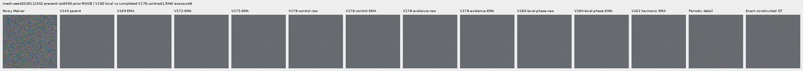

mesh-seed2026112302-present-iso6400-prior-RGGB; ROI `[176, 176, 160, 160]`, exposure8, contrast40.

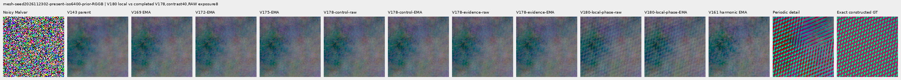

mesh-seed2026112309-present-iso6400-prior-RGGB; ROI `[176, 176, 160, 160]`, exposure8, contrast1.

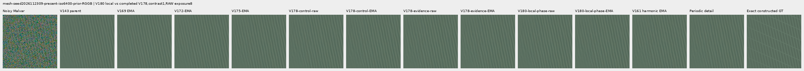

mesh-seed2026112309-present-iso6400-prior-RGGB; ROI `[176, 176, 160, 160]`, exposure8, contrast40.

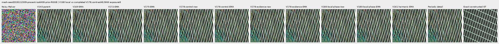

mesh-seed2026112304-absent-iso6400-prior-RGGB; ROI `[165, 0, 160, 160]`, exposure8, contrast40.

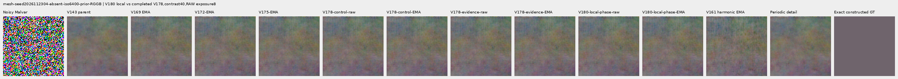

main-overcast-sky; ROI `[176, 176, 160, 160]`, exposure4, contrast1.

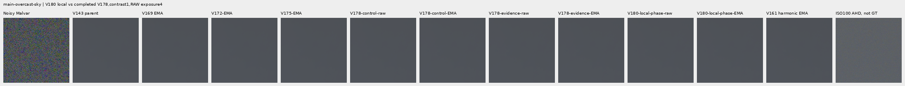

main-building-detail; ROI `[176, 176, 160, 160]`, exposure4, contrast1.

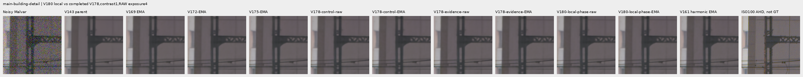

main-foliage; ROI `[176, 176, 160, 160]`, exposure4, contrast1.

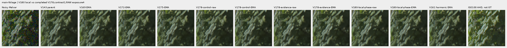

main-chain-link-fence; ROI `[176, 176, 160, 160]`, exposure4, contrast1.

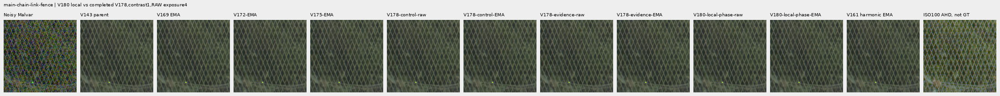

mesh-nominal; ROI `[206, 229, 160, 160]`, exposure16, contrast1.

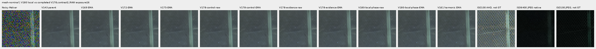

mesh-nominal; ROI `[426, 189, 160, 160]`, exposure16, contrast1.

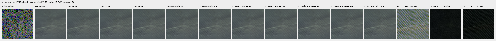

mesh-profile3879; ROI `[206, 229, 160, 160]`, exposure16, contrast1.

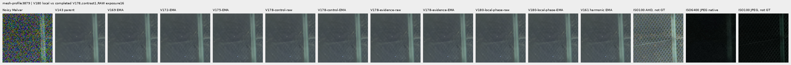

mesh-profile3879; ROI `[426, 189, 160, 160]`, exposure16, contrast1.

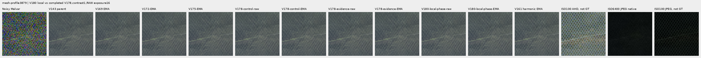

organic-02a76fd33b5e1414a0504f0b3f0aeb03a569b6f4-photo-faint-RGGB; ROI `[112, 112, 160, 160]`, exposure14.3883, contrast8.

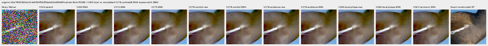

organic-dabacecd4780a1c230f8e9fce6ca1a604bdeab4c-photo-dark-RGGB; ROI `[112, 112, 160, 160]`, exposure102.758, contrast1.

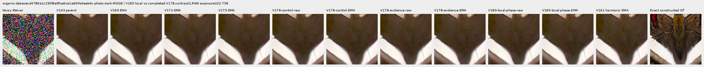

organic-6b3920bceba82d95ecf9351d47f6f94267694bd0-photo-dark-RGGB; ROI `[112, 112, 160, 160]`, exposure64.0491, contrast1.

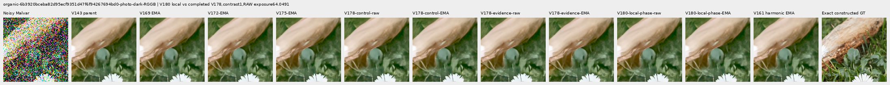

gray-l0.02-adc-only-RGGB; ROI `[48, 48, 160, 160]`, exposure4, contrast40.

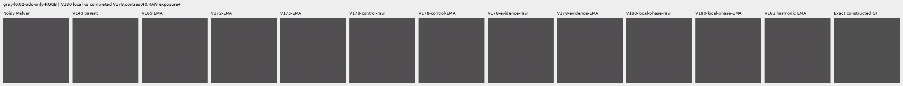

gray-l0.02-iso12800-prior-RGGB; ROI `[48, 48, 160, 160]`, exposure4, contrast40.

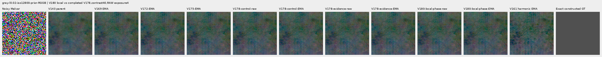

flat512-gray-l0.02-adc-only-RGGB; ROI `[176, 176, 160, 160]`, exposure4, contrast40.

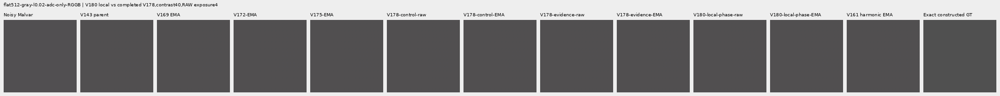

flat512-gray-l0.02-iso6400-prior-RGGB; ROI `[176, 176, 160, 160]`, exposure4, contrast40.

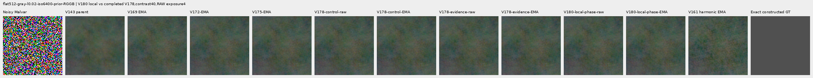

flat512-gray-l0.02-iso12800-prior-RGGB; ROI `[176, 176, 160, 160]`, exposure4, contrast40.

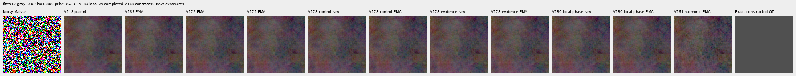

flat512-h210-s0.50-l0.02-iso6400-prior-RGGB; ROI `[176, 176, 160, 160]`, exposure4, contrast40.

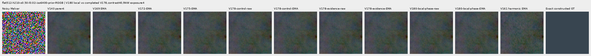

flat512-gray-l0.18-iso12800-prior-RGGB; ROI `[176, 176, 160, 160]`, exposure1, contrast8.

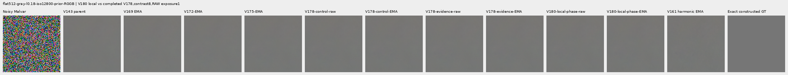

flat512-gray-l0.90-iso12800-prior-RGGB; ROI `[176, 176, 160, 160]`, exposure1, contrast4.

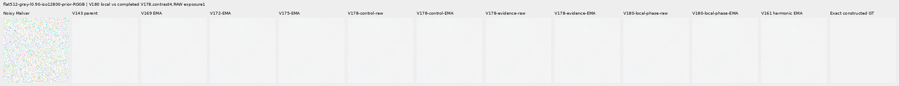

photo-3e638bbb56ed80abc88939468783e3bf9b92ee77-photo-faint-RGGB; ROI `[176, 176, 160, 160]`, exposure12.1494, contrast8.

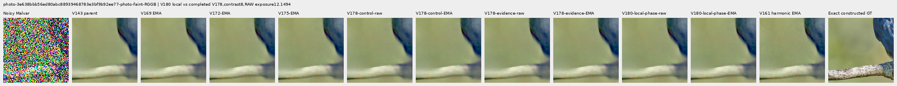

photo-3e638bbb56ed80abc88939468783e3bf9b92ee77-photo-dark-RGGB; ROI `[176, 176, 160, 160]`, exposure80.9959, contrast1.

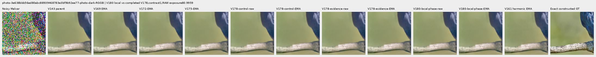

mixed-vertical-step-iso6400-prior-RGGB; ROI `[80, 176, 160, 160]`, exposure8, contrast40.

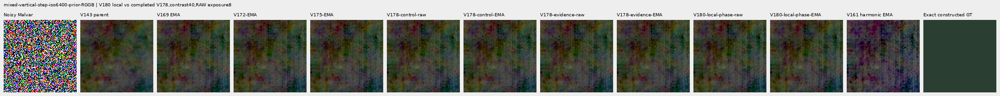

mixed-vertical-step-iso6400-prior-RGGB; ROI `[240, 176, 160, 160]`, exposure8, contrast1.

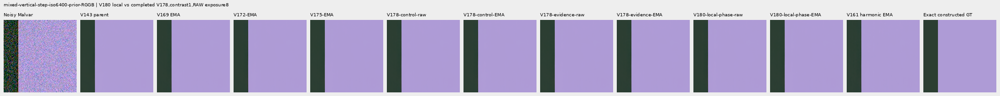

mixed-vertical-step-iso12800-prior-RGGB; ROI `[80, 176, 160, 160]`, exposure8, contrast40.

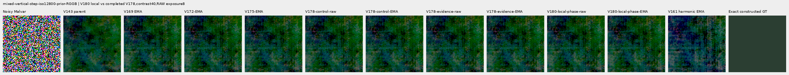

mixed-vertical-step-iso12800-prior-RGGB; ROI `[240, 176, 160, 160]`, exposure8, contrast1.

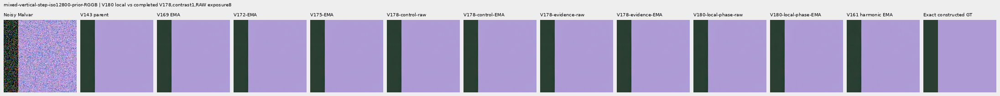

mixed-narrow-bar-iso6400-prior-RGGB; ROI `[80, 176, 160, 160]`, exposure8, contrast40.

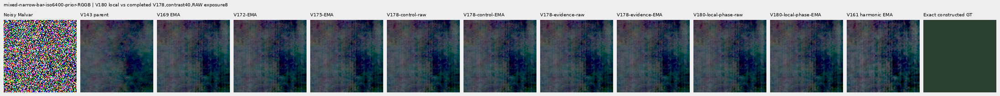

mixed-narrow-bar-iso6400-prior-RGGB; ROI `[240, 176, 160, 160]`, exposure8, contrast1.

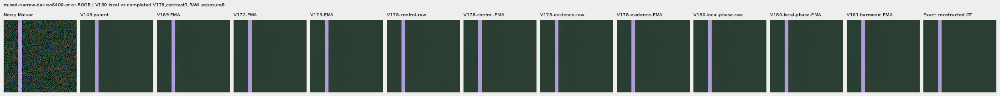

mixed-narrow-bar-iso12800-prior-RGGB; ROI `[80, 176, 160, 160]`, exposure8, contrast40.

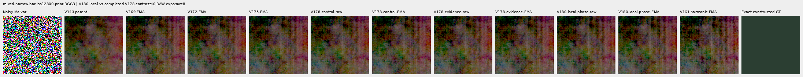

mixed-narrow-bar-iso12800-prior-RGGB; ROI `[240, 176, 160, 160]`, exposure8, contrast1.

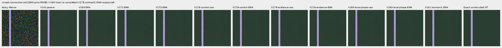

mixed-slanted-step-iso6400-prior-RGGB; ROI `[80, 176, 160, 160]`, exposure8, contrast40.

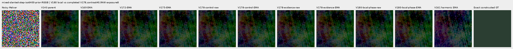

mixed-slanted-step-iso6400-prior-RGGB; ROI `[240, 176, 160, 160]`, exposure8, contrast1.

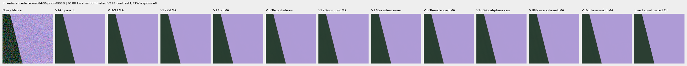

mixed-slanted-step-iso12800-prior-RGGB; ROI `[80, 176, 160, 160]`, exposure8, contrast40.

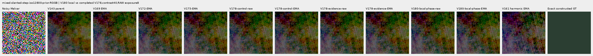

mixed-slanted-step-iso12800-prior-RGGB; ROI `[240, 176, 160, 160]`, exposure8, contrast1.

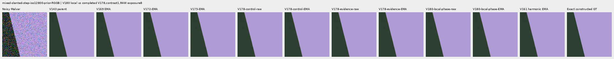

mixed-striped-patch-iso6400-prior-RGGB; ROI `[80, 176, 160, 160]`, exposure8, contrast40.

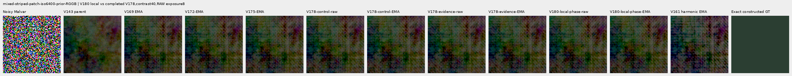

mixed-striped-patch-iso6400-prior-RGGB; ROI `[240, 176, 160, 160]`, exposure8, contrast1.

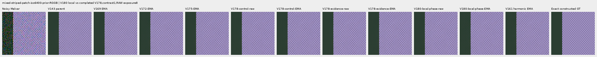

mixed-striped-patch-iso12800-prior-RGGB; ROI `[80, 176, 160, 160]`, exposure8, contrast40.

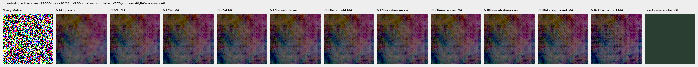

mixed-striped-patch-iso12800-prior-RGGB; ROI `[240, 176, 160, 160]`, exposure8, contrast1.

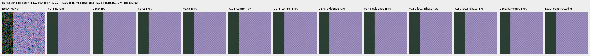

V150-control-bark-contrast0p025-adc-RGGB; ROI `[48, 48, 160, 160]`, exposure1, contrast40.

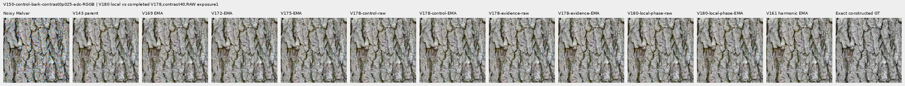

V150-control-raccoon-fur-contrast0p025-adc-RGGB; ROI `[48, 48, 160, 160]`, exposure1, contrast40.

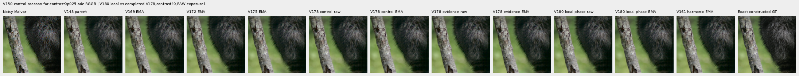

V150-control-ADC-plane0-RGGB; ROI `[176, 176, 160, 160]`, exposure45, contrast8.

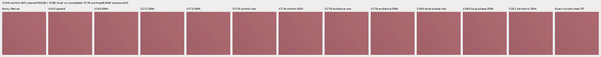

V150-control-ADC-plane1-RGGB; ROI `[176, 176, 160, 160]`, exposure9, contrast8.

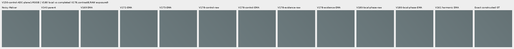

V150-control-ADC-plane2-RGGB; ROI `[176, 176, 160, 160]`, exposure1, contrast8.

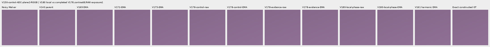

V150-control-ADC-plane3-RGGB; ROI `[176, 176, 160, 160]`, exposure0.24, contrast8.

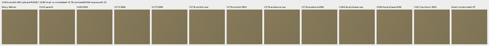

### Noisy, restored and exact constructed GT

mesh-seed2026112302-present-iso6400-prior-RGGB; ROI `[176, 176, 160, 160]`, exposure8, contrast1.

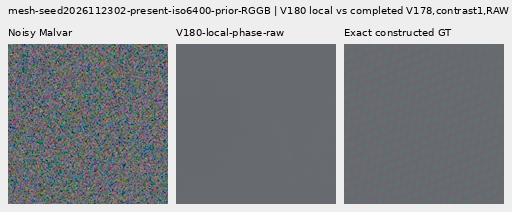

mesh-seed2026112302-present-iso6400-prior-RGGB; ROI `[176, 176, 160, 160]`, exposure8, contrast1.

mesh-seed2026112309-present-iso6400-prior-RGGB; ROI `[176, 176, 160, 160]`, exposure8, contrast1.

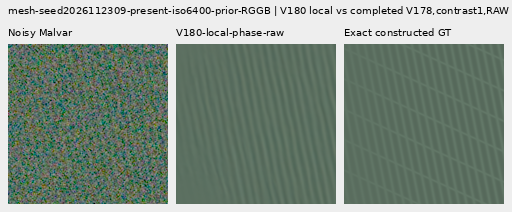

mesh-seed2026112309-present-iso6400-prior-RGGB; ROI `[176, 176, 160, 160]`, exposure8, contrast1.

flat512-gray-l0.02-iso6400-prior-RGGB; ROI `[176, 176, 160, 160]`, exposure4, contrast40.

flat512-gray-l0.02-iso6400-prior-RGGB; ROI `[176, 176, 160, 160]`, exposure4, contrast40.

flat512-gray-l0.02-iso12800-prior-RGGB; ROI `[176, 176, 160, 160]`, exposure4, contrast40.

flat512-gray-l0.02-iso12800-prior-RGGB; ROI `[176, 176, 160, 160]`, exposure4, contrast40.

mixed-vertical-step-iso6400-prior-RGGB; ROI `[80, 176, 160, 160]`, exposure8, contrast40.

mixed-vertical-step-iso6400-prior-RGGB; ROI `[80, 176, 160, 160]`, exposure8, contrast40.

mixed-vertical-step-iso12800-prior-RGGB; ROI `[80, 176, 160, 160]`, exposure8, contrast40.

mixed-vertical-step-iso12800-prior-RGGB; ROI `[80, 176, 160, 160]`, exposure8, contrast40.

[Publication verification](results/v180-local-phase-evidence-publication-verification-v1.json).
