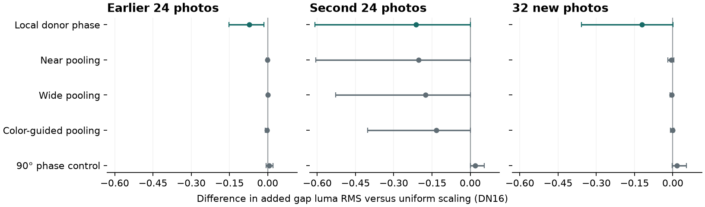
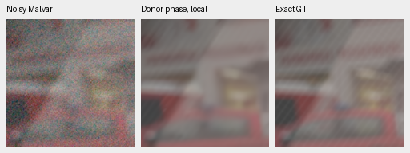
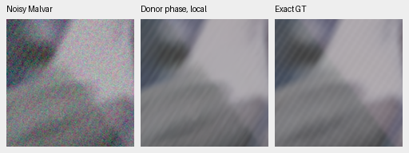

# An exterior phase check for weak Bayer detail

The new `weak-phase-guard` crop option uses nearby RAW patches to predict the phase of faint detail, then uses 16-pixel local measurements to decide where to apply the [weak-only correction](local-conditional-posterior.md). At equal recovered contrast on 32 new ISO6400 photo-based fixtures, it lowers added gap luma RMS from **0.311 to 0.189 DN16**. One photo accounts for 97% of the mean difference. The wider and coarse-color-guided checks offer little improvement on that panel, and both right GFX cab crops fall back because the exterior phase is inconsistent.

The [curved phase follow-up](local-curved-phase-transport.md) improves agreement with the known phase on new curved fields. The gain in recovered contrast is small, and the phase fit remains ineligible on both right cab profiles.

## Separate the phase from the local support check

The [previous support replay](local-weak-support.md) used a weak waveform already fitted at the center or tested red/blue ratios against a green fitted there. This check estimates the entire complex phase for each Bayer site from four separate 128-pixel RAW patches. The frequency, weak/strong rank and applied weak correction come from the existing pipeline. An inverse-noise weighted phase consensus must have a magnitude of at least 65% of the weighted mean magnitude and squared signal-to-noise of at least 16 on both green lattices. Red and blue join the check individually when they satisfy the same criteria.

Each nonoverlapping 16-pixel station tests the fixed phase after projecting out a quadratic background and the continuing strong fundamental. Positive signed evidence favors keeping the existing weak correction. The station scores are interpolated before tapering just the difference from the combined check. The strongest direction keeps its existing fit. Near pooling uses a 12.8-pixel Gaussian scale within the crop. Wide pooling uses scale 24.8 pixels and an extra 48 pixels of context per side. The coarse-color arm uses the same wider samples with an affinity based on log mean RAW levels. The real replay has a 16-pixel context halo. The 90° phase control uses the same local measurements with a rotated donor template.

An earlier 32-photo calibration sets the target at 75% of the full weak increment. Within each method family it chooses the lowest added gap RMS among four score cutoffs at that target. The local lock uses cutoff 2.5, a two-unit ramp and a final blend of 0.973186 with the combined check. Where donor phase is unavailable on a crop with a weak increment, the same blend applies uniformly. A mutation audit checks all four Bayer layouts. Changing the entire scored footprint leaves donor frequency and phase identical. A halo-only change alters wide scores and leaves near and local scores equal.

## Exact-target results

The new panel uses 32 source-disjoint backgrounds, two noise draws, all four CFA layouts and six roles, including exact gaps, flat cores, plain edges and uniform controls. The audit excludes the earlier evaluation sources and checks the new IDs and hashes against 559,808 recorded Local 50k training photo visits. The fixed camera recipe uses optical blur σ 0.85, ISO6400 shot/read `0.00128 / 6.5536e-6`, exposure 0.33, black offset 0.03 and 16-bit ADC. Parents use CUDA IEEE FP32. The combined and weak replays reproduce earlier per-draw scores exactly on the reused panels.

| 32 new photos, weights frozen on calibration | Weak response | Intact weak RMS (DN16) | False weak RMS in gaps (DN16) | Added gap luma RMS (DN16) |
| --- | ---: | ---: | ---: | ---: |
| Combined check | 13.622% | 36.221 | 2.860 | 0.000 |
| Full weak posterior | 15.121% | 35.163 | 2.950 | 0.408 |
| Uniform 75% | 14.746% | 35.427 | 2.927 | 0.306 |
| Local donor phase | 14.767% | 35.399 | 2.891 | 0.189 |
| Near pooling | 14.743% | 35.428 | 2.925 | 0.300 |
| Wide pooling | 14.748% | 35.425 | 2.926 | 0.302 |
| Coarse-color-guided pooling | 14.747% | 35.426 | 2.926 | 0.304 |
| 90° phase control | 14.722% | 35.447 | 2.929 | 0.316 |

The local guard differs from the fixed 75% control by +0.021 weak-response points `[−0.059, +0.117]` and −0.116 DN16 added gap luma RMS `[−0.342, +0.001]`. Continuing strong RMS differs by +0.0003 DN16. Added gap luma RMS measures the actual changes from the combined check inside the exact missing masks of 16 photos. The false weak RMS column measures projection onto the missing direction. Two flat-core changes and four of the five edge-only changes are inherited from the combined fit. The fifth edge-only change is also present in the full weak fit. Uniform controls reproduce the parent. The guard can check 263 of 327 selected weak windows across the six roles.

Adjusting each uniform comparator to the same measured recovery gives local gap differences of **−0.073 DN16** `[−0.152, −0.014]`, **−0.212 DN16** `[−0.610, +0.001]` and **−0.122 DN16** `[−0.359, +0.001]` across the earlier 24, second 24 and new 32 photos. The two draws of `phase-extent-14` account for 97% of the new panel's mean reduction. The remaining photos average a reduction of 0.004 DN16. On the largest draw, the local check reduces added gap luma RMS from 6.742 to 3.584 DN16. The wide and color-guided checks differ from matched uniform by −0.004 and −0.002 DN16 on the new panel. Intervals use source-paired resampling stratified by geometry with both draws kept together.

## Native exact comparisons

The 160×160 pixels are unscaled at crop `[48,48,160,160]` in query `[128,128,256,256]`, with draw zero and the ISO6400 capture conditions above. Every panel uses display exposure ×2 followed by sRGB. The guard composes the fixed weak posterior and Local 50k EMA SHA256 `62f4e9ce84075c8df1a254a1889033b5787133e8c98c63e0ec3d174a94734959`. The exact reference is the pre-Bayer scene after optical blur. Both crops recover part of the faint strand. Crossings remain more distinct in the exact targets.

The BGGR strip uses GT1976's Frankenfels fire apparatus photograph at bin-four crop `[176,80,512,512]`, adapted by binning, adding wires and simulating optics and noise. [All methods](assets/local-phase-extent-v1/phase-extent-01-comparison.png) · [Source](https://commons.wikimedia.org/wiki/File:2018-01-13_(111)_TLF-A_1000_Wei%C3%9Fenburg,_KLF-A_Wei%C3%9Fenburg_and_VF_Kirchberg_an_der_Pielach_at_powertest_of_the_breathing_apparatus_men_in_Wei%C3%9Fenburg,_Frankenfels.jpg) · [CC BY-SA 4.0](https://creativecommons.org/licenses/by-sa/4.0).

The BGGR ellipse uses King of Hearts' California gull photograph at bin-four crop `[228,82,512,512]` with the same adaptation. [All methods](assets/local-phase-extent-v1/phase-extent-09-comparison.png) · [Source](https://commons.wikimedia.org/wiki/File:Larus_californicus_Palo_Alto_May_2011_012.jpg) · [CC BY-SA 4.0](https://creativecommons.org/licenses/by-sa/4.0).

The largest improvement uses the GRBG `phase-extent-14` crop from Tuxyso's Tokina lens photograph at bin-four `[86,164,512,512]`. Under the shared display transform the gap gets slightly less diagonal texture. The earlier gap outlier `weak-side-07` also retains some false texture under the guard. [New outlier triplet](assets/local-phase-extent-v1/phase-extent-14-triplet.png) · [New outlier comparison](assets/local-phase-extent-v1/phase-extent-14-comparison.png) · [Earlier outlier triplet](assets/local-phase-extent-v1/weak-side-07-triplet.png) · [Earlier outlier comparison](assets/local-phase-extent-v1/weak-side-07-comparison.png) · [Earlier source and attribution](local-weak-support.md#native-exact-comparisons) · [Lens source](https://commons.wikimedia.org/wiki/File:Tokina-28mm-RMC-f2.8-NikonF-Front.jpg) · [CC BY-SA 3.0](https://creativecommons.org/licenses/by-sa/3.0).

## Standing GFX100S comparisons

All 12 boards were inspected at native resolution. Sky, foliage and building reproduce Local 50k, with smooth sky and unchanged rail edges. The local guard sees coherent exterior phase on the coarse fence, changes it by 4.60 DN16 RGB RMS versus the combined check and preserves connected crossings. Both left cab crops use the combined check because the rank is ambiguous. The two right profiles use the fallback blend because donor phase fails the coherence check. The weaker diagonal remains visible in places, with incomplete crossings and mottle under the transferred profile. No new repeating color is apparent.

The fixed main origins are `[5800,1400]`, `[5790,2690]`, `[8890,5570]` and `[2240,6000]`. Cab origins are `[806,6489]` and `[1026,6449]`. The Local 50k checkpoint above is the parent. V120 Small EMA SHA256 `a9d9b6b4f974e24a6b11e5e740aab32314233a7f53c056cf37c7d2aac1c589fb` supplies the general-model comparison. Nominal shot/read is `0.00128 / 6.5536e-6`. The transferred values are `0.0014635775921166604 / 1.0715704128646712e-6`. The independent ISO100 AHD and camera JPEGs provide qualitative references with different exposure, aperture and moving subjects. Board metadata records the native coordinates and display transforms.

| RAW and profile | Native boards |
| --- | --- |
| DSCF3879 nominal ×4 | [Sky](assets/local-phase-extent-v1/main-overcast-sky-main-overcast-sky-x4.png) · [Building](assets/local-phase-extent-v1/main-building-detail-main-building-detail-x4.png) · [Foliage](assets/local-phase-extent-v1/main-foliage-main-foliage-x4.png) · [Coarse fence](assets/local-phase-extent-v1/main-chain-link-fence-main-chain-link-fence-x4.png) |
| DSCF3842 nominal | [Left ×4](assets/local-phase-extent-v1/mesh-nominal-fine-green-mesh-left-x4.png) · [Right ×4](assets/local-phase-extent-v1/mesh-nominal-fine-green-mesh-right-x4.png) · [Left ×16](assets/local-phase-extent-v1/mesh-nominal-fine-green-mesh-left-x16.png) · [Right ×16](assets/local-phase-extent-v1/mesh-nominal-fine-green-mesh-right-x16.png) |
| DSCF3842 transferred | [Left ×4](assets/local-phase-extent-v1/mesh-profile3879-fine-green-mesh-left-x4.png) · [Right ×4](assets/local-phase-extent-v1/mesh-profile3879-fine-green-mesh-right-x4.png) · [Left ×16](assets/local-phase-extent-v1/mesh-profile3879-fine-green-mesh-left-x16.png) · [Right ×16](assets/local-phase-extent-v1/mesh-profile3879-fine-green-mesh-right-x16.png) |

## Packaged crop fit

Use `method="weak-phase-guard"` with the same native 160×160 crop, 192×192 parent context and packed RAW as `weak-posterior`. [Crop inference example](usage.md#repeating-mesh-crops).

The API matches the local research arm within 0.002 DN16 peak across 384 synthetic crops and eight standing RAW crops. On GB10 single-thread CPU, the median over the synthetic mixture is 26.20 ms per crop after the parent forward, versus 26.07 ms for the unguarded option. These medians include cases without a weak increment. The study uses frozen weights and covers this crop operation. The fixed 427-photo and known/unseen camera panels fall outside the replay.

[Paired results](results/local-phase-extent-v1/summary.json) · [Native manifest](assets/local-phase-extent-v1/manifest.json) · [Publication hashes](results/local-phase-extent-v1/publication.json) · [Frozen evidence](results/local-phase-extent-v1/evidence.tar.xz).
