# Stronger mesh with less spill into blank regions

The later [local complex phase fit](complex-phase-envelope.md) makes both mesh
directions more visible on complete frames, with measured nonuniform tradeoffs.
This report retains the original scalar patch policy, results and receipts.

**Local RAW evidence improves the harmonic patch correction: the tested fence
stays visible, while added structure in blank areas falls substantially.**
The correction now works with the completed V1435k parent, preserving its
measured faint-detail gains. It remains an experimental native256 patch option.
Blank-region spill is reduced, not eliminated. A subsequent
[optional full-image implementation](phase-harmonic-inference.md) now covers
complete102MP RGB16 outputs, with weaker/window-dependent recovery and added CPU
cost. This report retains the original centred-patch comparisons and evidence.

[Operator](../scripts/local_phase_harmonic_patch.py) ·
[Publication and actual execution](results/local-phase-publication-v1.json) ·
[Locked validation](results/local-phase-validation-v2.json) ·
[Independent audit](results/local-phase-validation-independent-audit-v1.json) ·
[Native metadata](images/local-phase-harmonic-v1/manifest.json).

## What changed

The [first harmonic correction](phase-harmonic-patch.md) fit a periodic field
over a whole patch. It recovered soft fence structure but continued that field
past the true support of some textures. The new operator keeps its input-only
frequency selection, physical CFA coordinates and global RAW-minus-parent fit.
It estimates an amplitude envelope locally from the two measured green phases.

A Gaussian with native sigma32 gathers signed residual/template agreement and
template energy, using separate kernels for the greens' physical positions.
Squared kernels propagate independent input variance conditional on the fixed
template. Positive amplitude is shrunk by `max(0,1−4v/n²)`, capped at3, then
combined with the existing global gate. The output window has a flat192 center
and32-pixel cosine-squared border aprons. This restores more central detail
while local evidence can fade the field around its support.

Only RAW, variance, CFA and the parent output enter correction. Template
selection, fitted coefficients and variance all use the noisy input, so the
conditional variance and global score are **not calibrated confidence**.
GT/reference images are used solely for scoring and display comparisons.

## New validation, locked before looking at its results

Settings were selected on the earlier four development recipes, then locked
before evaluating16 new recipes. Each has present/empty states, ADC-only and
ISO6400-prior conditions, and four CFAs:256 shared inputs. Actual V120 and
V1435k inference adds512 root/DINO calls; correction variants add none.
The scene level is0.02 before camera transport, with original continuous
512→geometry→area2 generation and one draw per case. ISO6400 prior uses
shot0.00128/read variance6.5536×10⁻⁶, ADC16 and black0.03.

Only one of the16 present recipes activates, across all four CFAs. Its response
on V143 is shown below; these are descriptive results from one active recipe,
not four independent training runs or broad recovery evidence.

| Active recipe2026110207, mean over four CFAs | V143 parent | Global patch | Local patch |
| --- | ---: | ---: | ---: |
| Known-template gain, ideal1 | 0.20771 | 0.26607 | 0.33650 |
| Native160 ROI spatial error,RMS DN16 | 30.18573 | 28.78973 | 27.00651 |
| Complete256 RGB error,RMS DN16 | 22.57614 | 21.80204 | 20.52382 |
| Added field in complete-patch blank regions,RMS DN16 | 0 | 2.67907 | 1.00728 |
| Error in those blank regions,RMS DN16 | 6.10121 | 6.70027 | 6.19706 |

The local correction lowers full-patch added blank-region structure62.40%
versus the global correction. Its blank-region error remains above the parent.
The corresponding native160 added-field reduction is73.52%. The
[complete256 audit](results/local-phase-full-patch-blank-audit-v1.json) includes
pixels outside the displayed crops, as well as worst cases and per-CFA values.

Across all64 noisy-present cases, V143's mean spatial RMS is
12.89238 / 12.80513 / 12.69368 DN16 for parent/global/local. The15 inactive
recipes remain unchanged. All64 noisy-absent inputs and128 ADC inputs retain
their parent values under both corrections. Results on V120 show the same
direction. All1,536 score rows are retained and independently audited.

## Native exact-GT examples

Noisy Malvar → V143 plus local correction → **exact procedural GT**. Cells are
unchanged160×160 crops at ROI`[48,48,160,160]`, shared +3 EV display and common
WB/matrix. The first example is the active new recipe; the second is the first
inactive recipe. Illustration selection uses observed activation, after
evaluation; the complete16-recipe results remain reported.

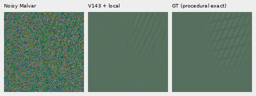

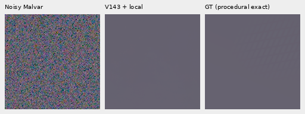

The active case recovers one family more strongly; the crossing family is
still weak. The lower-contrast case remains suppressed. The full five-way
boards and all source recipes are in the manifest.

## Both standing GFX scenes

Noisy → V143 → global correction → local correction → independent ISO100
reference, **not exact GT**. Main DSCF3879/3880 foliage, fence, sky and building
use native160 ROIs`[176,176,160,160]` in512 contexts and shared +2 EV display.
The ISO100 f/5.6 exposure differs in aperture and moving subjects. Sky, building
and foliage retain parent values; the larger fence changes.

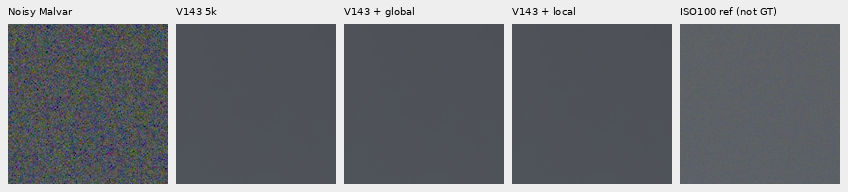

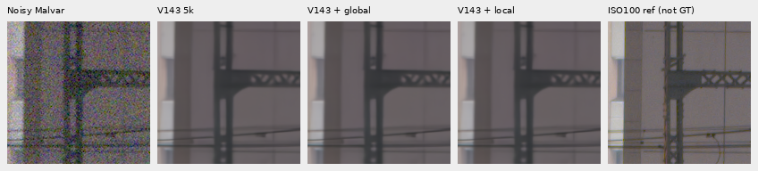

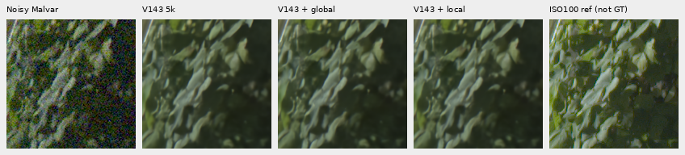

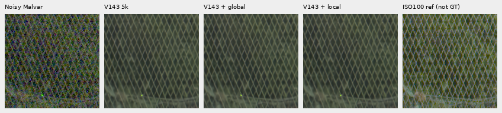

Extra fine mesh uses DSCF3842 ISO6400 and independent DSCF3835 ISO100 f/5.6,
**not exact GT**. Left/right native160 ROIs begin`[806,6489]` / `[1026,6449]`
in the retained768 contexts, with shared +4 EV and the original reference x
shift. Aperture, exposure time and moving subjects differ. The correction uses
the same even-origin256 windows as the earlier patch report.

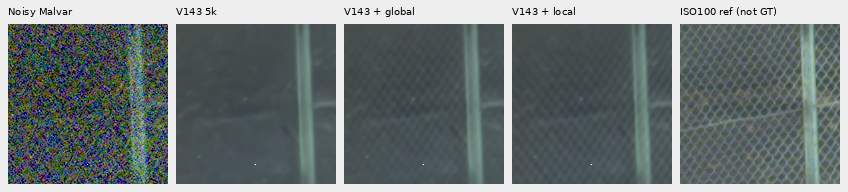


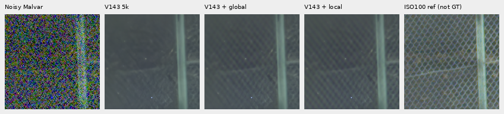

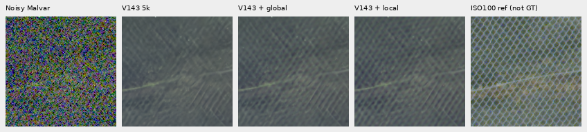

Nominal conditioning is shot0.00128/read variance6.5536×10⁻⁶; nearby DSCF3879
conditioning is shot0.0014635775921166604/read variance1.0715704128646712×10⁻⁶,
not fitted to this capture. Local correction retains and often strengthens the
soft diagonals, with an imbalance between directions in some views. It remains
weaker than the independent ISO100 image. Both camera JPEGs under both priors
are included in [four additional boards](images/local-phase-harmonic-v1/manifest.json).
These standing development scenes do not establish blind photographic quality.

## Existing photo/flat support and precision

Both parent checkpoints retain their pixel values on all96 photographic and48
analytic uniform-field inputs under both correction variants. Thus the useful
[V143 faint/shadow gains and its measured coarse/ADC costs](v143-final5000-quality.md)
remain present. This is limited tested support, not broad flat-safety proof.

Two additional exact-synthetic-GT triplets show faint bark/fur ADC checks.
Each160×160 cell is at8×-binned evaluation resolution, ROI`[48,48,160,160]`,
contrast0.025, ADC16/black0.03 and shot/read0. The common40× camera-linear
contrast display uses the same original target channel means, WB/matrix and
exposure1; no crop pixels resize. The local stage takes the ADC bypass.

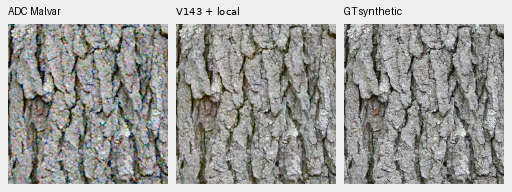

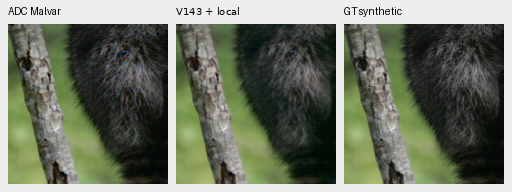

V143 parent SHA256:
`96d146d017c54196288c585f8b7eddcf030e8a235061049c31e985b9380b7ce4`.
V120 control SHA256:
`a9d9b6b4f974e24a6b11e5e740aab32314233a7f53c056cf37c7d2aac1c589fb`.
Full operator hashes, source/ROI/noise and transforms accompany each image.

```bash
PYTHONPATH=src:scripts .venv/bin/python scripts/local_phase_harmonic_patch.py \
  INPUTS.npz BASE-PREDICTION.npy OUTPUT-DIRECTORY --checkpoint V143-CHECKPOINT.pt
```

The command consumes one saved native256 RAW/RGB patch and writes float64
linear camera RGB, with no8-bit quantization or model execution. The checkpoint
argument records the declared source. It does not implement full-image tiling.

## Verification and remaining work

Public output matches all6,291,456 values from the locked32-case development
prototype. Actual CLI output matches196,608 validation values. Sixteen targeted
tests cover both operators, all CFA layouts, dense physical-coordinate sums,+squared-kernel variance, interpolation, ADC/uniform bypasses and invalid input.
Independent joint affine/template fits check1,536 validation rows, maximum gain
difference2.94×10⁻¹⁴; pixel arrays verify spatial/DC/blank metrics and all means.
Independent rendering/copy checks6,604,800 channels across18 actually viewed
native boards. Crop pixels are never resized.

The first validation launch failed during offline DINO cache lookup before
any root/DINO forward. Its bytes and failure remain preserved. The successful
queues reuse all256 original input arrays after sourcing the cache environment;
all512 actual calls pass complete model/backbone/input/RNG checks. No extra
noise is generated in recovery, and no RAW is decoded anywhere in this study.

The subsequent [tiled inference report](phase-harmonic-inference.md) adds
complete102MP exports, seam/odd-boundary tests, actual CPU timing and a wider sky
check. Remaining spill, weak recipes, color/highlight behavior, tile-origin
sensitivity and broader photo/camera support remain open.
V120 stays the validated general recommendation; V143 plus local correction
is the current useful experimental patch option for the tested fine mesh.
