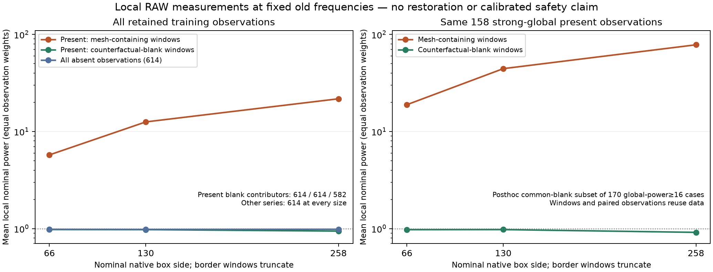

# Local RAW coefficients: support diagnostic

Local measurements at an already selected RAW frequency have higher mean power
where a constructed mesh is present, while counterfactual-blank windows stay
near nominal power 1. Larger windows gather more signal but leave fewer pure
blank footprints. **No RGB is restored and no model is trained.** These reused
training observations do not establish a detector, real-camera confidence or
an improvement in fine fence/sky restoration.

The left panel retains all 614 present and 614 absent observations. Present
blank contributors change from 614 to 582 at the largest scale, as shown.
The right panel is a posthoc sensitivity comparison using the same 158 of
170 strong-global present observations with blank windows at every scale.
Means give equal weight to contributing observations; overlapping windows and
coupled pair members reuse data. The dotted power-1 line is a nominal reference,
not a calibrated decision boundary. Both plotted versions are preserved; the
final chart moves annotations clear of the curves and was actually viewed.

[SVG](images/v179-local-phase-support-v1/local-phase-support-v2.svg) ·
[PDF](images/v179-local-phase-support-v1/local-phase-support-v2.pdf) ·
[All source, plot points, reductions and verification](results/v179-local-phase-support-v1.json).

## Fixed input measurements

The study reuses the [V177 input-only selections](phase-frequency-evidence.md)
from all 307 retained noisy mesh batches. Each observation uses only rank 1
from the lower-index green phase's selection direction. The higher-index green
phase is measured at that fixed bin. No frequency is reselected; no target,
pair label or other-phase value changes the selected bin.

On the packed 256×256 grid, 81 centers cover positions 0,32,…,224,255 in each
axis. Nominal box sides 33/65/129 packed samples correspond to 66/130/258 native
pixels. Border windows truncate to actual support, without reflected samples.
Each rectangle independently removes its unweighted affine plane. For a local
basis Q and complex carrier f, the effective row is
`a = f − Q(QᵀQ)⁻¹Qᵀf`; the coefficient is `aᵀRAW`, and propagated variance is
`sum(variance × |a|²)`. Summed-area moments include the fitted-plane terms.
This differs from V177's global Hann measurement; they are not matched filters.

All four input observations in a batch are measured and durably journaled
before target/pair arrays are interpreted. Targets then supply score-only clean
coefficients, conditional **pre-ADC** variance and exact counterfactual support.
A blank window contains no added mesh in any native RGB sample of its Bayer-cell
footprint; the constructed background may have a gentle affine slope. A
signal-containing window need not have detectable signal at the selected bin.
Observed-intensity variance proxies, ADC effects and selected observations
prevent interpreting nominal powers as probabilities.

## Observed localization and aggregation

| Nominal native box side | Present signal-containing mean power | Present blank mean power | Blank contributors | Absent mean power /614 |
|---:|---:|---:|---:|---:|
| 66 | 5.749 | 0.979 | 614 | 0.983 |
| 130 | 12.572 | 0.977 | 614 | 0.980 |
| 258 | 21.761 | 0.943 | 582 | 0.985 |

All present signal-containing means use the same 614 observations. The largest
box has fewer observations with a pure blank window, so the blank curve alone
does not isolate a size effect. There are 26,709/19,497/7,557 blank windows among
49,734 present window measurements at each size.

Among the same 158 strong-global present observations, signal-containing means
are **18.912/44.466/78.301**, versus blank means **0.976/0.978/0.915**. Their
blank-window counts shrink from 6,835 to 4,990 to 1,799. The strong-global group
conditions on the same other-phase data and is descriptive, not an independent
test. The common-case restriction is posthoc and disclosed in the plot/data.

Absent observations have 827/827/826 window measurements at nominal power≥4
out of 49,734 per size—about 1.7%. None reach 16 in this cohort. Zero observed
events at 16 does not establish zero false discoveries on new scenes, real
noise, more frequencies or a learned restoration. Many signal-containing
windows also have weak measurements. No hard threshold is proposed.

The useful hypothesis is to expose continuous local coefficients alongside
global frequency evidence, giving a learned branch information about spatial
support. The [V178 global wave features](phase-evidence-matching.md) remain
features rather than drawn wires; their network can already learn support from
other inputs. This diagnostic does not show that V178 hallucinates, compare
its restored RGB, or establish that another feature path will improve it.
Native aliasing, weaker unknown frequencies, border support, FP32/GPU behavior
and learned detail/flat tradeoffs still need testing. V175's completed comparison
and the running V178 trial retain their separate fixed recipes.

The follow-on [V180 local-evidence model](local-phase-evidence-matching.md)
implements this hypothesis with V178's parameter layout. Its local FP64 maps
pass independent native CPU checks, but CUDA, training and restored quality
remain unmeasured. Window and interpolation choices can still spread support.

## Checks and execution

The [NumPy reference](../scripts/local_phase_projection.py) passes
[20 CPU tests](../tests/test_local_phase_projection.py): direct QR coefficient/
heteroscedastic-noise rows, clipped borders, affine invariance, exact constants,
noise scaling and invalid inputs. The
[frozen study](../scripts/diagnose_local_phase_support.py) completes 3,684 local
input projections and 3,684 score-only clean projections: 298,404 windows in
each stream. All 1,228 old primary bins and 921 actual input-fingerprint bindings
match; all scored records retain their measured input powers.

Independent QR checks cover fixed first-four batches, all four observations,
all three scales and both corners plus center: **288 native reference rows**
across noisy and clean data. Largest coefficient/variance differences are
1.22e−13/1.98e−14, within the fixed 1e−9 absolute/relative tolerance. This is a
selected independent audit, not direct QR on every window. Exact complex-power
reconstruction passes throughout; a separately computed sum of squared real/
imaginary components differs by at most 8.02e−16 relatively.

The first CPU reduction incorrectly required bit equality between those two
floating-point energy formulas. Its source and failure log are preserved. The
corrected reducer checks the original complex arithmetic exactly and bounds
the independent expression's rounding. Scientific measurements were not rerun.

The scientific process peaks at **124.68 MiB RSS**, imports neither Torch nor
rawpy, and makes zero neural, parent/DINO, checkpoint, source-render, new-noise
or RAW-decoder calls. It runs at nice 10 on CPUs 6/7 while the original V175
training continues. Both scientific journals remain locally cached, with no
new external artifacts. Both protected GFX families and originals are unused
here and remain excluded from training; their ISO100/AHD/JPEG comparisons stay
qualitative references. For actual restored images use the completed
[V172](local-noise-matching.md)/[V174](spread-sample-matching.md) comparisons.
