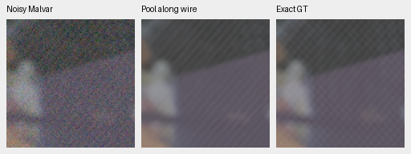
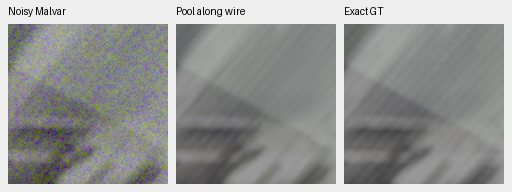

# Pooling Bayer phase while validating local detail

A phase field pooled over a 192-pixel RAW neighborhood improves
the fit to warped weak wires with isotropic neighbor weights. On 20 warped backgrounds, that variant gains **0.320
weak-response points** and lowers intact fundamental error by
**0.191 DN16** versus the [fixed combined fit](local-nested-support.md).
Its advantage is smaller on straight wires. Scaling both
directions to comparable weak recovery costs continuing-strand
accuracy. Pooling only the weaker direction retains most of the
warped gain and keeps the stronger correction fixed. The real
cab changes are subtle.

## Measure a phase field, then check it locally

The same four exterior 128-pixel donor patches nominate the
two carriers for all arms. Within the 192-pixel verification
footprint, each green lattice independently fits sine and cosine
in 64 disjoint 24-pixel blocks. Each block accounts for the
competing carrier and smooth background. The complex estimates
share one origin so their signs and phases align before pooling.

The fit weights each block by its estimated carrier information
divided by RAW noise variance. A weighted neighbor penalty on an
eight-connected grid smooths the two complex coefficients.
Even pooling weights immediate neighbors inversely by their
distance. The oriented arm multiplies those weights by
`0.24 + 1.76 cos⁴(θ)`, where θ is the angle between the
grid displacement and the wire tangent. The overall penalty
scale is half the median measurement information. Bilinear
interpolation and normalization produce a unit-amplitude
carrier template at each pixel. The rotated control turns the
oriented estimate a quarter cycle.

For each overlapping 64 × 64 window, only the fitting green
lattice supplies a nonnegative amplitude for that fixed shape.
The other green lattice tests the prediction both in the
broad window and its 32 × 32 center. Folds swap roles. The
pooled alternative must clear the original 6 and 1.5 absolute
scores and beat the planar predictions by 1 and 0.2 respectively
on both folds. The model uses the planar correction when the
alternative fails. The delivered correction subtracts the
projection of Local 50k and uses the common measured-amplitude
cap, native overlap taper and 0.73 nominal strength.

An audit across the four Bayer layouts replaces all samples
on each held lattice. It leaves the phase field and fitted
amplitude for that fold bit-identical. The two holdout scores
use overlapping sites and share validation data across
alternatives. These are empirical checks on the whole
selection procedure.

## Optical and phase evidence

The parent is Local 50k EMA
`62f4e9ce84075c8df1a254a1889033b5787133e8c98c63e0ec3d174a94734959`.
The recommended reference is V120 Small EMA
`a9d9b6b4f974e24a6b11e5e740aab32314233a7f53c056cf37c7d2aac1c589fb`.
Parent and reference predictions reuse the CUDA IEEE FP32
replays from the [affine carrier experiment](local-carrier-envelope.md).
This replay uses its 12 calibration sources and 20 distinct
test sources with both straight and warped forms, plus the earlier
[32-photo combined-support panel](local-nested-support.md).
All have two independent RAW draws and σ 0.85 pre-Bayer blur.
The straight and warped recipients share the same measured
exterior. This is a new method on retained test data. The
secondary smooth dips score the full continuous wire support,
as in the source study. The follow-up review takes 55.26 s
on CPU using the saved predictions and calibration.

The phase audit checks the signed correlation of the
unit-amplitude prediction against the known weak fundamental,
before passing it through a support gate. It covers 16 of 20
sources with windows containing at least 75% intact weak
support. The remaining smooth dips lack eligible windows.
Both draws and folds are averaged at source level.

| Template correlation | Straight | Warped |
| --- | ---: | ---: |
| Local planar fit | 0.866 | 0.698 |
| Even pooling | **0.905** | **0.726** |
| Along-wire pooling | 0.894 | 0.684 |
| Quarter-cycle control | 0.047 | −0.012 |

For warped wires the even-minus-planar difference is +0.028
[+0.010, +0.046]. Along-wire minus planar is −0.014
[−0.035, +0.005]. The quarter-cycle control never replaces a
planar prediction in the optical replay or the standing GFX
views.

| Nominal change versus fixed combined | Straight, 20 sources | Warped, 20 sources | Earlier straight, 32 sources |
| --- | ---: | ---: | ---: |
| Even pooling, weak response points | +0.081 | +0.320 | +0.111 |
| Along wire, weak response points | +0.093 | +0.195 | +0.100 |
| Even pooling, continuing-strand error DN16 | −0.492 | −0.216 | −0.245 |
| Along wire, continuing-strand error DN16 | −0.507 | −0.249 | −0.245 |

On the warped panel, even pooling changes intact fundamental
error by −0.191 DN16 [−0.344, −0.060]. It has 0/40
activations in each of the flat-core, edge-only and uniform
roles. The earlier straight panel gives it the same two
flat-core activations as the fixed correction, without
additional edge-only or uniform activations. Along-wire
pooling adds one uniform activation on that panel.
False weak-band RMS for even pooling on warped gaps changes
by +0.001 DN16 [−0.003, +0.005]. At global response matching,
even pooling raises continuing-strand RMS by 2.114 DN16
[1.436, 2.714] on warped sources with a +0.010-point weak
response difference [−0.113, +0.124]. Along-wire
pooling costs 1.232 DN16 [0.835, 1.585] in its separate match.
The match scales both parts of the correction together.

### Holding the stronger correction fixed

In a follow-up, each green lattice independently ranks the two
directions by median noise-subtracted carrier power across the
64 blocks. They must agree and each must give the stronger
direction at least a 25% power margin. The candidate can then
replace only the weaker direction with the evenly pooled phase,
subject to the original held checks. Both directions keep their
planar fits where the ranking is ambiguous. The observed ranking
selects the planted weaker direction in all 40 warped and 64
secondary straight intact observations.

| Weak-only change versus fixed combined | Warped, 20 sources | Earlier straight, 32 sources |
| --- | ---: | ---: |
| Nominal weak response points | +0.307 [0.099, 0.555] | +0.108 [0.036, 0.202] |
| Nominal intact fundamental RMS, DN16 | −0.186 [−0.339, −0.055] | −0.070 [−0.133, −0.022] |
| Continuing-strand RMS, DN16 | <0.001 change | <0.001 change |
| False weak-band RMS, DN16 | <0.001 change | <0.001 change |
| Exact-flat RMS, DN16 | 0.000 | 0.000 |

The warped fit replaces 36 weak-direction windows. Neither
panel has additional correction on flat-core, edge-only or
uniform recipients. A separate warp calibration sets weights
0.500 and 0.3665 on the planar and pooled weak corrections.
Both arms keep the same full-strength stronger correction.
On the warped confirmation set the weak-response difference
is −0.040 points [−0.155, +0.071] and the continuing-strand
difference stays below 0.001 DN16. The secondary results use
nominal weights. The tests cover these planted waveforms and
noise draws.

## Native exact views

Every panel is a native 160 × 160 crop at
`(48,48,160,160)` in the 256-pixel recipient at `(128,128)`.
The first draw uses exposure 0.33, σ 0.85 optical blur,
shot/read `0.00128 / 6.5536e-6`, and a 0.03 black offset.
Display uses ×2 scene-linear exposure followed by sRGB.
The exact reference follows optics and precedes Bayer sampling.
The two-wire target retains a faint curved slope that remains
subdued through much of both reconstructions.

The ellipse uses King of Hearts' Liberty Science Center photo,
bin-four crop `(372,30,512,512)`, with RGGB. Adapted by binning,
planting wires and simulating optics and noise.
[Source](https://commons.wikimedia.org/wiki/File:Liberty_Science_Center_Jersey_City_July_2013_001.jpg) ·
[CC BY-SA 4.0](https://creativecommons.org/licenses/by-sa/4.0/) ·
[All controls](assets/local-pooled-carrier-v1/envelope-13-comparison.png).

The smooth dip uses mattbuck's Bristol Temple Meads photo,
bin-four crop `(28,110,512,512)`, with BGGR and the same adaptation.
[Source](https://commons.wikimedia.org/wiki/File:Bristol_Temple_Meads_railway_station_MMB_45_220003.jpg) ·
[CC BY-SA 3.0](https://creativecommons.org/licenses/by-sa/3.0/) ·
[All controls](assets/local-pooled-carrier-v1/envelope-14-comparison.png).

The weak-only result uses the same source, draw, CFA and
render. Its small changes leave the fine crossing pattern below
the contrast of each exact target.
[Ellipse triplet](assets/local-pooled-carrier-v1/envelope-13-weak-triplet.png) ·
[Ellipse comparison](assets/local-pooled-carrier-v1/envelope-13-weak-comparison.png) ·
[Smooth-dip triplet](assets/local-pooled-carrier-v1/envelope-14-weak-triplet.png) ·
[Smooth-dip comparison](assets/local-pooled-carrier-v1/envelope-14-weak-comparison.png).

## Standing GFX100S comparisons

The DSCF3879 ISO6400 boards use 512-pixel contexts,
shot/read `0.00128 / 6.5536e-6` and ×4 display. The donor
boxes start outside the 16-pixel verification halo. Sky,
building and foliage match Local 50k. The coarse fence keeps its
crossings and bright green speck. Even and oriented pooling
change the Local 50k fence by 8.16 and 7.97 DN16 RGB RMS,
respectively, versus 9.78 for the fixed correction.
DSCF3880 ISO100 AHD is the independently demosaiced
qualitative reference.
[Sky](assets/local-pooled-carrier-v1/main-overcast-sky-main-overcast-sky-x4.png) ·
[Building](assets/local-pooled-carrier-v1/main-building-detail-main-building-detail-x4.png) ·
[Foliage](assets/local-pooled-carrier-v1/main-foliage-main-foliage-x4.png) ·
[Coarse fence](assets/local-pooled-carrier-v1/main-chain-link-fence-main-chain-link-fence-x4.png).

The DSCF3842 ISO6400 cab uses 768-pixel contexts under both
the nominal and the transferred DSCF3879 shot/read
`0.0014635775921166604 / 1.0715704128646712e-6` priors.
The boards include DSCF3835 ISO100 AHD and both camera JPEGs.
These references differ in aperture, exposure time and motion.
At nominal conditioning the even arm replaces nine direction
windows on the left and eleven on the right. The pattern still
breaks near the post and soft diagonal fragments remain on the
right. The pooling variants look close to the fixed combined
fit, including its green-gray mottle.

| Native 160 × 160 crop | Nominal | Transferred DSCF3879 prior |
| --- | --- | --- |
| Left `(806,6489)` | [×4](assets/local-pooled-carrier-v1/mesh-nominal-fine-green-mesh-left-x4.png) · [×16](assets/local-pooled-carrier-v1/mesh-nominal-fine-green-mesh-left-x16.png) | [×4](assets/local-pooled-carrier-v1/mesh-profile3879-fine-green-mesh-left-x4.png) · [×16](assets/local-pooled-carrier-v1/mesh-profile3879-fine-green-mesh-left-x16.png) |
| Right `(1026,6449)` | [×4](assets/local-pooled-carrier-v1/mesh-nominal-fine-green-mesh-right-x4.png) · [×16](assets/local-pooled-carrier-v1/mesh-nominal-fine-green-mesh-right-x16.png) | [×4](assets/local-pooled-carrier-v1/mesh-profile3879-fine-green-mesh-right-x4.png) · [×16](assets/local-pooled-carrier-v1/mesh-profile3879-fine-green-mesh-right-x16.png) |

The weak-only fit leaves both left crops equal to the planar
correction because the two lattices cannot agree on a direction
with the required margin. It changes seven right windows under
each prior, with RGB differences of 1.39 DN16 nominal and
0.89 DN16 transferred versus fixed combined. The fine right
crossings remain incomplete. The coarse fence's difference is
0.54 DN16 and its connected intersections remain visible.
[Sky](assets/local-pooled-carrier-v1/main-overcast-sky-main-overcast-sky-x4-weak.png) ·
[Building](assets/local-pooled-carrier-v1/main-building-detail-main-building-detail-x4-weak.png) ·
[Foliage](assets/local-pooled-carrier-v1/main-foliage-main-foliage-x4-weak.png) ·
[Coarse fence](assets/local-pooled-carrier-v1/main-chain-link-fence-main-chain-link-fence-x4-weak.png).

| Weak-only cab comparison | Nominal | Transferred DSCF3879 prior |
| --- | --- | --- |
| Left | [×4](assets/local-pooled-carrier-v1/mesh-nominal-fine-green-mesh-left-x4-weak.png) · [×16](assets/local-pooled-carrier-v1/mesh-nominal-fine-green-mesh-left-x16-weak.png) | [×4](assets/local-pooled-carrier-v1/mesh-profile3879-fine-green-mesh-left-x4-weak.png) · [×16](assets/local-pooled-carrier-v1/mesh-profile3879-fine-green-mesh-left-x16-weak.png) |
| Right | [×4](assets/local-pooled-carrier-v1/mesh-nominal-fine-green-mesh-right-x4-weak.png) · [×16](assets/local-pooled-carrier-v1/mesh-nominal-fine-green-mesh-right-x16-weak.png) | [×4](assets/local-pooled-carrier-v1/mesh-profile3879-fine-green-mesh-right-x4-weak.png) · [×16](assets/local-pooled-carrier-v1/mesh-profile3879-fine-green-mesh-right-x16-weak.png) |

This inference-only crop replay has no new fixed-photo or camera
scores.
[Paired results and figures](results/local-pooled-carrier-v1/publication.json) ·
[Original receipts and source](results/local-pooled-carrier-v1/evidence.tar.xz).

## Packaged crop fit

`refine_raw_mesh_carriers(method="pooled", parent_context=...)` applies
the weak-only correction to a native 160 × 160 crop. It reads just the
two green RAW lattices in the verification footprint after donor
nomination, builds the weaker phase field once per lattice, and batches
the overlapping window fits. The default `local64` remains available.
[Usage and input shapes](usage.md#repeating-mesh-crops).

All 40,550,400 RGB values matched the archived weak-only implementation
bit for bit. The check replayed 20 warped and 32 straight photo backgrounds,
two RAW draws and five roles per background, plus the eight standing GFX
crops. The composed parent used the Local 50k EMA checkpoint
`62f4e9ce84075c8df1a254a1889033b5787133e8c98c63e0ec3d174a94734959`.
The existing native comparisons above therefore show the packaged result.

Median warm CPU time in milliseconds per crop on the GB10 host, with
one BLAS thread and 21 interleaved measurements per method and case.
The measurements include donor search and fit construction with both
input and parent already in memory. They cover crop refinement only.

| GFX crop | Archived weak-only | Packaged pooled | Default `local64` |
| --- | ---: | ---: | ---: |
| Overcast sky | 9.03 | 9.14 | 9.05 |
| Building | 9.10 | 9.13 | 9.10 |
| Foliage | 9.13 | 9.15 | 9.05 |
| Coarse fence | 71.05 | 38.14 | 15.86 |
| Left cab, nominal | 68.80 | 26.75 | 14.33 |
| Right cab, nominal | 69.98 | 37.13 | 14.78 |
| Left cab, transferred | 68.86 | 26.65 | 14.44 |
| Right cab, transferred | 69.86 | 37.20 | 14.79 |

Pooling is about 1.9× faster than the archived weak-only replay on
the coarse fence and right cab and still takes about 2.5× as long
as the original 64-pixel fit on those crops. Both left cab profiles
use the planar fallback because the direction ranking is ambiguous.
[Replay and timing manifest](results/local-pooled-carrier-api-v1/publication.json) ·
[Receipts and benchmark source](results/local-pooled-carrier-api-v1/evidence.tar.xz).
