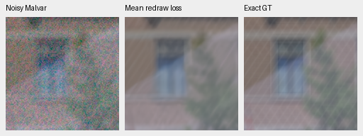
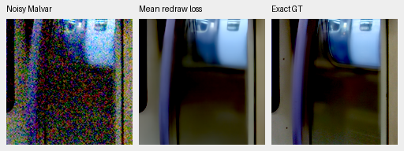

# Training on the mean signed increment across independent redraws

Averaging two signed predictions before computing the pair loss recovers
**3.07 percentage points more natural fine response** and **3.31 points
more weak-wire response** than computing the loss on each draw. On the
same fixed ISO6400 captures it adds **1.97 DN16** of natural fine-increment
error and **0.14 DN16** of natural exact-flat fine RMS. The learned model
needs a single RAW exposure per output. The fine cab crossings remain
incomplete.

[Repeat and gap loss follow-up](local-redraw-stability.md) tests whether
the strongest mean endpoint's extra response can be made more stable.

[Training audit](results/local-redraw-average-v1/training.json) ·
[Frozen training evidence](results/local-redraw-average-v1/training-evidence.tar.xz) ·
[Scoped metrics](results/local-redraw-average-v1/publication.json) ·
[Native provenance](images/local-redraw-average-v1/manifest.json).

## Matched training

Both continuations start from the Local-only 50k EMA
`62f4e9ce84075c8df1a254a1889033b5787133e8c98c63e0ec3d174a94734959`
and update the same full restoration trunk and context projections above
frozen DINO weights. The earlier single-pair experiment supplies the
same 512 source photos, camera recipes, native crop geometry and first
noise seeds. A fresh independent redraw keeps the clean present and
absent targets and the same within-pair coupling law. Each update uses
both pairs, one exact-flat crop and one ordinary crop, for six 256-pixel
observations. Balanced cells span ISO400 and ISO6400, the four Bayer
layouts, natural and wire targets, and both coupling laws.

Both arms minimize the same absolute reconstruction loss over all six
observations. The individual arm averages two robust signed band losses
at weight 0.8. The mean arm uses the same loss and weight on the average
signed increment. Averaging first discounts errors that change sign
between independent noise draws. Exact-flat and true-gap targets still
enter the absolute loss on each draw. The complete paired core stays
valid in 486 of 512 cases. The eight-update qualification confirms
identical initial outputs, fresh noise in the extra RAW pairs and
identical clean targets. All original qualification observations replay
byte for byte when the second draw is omitted.

| Arm | Updates | Native observations | Checkpoint SHA256 |
| --- | ---: | ---: | --- |
| Individual redraw loss | 512 | 3,072 | `b978086a8142550b665c27e09a8504c17523a5517c122c3ea67b0d807f7d935d` |
| Mean redraw loss | 512 | 3,072 | `c9083e7be3ec87e2f9bd2c2d4372cf0bce005d9d46d43b89c50e7af9e9bc272c` |

Both artifacts store separate raw and EMA states. Interleaved BF16
training took **579.49 s** including data and hashing. Evaluation uses
EMA with CUDA IEEE FP32 and processes each restored RAW on its own.
Both fixed measured-camera panels are complete. The identical
mean-redraw EMA scores 37.25003 dB on the fixed 427 photos as the
starting model of the [repeat and gap study](local-redraw-stability.md#fixed-photo-panel).
The individual-redraw EMA's fixed photo result is pending.
[Prior single-pair continuation](local-paired-continuation.md) ·
[Comparable PSNR history](performance-history.md).

## Fixed held-out ISO6400 comparisons

The same exact observations cover 24 natural and 24 planted-wire
backgrounds. Natural RMS pools per-source squared errors. Wire
RMS is the mean over source-level fits. Brackets in the text are
source-bootstrap 95% intervals.

| EMA | Natural fine response | Natural increment RMS, DN16 | Natural fine-flat RMS, DN16 | Wire weak response | Intact-wire RMS, DN16 | Wire gap RMS, DN16 |
| --- | ---: | ---: | ---: | ---: | ---: | ---: |
| V120 | 58.224% | 137.344 | 5.726 | 31.834% | 187.930 | 171.203 |
| Corpus 100k | 58.314% | 137.447 | 5.569 | 32.230% | 187.859 | 169.208 |
| Local-only 50k | 58.010% | 136.335 | 4.489 | 32.377% | 188.074 | 168.488 |
| Single-pair continuation | 58.329% | 135.842 | 4.177 | 24.091% | 173.470 | 163.959 |
| Individual redraw loss | 58.509% | 135.868 | 4.227 | 24.189% | 174.380 | 162.263 |
| Mean redraw loss | 61.583% | 137.842 | 4.367 | 27.504% | 180.782 | 161.795 |

Compared with individual redraw loss, mean-first training raises natural
fine response by 3.074 points [2.557, 3.589], fine increment RMS by
1.974 DN16 [1.349, 2.618] and fine-flat RMS by 0.141 DN16
[0.029, 0.269]. Weak wire response rises 3.315 points [2.769, 3.831].
Wire exact-flat RMS rises 0.504 DN16 [0.388, 0.619]. Error in the
absent weak direction inside true gaps increases 0.357 DN16
[0.177, 0.546]. Total gap RMS changes −0.468 DN16 with an interval
spanning zero. Relative to Local 50k, the mean arm retains lower
intact wire error and lower total gap error. Its weak-wire response
is still 4.873 points below Local 50k.

## Separate three-draw validation

Sixteen separate held-out photos use three complete ISO6400 redraws
per coupling law. Each inference still receives one noisy frame.
The error term shared across redraws is estimated from the mean
cross-product of different-draw errors. The draw-sensitive term is
the sample variance of those errors. Their sum recovers the mean
squared increment error.

| Noise within each pair | Fine response change | Fine-increment RMS change | Shared error change | Draw-sensitive variance change |
| --- | ---: | ---: | ---: | ---: |
| Coupled | +2.371 points | −2.841 DN16 | −610.4 DN16² | +84.2 DN16² |
| Independent | +2.292 points | +2.021 DN16 | −568.6 DN16² | +1,001.7 DN16² |

All changes compare mean-first with the matched individual-loss
control. On independent pairs, the response gain interval is
[1.878, 3.510] points. The shared error falls [−836.0, −328.7]
DN16² and draw-sensitive variance rises [602.1, 1,487.2] DN16².
Fine RMS on the actual present target rises 0.616 DN16.
This distinguishes recovery of the true average increment from the
extra noise in each single-frame prediction.

### Response versus false detail

Fixed camera-RGB mixtures interpolate the two EMA predictions on the
same queries. The readout measures how much extra response and error
come together across the curve. All evaluated strengths increase
both quiet-region and absent-wire error as the share of the mean
endpoint rises.

| Share of mean endpoint | Natural fine response | Natural fine-flat RMS, DN16 | Weak-wire response | Wire flat RMS, DN16 | Weak-band gap RMS, DN16 |
| --- | ---: | ---: | ---: | ---: | ---: |
| 0% | 58.509% | 4.227 | 24.189% | 19.666 | 8.494 |
| 25% | 59.278% | 4.254 | 25.018% | 19.781 | 8.574 |
| 50% | 60.046% | 4.287 | 25.847% | 19.903 | 8.660 |
| 75% | 60.814% | 4.324 | 26.675% | 20.033 | 8.753 |
| 100% | 61.583% | 4.367 | 27.504% | 20.170 | 8.851 |

[Source-bound numeric curve](results/local-redraw-average-v1/dose-evidence.json).

## Fixed photo comparison with Corpus 100k

On the same 427 source photos, mean-redraw EMA scores 37.25003 dB
versus 37.24747 dB for Corpus 100k. The paired mean change is
+0.00255 dB with a 95% source bootstrap interval of
[−0.00919, +0.01354]. Scores rise on 239 photos and fall on 188.
The 5th to 95th percentile of per-source changes spans −0.14890
to +0.15716 dB. Both policies use IEEE FP32 and identical scored
inputs. The mean-redraw collection uses CUDA and the Corpus 100k
collection uses CPU. V120's source means agree within 0.000004 dB
between the two collections.

| Condition | Mean redraw − Corpus 100k sRGB PSNR |
| --- | ---: |
| ISO100 prior | +0.02548 dB |
| ISO1600 prior | +0.02231 dB |
| ISO12800 prior | +0.01779 dB |
| Legacy noise | +0.01853 dB |
| Shadows | +0.02355 dB |
| ADC only | −0.00932 dB |
| Highlights | −0.08045 dB |

The gains at the ISO priors, legacy noise and shadows accompany
a larger highlight regression.
The overall interval spans zero, and the two checkpoints have
different known-camera results and wire behavior. Compared with
Corpus 100k, mean redraw loses 0.18693 dB on known CFA and gains
0.01081 dB on unseen CFA. The scoped wire and native comparisons
provide the separate evidence for detail and artifacts.
[Per-source comparison](results/local-redraw-average-v1/fixed-photo-mean-vs-corpus.json) ·
[Frozen comparison driver](results/local-redraw-average-v1/fixed-photo-mean-vs-corpus-replay.tar.xz).

## Fixed camera panels

The replays cover the same 72 known-camera and 90 unseen-camera
crops on measured CFA pixels. All arms use the canonical Bayer
observations and scoring borders. The new V120 means match the
archived panel means within 0.000002 dB.

| EMA | Known CFA PSNR | Unseen CFA PSNR |
| --- | ---: | ---: |
| V120 | 54.31272 dB | 54.00872 dB |
| Corpus 100k | 54.33708 dB | 53.97826 dB |
| Local-only 50k | 54.22726 dB | 53.97844 dB |
| Single-pair continuation | 54.17481 dB | 54.03148 dB |
| Individual redraw loss | 54.18249 dB | 54.03049 dB |
| Mean redraw loss | 54.15014 dB | 53.98907 dB |

The mean arm loses 0.03235 dB known and 0.04143 dB unseen
relative to its individual-loss control. The paired camera results
are included in the chart, along with the mean-redraw EMA's completed
fixed photo panel.
[Camera evidence](results/local-redraw-average-camera-v1/publication.json) ·
[Per-batch archive](results/local-redraw-average-camera-v1/evidence.tar.xz) ·
[Earlier matched camera panels](scene-50000-cameras.md) ·
[PSNR history](performance-history.md).

## Native exact-target triplets

Each cell contains 160 × 160 native pixels at `[48,48,160,160]` in
the 256-pixel query. All methods use the same ISO6400 profile
`0.00128/6.5536e-6`, capture exposure ×0.33, 16-bit ADC and black
level 0.03. The triplets show noisy Malvar, the mean-loss EMA and
the exact target.

**Wagenberg facade wire fixture**, Renée Kools, CC BY 4.0. The GBRG
query `[128,128,256,256]` is within the constructed field using
source box `[26,6,512,512]`. Display ×2 and contrast ×1. The weak
diagonal remains faint across the facade.
[Source](https://commons.wikimedia.org/wiki/File:Dorpsstraat_41,_Wagenberg_voorkant.jpg) ·
[All methods](images/local-redraw-average-v1/exact/09-wire-iso6400-comparison.png).

**St Pancras railway station**, mattbuck, CC BY-SA 3.0.
BGGR, query `[576,264,256,256]`, display ×3.03 and contrast ×2.
The dark train and bright trim retain their major edges. Fine shape
in the foreground stays soft.
[Source](https://commons.wikimedia.org/wiki/File:St_Pancras_railway_station_MMB_C9_395028.jpg) ·
[All methods](images/local-redraw-average-v1/exact/36-natural-iso6400-comparison.png).

**Dornier Do-27A-4**, Julian Herzog, CC BY 4.0. BGGR,
query `[446,282,256,256]` with the same display. Ground texture
stays soft beside the wheel.
[Source](https://commons.wikimedia.org/wiki/File:Dornier_Do-27A-4_D-EEPN_Hahnweide_2011.jpg) ·
[Native triplet](images/local-redraw-average-v1/exact/33-natural-iso6400-triplet.png).

## Standing GFX100S comparisons

Both redraw EMAs keep a smooth overcast sky and coherent coarse
crossings on DSCF3879 at display ×4. Fine building wires and leaves
remain soft. The mean arm changes the four camera-linear crops by
2.54–16.29 DN16 RGB RMS versus Local 50k. The DSCF3842 cab at display
×16 varies by 3.03–11.97 DN16. Both profiles preserve the rail, with
clearer right diagonals under the transferred profile and incomplete
intersections. Each cab board includes both ISO6400 and ISO100 camera
JPEGs. The separately captured ISO100 AHD and camera JPEGs are
qualitative references.

[Sky](images/local-redraw-average-v1/standing/main-overcast-sky-main-overcast-sky.png) ·
[Building](images/local-redraw-average-v1/standing/main-building-detail-main-building-detail.png) ·
[Foliage](images/local-redraw-average-v1/standing/main-foliage-main-foliage.png) ·
[Coarse fence](images/local-redraw-average-v1/standing/main-chain-link-fence-main-chain-link-fence.png).

| Cab profile | Left native crop | Right native crop |
| --- | --- | --- |
| Nominal `0.00128/6.5536e-6` | [Left](images/local-redraw-average-v1/standing/mesh-nominal-fine-green-mesh-left.png) | [Right](images/local-redraw-average-v1/standing/mesh-nominal-fine-green-mesh-right.png) |
| Transferred `0.0014635775921166604/1.0715704128646712e-6` | [Left](images/local-redraw-average-v1/standing/mesh-profile3879-fine-green-mesh-left.png) | [Right](images/local-redraw-average-v1/standing/mesh-profile3879-fine-green-mesh-right.png) |
