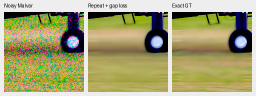
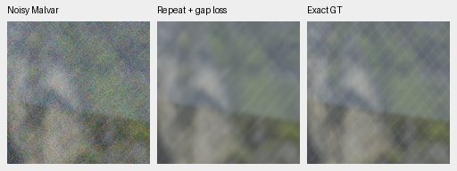

# Repeat and gap losses for weak detail

Penalizing differences across noise redraws lowers ISO6400 natural
fine-increment error by **2.83 DN16** and exact-flat fine RMS by
**0.26 DN16** against the matched mean-loss control. It costs **3.58
points** of natural fine response and **3.36 points** of weak-wire
response. At equal natural response to a mixture of the earlier
redraw models, it still lowers exact-flat fine RMS by **0.28 DN16**.
The added gap loss recovers **0.66 points** of weak-wire response
from repeat alone and reduces total error in the gap. The measured
weak-direction residue inside the gap moves by **+0.05 DN16** with
an interval spanning zero. Fine cab crossings remain incomplete across all three arms.

[Scope and measurements](results/local-redraw-stability-v1/publication.json) ·
[Native provenance](images/local-redraw-stability-v1/manifest.json) ·
[Prior mean-redraw study](local-redraw-average.md).
## Matched training

All three arms start from the 512-update mean-redraw EMA
`c9083e7be3ec87e2f9bd2c2d4372cf0bce005d9d46d43b89c50e7af9e9bc272c`.
They update the full local restoration trunk and context projections.
The DINO encoder stays frozen. The schedule draws 320 distinct photos
from the approved 90,692-photo training manifest. The 320 training and
eight qualification photos are disjoint from the preceding redraw study's
training and qualification schedules. Balanced cells span natural and wire
targets, ISO400 and ISO6400, all four Bayer layouts, and coupled and
independent noise within each pair. Each source supplies two fresh draws
of both the present and absent targets, an exact-flat observation and an
ordinary observation. All arms see the same inputs in the same order.

- **Mean control.** Absolute reconstruction on all six observations, plus
  the 0.8-weighted band loss on the average signed present-minus-absent
  error over both draws.
- **Repeat loss.** Adds a 0.5-weighted band loss on the difference between
  the two signed errors, divided by √2. This term acts on examples with
  independently sampled noise within each present/absent pair.
- **Repeat + gap loss.** Also adds a 0.8-weighted loss on the remaining
  weak-wire phase and quadrature error in the two present draws. The
  projection tapers to zero inside the boundary of the exact planted
  gap. It removes a local plane and the first three harmonics of the
  continuing strong direction. The target is the scene luminance within
  that gap, including the surviving natural background and strong wire.

The paired frequency bands are 1/32–1/8 and 1/8–1/3 cycles per native
pixel. Clean geometry and both redraws enter training only. Each inference
uses one Bayer observation per output with the ordinary local path.
The runs store separate raw and EMA states. The evaluation uses the EMA
weights, channels-last CUDA and IEEE FP32.

| Arm | Updates | Native observations | Checkpoint SHA256 |
| --- | ---: | ---: | --- |
| Mean control | 320 | 1,920 | `d771a3256db49e7d2fdbc98f76e0bc2d6e3a95f103d711a20749f15a1bd4764a` |
| Repeat loss | 320 | 1,920 | `cc5a3cd5d33096f9696d250627d380ecc2f0ed53971da8c2d3f9772550cf9a7a` |
| Repeat + gap loss | 320 | 1,920 | `d9b68e30fea57cfe0e84509688c1326c5f5ce6f5286fe2b6a16e4775a2cba533` |

The interleaved GB10 training loop took 730.85 s with a BF16 neural
forward and FP32 camera arithmetic and losses. That duration includes
data preparation and hashing.
The complete paired core stays valid in 305 of 320 cases. The eight-update
qualification confirms identical first predictions and finite gradients
in every arm. [Training audit](results/local-redraw-stability-v1/training.json) ·
[Source, observations and receipts](results/local-redraw-stability-v1/evidence.tar.xz).

## Fixed exact ISO6400 observations

The unchanged 48-source panel has 24 natural scenes and 24 planted-wire
scenes. Twelve wire scenes contain a complete interruption of the weak
direction in the scoring core. Natural RMS pools per-source squared
errors. Wire RMS averages the per-source measurements.

| EMA | Natural fine response | Natural increment RMS (DN16) | Natural flat fine RMS (DN16) | Weak-wire response | Intact-wire RMS (DN16) | Weak gap RMS (DN16) | Total gap RMS (DN16) |
| --- | ---: | ---: | ---: | ---: | ---: | ---: | ---: |
| V120 | 58.224% | 137.344 | 5.726 | 31.834% | 187.930 | 9.463 | 171.203 |
| Corpus 100k | 58.314% | 137.447 | 5.569 | 32.230% | 187.859 | 9.801 | 169.208 |
| Local 50k | 58.010% | 136.335 | 4.489 | 32.377% | 188.074 | 9.615 | 168.488 |
| Mean parent | 61.583% | 137.842 | 4.367 | 27.504% | 180.782 | 8.851 | 161.795 |
| Mean control | 63.109% | 138.743 | 4.243 | 26.773% | 178.966 | 8.749 | 162.895 |
| Repeat loss | 59.531% | 135.909 | 3.982 | 23.409% | 171.479 | 8.471 | 165.577 |
| Repeat + gap loss | 59.397% | 135.821 | 4.098 | 24.067% | 172.426 | 8.518 | 164.683 |

Compared with the matched mean control, repeat lowers intact-wire RMS
by 7.487 DN16 [−8.862, −6.179] and weak-direction gap RMS by 0.278 DN16
[−0.471, −0.081]. Total gap RMS increases 2.682 DN16 [1.747, 3.656].
Adding the gap loss to repeat reduces that total by 0.894 DN16
[−1.886, −0.170]. It increases intact-wire RMS by 0.947 DN16
[0.646, 1.285], exact-flat wire RMS by 0.792 DN16 [0.605, 0.988]
and natural exact-flat fine RMS by 0.116 DN16 [0.053, 0.188]. The
change in weak-direction gap RMS is +0.047 DN16 [−0.034, +0.137].
The intervals are paired source bootstrap 95% intervals.

At the same mean natural response as a camera-RGB mixture of the
prior individual and mean redraw outputs, repeat lowers exact-flat
fine RMS by 0.282 DN16 [−0.425, −0.146]. Repeat + gap lowers it by
0.160 DN16 [−0.261, −0.067]. The fine-increment RMS differences
for both intervals span zero. Both repeat arms have weaker wire
response than the earlier individually supervised endpoint. The
mixtures cover the old response range and the match is descriptive.
[Source-level matched response](results/local-redraw-stability-v1/matched-response.json).

## Separate three-draw validation

Sixteen additional held-out photos each supply three fresh ISO6400
pairs under each coupling law. Cross-products of errors from distinct
draws estimate the shared error. Within-source sample variance estimates
error that changes with the draw. Each forward still receives one RAW.

| Noise within a pair | Fine response change | Increment RMS change (DN16) | Shared error change (DN16²) | Draw-sensitive variance change (DN16²) |
| --- | ---: | ---: | ---: | ---: |
| Coupled | −2.703 points | +3.629 | +769.1 | −88.4 |
| Independent | −2.630 points | −2.827 | +735.4 | −1,333.9 |

The table compares repeat against the matched mean control. With
independent pairs, draw-sensitive variance falls from 6,599.9 to
5,266.0 DN16², or 20.2%. The difference interval is [−2,019.2, −794.5]
DN16². Shared error increases [410.9, 1,096.6] DN16². Fine RMS on the
present target falls 0.803 DN16 [−1.344, −0.274]. With coupled pairs,
draw-to-draw variance is a smaller share of error and the overall
increment RMS increases. Adding the gap loss changes independent
variance by −8.1 DN16² [−50.7, 32.0] and independent increment RMS by
−0.060 DN16 [−0.149, 0.023].
[Per-source redraw analysis](results/local-redraw-stability-v1/publication.json).

## Native exact-target triplets

Each cell contains the unchanged 160 × 160 pixels at
`[48,48,160,160]` in the 256-pixel query. The triplets show noisy Malvar,
Repeat + gap EMA `d9b68e30…a2cba533`, and the exact target. All methods
use ISO6400 shot/read `0.00128/6.5536e-6`, capture exposure ×0.33,
16-bit ADC and black 0.03. The natural aircraft crop uses display ×3.03
and contrast ×2 around the target's linear color mean. The planted-wire
crop uses display ×2 and ordinary contrast. The comparison boards also
include V120, Corpus 100k, the mean parent and both matched controls.
The four examples are the extrema of the paired changes in natural
fine-increment RMS and weak-direction gap RMS.

The aircraft wheel and cable stay coherent. Subtle grass streaks remain
soft. [Full native comparison](images/local-redraw-stability-v1/exact/33-natural-iso6400-comparison.png).

A weak lattice was planted on the Koh Poda background. The strong
diagonal survives and many weak crossings remain unresolved.
[Full native comparison](images/local-redraw-stability-v1/exact/00-wire-iso6400-comparison.png).

[Stone and lettering](images/local-redraw-stability-v1/exact/27-natural-iso6400-comparison.png) ·
[Wire over chrysanthemum](images/local-redraw-stability-v1/exact/17-wire-iso6400-comparison.png) ·
[Source licenses, coordinates and transforms](images/local-redraw-stability-v1/manifest.json).

## Standing GFX100S comparisons

All eight 160-pixel crop boards were viewed at native scale against the
matched parent and V120. The main DSCF3879/3880 scene uses the established
nominal shot/read `0.00128/6.5536e-6` and display ×4. The sky looks
smooth across arms. The coarse crossings remain coherent. Foliage and
fine building cables stay soft. The cab DSCF3842/3835 scene uses display
×16, both fixed noise profiles and both camera JPEGs. The nominal left
lattice is mostly absent. The transferred profile reveals soft diagonals
on both sides. The right cab has the clearest existing crossings, which
remain incomplete in all outputs. No obvious new false colors or
isolated splotches appeared. The ISO100 AHD and JPEG captures are
qualitative references from a different aperture, exposure and moment.

| Capture and conditioning | Native comparisons |
| --- | --- |
| Main DSCF3879, nominal | [Sky](images/local-redraw-stability-v1/standing/main-overcast-sky-main-overcast-sky.png) · [Building](images/local-redraw-stability-v1/standing/main-building-detail-main-building-detail.png) · [Foliage](images/local-redraw-stability-v1/standing/main-foliage-main-foliage.png) · [Coarse fence](images/local-redraw-stability-v1/standing/main-chain-link-fence-main-chain-link-fence.png) |
| Cab DSCF3842, nominal | [Left](images/local-redraw-stability-v1/standing/mesh-nominal-fine-green-mesh-left.png) · [Right](images/local-redraw-stability-v1/standing/mesh-nominal-fine-green-mesh-right.png) |
| Cab DSCF3842, transferred | [Left](images/local-redraw-stability-v1/standing/mesh-profile3879-fine-green-mesh-left.png) · [Right](images/local-redraw-stability-v1/standing/mesh-profile3879-fine-green-mesh-right.png) |

[Standing main comparison map](gfx-qualitative.md) ·
[Fine cab comparison map](gfx-green-mesh.md) ·
[Capture hashes, ROIs and conditioning](images/local-redraw-stability-v1/manifest.json).

## Fixed camera panels

Both fixed measured-CFA panels are complete. The results balance 72
known-camera crops and 90 unseen-camera crops by capture pair and
scene. All endpoints use the exact same Bayer inputs, scoring borders
and CUDA IEEE FP32 policy. The matched parent reproduces both archived
means exactly. V120 matches the archived values within 0.000002 dB.

| EMA | Known CFA PSNR | Unseen CFA PSNR |
| --- | ---: | ---: |
| V120 | 54.31272 dB | 54.00872 dB |
| Corpus 100k | 54.33708 dB | 53.97826 dB |
| Mean parent | 54.15014 dB | 53.98907 dB |
| Mean control | 54.18081 dB | 53.99807 dB |
| Repeat loss | 54.19868 dB | 54.01346 dB |
| Repeat + gap loss | 54.20259 dB | 54.01114 dB |

Repeat gains 0.04853 dB known and 0.02439 dB unseen over the actual
parent. Relative to the matched continuation control, it gains
0.01787 dB known and 0.01539 dB unseen. It still trails V120 by
0.11404 dB known and leads by 0.00473 dB unseen across these five scenes.
The added gap loss shifts repeat's scores by +0.00391 dB known and
−0.00231 dB unseen. The known camera gap and the faint-wire response
loss hold back a general recommendation.

The canonical 427-photo run is in progress with the same three EMA
hashes listed above. Its measured averages remain pending. The full427
V120 and Corpus 100k references are independently complete. [Camera summary](results/local-redraw-stability-camera-v1/publication.json) ·
[Camera archive](results/local-redraw-stability-camera-v1/evidence.tar.xz) ·
[Comparable PSNR history](performance-history.md) ·
[Corpus references](scene-50000-cameras.md).
