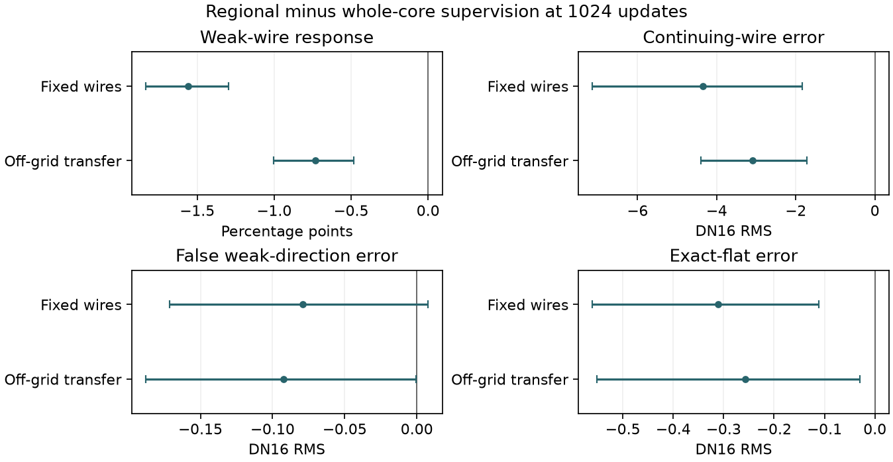
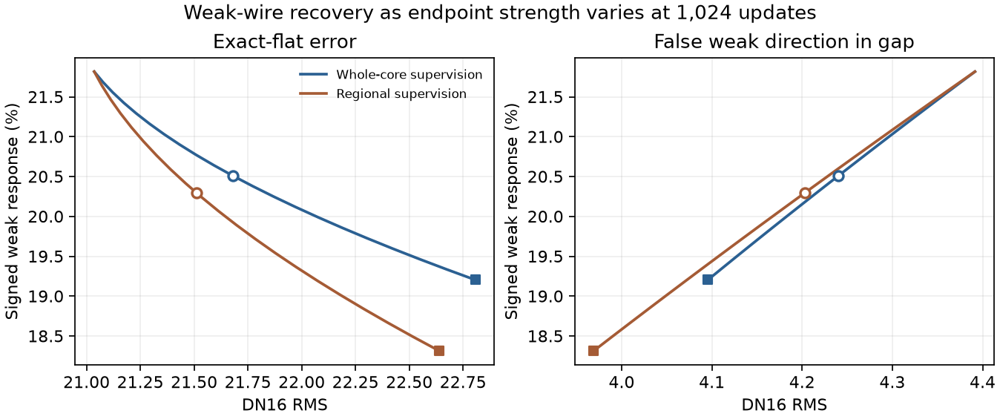
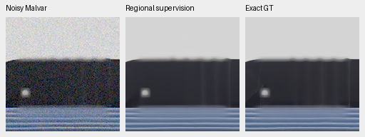
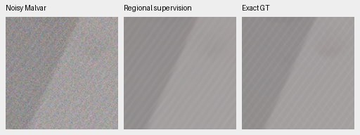

# Completed regional weak-wire training from Local 50k

At 1,024 updates, regional supervision lowers off-grid continuing-strand
error by 3.100 DN16 versus whole-core supervision. Weak response falls
0.733 percentage points. Natural fine-increment error is 0.218 DN16
lower with similar fine response. The GFX cab still has incomplete
crossings. [Training protocol](local-regional-wire.md).

## Final checkpoints

| Model, EMA weights for review | Checkpoint SHA256 |
| --- | --- |
| V120 Small | `a9d9b6b4f974e24a6b11e5e740aab32314233a7f53c056cf37c7d2aac1c589fb` |
| Corpus 100k | `87b96f3c487b9edaf1c477742b6c38f2a82cc6b20a94716d51cc8cf46a17a760` |
| Local 50k parent | `62f4e9ce84075c8df1a254a1889033b5787133e8c98c63e0ec3d174a94734959` |
| Whole-core supervision | `2e0f04c448a28c1a40beafc57bac1fc015c114180eeff75f28ccc7cbbffdd29d` |
| Regional supervision | `bc633b61e30ac5bc708b7249c7885ca0c45591a2155882ba51ead94c97a6f445` |

Experiment `local-regional-wire-v1` used the same 1,024 distinct photos and
6,144 native observations per arm. The 512 planted-wire groups include
400 continuing strong wires and 112 double gaps. The remaining 512 groups
are natural. The trainer records 2,820.76 s wall time for the interleaved
arms, including preparation, checkpoints and hashes. Both raw and EMA
tensors and the AdamW states are finite, the frozen DINO checksum
matches, and all logged updates match the complete source schedule.
All 32 cases in the separate gradient audit now match the observed
training trace. [Matched training and frozen recipe](local-regional-wire.md) ·
[Gradient audit](local-regional-wire-gradient-audit.md).

Image review uses the existing local path on a single noisy Bayer
observation in CUDA IEEE FP32. Local 50k reuses 86 verified inputs
and matching saved EMA outputs. V120 and Corpus 100k use the frozen
reference outputs. No inference-time supervision or blend is part of
the trained endpoints.

## Fixed exact panels

The 24 natural photos and 24 exact wire fields match the saved
128- and 512-update reviews. The table gives source means and 95%
intervals from 8,000 paired source resamples. RMS is in DN16.

| Panel and measure | Local 50k | Whole core | Regional | Regional − whole core (95% CI) |
| --- | ---: | ---: | ---: | ---: |
| Natural fine response (%) | 58.010 | 58.294 | 58.288 | −0.005 [−0.101, +0.087] pts |
| Natural fine-increment RMS | 116.278 | 116.124 | 115.906 | −0.218 [−0.339, −0.104] |
| Natural fine exact-flat RMS | 4.181 | 3.959 | 3.918 | −0.041 [−0.062, −0.019] |
| Wire weak response (%) | 32.377 | 31.869 | 30.310 | −1.559 [−1.835, −1.298] pts |
| Wire intact-increment RMS | 188.074 | 186.819 | 188.195 | +1.376 [+0.689, +2.131] |
| Wire continuing strong RMS through gap | 97.064 | 84.669 | 80.320 | −4.349 [−7.139, −1.836] |
| Wire false weak-direction RMS in gap | 9.615 | 8.895 | 8.816 | −0.079 [−0.171, +0.008] |
| Wire exact-flat RMS | 20.490 | 23.652 | 23.341 | −0.311 [−0.560, −0.111] |

Compared with Local 50k, the regional model gains 0.278 natural
fine-response points, lowers fine-increment RMS by 0.372 DN16 and
lowers natural fine-flat RMS by 0.262 DN16. On wires it loses 2.066
points of weak response and adds 2.851 DN16 of flat RMS. Compared with
the [512-update checkpoint](local-regional-wire-512.md), both arms
end with slightly higher error on the continuing direction. Their
difference widens as regional supervision gives up more weak response.

V120 and Corpus 100k give 58.224% and 58.314% response and 117.370
and 117.267 DN16 fine-increment RMS on the natural panel. They give
31.834% and 32.230% fixed-wire weak response, with 100.079 and 96.274 DN16
continuing-wire RMS. The regional checkpoint retains natural fine response
near both references, with less of the weak direction on wires.

## Off-grid wire transfer

The frozen 32-source replay uses continuous off-grid frequencies.
The two gap measures use the 16 fields with a true weak gap.

| Measure | V120 | Corpus 100k | Local 50k | Whole core | Regional | Regional − whole core (95% CI) |
| --- | ---: | ---: | ---: | ---: | ---: | ---: |
| Fundamental response (%) | 20.459 | 21.706 | 22.437 | 19.236 | 18.504 | −0.733 [−1.006, −0.483] pts |
| Continuing strong RMS | 83.471 | 78.197 | 78.225 | 68.243 | 65.143 | −3.100 [−4.396, −1.728] |
| False weak-direction RMS | 4.664 | 4.751 | 4.776 | 4.449 | 4.357 | −0.092 [−0.188, −0.0007] |
| Exact-flat RMS | 24.154 | 22.965 | 21.437 | 23.759 | 23.502 | −0.258 [−0.552, −0.030] |

On the 16 lowest planted amplitudes, the regional arm loses 0.668
weak-response points versus whole core. Continuing-strand error in the
nine weak gaps in this half falls 2.651 DN16. The false-direction
error interval spans zero in that subgroup. Relative to Local 50k
on all 32 sources, regional retains 3.934 points less weak response,
with 13.083 DN16 lower continuing-strand error and 2.065 DN16 higher
wire-flat error.

### Response versus false detail

A separate diagnostic interpolates each endpoint with Local 50k in
linear camera RGB. The two blend strengths were selected to have equal
signed weak response on 16 calibration sources and then applied to the
other 16, with eight true gaps in each half. The strengths are 0.500
for whole core and 0.434 for regional, for 21.163% response on calibration.

On the reserve, response still differs by −0.213 points
[−0.393, −0.059] for regional minus whole core. Flat RMS is lower by
0.170 DN16 [−0.293, −0.059]. On the eight gaps, the intervals for
the false weak direction (−0.037 DN16) and continuing strand
(−0.972 DN16) span zero. The reduced-strength replay therefore
does not establish a gap-error gain at the same held-out weak
response. The curves below use the reserved sources, with response
and flat error on all 16 and false projection on eight. Squares
mark the trained endpoints and open circles the strengths fixed
on calibration. A blend requires both forwards.

## Native exact comparisons

Each column uses the same 160 × 160 native pixels from local
`(48,48,160,160)` of the 256-pixel query. Columns are noisy Malvar,
regional EMA and exact clean target. White balance, camera matrix
and ×2 display exposure match across methods. Conditioning uses the
fixed ISO6400 prior with shot 0.00128, read variance 6.5536e−6 and
normalized exposure metadata 0.33. The simulated observation uses a
fixed 16-bit Bayer draw. The four cases show the tails of the
regional-minus-whole-core differences.

Crisco 1492's Mach3 cartridge, RGGB, bin-four source box
`(232,28,256,256)`. Regional fine-increment RMS falls 1.013 DN16
versus whole core. The shallow grooves remain soft in both arms.
The crops adapt the source through binning, simulated sensor noise,
cropping and rendering and use CC BY-SA 4.0.
[Original via Wikimedia Commons](https://commons.wikimedia.org/wiki/File:Cartridge_for_Gillette_Mach3_razor,_2015-08-03.jpg) · [License](https://creativecommons.org/licenses/by-sa/4.0) · [All-model board](images/local-regional-wire-v1/step-1024/exact/photo-29-comparison.png).

The planted-wire camera crop adapts Tobias “ToMar” Maier's rear view
of the Concord Eye-Q 1M. It uses GBRG, bin-four
source box `(180,4,512,512)` and fixture window `(128,128,256,256)`.
Regional false weak-direction error falls 0.349 DN16. Most faint
crossings are still missing in the restored crop. The adaptations use
CC BY-SA 3.0 and add planted lines and simulated noise to the rendered
source crop. [Original via Wikimedia Commons](https://commons.wikimedia.org/wiki/File:Concord_Eye-Q_1M_Camera_rear_view.jpg) · [License](https://creativecommons.org/licenses/by-sa/3.0) · [All-model board](images/local-regional-wire-v1/step-1024/exact/wire-12-comparison.png).

- Petar Milošević's Michelin Lithion 2 crop uses RGGB and bin-four
  box `(370,552,256,256)`. The thin lines below the red edge remain
  subdued. Regional fine-increment RMS rises 0.194 DN16. Cropping,
  binning, noise and rendering produce the CC BY-SA 4.0 adaptation.
  [Original](https://commons.wikimedia.org/wiki/File:Michelin_Lithion_2.jpg) · [License](https://creativecommons.org/licenses/by-sa/4.0) · [Triplet](images/local-regional-wire-v1/step-1024/exact/photo-42-triplet.png) · [All-model board](images/local-regional-wire-v1/step-1024/exact/photo-42-comparison.png).
- Aparajita Datta's minivet supplies the background for the planted
  GRBG wire scene. Bin-four source box `(86,100,512,512)` and fixture
  window `(128,128,256,256)`. The strong diagonal is visible on dark
  plumage, with missing fine crossings. Regional false projection
  rises 0.177 DN16. The crops add planted wires and simulated noise
  and use CC BY-SA 4.0. [Original](https://commons.wikimedia.org/wiki/File:Swinhoe%27s_minivet2.jpg) · [License](https://creativecommons.org/licenses/by-sa/4.0) · [Triplet](images/local-regional-wire-v1/step-1024/exact/wire-08-triplet.png) · [All-model board](images/local-regional-wire-v1/step-1024/exact/wire-08-comparison.png).

## Standing GFX100S comparisons

On the DSCF3879 ISO6400 capture, both arms keep the overcast sky
smooth and the coarse chain-link crossings connected. The bright
green speck is visible on Local 50k and both endpoints. Building
cables and leaf divisions remain soft. Regional changes versus
Local 50k are 3.90 DN16 RGB RMS in sky, 8.98 in building, 12.71
in foliage and 19.03 on the coarse fence. The four crops use
512-pixel contexts, the input white balance and matrix,
shot/read `0.00128 / 6.5536e-6` and display ×4. The separate
DSCF3880 ISO100 AHD rendering supplies the qualitative reference.
[Sky](images/local-regional-wire-v1/step-1024/standing/main-overcast-sky-main-overcast-sky-x4.png) · [Building](images/local-regional-wire-v1/step-1024/standing/main-building-detail-main-building-detail-x4.png) · [Foliage](images/local-regional-wire-v1/step-1024/standing/main-foliage-main-foliage-x4.png) · [Coarse fence](images/local-regional-wire-v1/step-1024/standing/main-chain-link-fence-main-chain-link-fence-x4.png).

Both DSCF3842 cab ROIs use 768-pixel contexts and the nominal
profile above or transferred DSCF3879 shot/read
`0.0014635775921166604 / 1.0715704128646712e-6`.
All boards were viewed with the independently demosaiced DSCF3835
ISO100 reference and both camera JPEGs. The real references have
aperture, exposure time and motion differences and are qualitative.

| Native cab ROI | Nominal | Transferred DSCF3879 |
| --- | --- | --- |
| Left `(806,6489,160,160)` | [×4](images/local-regional-wire-v1/step-1024/standing/mesh-nominal-fine-green-mesh-left-x4.png) · [×16](images/local-regional-wire-v1/step-1024/standing/mesh-nominal-fine-green-mesh-left-x16.png) | [×4](images/local-regional-wire-v1/step-1024/standing/mesh-profile3879-fine-green-mesh-left-x4.png) · [×16](images/local-regional-wire-v1/step-1024/standing/mesh-profile3879-fine-green-mesh-left-x16.png) |
| Right `(1026,6449,160,160)` | [×4](images/local-regional-wire-v1/step-1024/standing/mesh-nominal-fine-green-mesh-right-x4.png) · [×16](images/local-regional-wire-v1/step-1024/standing/mesh-nominal-fine-green-mesh-right-x16.png) | [×4](images/local-regional-wire-v1/step-1024/standing/mesh-profile3879-fine-green-mesh-right-x4.png) · [×16](images/local-regional-wire-v1/step-1024/standing/mesh-profile3879-fine-green-mesh-right-x16.png) |

The nominal crops remain soft. With the transferred profile, both
arms strengthen the diagonals and broad bands. The right regional
crop emphasizes the stronger direction and still has muted
crossings and broad green-gray mottling at ×16. Its two signed
projections relative to the noisy RAW are 81.75% and 34.63%, versus
78.06% and 37.57% for whole core and 55.51% and 36.54% for Local 50k.
The measured RAW can contain coherent noise. Both nominal crops
change by 5.92–7.82 DN16 RGB RMS, and the transferred crops change
by 9.95–15.21 versus Local 50k.

## Fixed camera panels

The known and unseen measured CFA panels cover 72 and 90 crops,
respectively. The endpoint replay uses the frozen Bayer inputs,
canonical scoring borders and CUDA IEEE FP32. V120, Corpus 100k and
Local 50k camera score receipts were reused after matching checkpoint, input
and test policy. The canonical qualification reran eight batches.

| EMA | Known CFA PSNR | Unseen CFA PSNR |
| --- | ---: | ---: |
| V120 | 54.31272 dB | 54.00872 dB |
| Corpus 100k | 54.33708 dB | 53.97826 dB |
| Local 50k | 54.22726 dB | 53.97844 dB |
| Whole core | 54.22741 dB | 53.99124 dB |
| Regional | 54.22037 dB | 53.99397 dB |

Regional versus whole core changes the scene-balanced means by
−0.00705 dB known and +0.00274 dB unseen. Relative to Local 50k
the changes are −0.00689 dB known and +0.01553 dB unseen.
V120 remains above both on these panels. There are five unseen scenes.
The replay took 242.21 s wall with concurrent inference running.
[Camera summary](results/local-regional-wire-camera-v1/publication.json) ·
[Per-case camera evidence](results/local-regional-wire-camera-v1/evidence.tar.xz).

## Review status and evidence

Training, scoped numerical scoring, native inspection and both fixed
camera panels are complete.
The scoped review took 215.04 seconds wall across all inputs and rendering
under concurrent GPU work. The full 427-photo collection is running on
both final EMA checkpoints identified above. That panel has no result
for either arm yet.
[Comparable PSNR history](performance-history.md).

[Native provenance](images/local-regional-wire-v1/step-1024/manifest.json) ·
[Machine receipt](results/local-regional-wire-v1/review-1024.json) ·
[Frozen training and evaluation evidence](results/local-regional-wire-v1/review-1024-evidence.tar.xz).
