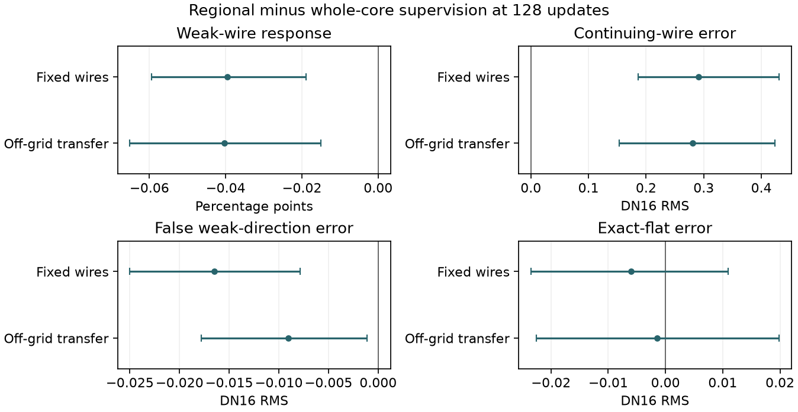
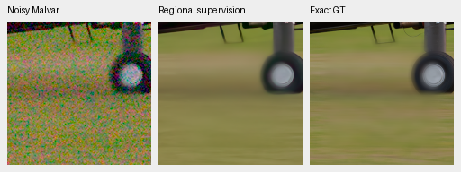
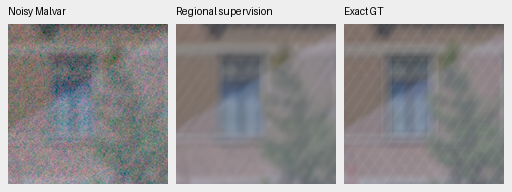

# Regional weak-wire training at 128 updates

The first matched Local 50k continuation checkpoints lower flat and
paired-increment error on the fixed natural panel. Both also retain
less target-aligned fine contrast. Localizing weak-direction supervision
makes a small further reduction in error and loses a little more contrast.
The 128-update pair is an intermediate checkpoint from the ongoing
1,024-update matched run. [Training protocol](local-regional-wire.md).

## Checkpoints and evaluation

| EMA weights evaluated | Checkpoint SHA256 |
| --- | --- |
| V120 Small | `a9d9b6b4f974e24a6b11e5e740aab32314233a7f53c056cf37c7d2aac1c589fb` |
| Corpus 100k | `87b96f3c487b9edaf1c477742b6c38f2a82cc6b20a94716d51cc8cf46a17a760` |
| Local 50k parent | `62f4e9ce84075c8df1a254a1889033b5787133e8c98c63e0ec3d174a94734959` |
| Whole-core supervision | `76ff2c1d981a9680ef6a1216bf750fb9bcaa28c628ee048b29c8bb272a572174` |
| Regional supervision | `079b96e25e65a79dcccec9f9f87a574d2b012bfea527f7c93c9826cfb299d67c` |

Experiment `local-regional-wire-v1` starts both full-trunk arms from the
same parent. The saved prefix uses 128 distinct photos per arm, with
71 natural groups, 39 continuing-strong wire groups and 18 double-gap
wire groups. Both arms saw the same 768 native observations. Training
logged 402.25 s wall elapsed at update 128 for the two interleaved arms.
Both raw and EMA weights and the AdamW state at step 128 were verified.
The review uses EMA weights and the local CUDA IEEE FP32 evaluation path
with one noisy Bayer observation at a time. The native review ran for
568.20 s wall across all cases and models under concurrent training.
Frozen V120 EMA and Corpus 100k outputs use the matching input and
profile. [Launch receipt](results/local-regional-wire-v1/launch.json).

## Fixed exact panels

These are per-photo means on 24 natural sources and 24 planted-wire
backgrounds. The confidence intervals use 8,000 paired resamples over
photos. Response is the target-aligned signed fraction returned by the
model. RMS is in 16-bit units. Lower RMS can result from attenuation,
so the response and the continuing stronger direction are scored
alongside each false-detail measure.

| Panel and measure | Local 50k | Whole core | Regional | Regional − whole core (95% CI) |
| --- | ---: | ---: | ---: | ---: |
| Natural fine response (%) | 58.010 | 57.558 | 57.516 | −0.042 [−0.064, −0.020] pts |
| Natural fine-increment RMS | 116.278 | 116.020 | 115.989 | −0.031 [−0.061, −0.010] |
| Natural fine exact-flat RMS | 4.181 | 3.976 | 3.959 | −0.017 [−0.028, −0.008] |
| Wire weak response (%) | 32.377 | 31.161 | 31.122 | −0.040 [−0.059, −0.019] pts |
| Wire intact RMS | 188.074 | 187.442 | 187.249 | −0.192 [−0.240, −0.148] |
| Wire continuing strong RMS through gap | 97.064 | 97.313 | 97.604 | +0.291 [+0.186, +0.431] |
| Wire false weak-direction RMS in gap | 9.615 | 9.358 | 9.342 | −0.016 [−0.025, −0.008] |
| Wire exact-flat RMS | 20.490 | 20.118 | 20.112 | −0.006 [−0.023, +0.011] |

On the fixed wire panel, the regional term lowers intact and false
weak-direction error slightly relative to whole-core supervision.
The continuing direction through a true weak gap suffers, and the
weak strand that is present has slightly lower signed response.
The exact-flat wire panel does not resolve a regional effect.

V120 Small and Corpus 100k retain 58.224% and 58.314% fine response
on the natural panel, with 117.370 and 117.267 DN16 fine-increment RMS.
Their fixed-wire weak responses are 31.834% and 32.230%. The regional
arm trades lower natural error for weaker response on both panels.

## Off-grid wire transfer

On 32 held-out photographs, the wire fixtures use continuous frequencies
and both uninterrupted fields and true weak gaps. Response and flat error
use all 32 sources. The gap metrics use the 16 true gaps. Gaps are
scored against the known target, including the continuing stronger strand.

| Measure | V120 | Corpus 100k | Local 50k | Whole core | Regional | Regional − whole core (95% CI) |
| --- | ---: | ---: | ---: | ---: | ---: | ---: |
| Fundamental response (%) | 20.459 | 21.706 | 22.437 | 21.529 | 21.488 | −0.040 [−0.065, −0.015] pts |
| Continuing strong RMS | 83.471 | 78.197 | 78.225 | 77.921 | 78.201 | +0.280 [+0.154, +0.424] |
| False weak-direction RMS | 4.664 | 4.751 | 4.776 | 4.644 | 4.635 | −0.009 [−0.018, −0.001] |
| Exact-flat RMS | 24.154 | 22.965 | 21.437 | 21.204 | 21.202 | −0.002 [−0.023, +0.020] |

For the 16 lowest planted weak amplitudes, regional response falls by
0.040 points relative to whole-core supervision. The nine available gaps
in that half add 0.372 DN16 continuing-strand RMS. The false-direction
change is −0.008 DN16 with an interval spanning zero. The full off-grid
set repeats the fixed-wire tradeoff. Against Local 50k, both continuations
recover less weak contrast and lower flat error.

## Native exact comparisons

Each column is a native 160 × 160 model-grid crop. Left to right are
noisy Malvar, regional EMA, and exact clean target. The two illustrated
cases were selected by the largest error decrease and increase per panel
against whole-core supervision. The all-model boards show both tails.
The simulated Bayer draw uses its source's fixed camera and noise seed.
All methods share the ISO6400 conditioning prior (shot 0.00128,
read variance 6.5536e−6, normalized exposure metadata 0.33), fixed
white balance and matrix for that draw, and ×2 display exposure.

The aircraft crop uses the bin-four source box `(446,282,256,256)`
and local `(48,48,160,160)` ROI. The panels adapt Julian Herzog's
photograph with simulated sensor noise, a color transform and cropping.
[Original via Wikimedia Commons](https://commons.wikimedia.org/wiki/File:Dornier_Do-27A-4_D-EEPN_Hahnweide_2011.jpg) · [CC BY 4.0](https://creativecommons.org/licenses/by/4.0) · [All-model board](images/local-regional-wire-v1/step-0128/exact/photo-33-comparison.png).

The planted wire crop uses the bin-four source box `(26,6,512,512)`,
the `(128,128,256,256)` fixture window and its local
`(48,48,160,160)` ROI. The evaluation adapts the background
with planted strands, simulated Bayer noise and a color transform.
Image by Renée Kools via Wikimedia Commons,
[CC BY 4.0](https://creativecommons.org/licenses/by/4.0).
[Original photograph](https://commons.wikimedia.org/wiki/File:Dorpsstraat_41,_Wagenberg_voorkant.jpg) · [All-model board](images/local-regional-wire-v1/step-0128/exact/wire-09-comparison.png).

- The statue crop adapts Daniel Schwen's photograph by binning, cropping,
  simulation and rendering. The derived crops are CC BY-SA 4.0.
  [Original via Wikimedia Commons](https://commons.wikimedia.org/wiki/File:Hermannsdenkmal_statue.jpg) · [License](https://creativecommons.org/licenses/by-sa/4.0) · [Triplet](images/local-regional-wire-v1/step-0128/exact/photo-47-triplet.png) · [All-model board](images/local-regional-wire-v1/step-0128/exact/photo-47-comparison.png).
- The handball crop adapts Steffen Prößdorf's photograph by binning,
  planting wires, cropping, simulation and rendering. The derived
  crops are CC BY-SA 4.0. [Original via Wikimedia Commons](https://commons.wikimedia.org/wiki/File:2023-04-02_Handball_Frauen,_Final4_2023,_Finale,_SG_BBM_Bietigheim_-_HSG_Bensheim-Auerbach_1DX_9144_by_Stepro.jpg) · [License](https://creativecommons.org/licenses/by-sa/4.0) · [Triplet](images/local-regional-wire-v1/step-0128/exact/wire-21-triplet.png) · [All-model board](images/local-regional-wire-v1/step-0128/exact/wire-21-comparison.png).

Both exact wire boards retain some of the strong diagonal and miss
many fine crossings. The aircraft wheel contour is coherent, with
less fine texture on the grass. The statue's fine surface marks are
softer across the restorations. The crop-level differences between
the two trained arms are subtle in all four boards.

## Standing GFX100S comparisons

The DSCF3879 ISO6400 input and separate DSCF3880 ISO100 AHD reference
use the standing main-scene coordinates. The native 160-pixel crops
use 512-pixel contexts, the nominal shot/read variance
`0.00128 / 6.5536e-6`, the input camera's white balance and matrix,
and ×4 display exposure. Both arms keep the sky smooth and preserve
most coarse chain-link crossings. The fine building cables and leaves
remain soft. A bright green fence speck is visible with the parent
and both trained models. The regional arm changes the sky by
0.55 DN16 RGB RMS and the fence by 2.44 DN16 versus Local 50k.
[Sky](images/local-regional-wire-v1/step-0128/standing/main-overcast-sky-main-overcast-sky-x4.png) · [Fence](images/local-regional-wire-v1/step-0128/standing/main-chain-link-fence-main-chain-link-fence-x4.png) · [Foliage](images/local-regional-wire-v1/step-0128/standing/main-foliage-main-foliage-x4.png) · [Building](images/local-regional-wire-v1/step-0128/standing/main-building-detail-main-building-detail-x4.png).

The DSCF3842 ISO6400 cab crops use 768-pixel contexts and both the
nominal prior above and the transferred DSCF3879 profile
`0.0014635775921166604 / 1.0715704128646712e-6`. The native
displays use ×4 or ×16 with the existing reference-specific rendering.
Each includes the separate DSCF3835 ISO100 AHD reference and both
camera JPEGs. Both ISO100 references are independent qualitative
captures with aperture, exposure time and subject differences.

| Cab ROI | Nominal | Transferred DSCF3879 |
| --- | --- | --- |
| Left `(806,6489,160,160)` | [×4](images/local-regional-wire-v1/step-0128/standing/mesh-nominal-fine-green-mesh-left-x4.png) · [×16](images/local-regional-wire-v1/step-0128/standing/mesh-nominal-fine-green-mesh-left-x16.png) | [×4](images/local-regional-wire-v1/step-0128/standing/mesh-profile3879-fine-green-mesh-left-x4.png) · [×16](images/local-regional-wire-v1/step-0128/standing/mesh-profile3879-fine-green-mesh-left-x16.png) |
| Right `(1026,6449,160,160)` | [×4](images/local-regional-wire-v1/step-0128/standing/mesh-nominal-fine-green-mesh-right-x4.png) · [×16](images/local-regional-wire-v1/step-0128/standing/mesh-nominal-fine-green-mesh-right-x16.png) | [×4](images/local-regional-wire-v1/step-0128/standing/mesh-profile3879-fine-green-mesh-right-x4.png) · [×16](images/local-regional-wire-v1/step-0128/standing/mesh-profile3879-fine-green-mesh-right-x16.png) |

The nominal left mostly shows a support bar and soft bands. The
transferred right shows the clearest diagonals and incomplete fine
crossings. Broad dark and colored patches are already visible in
the parent and remain similar in both arms. Neither cab crop
shows a clear new connected lattice.

The regional arm changes the cab crops by 0.74–1.50 DN16 RGB RMS
versus Local 50k. In the transferred right crop the signed projection
on the two established noisy RAW peaks changes from 55.51% and
36.54% of input to 56.74% and 35.08%. Whole-core gives 56.56%
and 35.02%. Those measurements describe agreement with the noisy
input, which can include noise. The two arms also retain less of both
nominal right peaks than Local 50k.

## Review status and evidence

The matched 128-update checkpoint review is complete on the scoped
exact and off-grid panels and both standing GFX scenes. The 1,024-update
endpoint is still training. The fixed 427-photo and known/unseen camera
evaluations are reserved for the endpoints and have no score for this pair.
[PSNR history](performance-history.md).

[Native manifest](images/local-regional-wire-v1/step-0128/manifest.json) ·
[Machine receipt](results/local-regional-wire-v1/review-0128.json) ·
[Frozen evidence and scripts](results/local-regional-wire-v1/review-0128-evidence.tar.xz).
