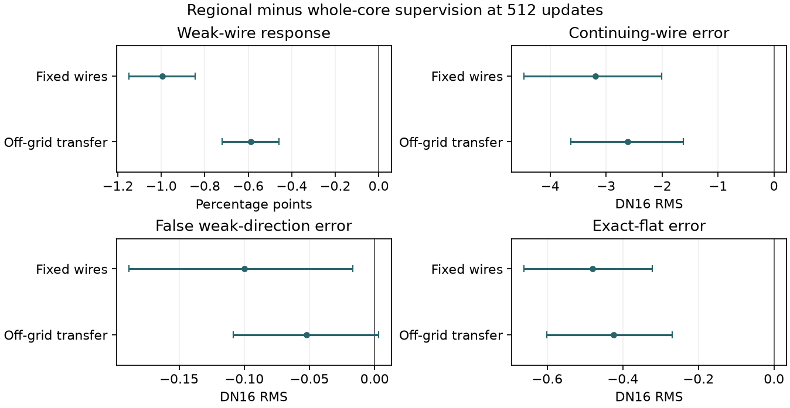
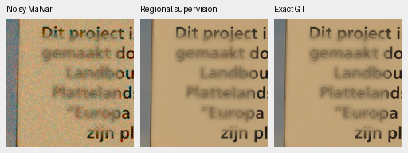
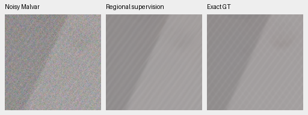

# Regional weak-wire training at 512 updates

At the midpoint of the matched Local 50k continuation, regional
supervision lowers error on the stronger strand that continues through
a weak gap. It also returns less of the weak strand where it is
present. The natural-photo panel shows slightly better fine response
and quieter flats than whole-core supervision.
[Matched recipe](local-regional-wire.md) · [128-update review](local-regional-wire-128.md).

## Checkpoints and evaluation

| Model, EMA weights | Checkpoint SHA256 |
| --- | --- |
| V120 Small | `a9d9b6b4f974e24a6b11e5e740aab32314233a7f53c056cf37c7d2aac1c589fb` |
| Corpus 100k | `87b96f3c487b9edaf1c477742b6c38f2a82cc6b20a94716d51cc8cf46a17a760` |
| Local 50k parent | `62f4e9ce84075c8df1a254a1889033b5787133e8c98c63e0ec3d174a94734959` |
| Whole-core supervision | `54bdb1d0ac91182af672edcf5772a5e3773493eb9decba5add208df3db75b055` |
| Regional supervision | `b7612259677b61a62edc461bc3a144568e372c6671130a052839dc7a1bee954e` |

Both arms of `local-regional-wire-v1` saw 512 distinct photos and
3,072 native observations each. The prefix includes 253 natural crops
and 259 planted-wire backgrounds, including 201 true strong continuations
and 58 double gaps. The interleaved training log records 1,738.87 seconds
at the 512th update. Raw weights, EMA and both AdamW states passed
the checkpoint checks. The image review uses EMA and the existing
local CUDA IEEE FP32 path on one Bayer observation at a time.
The verified Local 50k predictions are reused for the identical 86
inputs and conditioning settings. V120 and Corpus 100k also use the
frozen matching outputs.

## Fixed exact panels

The 24 natural and 24 wire cases match the 128-update review. The
metrics are means over source photos. Intervals resample paired
differences over sources 8,000 times. RMS values are in DN16.

| Panel and measure | Local 50k | Whole core | Regional | Regional − whole core (95% CI) |
| --- | ---: | ---: | ---: | ---: |
| Natural fine response (%) | 58.010 | 57.983 | 58.098 | +0.114 [+0.021, +0.222] pts |
| Natural fine-increment RMS | 116.278 | 116.054 | 116.002 | −0.052 [−0.122, +0.013] |
| Natural fine exact-flat RMS | 4.181 | 4.061 | 3.982 | −0.079 [−0.111, −0.051] |
| Wire weak response (%) | 32.377 | 31.549 | 30.554 | −0.995 [−1.149, −0.845] pts |
| Wire continuing strong RMS through gap | 97.064 | 82.222 | 79.029 | −3.193 [−4.465, −2.009] |
| Wire false weak-direction RMS in gap | 9.615 | 9.131 | 9.031 | −0.100 [−0.189, −0.017] |
| Wire exact-flat RMS | 20.490 | 23.443 | 22.962 | −0.481 [−0.661, −0.322] |

At 128 updates, both arms had weaker natural response and slightly
higher error on the continuing strong direction than Local 50k.
By 512 updates the regional arm recovers slightly more natural
fine response than that parent and substantially lowers the
continuing-direction error. Wire exact-flat variation rises
by 2.472 DN16 above Local 50k. Quietness on the exact-flat wire
controls and detail on the natural panel move independently.
The fixed-wire response deficit grows from 0.040 to 0.995 points
against whole-core supervision.

V120 and Corpus 100k retain 58.224% and 58.314% natural fine
response and have 117.370 and 117.267 DN16 fine-increment RMS.
They retain 31.834% and 32.230% fixed-wire weak response, with
100.079 and 96.274 DN16 continuing-wire RMS. The regional
checkpoint trades less weak-wire detail for a more accurate
strong direction, and keeps natural fine response close to V120.

## Off-grid wire transfer

The same independent 32-source panel uses continuous spatial
frequencies. Response and flat error use all 32 sources. Gap
metrics use the 16 fields with a true weak gap.

| Measure | V120 | Corpus 100k | Local 50k | Whole core | Regional | Regional − whole core (95% CI) |
| --- | ---: | ---: | ---: | ---: | ---: | ---: |
| Fundamental response (%) | 20.459 | 21.706 | 22.437 | 20.209 | 19.622 | −0.588 [−0.721, −0.459] pts |
| Continuing strong RMS | 83.471 | 78.197 | 78.225 | 66.416 | 63.802 | −2.614 [−3.635, −1.624] |
| False weak-direction RMS | 4.664 | 4.751 | 4.776 | 4.490 | 4.438 | −0.052 [−0.109, +0.003] |
| Exact-flat RMS | 24.154 | 22.965 | 21.437 | 23.765 | 23.339 | −0.425 [−0.600, −0.269] |

Against Local 50k, regional supervision lowers continuing-wire
RMS by 14.424 DN16 and false weak-direction RMS by 0.338 DN16.
It also loses 2.816 points of weak response and raises exact-flat
RMS by 1.902 DN16. On the 16 lowest planted amplitudes, the weak
response is 0.531 points below whole core. In the nine gaps
in that half, the stronger strand's error falls 2.307 DN16 and the
false-direction interval spans zero. The tradeoff persists on the
weakest test cases.

## Native exact comparisons

The crops below show noisy Malvar, regional EMA and the exact clean
target at native 160 × 160 pixels. Every column uses local
`(48,48,160,160)` in its 256-pixel query, the same white balance and
matrix and display ×2. The simulated input uses a fixed 16-bit Bayer
draw. Model conditioning is the fixed ISO6400 prior of shot 0.00128
and read variance 6.5536e−6 with normalized exposure metadata 0.33.
Cases show the tails of the regional-minus-whole-core error on each
panel. Each crop adapts its source through binning, cropping and
simulated Bayer rendering. Wire scenes also add planted crossings.

Dominicus Johannes Bergsma's information board at Oostvaardersplassen,
RGGB, bin-four source box `(134,200,256,256)`. Regional fine-increment
error drops 0.501 DN16 versus whole core. Thin letters near the center
stay soft in both. The crop adaptations are under CC BY-SA 4.0.
[Original via Wikimedia Commons](https://commons.wikimedia.org/wiki/File:Informatiebord._Locatie,_Oostvaardersplassen_01.jpg) · [License](https://creativecommons.org/licenses/by-sa/4.0) · [All-model board](images/local-regional-wire-v1/step-0512/exact/photo-45-comparison.png).

Tobias “ToMar” Maier's rear view of the Concord Eye-Q 1M, GBRG,
bin-four source box `(180,4,512,512)` and fixture window
`(128,128,256,256)`. Regional false weak-direction error drops
0.381 DN16 versus whole core. The stronger diagonal remains visible
across the gap and the faint crossings are hard to see. The
crop adaptations are under CC BY-SA 3.0.
[Original via Wikimedia Commons](https://commons.wikimedia.org/wiki/File:Concord_Eye-Q_1M_Camera_rear_view.jpg) · [License](https://creativecommons.org/licenses/by-sa/3.0) · [All-model board](images/local-regional-wire-v1/step-0512/exact/wire-12-comparison.png).

- The stone crop from Sumitsurai is GRBG with bin-four source box
  `(16,468,256,256)`. Regional fine-increment error rises 0.300 DN16.
  Subtle stone texture remains soft. The crop adaptations are under
  CC BY-SA 3.0. [Original photograph](https://commons.wikimedia.org/wiki/File:Para_Stone_Deul_Remaining_Works_%282%29.jpg) · [License](https://creativecommons.org/licenses/by-sa/3.0) · [Triplet](images/local-regional-wire-v1/step-0512/exact/photo-34-triplet.png) · [All-model board](images/local-regional-wire-v1/step-0512/exact/photo-34-comparison.png).
- The Namib dune background from Daniel Kraft is BGGR with bin-four
  source box `(338,100,512,512)` and fixture window
  `(128,128,256,256)`. Regional false weak-direction error rises
  0.100 DN16. The trained arms reveal the stronger diagonal more
  clearly. The crop adaptations are under CC BY-SA 3.0.
  [Original photograph](https://commons.wikimedia.org/wiki/File:Dune_Namib_Naukluft_2.jpg) · [License](https://creativecommons.org/licenses/by-sa/3.0) · [Triplet](images/local-regional-wire-v1/step-0512/exact/wire-04-triplet.png) · [All-model board](images/local-regional-wire-v1/step-0512/exact/wire-04-comparison.png).

## Standing GFX100S comparisons

I inspected both capture families at the native crop size, including
the ISO100 AHD and both cab JPEGs. On DSCF3879, the overcast sky
remains smooth and the coarse chain-link fence retains connected
crossings. The bright green speck is already present on the parent
fence. Fine building cables and leaf divisions remain soft.
The regional changes versus Local 50k are 2.70 DN16 RGB RMS
in the sky, 6.48 in the building, 9.94 in foliage and 12.57 on
the fence. All four crops use the standing 512-pixel contexts,
input white balance and matrix, shot/read `0.00128 / 6.5536e-6`
and display ×4. DSCF3880 is the separate ISO100 AHD reference.
[Sky](images/local-regional-wire-v1/step-0512/standing/main-overcast-sky-main-overcast-sky-x4.png) · [Building](images/local-regional-wire-v1/step-0512/standing/main-building-detail-main-building-detail-x4.png) · [Foliage](images/local-regional-wire-v1/step-0512/standing/main-foliage-main-foliage-x4.png) · [Coarse fence](images/local-regional-wire-v1/step-0512/standing/main-chain-link-fence-main-chain-link-fence-x4.png).

Both DSCF3842 cab ROIs use a 768-pixel context, the same camera
transform, and the nominal profile or the transferred DSCF3879
shot/read values `0.0014635775921166604 / 1.0715704128646712e-6`.
Both ISO100 references are independent qualitative captures with
differences in aperture, exposure time and subject motion. The
camera JPEGs show their own processing at the standing coordinates.

| Native cab ROI | Nominal | Transferred DSCF3879 |
| --- | --- | --- |
| Left `(806,6489,160,160)` | [×4](images/local-regional-wire-v1/step-0512/standing/mesh-nominal-fine-green-mesh-left-x4.png) · [×16](images/local-regional-wire-v1/step-0512/standing/mesh-nominal-fine-green-mesh-left-x16.png) | [×4](images/local-regional-wire-v1/step-0512/standing/mesh-profile3879-fine-green-mesh-left-x4.png) · [×16](images/local-regional-wire-v1/step-0512/standing/mesh-profile3879-fine-green-mesh-left-x16.png) |
| Right `(1026,6449,160,160)` | [×4](images/local-regional-wire-v1/step-0512/standing/mesh-nominal-fine-green-mesh-right-x4.png) · [×16](images/local-regional-wire-v1/step-0512/standing/mesh-nominal-fine-green-mesh-right-x16.png) | [×4](images/local-regional-wire-v1/step-0512/standing/mesh-profile3879-fine-green-mesh-right-x4.png) · [×16](images/local-regional-wire-v1/step-0512/standing/mesh-profile3879-fine-green-mesh-right-x16.png) |

Nominal conditioning leaves both cab crops soft. With transferred
conditioning, the trained arms strengthen the most visible diagonals
and broad bands, especially on the right. The weaker diagonal stays
soft and the crossings remain incomplete. Broad green-gray patches
remain visible in the right crop at ×16. Compared with Local 50k,
the regional arm changes the nominal crops by 3.81 and 5.21 DN16
RGB RMS and the transferred crops by 7.60 and 13.54.

In the transferred right crop, the two signed projections against
the noisy RAW peaks are 55.51% and 36.54% for Local 50k, 74.72%
and 33.00% for whole core, and 81.42% and 32.17% for regional.
The stronger direction accounts for the visible gain. The
denominator is the noisy RAW measurement and can contain noise.

## Review status

The scoped numerical and native review of both 512-update checkpoints
is complete. The 1,024-update run continues. The regional and whole-core
endpoints will have separate fixed 427-photo and known/unseen camera
evaluations. The scoped CUDA review took 370.45 seconds wall across
all cases under concurrent GPU load, including the saved-output
checks and rendering.
[Comparable PSNR history](performance-history.md).

[Native provenance](images/local-regional-wire-v1/step-0512/manifest.json) ·
[Machine receipt](results/local-regional-wire-v1/review-0512.json) ·
[Frozen evidence](results/local-regional-wire-v1/review-0512-evidence.tar.xz).
