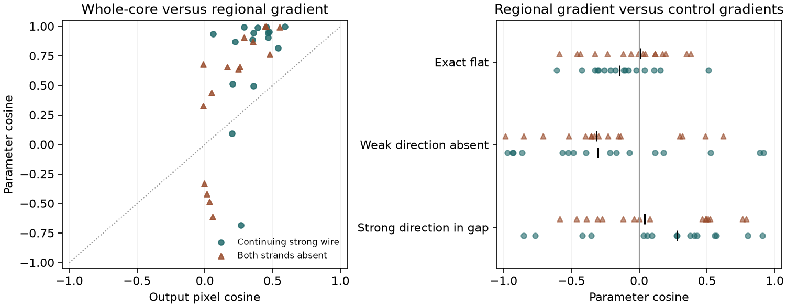

# How weak-wire losses interact through the shared trunk

The regional and whole-core weak-wire losses act on different
sets of output pixels. Their directions are closer after backpropagation
through the shared trunk. This audit measures the difference on the
frozen training recipe for the [matched Local 50k continuation](local-regional-wire.md).

## Method

The two loss functions are evaluated on the same Local 50k EMA
checkpoint `62f4e9ce84075c8df1a254a1889033b5787133e8c98c63e0ec3d174a94734959`.
The 32 groups come from the frozen 1,024-source schedule. A fixed seed
chooses one wire group per combination of ISO400 or ISO6400, four
Bayer layouts, coupled or independent noise within each pair, and
true strong continuation or a double gap. Each group uses the same
six native 256-pixel observations as training, for 192 observations.
The model is in training mode with BF16 neural forwards, FP32 camera
arithmetic and losses, and frozen DINO weights.

The audit differentiates each weighted term with respect to the
restored pixels and then through the original forward to all
trainable trunk parameters. Each gradient uses the same observation
and predictions. The exact-flat control is camera-RGB RMS on the
central 96 × 96 flat observation. The absence and continuing controls
use the actual weak-absence and strong-gap training losses. For these
controls, a negative cosine predicts higher control error after a
small step along the negative weak-response gradient. The repeat
loss contributes to the total gradient on independent within-pair
noise, as in training.

The audit measures Euclidean first-order directions at the shared
starting point. The AdamW state, gradient clipping and later
checkpoints can change the realized updates. The separate BF16
backward passes also round each contribution independently. The
sum describes the first-order comparison of terms.
[Training launch and objective weights](results/local-regional-wire-v1/launch.json).

## Effects through shared weights

The median cosine between the two directional terms rises from
**0.289 in the pixels to 0.844 in the parameters**. Their full loss
gradients have a median parameter cosine of **0.99965**. The weak
term has a median norm of 12.0% of the reconstruction gradient for
whole core and 6.4% for regional. The initial output-gradient dose
match from three usable qualification groups did not carry over to
each subgroup. The weighted regional-to-whole parameter norm ratio
has a median of 0.740 and falls between 0.259 and 1.973 from the
10th to the 90th percentile. On the eight true-continuation groups per
ISO, its median is 0.384 at ISO400 and 0.973 at ISO6400.

| Control | Whole-core median parameter cosine | Regional median parameter cosine | Whole-core / regional negative cases |
| --- | ---: | ---: | ---: |
| Exact flat | −0.136 | −0.091 | 23/32 and 20/32 |
| Weak direction absent | −0.296 | −0.315 | 22/32 and 23/32 |
| Strong direction in gap | +0.350 | +0.184 | 7/32 and 11/32 |

The exact-flat and strong-gap terms are orthogonal to each weak
term at the output to numerical tolerance. Coupling appears through
the trainable weights, including on the separate exact-flat
observation. In the 16 cases with an actual continuing strong
wire, the weak terms usually support its loss. The regional term
opposes it in four cases, compared with one for whole core.
The complete loss gradients each oppose the strong-gap control
in six of the 32 cases. The directional term in isolation therefore
does not explain the entire checkpoint tradeoff.
[Earlier flat and paired-detail gradient audit](flat-spatial-gradient-conflict.md).

Each point is one source. Teal circles indicate a continuing strong
wire. Brown triangles indicate a double gap. Vertical black marks in
the right panel are the corresponding group medians. Negative
cosines indicate first-order competition.

## Gradient components available for a controlled follow-up

Removing the components parallel to the exact-flat, weak-absence
and strong-gap gradients leaves a median **64.4%** of the original
whole-core norm and **77.3%** of the regional norm. The regional
10th–90th percentile spans **37.4–90.0%**. This identifies
directions that preserve all three control losses to first order
on the same batch. It also shows how much directional strength
a blanket projection could remove. The
[completed AdamW follow-up](local-adam-protected.md) measures
a small transferred flat-error reduction at matched norm. It
also finds lower response on the weakest held-out wires and
no clear gap improvement on the separate photos.

This audit made zero optimizer updates. It covered 32,904,704
parameters in 89 tensors and took 353.51 s on the shared GPU.
Nineteen regenerated groups had been reached by training when
summarized, and all nineteen match the live observation receipts
exactly. The other groups are bound to the future rows of the same
frozen schedule. No protected real capture was used. The
[128-update checkpoint review](local-regional-wire-128.md) records
the most recent completed restoration and native GFX comparisons
at the time of this audit. The 512-update image review has started.

[Machine summary](results/local-regional-wire-v1/gradient-audit.json) ·
[Frozen scripts and per-source matrices](results/local-regional-wire-v1/gradient-audit-evidence.tar.xz).
