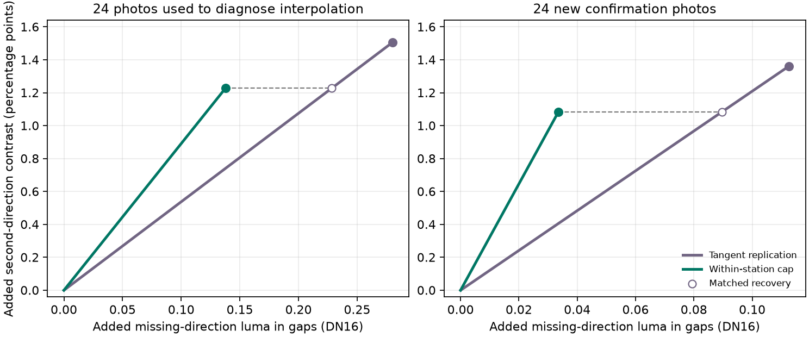
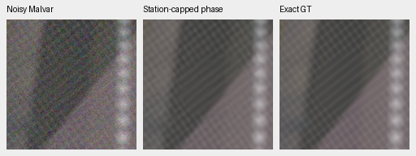
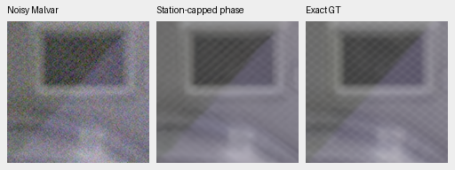

# Replicated Bayer phase with a within-station limit

The opt-in `weak-replicated-phase` crop fit checks both wire directions when the green lattices disagree on rank. Capping each correction by the evidence in its own 16-pixel station recovers **1.084 percentage points** more second-direction contrast than [nearby phase](local-near-phase.md) on 24 new photo-based tests. At equal recovery, it lowers added luma from the missing direction from **0.090 to 0.034 DN16** versus the same phase check with unrestricted interpolation. The real left cab changes very little and still lacks clean crossings.

## Replicate the phase check along the wire

The [earlier two-direction replay](local-unranked-phase.md) showed that a fixed nearby phase can help when there is no clear stronger direction. Its local check occasionally added a ripple to an exact flat. This version keeps exterior frequency nomination, ring-posterior amplitude and per-direction measured amplitude caps. When both green lattices rank the same direction, it uses the existing nearby-phase fit.

Each direction pools phase from the 32-pixel RAW collar and scores it in disjoint 16×16 stations. The local test projects out a quadratic background and the other carrier on each CFA phase. The pooled score is bounded by the lower green score plus 1.5 and by twice that lower score. It must also have nearby support along the wire. The two candidate neighbors are the opposed stations closest to the tangent direction. At least one must reach the center's threshold minus 0.5, and its strength limits the center's. The cutoff is 1.5 with a two-unit ramp. The interpolation cap takes the lower of the interpolated taper and the taper measured in the station containing each delivered pixel. It applies the existing 0.973 exterior gain and the locked 0.95 dose. An odd-origin audit on all four Bayer layouts confirms that changing a held station leaves the collar phase bit-identical. An isolated match, an opposite-phase neighbor and a match missing one green lose their corresponding support.

## Trace what reaches the gaps

The four photo groups use ISO6400 shot/read `0.00128 / 6.5536e-6`, exposure 0.33, black offset 0.03, σ 0.85 pre-Bayer optics and a 16-bit ADC. Their exact targets include strips, ellipses, smooth dips and contrast steps. The second injected direction is scaled to a clean median carrier RMS between 0.95 and 1.05 of the first, after blur and across native parity grids. This occurs before sensor noise is drawn. The groups use disjoint photo sources, two draws per source, four Bayer layouts and six recipient roles. The new panels were checked against 559,808 photographic training visits.

The 32-source calibration has 18 ambiguous exact-gap draws. It compares a single center, a score limited by both greens, tangent replication and replication combined with the two-green limit. The limits are 0.200 DN16 mean and 2.000 DN16 peak luma added by the absent direction, 0.025 DN16 additional mean false projection and 0.600 DN16 peak extra luma on flat, edge-only and uniform controls. The two-green center wins nominal recovery there and exceeds the gap limits on the next 32 sources. Both tangent arms pass on the second group. The combined arm has the smaller worst gap and is carried forward at its original cutoff and dose.

On a third, 24-source group, that unchanged combined arm gains 1.505 points but adds 0.280 DN16 mean and 2.382 DN16 peak luma from the absent direction. **98.7%** of its added missing-direction energy in the scored gaps lies within eight pixels of a gap boundary. Capping interpolation in this group retains 1.227 response points and lowers the mean to 0.138 DN16. At that recovery, the uncapped method adds 0.228 DN16. The cap and original dose are then frozen for a fourth group.

## Fourth panel with the locked cap

The final 24 sources contain 32 ambiguous intact draws out of 48, including 17 with exact gaps. Mean and peak missing-direction luma are measured only where that direction is absent in the exact target. The false projection metric also includes the parent's residual along the missing carrier. Total added gap luma includes the direction still present.

| 24 new photos | Second-direction contrast | Intact second RMS (DN16) | Continuing RMS in gaps (DN16) | False second RMS (DN16) | Added absent luma mean / peak (DN16) |
| --- | ---: | ---: | ---: | ---: | ---: |
| Nearby phase | 58.059% | 41.394 | 53.363 | 4.443 | 0.000 / 0.000 |
| Independent fit without phase check | 63.007% | 32.408 | 47.903 | 4.820 | 2.569 / 12.993 |
| Tangent replication | 59.421% | 38.781 | 51.712 | 4.455 | 0.113 / 0.803 |
| Tangent replication at matched recovery | 59.144% | 39.309 | 52.037 | 4.453 | 0.090 / 0.639 |
| Within-station cap | 59.144% | 39.305 | 52.111 | 4.449 | 0.034 / 0.361 |

Versus nearby phase, the cap gains **1.084 points** `[+0.859, +1.326]`, lowers intact RMS by **2.089 DN16** `[−2.608, −1.612]` and lowers continuing-strand RMS in gaps by **1.252 DN16** `[−2.293, −0.324]`. At equal recovery the absent-direction addition drops **0.056 DN16** `[−0.114, −0.020]` relative to unrestricted tangent replication. Total gap addition is higher by 0.676 DN16 `[+0.457, +0.945]`, and the continuing-strand error difference is +0.074 DN16 `[−0.087, +0.305]`. The false second-direction residual difference is −0.003 DN16 `[−0.020, +0.020]`. Intervals resample photos by geometry with both draws together.

The capped fit adds 0.112 DN16 at most on flat-core controls and repeats nearby phase on all edge-only and uniform controls. It retains a substantial recovery advantage over nearby phase but delivers less contrast than the unchecked fit. In a separate replay, unrestricted tangent replication reproduces nearby phase on all 48 ordinary photos under both authentic and incompatible planted far context. On the incompatible context the original nearby phase can still change the parent by 1.420 DN16 mean RGB RMS.

## Native exact comparisons

Both native 160×160 triplets use crop `[48,48,160,160]` inside query `[128,128,256,256]` with the ISO6400 simulation above and display exposure ×2 followed by sRGB. They compose the packaged Bayer fit with Local 50k EMA SHA256 `62f4e9ce84075c8df1a254a1889033b5787133e8c98c63e0ec3d174a94734959`. Exact GT includes pre-Bayer optics. The ellipse has the largest reduction in missing-direction luma, from 0.803 to 0.262 DN16, with continuous strands visible through the gap. The smooth dip is the largest response gain among continuous textures. It shows slightly stronger faint strands whose crossings remain softer than the exact target.

The ellipse uses GRBG draw one from Carlos Delgado's Torre Sacyr Vallehermoso and Torre Caja Madrid at night, bin-four source crop `[26,182,512,512]`. All source crops are adapted by binning, planting wires and simulating optics and sensor noise. [All methods](assets/local-replicated-phase-v1/station-fresh-06-comparison.png) · [Source](https://commons.wikimedia.org/wiki/File:Torre_Sacyr_Vallehermoso_%26_Torre_Caja_Madrid_de_noche_-_at_night.jpg) · [CC BY-SA 3.0](https://creativecommons.org/licenses/by-sa/3.0).

The smooth dip uses RGGB draw zero from Rama's Leica IIIf photograph at bin-four source crop `[544,58,512,512]`. [All methods](assets/local-replicated-phase-v1/station-fresh-12-comparison.png) · [Source](https://commons.wikimedia.org/wiki/File:Leica_IIIf_IMG_5399.jpg) · [CC BY-SA 2.0 France](https://creativecommons.org/licenses/by-sa/2.0/fr/deed.en).

## Standing GFX100S comparisons

Sky, building and foliage reproduce Local 50k. The coarse fence and both right cab views reproduce nearby phase. The left cab changes by **0.072 DN16 RGB RMS** with nominal noise and **0.041 DN16** with transferred noise. Both differences are difficult to see even at ×16 exposure. Fine crossings remain incomplete and mottling remains apparent. The boards show no visible new color pattern or station boundaries.

The native origins are `[5800,1400]` for sky, `[5790,2690]` for building, `[8890,5570]` for foliage, `[2240,6000]` for coarse fence, and `[806,6489]` and `[1026,6449]` for the cab. Nominal shot/read is `0.00128 / 6.5536e-6`. Transferred cab shot/read is `0.0014635775921166604 / 1.0715704128646712e-6`. The general comparison uses V120 Small EMA SHA256 `a9d9b6b4f974e24a6b11e5e740aab32314233a7f53c056cf37c7d2aac1c589fb`. The separate ISO100 AHD renders and the camera JPEGs are qualitative references under different imaging conditions.

| RAW and profile | Native boards |
| --- | --- |
| DSCF3879 nominal ×4 | [Sky](assets/local-replicated-phase-v1/main-overcast-sky-main-overcast-sky-x4.png) · [Building](assets/local-replicated-phase-v1/main-building-detail-main-building-detail-x4.png) · [Foliage](assets/local-replicated-phase-v1/main-foliage-main-foliage-x4.png) · [Coarse fence](assets/local-replicated-phase-v1/main-chain-link-fence-main-chain-link-fence-x4.png) |
| DSCF3842 nominal | [Left ×4](assets/local-replicated-phase-v1/mesh-nominal-fine-green-mesh-left-x4.png) · [Right ×4](assets/local-replicated-phase-v1/mesh-nominal-fine-green-mesh-right-x4.png) · [Left ×16](assets/local-replicated-phase-v1/mesh-nominal-fine-green-mesh-left-x16.png) · [Right ×16](assets/local-replicated-phase-v1/mesh-nominal-fine-green-mesh-right-x16.png) |
| DSCF3842 transferred | [Left ×4](assets/local-replicated-phase-v1/mesh-profile3879-fine-green-mesh-left-x4.png) · [Right ×4](assets/local-replicated-phase-v1/mesh-profile3879-fine-green-mesh-right-x4.png) · [Left ×16](assets/local-replicated-phase-v1/mesh-profile3879-fine-green-mesh-left-x16.png) · [Right ×16](assets/local-replicated-phase-v1/mesh-profile3879-fine-green-mesh-right-x16.png) |

## Packaged crop fit

Use `method="weak-replicated-phase"` with the 160-pixel linear parent and its 192×192 RGB context, the packed scene, CFA layout and camera/noise parameters. The package reproduces the research images exactly on 288 fourth-panel crops and eight standing crops. GB10 single-thread CPU time after the parent forward has a median of 28.90 ms versus 26.77 ms for nearby phase across all fourth-panel crops. Where the output changes, medians are 52.38 and 26.75 ms. [Crop usage](usage.md#repeating-mesh-crops).

The study uses frozen checkpoints. The fixed 427-photo and known/unseen camera panels fall outside this crop evaluation. [Paired scores](results/local-replicated-phase-v1/summary.json) · [Native provenance](assets/local-replicated-phase-v1/manifest.json) · [Publication hashes](results/local-replicated-phase-v1/publication.json) · [Frozen sources and receipts](results/local-replicated-phase-v1/evidence.tar.xz).
