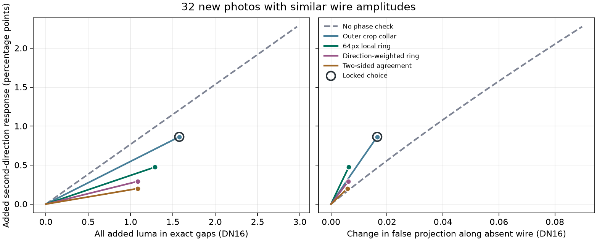
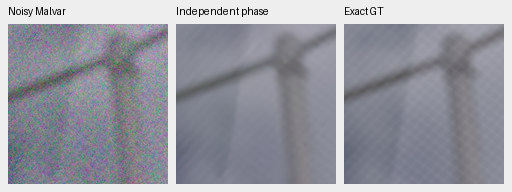
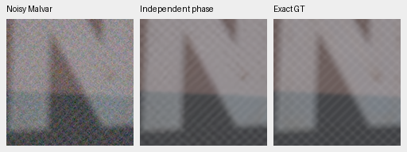

# Independent Bayer phase checks when wire ranking is ambiguous

On 32 new ISO6400 photo-based tests, checking each wire direction independently gained **0.863 percentage points** of second-direction contrast over [nearby phase](local-near-phase.md). The intact error fell **1.366 DN16**. Five draws changed inside true gaps. The change there was mainly along the continuing strand, with a small rise in false projection along the missing strand. The collar also added a faint ripple on one flat-core draw. Both left cab views changed subtly, with incomplete crossings. The experiment uses frozen weights and is available as a research replay.

The [replicated phase follow-up](local-replicated-phase.md) adds a separate
along-wire check and a within-station delivery limit, with new exact-gap
calibration and a frozen source-disjoint confirmation.

## Separate direction evidence from crop-wide rank

Nearby phase currently applies its conditional posterior only when both green lattices rank the same direction at least 25% higher by median estimated power. On the standing left cab, one green ranks the positive diagonal higher and the other ranks the negative diagonal higher. This study holds the exterior frequency nomination and neural parent fixed. When the rank is ambiguous, it fits both directions separately, conditioning each on the other direction and the smooth background. The full conditional fit uses the original amplitude cap. Each proposed update is measured relative to the existing combined correction.

Each 16-pixel station checks a template fixed on other Bayer samples. The four sources of phase are the 32-pixel crop collar, a 64-pixel local ring excluding its central 32 pixels, a direction-weighted version of the same ring, and the weighted ring with separate agreement between its two tangential halves. The weighted ring uses Gaussian scales of 22 pixels along the wire and 12 across it. Both green phases must have donor evidence of at least four standard deviations and phase cosine at least 0.5. The extra two-sided check requires each half to reach 2.5 standard deviations and their phase cosine to reach 0.5 on both green lattices. The collar also uses the existing coherence and directional pooling rules.

Held signed scores remove the local quadratic background and the competing wave separately on each Bayer phase, then cap pooled evidence by the weaker green score plus 1.5. The response ramps linearly from the cutoff to two score units above it. Reversing the second wave within a single held station leaves all its ring estimates bit-identical on all four layouts, at odd crop coordinates. The held score changes sign. The rank gate and posterior amplitude still see the whole crop, so the measured error rates apply to the complete procedure empirically.

## Calibration and new-source confirmation

The camera recipe uses ISO6400 shot/read `0.00128 / 6.5536e-6`, exposure 0.33, black offset 0.03, σ 0.85 pre-Bayer blur and a 16-bit ADC. Before attenuation and masking, the planted second wire has 0.88 to 1.32 times the first wire's amplitude. The panels have two independent draws per source, four CFA layouts and six roles per draw. The 32 confirmation photos are separate from the 48 recaptured calibration backgrounds and were checked against 559,808 photographic training visits by source ID and cache hash.

Calibration chooses cutoff and dose under mean added gap luma ≤0.080 DN16, mean excess false projection ≤0.025 DN16 and peak quiet-crop addition ≤0.600 DN16 relative to nearby phase. An initial absolute quiet restriction excluded all arms because nearby phase itself changed one flat-core control by 0.867 DN16. That calculation is preserved. The incremental calibration selects the outer collar with cutoff 1.5 and full dose. Only seven of 96 intact calibration draws have ambiguous rank, all on continuous contrast steps. As a result, the new path receives no exact-gap test during calibration. The confirmation panel has 12 ambiguous intact draws across eight photos, including five ellipse draws with exact gaps.

| 32 new photos | Second-direction contrast | Intact second-direction RMS (DN16) | Continuing-strand RMS in gaps (DN16) | False second-direction RMS in gaps (DN16) | All added gap luma (DN16) |
| --- | ---: | ---: | ---: | ---: | ---: |
| Nearby phase | 47.585% | 46.823 | 57.439 | 4.782 | 0.000 |
| Independent posterior without phase check | 49.861% | 43.485 | 56.535 | 4.872 | 2.966 |
| Outer collar, locked choice | 48.448% | 45.457 | 57.137 | 4.799 | 1.575 |
| Local 64-pixel ring | 48.059% | 46.003 | 57.271 | 4.789 | 1.288 |
| Direction-weighted ring | 47.876% | 46.291 | 57.375 | 4.789 | 1.086 |
| Two-sided ring agreement | 47.784% | 46.458 | 57.377 | 4.788 | 1.083 |

The locked choice gains **0.863 points** `[+0.348, +1.448]` and lowers intact RMS **1.366 DN16** `[−2.286, −0.542]`. Its mean false projection rises **0.0165 DN16** `[+0.0025, +0.0360]`, and the continuing-strand RMS change is −0.302 DN16 `[−0.859, +0.053]`. Intervals resample photos by geometry with both draws kept together. The 12 ambiguous draws gain a median **4.595 points**; the other 52 intact draws reproduce nearby phase. The improvement targets treatments for similar-amplitude directions and leaves the recovery of very faint strands in other scenes unresolved.

At equal second-direction recovery, the locked collar reduces false projection by **0.0150 DN16** `[−0.0350, −0.0023]` and adds **0.451 DN16** `[+0.024, +1.027]` more total gap luma than scaling the unchecked posterior. Tracking the two updates separately attributes mean gap RMS of 1.561 DN16 to the continuing direction and 0.112 DN16 to the absent one. Mean luma error against the exact target inside the gaps changes from 144.874 to 144.741 DN16. The largest gap update is 14.456 DN16, of which 14.441 comes from the continuing direction. This makes total added gap luma a conservative guard when both directions can change.

The collar exceeded the locked total gap and quiet budgets on the new panel. It changed the flat-core control by 1.013 added DN16 on one draw and reproduced both edge-only and uniform controls. On those quiet roles, all three ring variants reproduce nearby phase. The unchecked posterior added up to 5.349 DN16 on the flat core, 7.325 on edge-only and 4.563 on uniform. Forty-eight ordinary photo recipients reproduce their parents with authentic surroundings. When their distant donors are replaced with planted mesh, frequency nomination fires on all 48 and 31 have ambiguous rank. The collar changes one crop relative to nearby phase, with mean added 0.0022 DN16 RGB RMS. The unchecked posterior adds 2.598 DN16 on average in that mismatch. The evidence supports independent phase as a way to limit the unchecked fallback. The tested collar remains a research option because of the confirmed quiet-crop tail and limited real gains.

## Native exact comparisons

Both triplets use native 160×160 pixels at `[48,48,160,160]` inside the `[128,128,256,256]` query and display exposure ×2 followed by sRGB. The locked fit composes Local 50k EMA SHA256 `62f4e9ce84075c8df1a254a1889033b5787133e8c98c63e0ec3d174a94734959` with the Bayer crop correction. Exact GT includes optical blur before Bayer sampling. The contrast step shows slightly more diagonal signal near the edge, with weaker crossings than the target. The ellipse is the largest total gap update. The continuing strands are clearer across its dark lower portion, and the weakest crossings remain soft outside the gap.

The contrast step uses GBRG draw one and mattbuck's Nottingham railway station MMB 77 at bin-four source crop `[162,42,512,512]`, adapted by binning, planting wires and simulating optics and sensor noise. [All methods](assets/local-unranked-phase-v1/unranked-fresh-27-comparison.png) · [Source](https://commons.wikimedia.org/wiki/File:Nottingham_railway_station_MMB_77.jpg) · [CC BY-SA 3.0](https://creativecommons.org/licenses/by-sa/3.0).

The ellipse uses GRBG draw zero and Diego Delso's Bodega Sandeman in Vila Nova de Gaia at bin-four source crop `[46,464,512,512]` with the same adaptation. [All methods](assets/local-unranked-phase-v1/unranked-fresh-10-comparison.png) · [Source](https://commons.wikimedia.org/wiki/File:Bodega_Sandeman,_Vila_Nova_de_Gaia,_Portugal,_2012-05-09,_DD_01.JPG) · [CC BY-SA 3.0](https://creativecommons.org/licenses/by-sa/3.0).

## Standing GFX100S comparisons

Sky, building and foliage reproduce Local 50k. The coarse fence and both right cab profiles reproduce nearby phase. The independent fit changes both left cab views by 1.419 DN16 RGB RMS at nominal conditioning and 1.366 at transferred conditioning. The native boards show a slight redistribution of the diagonals below the rail. The reference grid remains much clearer, with real crossings still incomplete and mottling present. There is no visible new repeating color.

The main native crop origins are `[5800,1400]` sky, `[5790,2690]` building, `[8890,5570]` foliage and `[2240,6000]` coarse fence. Cab origins are `[806,6489]` and `[1026,6449]`. Nominal shot/read is `0.00128 / 6.5536e-6`. The transferred cab profile uses `0.0014635775921166604 / 1.0715704128646712e-6`. V120 Small EMA SHA256 `a9d9b6b4f974e24a6b11e5e740aab32314233a7f53c056cf37c7d2aac1c589fb` provides the general-model comparison. The ISO100 AHD renders and camera JPEGs are qualitative references with separate imaging conditions. The source RAW files remain read-only.

| RAW and profile | Native boards |
| --- | --- |
| DSCF3879 nominal ×4 | [Sky](assets/local-unranked-phase-v1/main-overcast-sky-main-overcast-sky-x4.png) · [Building](assets/local-unranked-phase-v1/main-building-detail-main-building-detail-x4.png) · [Foliage](assets/local-unranked-phase-v1/main-foliage-main-foliage-x4.png) · [Coarse fence](assets/local-unranked-phase-v1/main-chain-link-fence-main-chain-link-fence-x4.png) |
| DSCF3842 nominal | [Left ×4](assets/local-unranked-phase-v1/mesh-nominal-fine-green-mesh-left-x4.png) · [Right ×4](assets/local-unranked-phase-v1/mesh-nominal-fine-green-mesh-right-x4.png) · [Left ×16](assets/local-unranked-phase-v1/mesh-nominal-fine-green-mesh-left-x16.png) · [Right ×16](assets/local-unranked-phase-v1/mesh-nominal-fine-green-mesh-right-x16.png) |
| DSCF3842 transferred | [Left ×4](assets/local-unranked-phase-v1/mesh-profile3879-fine-green-mesh-left-x4.png) · [Right ×4](assets/local-unranked-phase-v1/mesh-profile3879-fine-green-mesh-right-x4.png) · [Left ×16](assets/local-unranked-phase-v1/mesh-profile3879-fine-green-mesh-left-x16.png) · [Right ×16](assets/local-unranked-phase-v1/mesh-profile3879-fine-green-mesh-right-x16.png) |

Numerical evaluation and native review are complete for this frozen crop replay. The fixed 427-photo and known/unseen camera panels fall outside its scope. [Summary and matched scores](results/local-unranked-phase-v1/summary.json) · [Native provenance](assets/local-unranked-phase-v1/manifest.json) · [Publication hashes](results/local-unranked-phase-v1/publication.json) · [Frozen evidence and source](results/local-unranked-phase-v1/evidence.tar.xz).
