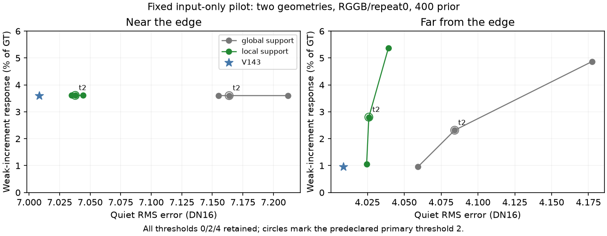
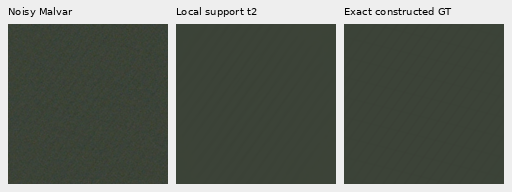
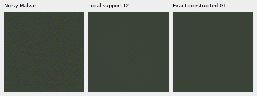

# Local conditional evidence improves a restricted input-only wave tradeoff

**Local support retains more far-edge weak response with less quiet error than
global support in the fixed pilot.** At threshold 2, mean weak response is
2.80% versus 2.32%, with quiet RMS 4.02596 versus 4.08421 DN16. The parent has
0.96% response and 4.00857 DN16 quiet RMS. The gain comes from one of the two
geometries; most weak detail and real cab crossings remain missing.

This is an implemented **input-only analytic correction**, unlike the preceding
[GT-oracle fit](measured-wave-oracle.md). The procedural parent is **V143**;
ordinary-material and GFX parents are **V120**. The initial procedural label was
incorrectly V120. Original outputs/receipts are preserved with a verified
[lineage addendum](results/local-validated-wave-pilot-v1/parent-lineage-addendum.json.gz),
corrected metrics and image headings. Numerical results did not change.
V120 remains the general recommendation.

The [matching/harmonic follow-up](local-wave-shapes.md) retains a fold-assignment
fix and an optional richer basis. H3 raises far weak response to 5.46% in this
same development pilot, with higher quiet/increment error and conspicuous
new building color bands. One harmonic remains the default. Original results
below and the frozen full-panel source stay unchanged.

The [completed full three-prior evaluation](local-wave-full-panel.md) covers
eight geometries × two placements × four CFAs × two repeats × three roles ×
three priors, or **1,152 images**, adopting12 exact pilot predictions. At400/far,
weak response rises1.826%→2.690% above V143, with quiet/increment costs.
Local support lowers global-support error in all six cells; higher-noise weak
detail remains missing. That result uses the historical matcher, without later
parameter or threshold changes. The separate
[V132 full-model comparison](v132-endpoint-quality.md) is now complete, with
faint-ADC regression and no new fine crossings.
[Pilot evidence and executed sources](results/local-validated-wave-pilot-v1/publication.json).

## Reconstruction from RAW before consulting the parent

The [implementation](../src/demosaic/local_validated_waves.py) extends the earlier
[disjoint-CFA edge prototype](withheld-cfa-edge-refinement.md) into a local RGB
correction above a saved DINOv3 restoration:

1. In each native 256 window, split half of every CFA phase into A/B using a
   fixed pixel-independent partition. Fit a refined step/affine nuisance on A,
   discover/refine one frequency, then find a competing angular family after
   removing the first A-only fit. Joint color coefficients use A-only noise
   proxies. Repeat with B as discovery.
2. Validate **each direction and each RGB color separately** on the complementary
   samples, against an A-only null that already includes the other direction.
   Match the two folds' frequencies within 1.5 native bins. A strong direction
   or green channel cannot supply the weaker direction's or another color's
   validation score.
3. Combine the two directional predictions using either whole-window scores or
   local 129-window scores at stride 32. Both use the same fixed soft support
   rule and thresholds 0/2/4. Only after scoring, project the parent onto the
   selected basis and replace that component. Blend overlapping windows at
   stride 128 with a smooth taper.

The replacement avoids adding the full measured wave on top of a component
already present in the parent. Its tested exact-parent case changes no pixels.
The local/global comparison reuses identical discovery fits, predictors,
frequency matching and parent projections; support aggregation differs.

GT, references, full-input parent features and target-derived variance maps do
not enter discovery or validation. The final output uses the parent after
scoring and is not a withheld prediction. Scores use discovery-only plug-in
noise estimates, overlapping windows and a two-fold decision. They are
**empirical predictive scores, not calibrated probabilities or risk bounds**.
Threshold 2 was fixed before this pilot, not selected on real-photo outcomes.

## What the pilot actually measures

The finite-wire panel uses the first two procedural geometries, RGGB/repeat 0,
near/far placement and the 400 prior. Each image role has independent sensor
noise. The means below average **two geometries**, not a broad photo population.
All threshold outputs remain archived; the primary comparison is threshold 2.

| Placement / method | Strong response | Weak response | Quiet RMS, DN16 | Weak-increment RMS, DN16 |
| --- | ---: | ---: | ---: | ---: |
| Near: V143 |17.923% |3.603% |7.00841 |13.52012 |
| Near: global support t2 |17.923% |3.602% |7.16378 |13.64740 |
| Near: local support t2 |18.006% |3.611% |7.03781 |13.54121 |
| Far: V143 |33.783% |0.958% |4.00857 |11.78863 |
| Far: global support t2 |42.312% |2.315% |4.08421 |11.84905 |
| Far: local support t2 |43.332% |2.801% |4.02596 |11.80386 |

Compared with V143, the local far result increases quiet RMS **0.434%** and
weak-increment error **0.129%**. Global support increases them 1.887% and
0.513%. Local support therefore improves this restricted tradeoff, while both
retain costs against the parent. Near-edge weak response barely changes.

Source 1 drives the far gain: weak response 0.902%→4.592%, versus global 3.618%.
Source 0 is effectively unchanged, 1.014%→1.011%. These percentages must not be
ranked directly against the separate eight-source V200/oracle means.



Ordinary bark/fur RGGB sRGB PSNR changes are +0.00032/+0.00103 dB versus V120;
their native appearance remains close to the parent. All four ADC-only material
controls are bit-identical to V120 for every variant. The two binned PIXLS
references retain their approximate-reference labels. There is no broad
427-photo/camera/standalone-flat/full-frame quality result for this stage.

## Native triplets retain a gain and a counterexample

Noisy Malvar → **local support t2 above V143** → exact constructed GT. Each cell
is 160×160 unchanged pixels from native 512 RGGB, two-direction role, far-edge
repeat 0, ROI `[176,176,160,160]`. Shot/read `0.00008/2.56e−8`, 16-bit ADC/black
0.03, exposure 2/contrast 1, identical WB/matrix/clipped-sRGB display per method.
The source 0 triplet retains the case without useful weak-response gain.





V143 parent checkpoint SHA256:
`96d146d017c54196288c585f8b7eddcf030e8a235061049c31e985b9380b7ce4`.
Photographic/GFX V120 checkpoint SHA256:
`a9d9b6b4f974e24a6b11e5e740aab32314233a7f53c056cf37c7d2aac1c589fb`.
There are no new trained weights. The corrected analytic configuration has
SHA256 `91a729a605b8312fc332726443cf92027576f66e0d9ce0038f4c5fcbe3c549bd`.
[Complete source/ROI/noise/display/parent metadata](images/local-validated-wave-pilot-v1/manifest.json).
Direct comparisons retain the
[source 0 counterexample](images/local-validated-wave-pilot-v1/source0-far-role2-comparison.png)
and [source 1 gain](images/local-validated-wave-pilot-v1/source1-far-role2-comparison.png),
plus [ordinary bark](images/local-validated-wave-pilot-v1/bark-RGGB-draw0-comparison.png)
and [fur](images/local-validated-wave-pilot-v1/raccoon-fur-RGGB-draw0-comparison.png).

## Real support limits remain visible

The V120-based main DSCF3879/3880 comparisons retain native 512 contexts/native
160 cells, exposure 4 and the unchanged nominal `.00128/6.5536e−6` prior:
[sky](images/local-validated-wave-pilot-v1/main-overcast-sky-comparison.png),
[building](images/local-validated-wave-pilot-v1/main-building-detail-comparison.png),
[foliage](images/local-validated-wave-pilot-v1/main-foliage-comparison.png) and
[coarse fence](images/local-validated-wave-pilot-v1/main-chain-link-fence-comparison.png).
Sky stays smooth, building detail soft, foliage painted and coarse wire
geometry retained. There is no convincing new recovery of fine structure.

Both native 768 cab profiles and both native 160 ROIs retain DSCF3842/3835,
exposure 16, both original-pixel camera JPEGs and unchanged noise priors:

| Profile | Left ROI | Right ROI |
| --- | --- | --- |
| Nominal `.00128/6.5536e−6` | [Left](images/local-validated-wave-pilot-v1/mesh-nominal-fine-green-mesh-left-comparison.png) | [Right](images/local-validated-wave-pilot-v1/mesh-nominal-fine-green-mesh-right-comparison.png) |
| Nearby DSCF3879 `.0014635775921166604/1.0715704128646712e−6` | [Left](images/local-validated-wave-pilot-v1/mesh-profile3879-fine-green-mesh-left-comparison.png) | [Right](images/local-validated-wave-pilot-v1/mesh-profile3879-fine-green-mesh-right-comparison.png) |

Global support creates new broad diagonal ripples. Local support suppresses
much of that modulation but still largely misses the fine mesh; crossings
remain incomplete. Six additional native ROIs inspect the **largest local
camera-RGB correction** in each context, selected after inference. They reveal
residual periodic changes, particularly beside the cab. These are stress views,
not representative samples or GT-error selections; no reference is claimed at
their extra coordinates. The largest building correction is near a clipped
highlight, where a large camera-space change need not be visible after display.
[Stress-view provenance and selections](images/local-validated-wave-pilot-v1/stress-manifest.json) ·
[Nominal cab stress view](images/local-validated-wave-pilot-v1/mesh-nominal-max-correction.png).

The ISO100/AHD references differ in aperture, exposure and moving subjects;
camera JPEGs have their own rendering. They are **not exact GT**, receive no
pixelwise scores and do not select thresholds. Originals remain read-only and
all protected captures/JPEGs/siblings remain outside training.

## Verification, use and outstanding review

The pilot closes all 24 input-only cases before loading targets/references,
uses saved parents and makes zero neural/DINO calls, source/noise draws, RAW
decodes or optimizer updates. CPU prediction takes 126.68 seconds for this mixed
set, including 196 overlapping patches; this is not a full-frame speed claim.
The independent audit reproduces 679 metric fields and **9,216,000 native RGB
channels** across 28 primary boards, including every camera-JPEG cell. Maximum
band-scalar discrepancy is 2.50e−15; PSNR and finite-increment discrepancies
are zero. All 28 boards/14 triplets, six stress boards and the corrected curve
were actually inspected. Original mislabeled receipts are retained; all
published canonical labels and parent identities are corrected without changing
prediction or crop pixels. Future preparation rejects a wrong wire checkpoint.

Thirty-five focused tests cover all-CFA NaN holdout invariance, conditional
direction/color checks, parent replacement, local boxes, zero-noise identity,
exact pilot adoption and parent-lineage rejection. The full panel runs on its
frozen source with 32 GiB RAM/96 GiB disk floors and a four-hour prediction
limit, adopting the 12 existing wire outputs. Its original frozen labels are
covered by the explicit lineage addendum and a separate label-only correction
watcher; numerical work is not restarted. Completed full-panel scoring and
native review remain pending.
[Publication checks](results/local-validated-wave-pilot-v1/publication-checks.json)
verify the 36 unchanged archives, 34 native image copies, 459 local documentation
links and exact live panel/training owners. That observation captures the panel
at 259/1,152 images and V132 at step 5,800; neither is completion evidence.

```python
from demosaic.local_validated_waves import restore_local_waves

outputs, evidence = restore_local_waves(
    parent_rgb, packed_raw, cfa_colors,
    shot=shot_coefficient, read=read_variance,
    thresholds=(2.0,),
)
restored = outputs[("local", 2.0)]
```

Inputs are matching normalized camera-RGB `3×H×W`, packed `4×H/2×W/2` and four
standard Bayer color indices. The current implementation accepts even axes
of at least 256 pixels. The original pilot/full-panel snapshot required
divisibility by four. Positive-noise native 66×70 boundary-tile tests cover
all four Bayer layouts; this does not establish full-frame performance.
It is an experimental NumPy component; full 102MP
integration and speed are unverified. Its finite-window sinusoidal model,
noise proxies and support test still miss weak nonperiodic/finite detail and
can retain structured artifacts. Broader evidence must determine whether the
observed localization gain persists before treating it as a general option.
