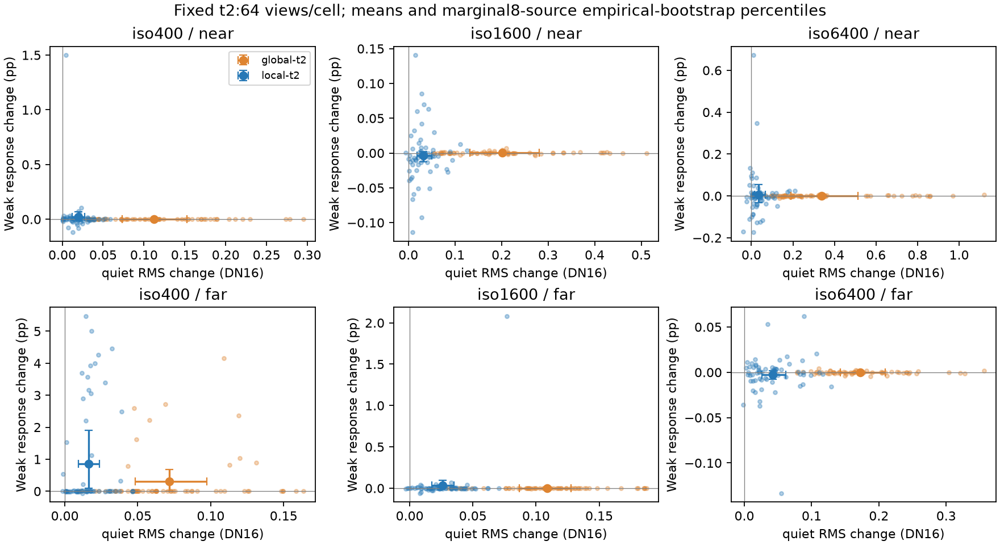
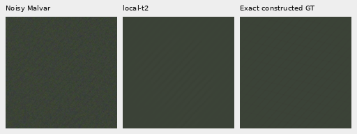
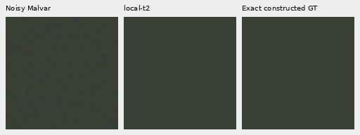

# Local support over the complete three-prior wire panel

**Local conditional support improves the global-support error tradeoff across
all six prior/placement cells.** At the clearest prior, far-edge weak response
rises from the V143 parent's **1.826% to 2.690%**, versus 2.125% with global
support. Quiet and weak-increment error still rise against the parent; most
weak detail and real cab crossings remain absent. V120 remains the general
photographic recommendation.

This closes the [two-geometry pilot](local-validated-waves.md), using the exact
original one-harmonic, threshold-2 stage. The executed full panel uses the
**historical fold matcher**. The later cardinality fix and optional
[harmonic controls](individual-wave-validation.md) are separate experiments.
[Native gallery](images/local-wave-full-panel-v1/native-viewer.html) ·
[Complete receipts and executed sources](results/local-wave-full-panel-v1/publication.json).
[Exact publication script](results/local-wave-full-panel-v1/publication-addendum.json).

## All geometries, CFAs and repeats

The frozen panel contains eight geometries × two placements × four CFAs × two
repeats × three independently corrupted roles × three noise priors: **1,152
images, 384 three-role groups**. Twelve exact pilot predictions are adopted;
1,140 are new analytic predictions. All three methods share the same RAW,
discovery fits, nuisance model, frequencies and parent. No neural, source,
RAW-decoding, optimizer or new-noise work is added. The producer took 6,788 s
under concurrent training; this is not a deployment speed benchmark.

The procedural parent is V143, SHA256
`96d146d017c54196288c585f8b7eddcf030e8a235061049c31e985b9380b7ce4`.
The original V120 label was wrong. Original receipt bytes remain intact;
canonical v2 metadata and the lineage addendum correct the label without
changing any numerical output. The photographic/GFX parent remains V120,
SHA256 `a9d9b6b4f974e24a6b11e5e740aab32314233a7f53c056cf37c7d2aac1c589fb`.

Each row below averages 64 paired views over eight source geometries. Response
is projected amplitude, not a quality score. Increment error measures the
predicted role difference against the exact constructed weak increment.

| Prior / placement | Method | Strong response | Weak response | Quiet RMS DN16 | Weak-increment RMS DN16 |
| --- | --- | ---: | ---: | ---: | ---: |
| 400 near | V143 |15.892% |3.400% |7.15183 |13.05199 |
| | Global t2 |17.411% |3.400% |7.26433 |13.16138 |
| | Local t2 |17.630% |3.422% |7.17153 |13.08269 |
| 400 far | V143 |30.902% |1.826% |4.05895 |10.06832 |
| | Global t2 |38.318% |2.125% |4.13043 |10.14693 |
| | Local t2 |39.524% |2.690% |4.07537 |10.09739 |
| 1600 near | V143 |3.293% |2.201% |10.78314 |19.05740 |
| | Global t2 |5.123% |2.201% |10.98505 |19.25928 |
| | Local t2 |5.890% |2.197% |10.81556 |19.10265 |
| 1600 far | V143 |6.214% |1.472% |6.00864 |14.55492 |
| | Global t2 |10.333% |1.472% |6.11722 |14.67997 |
| | Local t2 |12.683% |1.506% |6.03468 |14.61089 |
| 6400 near | V143 |0.570% |1.039% |26.08892 |30.73420 |
| | Global t2 |0.756% |1.038% |26.42554 |31.16207 |
| | Local t2 |1.042% |1.043% |26.12412 |30.80841 |
| 6400 far | V143 |0.411% |1.032% |11.09278 |22.43911 |
| | Global t2 |1.239% |1.032% |11.26505 |22.62874 |
| | Local t2 |1.970% |1.029% |11.13498 |22.51906 |

Local versus global lowers mean quiet and weak-increment error in every cell.
All corresponding source-bootstrap intervals are below zero. Against V143,
both error means increase in every cell. At 400/far, local adds **0.865
percentage points** weak response, with quiet RMS **+0.405%** and increment
error **+0.289%**. No view in that cell simultaneously improves weak response,
quiet error and increment error over V143. Sources 1 and 2 account for about
87% of the mean weak-response gain; this is not a uniform source gain.

The exact empirical cluster bootstrap enumerates all 8⁸ source resamples via
6,435 multinomial count vectors, keeping each source's eight CFA/repeat views
together. The 400/far local-minus-parent weak response interval is
`[+0.000979,+0.018945]` in gain units; quiet/increment differences are
`[+0.009424,+0.023826]` / `[+0.013683,+0.046736]` DN16. These are descriptive
intervals for this fixed cohort, not calibrated population confidence or
training-seed uncertainty. All 18 contrasts and 13 metrics remain archived.

## Native gains and counterexamples

Noisy Malvar → local t2 above V143 → **exact constructed GT**. Each cell is
160×160 unchanged pixels from native512, RGGB/repeat0, two-direction role,
far placement, ROI `[176,176,160,160]`. Prior400 uses shot/read
`0.00008/2.56e-8`, ADC16/black0.03, display exposure2/contrast1. Each method
uses identical per-source WB/matrix and clipped sRGB. Analytic configuration
SHA256 `4f83cd354a492fbaf5123fb4484806e4935d85d27d948488dad0cf123d5d9c07`;
there are no new trained weights.
[Every source, ROI, input, checkpoint and display binding](images/local-wave-full-panel-v1/manifest.json).

All 48 finite comparison boards were actually viewed, plus four standalone
triplets, eight protected-real comparisons, six stress boards and two plots.
At 1600/6400, outputs remain mostly flat; more amplitude does not restore
complete crossings. Every one of the 96 finite boards was also checked
independently, including those not separately viewed.

## Both protected real families retain their limits

The same-stage V120-based main DSCF3879/3880 comparisons retain native512
contexts, native160 crops, exposure4 and nominal shot/read `.00128/6.5536e-6`:
[sky](images/local-wave-full-panel-v1/main-overcast-sky-comparison.png),
[building](images/local-wave-full-panel-v1/main-building-detail-comparison.png),
[foliage](images/local-wave-full-panel-v1/main-foliage-comparison.png),
[coarse fence](images/local-wave-full-panel-v1/main-chain-link-fence-comparison.png).
Sky stays smooth, foliage painted, building detail soft and coarse wire
geometry retained. The independently demosaiced ISO100 capture is a qualitative
reference with aperture/motion differences, **not exact GT**. No pixelwise
reference score is reported.

DSCF3842/3835 cab boards retain native768 contexts, native160 ROIs, exposure16
and both original-pixel SOOC JPEGs. Nominal profile:
[left](images/local-wave-full-panel-v1/mesh-nominal-fine-green-mesh-left-comparison.png),
[right](images/local-wave-full-panel-v1/mesh-nominal-fine-green-mesh-right-comparison.png).
Nearby DSCF3879 profile `.0014635775921166604/1.0715704128646712e-6`:
[left](images/local-wave-full-panel-v1/mesh-profile3879-fine-green-mesh-left-comparison.png),
[right](images/local-wave-full-panel-v1/mesh-profile3879-fine-green-mesh-right-comparison.png).
Local support reduces the global stage's broad diagonal ripples but leaves
incomplete fine crossings. The ISO100/AHD/JPEG references differ in exposure,
aperture and motion; they are qualitative, not GT.

Six maximum-correction stress ROIs remain in the gallery and manifest. Their
coordinates were selected after inference by camera-RGB correction magnitude,
not target error; there is no reference at those extra coordinates. The
[profile3879 cab stress board](images/local-wave-full-panel-v1/stress/mesh-profile3879-max-correction.png)
retains visible residual periodic modulation. All adopted PNG bytes match
their original pilot evidence exactly. Cached RAWs and siblings remain
excluded from training; originals were not touched.

## Independent closure and current matcher scope

The independent audit recomputes **14,976 scalar fields, 234 means and 2,574
bootstrap values**, and checks **29,491,200 native RGB channels exactly** in
96 finite boards. Maximum discrepancies are `9.60e-11`, `3.92e-11`, `5.42e-12`;
all pass the original `1e-10` bound. Sixteen adopted protected-real boards
match exact PNG bytes. The auditor imports no Torch and performs no inference.

A separate saved-frequency audit finds 263/10,368 tiles where the current
cardinality matcher differs from the executed historical matcher, affecting
232/1,152 images. It finds 7,016 versus 6,851 matched pairs. Pair count alone
does not establish positive conditional support or improved image quality.
**The full quality result above is for the historical matcher.** A complete
current-matcher replay has not been measured. The fixed threshold, one-harmonic
baseline and all original evidence remain available without hiding this scope.
